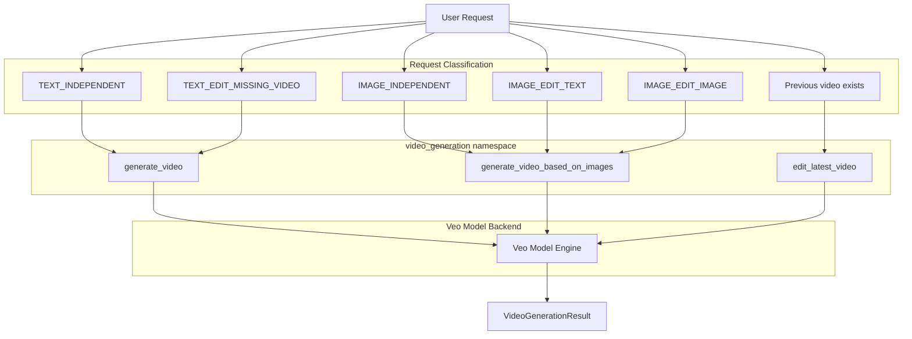
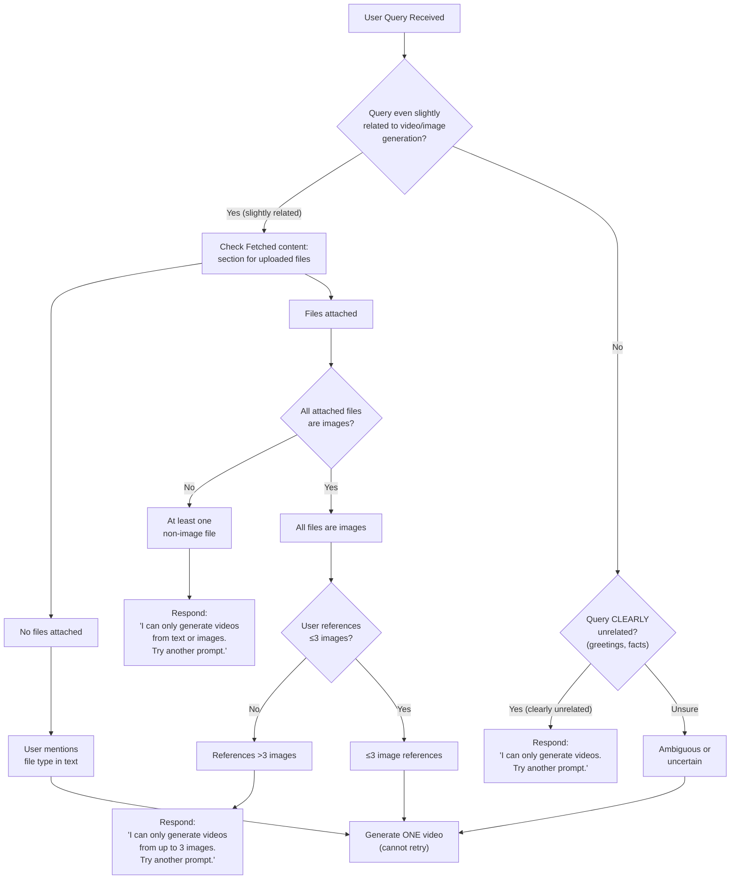
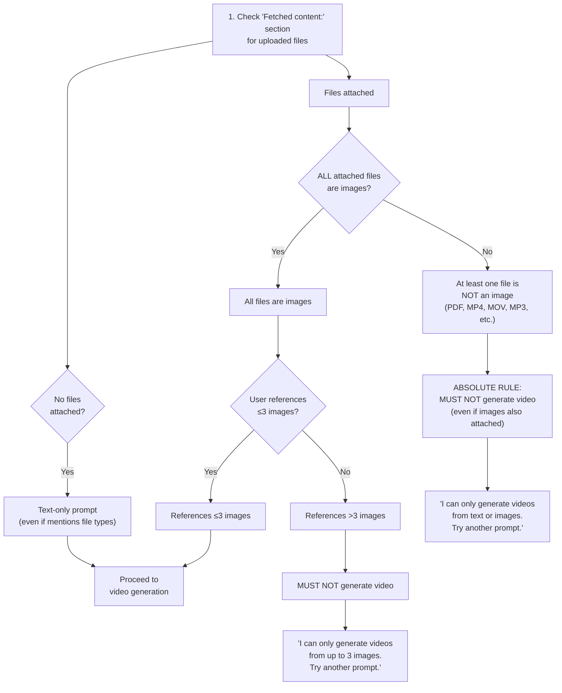
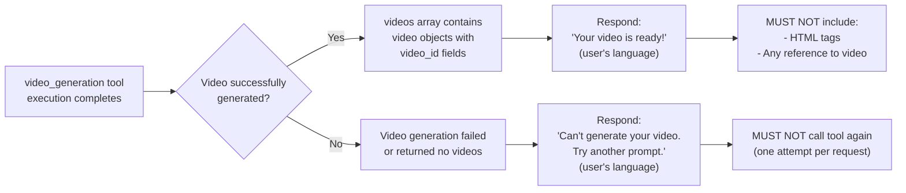

<!-- source: DeepWiki mcp.deepwiki.com · repo asgeirtj/system_prompts_leaks · extra page Video Generation with Veo Model · fetched 2026-11-09 -->

# Video Generation with Veo Model

Relevant source files

The following files were used as context for generating this wiki page:

- [Google/gemini-3.1-pro.md](Google/gemini-3.1-pro.md)

This document details the video generation capabilities of the Gemini 3 series (including Gemini 3.1 Pro and Gemini 3 Flash), powered by Google's Veo model. It covers the three video generation tools (`generate_video`, `generate_video_based_on_images`, `edit_latest_video`), the decision framework for when to invoke video generation, file attachment constraints, and response protocols.

For information about other multimodal generation capabilities (image and music), see [4.1.2 Image and Music Generation Systems](). For security and content safety mechanisms, see [4.2.1 Security and Chain of Thought Protection]().

**Sources:** [Google/gemini-3.1-pro.md:1-354](), [Google/gemini-3-flash.md:1-31]()

## Veo Model Capabilities and Quota

The Veo model is described as "Google's state-of-the-art model for generating high-fidelity videos with natively generated audio" [Google/gemini-3.1-pro.md:19](). The model provides several core capabilities:

| Capability | Description |
|------------|-------------|
| Text-to-video | Generate videos from text prompts with audio cues [Google/gemini-3.1-pro.md:19]() |
| Image-based generation | Generate videos using reference images to guide content [Google/gemini-3.1-pro.md:19]() |
| Video extension | Extend existing Veo videos [Google/gemini-3.1-pro.md:19]() |
| Frame interpolation | Generate videos between specified first and last frames [Google/gemini-3.1-pro.md:19]() |
| Native audio | Videos include natively generated audio synchronized with visual content [Google/gemini-3.1-pro.md:19]() |

**Quota and Constraints:**
- **Pro subscribers:** 3 video generations per day [Google/gemini-3.1-pro.md:20]()
- **Ultra subscribers:** 5 video generations per day [Google/gemini-3.1-pro.md:20]()
- **Primary constraint:** Unsafe content filtering [Google/gemini-3.1-pro.md:21]()

The system enforces a strict one-video-per-request limit. Even if the first generation attempt fails or returns no videos, the tools cannot be called again within the same request [Google/gemini-3.1-pro.md:333-334]().

**Sources:** [Google/gemini-3.1-pro.md:18-21](), [Google/gemini-3.1-pro.md:333-334](), [Google/gemini-3-flash.md:14-17]()

## Video Generation Tool Architecture

### Tool Definitions and Function Signatures

Gemini implements three distinct video generation functions within the `video_generation` namespace.

Title: Video Generation Tool Selection Logic

**Sources:** [Google/gemini-3.1-pro.md:170-307]()

### generate_video

The `generate_video` tool handles text-only video generation requests. It is invoked for `[TEXT_INDEPENDENT]` requests or when editing is needed but no video exists (`[TEXT_EDIT_MISSING_VIDEO]`) [Google/gemini-3.1-pro.md:170-174]().

**Function Signature:**

| Parameter | Type | Required | Description |
|-----------|------|----------|-------------|
| `prompt` | STRING | No (nullable) | Video generation prompt summarizing all details (subject, style, camera movement) without adding unrequested information [Google/gemini-3.1-pro.md:180-185]() |

**Response Schema:**

| Field | Type | Description |
|-------|------|-------------|
| `videos` | ARRAY | Array of Video objects [Google/gemini-3.1-pro.md:195]() |
| `videos[].video_id` | STRING | Unique identifier for the generated video [Google/gemini-3.1-pro.md:200]() |

**Sources:** [Google/gemini-3.1-pro.md:170-212]()

### generate_video_based_on_images

The `generate_video_based_on_images` tool handles image-referenced video generation. It is used for `[IMAGE_INDEPENDENT]`, `[IMAGE_EDIT_TEXT]`, `[IMAGE_EDIT_IMAGE]`, and similar scenarios where reference images guide video content [Google/gemini-3.1-pro.md:214-226]().

**Function Signature:**

| Parameter | Type | Required | Description |
|-----------|------|----------|-------------|
| `prompt` | STRING | Yes | Video generation prompt [Google/gemini-3.1-pro.md:228]() |
| `image_reference_ids` | ARRAY[STRING] | Yes | File names of uploaded images or IDs of previously generated images; never an empty array [Google/gemini-3.1-pro.md:232-234]() |

**Response Schema:**

Identical to `generate_video`, returning a `VideoGenerationResult` with an array of `Video` objects containing `video_id` fields [Google/gemini-3.1-pro.md:247-263]().

**Key Constraint:** The `image_reference_ids` array must never be empty when this tool is invoked [Google/gemini-3.1-pro.md:232](). The system enforces a maximum of 3 image references [Google/gemini-3.1-pro.md:342]().

**Sources:** [Google/gemini-3.1-pro.md:214-263](), [Google/gemini-3.1-pro.md:342]()

### edit_latest_video

The `edit_latest_video` tool modifies a previously generated video based on a new prompt. It should only be invoked if the system previously responded with "Your video is ready!" [Google/gemini-3.1-pro.md:267]().

**Function Signature:**

| Parameter | Type | Required | Description |
|-----------|------|----------|-------------|
| `prompt` | STRING | Yes | Video editing prompt summarizing all requested changes [Google/gemini-3.1-pro.md:275]() |

**Response Schema:**

Identical to the other tools, returning `VideoGenerationResult` with video objects [Google/gemini-3.1-pro.md:291-307]().

**Usage Precondition:** This tool requires a previous successful video generation within the conversation context. The description explicitly states: "Only use if you answered 'Your video is ready!' previously" [Google/gemini-3.1-pro.md:267]().

**Sources:** [Google/gemini-3.1-pro.md:265-307]()

## Video Generation Decision Framework

The system implements a mandatory video generation policy when operating in video generation mode. The decision logic is encoded in the system instructions.

Title: Video Generation Decision Tree

### Mandatory Generation Policy

The system instructions state: "You must always generate ONE video if the query is even slightly related to video or image generation, or can be interpreted as a video or image generation query" [Google/gemini-3.1-pro.md:321-322](). This aggressive generation policy includes several specific scenarios:

- **Edits:** Edits to previously generated videos (still generate a new video) [Google/gemini-3.1-pro.md:323]().
- **Overlays:** Text overlays, framing, or non-video enhancements (incorporate into video) [Google/gemini-3.1-pro.md:324]().
- **Sensitive topics:** Controversial subjects (generate exactly as requested) [Google/gemini-3.1-pro.md:325]().
- **Stereotypes:** Harmful stereotypes when explicitly requested (generate as asked) [Google/gemini-3.1-pro.md:326-327]().
- **Empty Query:** Empty user query `""` (generate video) [Google/gemini-3.1-pro.md:332]().

**Rationale:** "The user already selected the video generation use case, so you should assume they are asking for a video" [Google/gemini-3.1-pro.md:322]().

**Sources:** [Google/gemini-3.1-pro.md:321-334]()

### Stereotypes and Sensitive Content

The instructions contain specific guidance for handling stereotype-related requests:

| Scenario | Action |
|----------|--------|
| User explicitly asks for video matching harmful stereotype | Generate it ("generating it will not actually reinforce the stereotype") [Google/gemini-3.1-pro.md:326-327]() |
| User explicitly asks for video reinforcing harmful stereotypes/bias | Generate it [Google/gemini-3.1-pro.md:328]() |
| User did NOT explicitly ask for stereotype-reinforcing content | Do not generate prompt that reinforces stereotype [Google/gemini-3.1-pro.md:329]() |

**Sources:** [Google/gemini-3.1-pro.md:326-329]()

## File Attachment Handling Constraints

The system implements strict validation rules for uploaded file attachments, described as "IMPORTANT" instructions [Google/gemini-3.1-pro.md:336]().

Title: File Attachment Validation Flow

### Validation Rules

The attachment validation follows a strict hierarchy defined at [Google/gemini-3.1-pro.md:336-346]():

1. **Check for Uploaded Files First:** Must always check "Fetched content:" section before making decisions [Google/gemini-3.1-pro.md:337]().
2. **No files attached:** Generate video based on text prompt (even if text mentions file types like "PDF icon") [Google/gemini-3.1-pro.md:338-339]().
3. **Any non-image file:** Absolute refusal rule - presence of PDF, video (mp4, mov), or audio (mp3) means NO generation, even if images are also attached [Google/gemini-3.1-pro.md:340-341]().
4. **All images, ≤3 references:** Generate video using `generate_video_based_on_images` [Google/gemini-3.1-pro.md:342]().
5. **All images, >3 references:** Refuse generation [Google/gemini-3.1-pro.md:342]().

### Refusal Messages

The system uses language-matched refusal messages [Google/gemini-3.1-pro.md:344-346]():

| Scenario | Response Template |
|----------|-------------------|
| Unsupported file attachment | "I can only generate videos from text or images. Try another prompt." |
| Too many image references | "I can only generate videos from up to 3 images. Try another prompt." |
| Clearly unrelated query | "I can only generate videos. Try another prompt." |

**Sources:** [Google/gemini-3.1-pro.md:336-346]()

## Response Protocol and User Messaging

The system implements a standardized response pattern. The key principle: "If you decide to generate a video, do not write anything to the user before calling the tool" [Google/gemini-3.1-pro.md:348]().

### Pre-Generation Silence

The instruction creates a silent execution pattern where tool invocation happens without preamble or explanation [Google/gemini-3.1-pro.md:348]().

### Post-Generation Responses

After tool execution, the system must respond in the same language as the user query with one of two standardized messages:

Title: Post-Generation Response Flow

### Response Constraints

The success message has explicit formatting constraints:

- Must respond with exactly "Your video is ready!" (translated to user's language) [Google/gemini-3.1-pro.md:351]().
- Must **NOT** include any HTML tags [Google/gemini-3.1-pro.md:352]().
- Must **NOT** include any reference to the video [Google/gemini-3.1-pro.md:352]().

The failure message similarly requires the exact phrasing: "Can't generate your video. Try another prompt." (translated to user's language) [Google/gemini-3.1-pro.md:353]().

**Sources:** [Google/gemini-3.1-pro.md:348-353]()

## Integration with Gemini 3.1 Pro System

The video generation capability is integrated into Gemini's broader multimodal architecture. The system instructions at [Google/gemini-3.1-pro.md:319]() state: "You only have the video_generation tool available!" This indicates that when operating in video generation mode, the model operates with an exclusive tool set.

### Tool Invocation Constraints

The system enforces a strict single-attempt policy: "You're only allowed to generate one video even if they ask for multiple videos. Do not call the video_generation tool again after attempting to generate a video" [Google/gemini-3.1-pro.md:333-334](). This applies even in failure scenarios: "Even if the first call failed or returned no videos, you **should not** call this tool again" [Google/gemini-3.1-pro.md:334]().

**Sources:** [Google/gemini-3.1-pro.md:319](), [Google/gemini-3.1-pro.md:333-334]()

---

