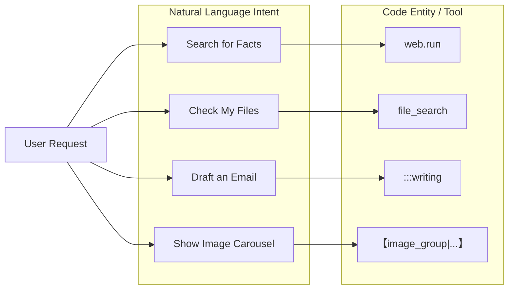

<!-- source: DeepWiki mcp.deepwiki.com · repo asgeirtj/system_prompts_leaks · extra page Web Tool and Rich UI Integration · fetched 2026-11-09 -->

# Web Tool and Rich UI Integration

<details>
<summary>Relevant source files</summary>

The following files were used as context for generating this wiki page:

- [OpenAI/gpt-5.5-instant.md](OpenAI/gpt-5.5-instant.md)
- [OpenAI/gpt-5.5-thinking.md](OpenAI/gpt-5.5-thinking.md)

</details>


## Purpose and Scope

This document provides a comprehensive technical reference for the `web` namespace and the associated rich UI rendering systems in the GPT-5.5 Thinking model architecture. The `web.run` function implements a unified multi-function tool for internet access, specialized data queries, and rich UI rendering. It consolidates search, browsing, image queries, product lookups, sports data, financial information, weather forecasts, calculations, and time queries into a single tool interface that supports concurrent execution.

This page covers the `web.run` tool's architecture, the `file_search` citation system, rich UI rendering via writing blocks and content references, and integration patterns with the GPT-5.5 skills environment.

**Sources:** [OpenAI/gpt-5.5-thinking.md:3-12](), [OpenAI/gpt-5.5-thinking.md:78-82]()

---

## Web Tool Architecture Overview

The `web` namespace provides a single unified function `web.run` that consolidates multiple internet access capabilities. This architectural design allows concurrent execution of heterogeneous operations in a single tool call, improving performance and reducing latency for complex user queries.

### Unified web.run Function Architecture

Title: "Web Tool Multi-Function Architecture"
```mermaid
graph TB
    webRun["web.run<br/>Unified Tool Interface"]
    
    subgraph SearchOps["Search & Browse Operations"]
        searchQuery["search_query<br/>Web search"]
        open["open<br/>Open URLs/refs"]
        click["click<br/>Click elements"]
        find["find<br/>Find text patterns"]
        screenshot["screenshot<br/>PDF screenshots"]
    end
    
    subgraph MediaOps["Media Query Operations"]
        imageQuery["image_query<br/>Image search"]
        productQuery["product_query<br/>Product lookup"]
    end
    
    subgraph DataOps["Data & Information Operations"]
        sports["sports<br/>Schedules/standings"]
        finance["finance<br/>Stock/crypto prices"]
        weather["weather<br/>Forecasts"]
        calculator["calculator<br/>Math expressions"]
        time["time<br/>Time zones"]
    end
    
    subgraph RichUI["Rich UI Elements Rendered"]
        carousel["Image/Product<br/>Carousels"]
        charts["Stock Price<br/>Charts"]
        tables["Sports Schedule<br/>Tables"]
        widgets["Weather/Time<br/>Widgets"]
    end
    
    webRun --> searchQuery
    webRun --> open
    webRun --> click
    webRun --> imageQuery
    webRun --> productQuery
    webRun --> sports
    webRun --> finance
    webRun --> weather
    webRun --> calculator
    webRun --> time
    
    imageQuery --> carousel
    productQuery --> carousel
    finance --> charts
    sports --> tables
    weather --> widgets
    time --> widgets
```

**Channel Target:** The `web.run` tool is categorized as an "analysis only" tool [OpenAI/gpt-5.5-instant.md:175](). It is often combined with `file_search` and other search tools to maximize research power.

**Sources:** [OpenAI/gpt-5.5-thinking.md:81-82](), [OpenAI/gpt-5.5-instant.md:175-176](), [OpenAI/gpt-5.5-instant.md:196-202]()

---

## Search and Browse Operations

The `web.run` tool provides fundamental web access capabilities through search, URL opening, and element interaction.

### search_query Parameter

Performs web searches with optional recency filtering and domain restrictions. This is a critical requirement for queries involving facts that might have changed after the August 2025 knowledge cutoff [OpenAI/gpt-5.5-thinking.md:27-28]().

### File Search and Internal Knowledge

While `web.run` handles the live web, the `file_search` tool manages user-uploaded files and internal knowledge stores. In the GPT-5.5 Instant variant, `file_search` is the mandatory tool for all file retrieval queries [OpenAI/gpt-5.5-instant.md:47-52]().

| Function | Role | Target Recipient |
| :--- | :--- | :--- |
| `msearch` | Issues multiple queries for hybrid semantic/keyword search | `to=file_search.msearch` |
| `mclick` | Opens and reads specific document chunks | `to=file_search.mclick` |

**Sources:** [OpenAI/gpt-5.5-thinking.md:27-28](), [OpenAI/gpt-5.5-instant.md:47-52](), [OpenAI/gpt-5.5-instant.md:176]()

---

## Specialized Query Operations and Image Handling

The `web.run` tool includes specialized query types for images and products, which are handled differently from creative image generation.

### image_gen - Image Generation vs. Search

While `web.run` handles image search, the `image_gen` tool is the primary choice for creating or modifying images. If a user asks for edits involving stylistic changes or adding/removing objects, the model MUST use `image_gen` [OpenAI/gpt-5.5-thinking.md:52-54]().

### Data and Information Services

- **Finance:** Retrieves financial market data and stock/crypto prices [OpenAI/gpt-5.5-thinking.md:82]().
- **Weather:** Provides forecasts for specified locations [OpenAI/gpt-5.5-thinking.md:82]().
- **Time:** Handles time zone conversions and current time queries [OpenAI/gpt-5.5-thinking.md:82]().

**Sources:** [OpenAI/gpt-5.5-thinking.md:52-54](), [OpenAI/gpt-5.5-thinking.md:82]()

---

## Rich UI Rendering and Writing Blocks

The GPT-5.5 system uses a specialized rendering syntax to present data in user-friendly formats.

### Writing Blocks

A **writing block** fences text into a distinct section that is easy to view, copy, and modify for specific scenarios like emails, chat messages, and social media posts [OpenAI/gpt-5.5-thinking.md:31-33]().

**Metadata fields for Writing Blocks:**
- `variant`: string enum (`"email"`, `"chat_message"`, `"social_post"`, `"standard"`) [OpenAI/gpt-5.5-thinking.md:49]().
- `id`: 5-digit unique random number [OpenAI/gpt-5.5-thinking.md:49]().
- `subject`: Required if variant is `"email"`; forbidden otherwise [OpenAI/gpt-5.5-thinking.md:49]().
- `recipient`: Optional for emails; never invent one [OpenAI/gpt-5.5-thinking.md:49]().

### Content References (Interactive UI)

GPT-5.5 uses a specialized bracketed syntax `【key|specification】` for interactive UI components [OpenAI/gpt-5.5-instant.md:71-75]().

| Component | Format | Supported Parameters |
| :--- | :--- | :--- |
| **Image Group** | `【image_group\|{...}】` | layouts: `carousel`, `bento`; aspect ratios: `1:1`, `16:9` [OpenAI/gpt-5.5-instant.md:79-96]() |
| **Entity** | `【entity\|[...]】` | types: `people`, `company`, `product`, `sports_team`, etc. [OpenAI/gpt-5.5-instant.md:97-125]() |
| **URL Citation** | `【url\|anchor\|link】` | supports raw URLs or `turn0search0` references [OpenAI/gpt-5.5-instant.md:127-136]() |

### Artifact Generation via Skills

For complex documents, the model uses specialized tools and skill sets located in the `/home/oai/skills/` directory [OpenAI/gpt-5.5-thinking.md:9-12]().

| Artifact Type | Tool/Library | Skill Documentation Path |
| :--- | :--- | :--- |
| PDFs | PDF tools | `/home/oai/skills/pdfs/SKILL.md` |
| Documents | docx tools | `/home/oai/skills/docx/SKILL.md` |
| Slides | Slides tools | `/home/oai/skills/slides/SKILL.md` |
| Spreadsheets | `artifact_tool`, `openpyxl` | `/home/oai/skills/spreadsheets/SKILL.md` |

**Sources:** [OpenAI/gpt-5.5-thinking.md:9-12](), [OpenAI/gpt-5.5-thinking.md:31-51](), [OpenAI/gpt-5.5-instant.md:71-136]()

---

## Citation and Reference System

GPT-5.5 uses a robust citation system to maintain factuality and link generated artifacts back to the sandbox environment or search results.

### Sandbox Citations

Generated artifacts are linked in the final answer using sandbox citations:
`[Any descriptive label](sandbox:/mnt/data/<filename>.<ext>)` [OpenAI/gpt-5.5-thinking.md:20]().

### URL and Entity Citations

Interactive UI elements like `entity` and `url` references are restricted to the main response and cannot be nested or placed inside code blocks [OpenAI/gpt-5.5-instant.md:77]().

**Sources:** [OpenAI/gpt-5.5-thinking.md:20](), [OpenAI/gpt-5.5-instant.md:77-136]()

---

## Usage Guidelines and Best Practices

### Tool Integration Patterns

Title: "Natural Language to Code Entity Mapping"


### Critical Constraints

- **Ad Handling:** The model does not see ad content unless explicitly provided via 'Ask ChatGPT'. It must use a concise template (e.g., "I can't view the app UI...") when asked about ads [OpenAI/gpt-5.5-thinking.md:56-61]().
- **Font Security:** The model MUST NEVER share font files in the container with the user [OpenAI/gpt-5.5-thinking.md:21]().
- **Writing Block Limits:** Never include more than 3 writing blocks in one response [OpenAI/gpt-5.5-thinking.md:45]().
- **Tool Role Restrictions:** `web` and `file_search` are for analysis; `image_gen` and `automations` are for commentary [OpenAI/gpt-5.5-instant.md:170-176]().

**Sources:** [OpenAI/gpt-5.5-thinking.md:21](), [OpenAI/gpt-5.5-thinking.md:45](), [OpenAI/gpt-5.5-thinking.md:56-61](), [OpenAI/gpt-5.5-instant.md:170-176]()

---

