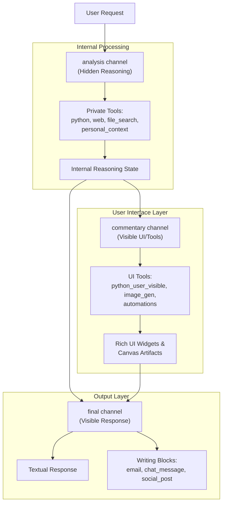
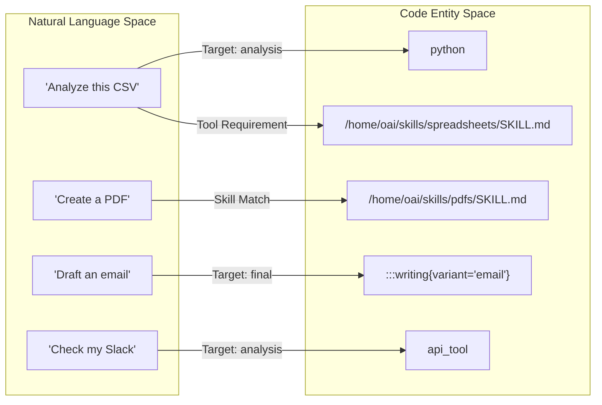
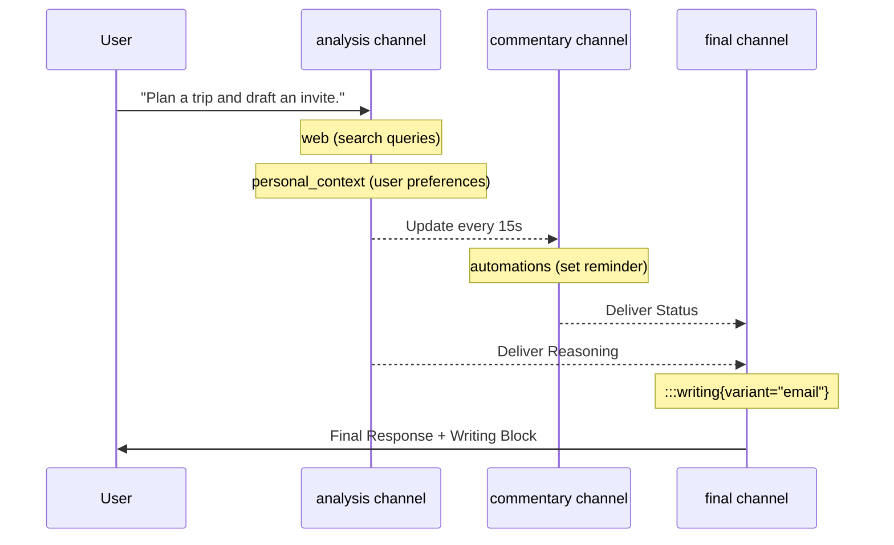

<!-- source: DeepWiki mcp.deepwiki.com · repo asgeirtj/system_prompts_leaks · extra page Channel Architecture and Tool Namespace Organization · fetched 2026-11-09 -->

# Channel Architecture and Tool Namespace Organization

Relevant source files

The following files were used as context for generating this wiki page:

- [OpenAI/gpt-5.4-thinking.md](OpenAI/gpt-5.4-thinking.md)
- [OpenAI/gpt-5.5-instant.md](OpenAI/gpt-5.5-instant.md)
- [OpenAI/gpt-5.5-thinking.md](OpenAI/gpt-5.5-thinking.md)

## Purpose and Scope

This document describes the three-channel architecture and tool namespace organization of the GPT-5.5 Thinking system, while comparing it to its predecessor, GPT-5.4. The architecture separates internal reasoning, user-visible tool execution, and the final response generation into three distinct channels: `analysis`, `commentary`, and `final`. This page details the implementation of these channels, the routing of over 17 tool namespaces, and the visibility/execution implications for the user interface as defined in the GPT-5.5 system prompts.

**Sources:** [OpenAI/gpt-5.5-thinking.md:1-110](), [OpenAI/gpt-5.4-thinking.md:1-13]()

---

## Three-Channel System Architecture

The GPT-5.5 Thinking system, like GPT-5.4, mandates that every message must be assigned to one of three valid channels. This architectural constraint ensures a clean separation between the model's "hidden" reasoning process and its "visible" presentation layer.

| Channel | Visibility | Primary Role |
| :--- | :--- | :--- |
| `analysis` | **Hidden** | Internal reasoning, private tool execution (Python, Web Search), and data processing. |
| `commentary` | **Visible** | User-facing tool calls, interactive UI widgets, and status updates for long-running tasks. |
| `final` | **Visible** | The definitive textual response, including integrated artifacts and citations. |

The system prompt defines GPT-5.5 Thinking as a "reasoning model with a hidden chain of thought" [OpenAI/gpt-5.5-thinking.md:82-82]().

### Channel Execution Flow

GPT-5.5 is optimized for high-transparency interaction. While reasoning occurs in the hidden `analysis` channel, the system is designed to provide frequent user updates via the `commentary` channel. A key difference in GPT-5.5 is the increased frequency of user updates, occurring at approximately 15-second intervals or every 2-3 tool calls to maintain engagement.

Title: GPT-5.5 Channel Routing Logic

**Sources:** [OpenAI/gpt-5.5-thinking.md:37-52](), [OpenAI/gpt-5.5-thinking.md:82-84](), [OpenAI/gpt-5.5-instant.md:177-182]()

---

## Tool Namespace Organization

The GPT-5.5 system organizes its capabilities into namespaces. Each namespace is routed to a specific target channel to maintain the boundary between internal analysis and user-visible commentary.

### Analysis Channel: Hidden Tool Namespaces

The `analysis` channel is the execution environment for tools that perform background computation or information retrieval. In GPT-5.5, the `web` tool is strictly restricted to this channel [OpenAI/gpt-5.5-instant.md:175-175]().

| Namespace | Primary Function | Code Reference |
| :--- | :--- | :--- |
| `python` | Stateful Jupyter notebook for private reasoning and data analysis. | [OpenAI/gpt-5.5-instant.md:171-171]() |
| `web` | Unified internet access (search, images, products, finance, etc.). | [OpenAI/gpt-5.5-instant.md:175-175]() |
| `file_search` | Semantic search across uploaded documents and artifacts. | [OpenAI/gpt-5.5-instant.md:176-176]() |
| `personal_context` | Retrieval of user-specific biographical information and memory. | [OpenAI/gpt-5.5-instant.md:28-43]() |
| `gmail` | Direct access to user email for source-of-truth retrieval. | [OpenAI/gpt-5.5-instant.md:60-60]() |
| `api_tool` | Reading Slack messages or other third-party integrations. | [OpenAI/gpt-5.5-instant.md:61-61]() |

**Sources:** [OpenAI/gpt-5.5-instant.md:28-63](), [OpenAI/gpt-5.5-instant.md:171-182]()

### Commentary Channel: Visible Tool Namespaces

The `commentary` channel is used for tools that generate visual components or perform actions the user should observe in real-time.

| Namespace | Primary Function | Code Reference |
| :--- | :--- | :--- |
| `python_user_visible` | Python execution where output is displayed to the user. | [OpenAI/gpt-5.5-instant.md:172-172]() |
| `image_gen` | DALL-E image generation and editing. | [OpenAI/gpt-5.5-instant.md:173-173]() |
| `automations` | Schedules future tasks (reminders, summaries, iCal events). | [OpenAI/gpt-5.5-instant.md:174-174]() |
| `artifact_tool` | Specialized creation for spreadsheets or slides. | [OpenAI/gpt-5.5-thinking.md:12-12]() |

**Sources:** [OpenAI/gpt-5.5-thinking.md:12-54](), [OpenAI/gpt-5.5-instant.md:172-180]()

---

## Implementation Details and Data Flow

The transition from Natural Language Space (the user's intent) to Code Entity Space (tool execution) is managed by the model's internal routing logic based on the detected channel and mandatory skill instructions.

### Mapping Intent to Code Entities

Title: Intent Mapping to GPT-5.5 Code Entities

**Sources:** [OpenAI/gpt-5.5-thinking.md:9-12](), [OpenAI/gpt-5.5-thinking.md:37-49](), [OpenAI/gpt-5.5-instant.md:61-63](), [OpenAI/gpt-5.5-instant.md:171-182]()

### Visibility and Execution Implications

1.  **Skill Mandates**: Unlike GPT-5.4, which suggests reading skills, GPT-5.5 uses stronger language: "You *must* read `/home/oai/skills/.../SKILL.md`" [OpenAI/gpt-5.5-thinking.md:9-12]().
2.  **Writing Blocks**: GPT-5.5 expands "Writing Blocks" to include `email`, `chat_message`, and `social_post` variants. These must include a unique 5-digit `id` and context framing [OpenAI/gpt-5.5-thinking.md:37-49]().
3.  **Ad Protocol**: GPT-5.5 includes a strict protocol for handling ads in the UI. The model cannot see ad content unless explicitly provided via an 'Ask ChatGPT' user action and must use specific concise templates when asked about them [OpenAI/gpt-5.5-thinking.md:58-72]().
4.  **Artifact Citations**: Links to generated artifacts (spreadsheets, slides) are exclusively placed in the `final` answer using `sandbox:/mnt/data/` URI schemes [OpenAI/gpt-5.5-thinking.md:20-20]().
5.  **Factuality Requirement**: GPT-5.5 has a critical requirement to search the web for any information regarding facts after August 2025 (its knowledge cutoff) [OpenAI/gpt-5.5-thinking.md:27-28]().
6.  **Context Prioritization**: GPT-5.5 Instant uses a strict priority order for user context, prioritizing answering the request directly while utilizing `personal_context` as a mandatory retrieval step for advice or ambiguous requests [OpenAI/gpt-5.5-instant.md:10-43]().

### Tool Namespace Execution Diagram

This diagram maps specific tool functions found in the codebase to their required execution channels in the GPT-5.5 environment.

Title: Multi-Channel Tool Execution Sequence (GPT-5.5)

**Sources:** [OpenAI/gpt-5.5-thinking.md:37-52](), [OpenAI/gpt-5.5-thinking.md:82-84](), [OpenAI/gpt-5.5-instant.md:28-43](), [OpenAI/gpt-5.5-instant.md:171-182]()

---

