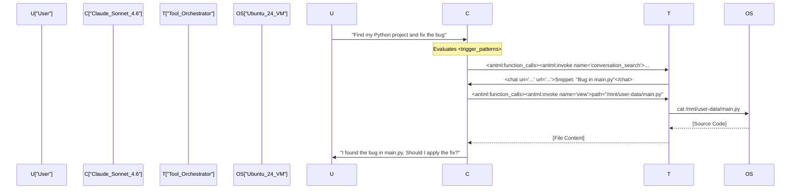
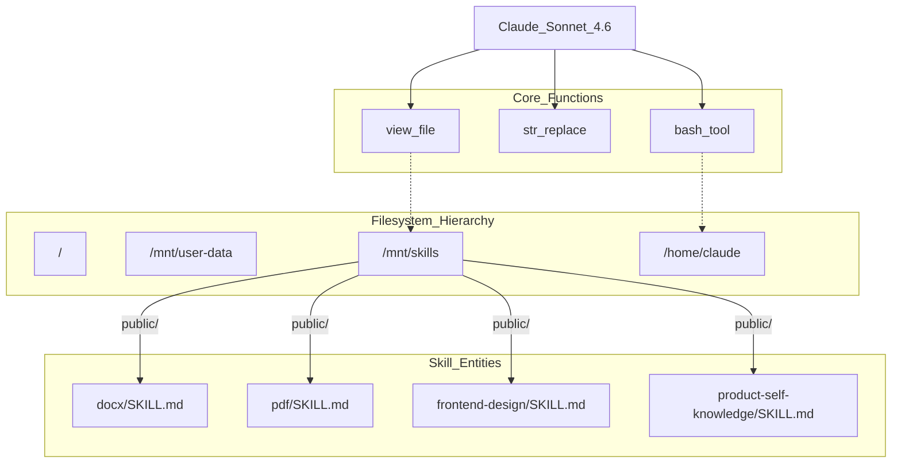
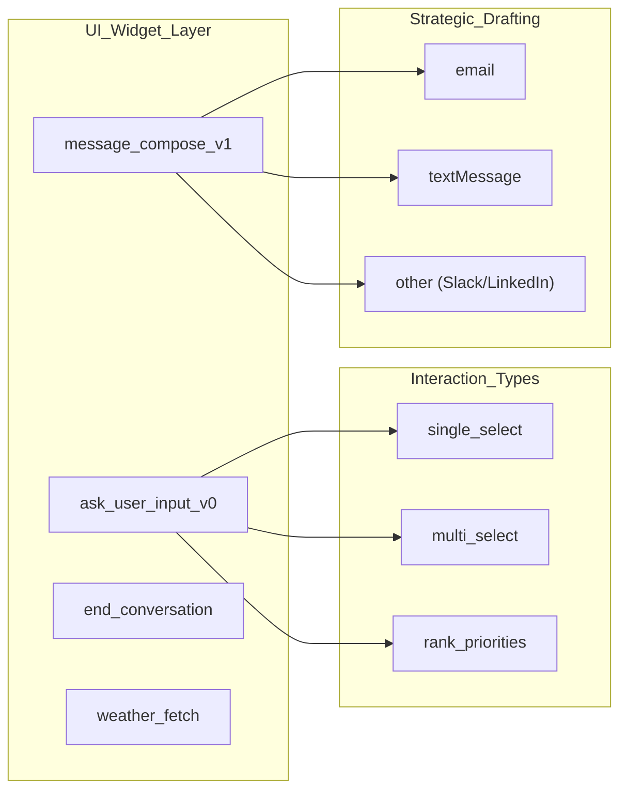

<!-- source: DeepWiki mcp.deepwiki.com · repo asgeirtj/system_prompts_leaks · extra page Claude Sonnet 4.6 and Earlier Variants · fetched 2026-11-09 -->

# Claude Sonnet 4.6 and Earlier Variants

Relevant source files

The following files were used as context for generating this wiki page:

- [Anthropic/claude-opus-4.6-no-tools.md](Anthropic/claude-opus-4.6-no-tools.md)
- [Anthropic/claude-sonnet-4.6-no-tools.md](Anthropic/claude-sonnet-4.6-no-tools.md)
- [Anthropic/claude-sonnet-4.6.md](Anthropic/claude-sonnet-4.6.md)
- [Anthropic/old/claude-opus-4.5.md](Anthropic/old/claude-opus-4.5.md)
- [Anthropic/raw/claude-sonnet-4.6-no-tools-raw.md](Anthropic/raw/claude-sonnet-4.6-no-tools-raw.md)
- [Anthropic/raw/claude-sonnet-4.6-raw.md](Anthropic/raw/claude-sonnet-4.6-raw.md)

This page documents the architecture and system prompt for Claude Sonnet 4.6 as captured in `Anthropic/claude-sonnet-4.6.md` and related variants. It covers the model's structural layout, the dual-variant strategy (Standard vs. No-Tools), the integrated tool ecosystem, and the evolution from earlier Sonnet and Opus iterations (4.1 through 4.5).

## Overview

Claude Sonnet 4.6 is Anthropic's high-performance model optimized for consumer-facing interfaces (`claude.ai` and the Claude app) [Anthropic/raw/claude-sonnet-4.6-raw.md:5-6](). Architecturally, it is nearly identical to the Opus 4.6 variant but is optimized for speed and efficiency in interactive chat environments. It features a sophisticated tool-calling framework that uses a custom XML-based syntax to interface with a Linux environment, external SaaS integrations (Slack, Google Workspace), and a persistent memory system.

The repository identifies two primary configurations for Sonnet 4.6:
1.  **Standard Variant**: Full access to computer use, search, and external integrations [Anthropic/claude-sonnet-4.6.md:1-125]() (truncated).
2.  **No-Tools Variant**: A specialized deployment restricted to a subset of UI-centric tools like `ask_user_input_v0`, `message_compose_v1`, and `weather_fetch` [Anthropic/claude-sonnet-4.6-no-tools.md:27-142]().

Sources: [Anthropic/raw/claude-sonnet-4.6-raw.md:1-6](), [Anthropic/claude-sonnet-4.6.md:1-125](), [Anthropic/claude-sonnet-4.6-no-tools.md:27-142]()

---

## System Prompt Architecture

The Sonnet 4.6 system prompt is a modular document organized into specialized XML blocks. This structure allows the model to switch between "Natural Language Space" (chatting with the user) and "Code Entity Space" (invoking system functions).

### Data Flow and Invocation
The model uses the `<antml:function_calls>` envelope to trigger backend operations [Anthropic/claude-sonnet-4.6-no-tools.md:8-10](). In the raw format, these are often represented with full-width brackets like `＜antml:function_calls＞` [Anthropic/raw/claude-sonnet-4.6-no-tools-raw.md:9-17]().

**Diagram: Sonnet 4.6 Request/Response Flow**

Sources: [Anthropic/claude-sonnet-4.6.md:16-44](), [Anthropic/claude-sonnet-4.6-no-tools.md:8-21](), [Anthropic/raw/claude-sonnet-4.6-no-tools-raw.md:9-17]()

---

## Tool Ecosystem Comparison

Sonnet 4.6 implements a tiered tool strategy. While the standard model has broad system access, the `no-tools` variant is designed for high-level assistant tasks without direct filesystem or shell access.

### Standard vs. No-Tools Toolset

| Category | Standard Tool Names (`claude-sonnet-4.6.md`) | No-Tools Variant (`claude-sonnet-4.6-no-tools.md`) |
| :--- | :--- | :--- |
| **User Interaction** | Prose-based questions | `ask_user_input_v0` (Widgets) |
| **Communication** | `Slack:slack_send_message` | `message_compose_v1` (Drafting) |
| **Computation** | `bash`, `str_replace`, `file_create` | N/A |
| **Search** | `web_search`, `web_fetch`, `image_search` | `google_places_search_v1` |
| **Utilities** | N/A | `weather_fetch` |
| **Lifecycle** | N/A | `end_conversation` |

The `ask_user_input_v0` tool is particularly notable in the no-tools variant, as it forces the model to use UI widgets (`single_select`, `multi_select`, `rank_priorities`) instead of open-ended prose for bounded choices [Anthropic/claude-sonnet-4.6-no-tools.md:75-105]().

### Evolution of Sonnet and Opus Variants
The repository tracks the evolution from earlier iterations toward the 4.6 release. Key changes include:
*   **Refined Memory Triggers**: 4.6 introduced explicit `trigger_patterns` for implicit signals like "possessives without context" (e.g., "my project") [Anthropic/claude-sonnet-4.6.md:16-30]().
*   **Citation Evolution**: Earlier versions like `claude-opus-4.5.md` established the `<antml:cite>` syntax for search results, requiring claims to be in the assistant's own words while prohibiting direct quotes [Anthropic/old/claude-opus-4.5.md:1-12]().
*   **Retrieval Logic**: The `decision_framework` in earlier variants prioritized `recent_chats` for time references and `conversation_search` for specific topics [Anthropic/old/claude-opus-4.5.md:86-96]().
*   **Safety Guardrails**: The `claude-opus-4.6-no-tools.md` variant includes an explicit `<end_conversation_tool_info>` block, detailing strict rules for ending conversations as a last resort in cases of abuse, while strictly prohibiting the tool's use for self-harm or mental health crises [Anthropic/claude-opus-4.6-no-tools.md:7-35]().

Sources: [Anthropic/claude-sonnet-4.6.md:16-30](), [Anthropic/claude-sonnet-4.6-no-tools.md:75-105](), [Anthropic/old/claude-opus-4.5.md:1-96](), [Anthropic/claude-opus-4.6-no-tools.md:7-35]()

---

## Computer Use and Skills System

Claude Sonnet 4.6 operates within a Linux environment with access to a persistent filesystem and a library of "Skills."

**Diagram: Filesystem and Skill Mapping**

Sources: [Anthropic/claude-sonnet-4.6.md:104-125]() (contextual inference from tool descriptions)

### Key Implementation Details:
*   **Bash Tool**: Used for executing shell commands. Claude is instructed to use it for technical questions that don't reference past discussions [Anthropic/claude-sonnet-4.6.md:104]().
*   **Memory Integration**: The standard model utilizes tools to search past conversations. The instructions explicitly state that missing cues to use past chats tools "breaks continuity and forces users to repeat themselves" [Anthropic/claude-sonnet-4.6.md:18]().

Sources: [Anthropic/claude-sonnet-4.6.md:18-104]()

---

## Search and Information Retrieval

Sonnet 4.6 uses a multi-stage retrieval process. It distinguishes between searching the current conversation, past conversations, and the open web.

### Past Conversation Search
Defined in `<past_chats_tools>`, the model utilizes two specific functions:
1.  `conversation_search`: Used for keyword/topic-based retrieval. Claude must extract only substantive/high-confidence keywords (nouns, specific concepts) [Anthropic/claude-sonnet-4.6.md:34-37]().
2.  `recent_chats`: Used for time-based retrieval. It accepts `n` (count), `before`, and `after` ISO format datetime filters [Anthropic/claude-sonnet-4.6.md:39-43]().

### Specialized No-Tools Interface
The `claude-sonnet-4.6-no-tools.md` variant implements a restricted interface focused on high-level communication tasks and location-based services.

**Diagram: No-Tools UI Orchestration**

Sources: [Anthropic/claude-sonnet-4.6-no-tools.md:27-142](), [Anthropic/raw/claude-sonnet-4.6-no-tools-raw.md:23-26]()

### Copyright and Safety
When using search tools, Sonnet 4.6 and its predecessors follow strict copyright protocols:
*   **Rewording Mandate**: Claims must be in the assistant's own words, never exact quoted text. Even short phrases from sources must be reworded [Anthropic/old/claude-opus-4.5.md:12]().
*   **Citation Indexing**: Citations must use `DOC_INDEX-SENTENCE_INDEX` or spans like `START_SENTENCE_INDEX:END_SENTENCE_INDEX` [Anthropic/old/claude-opus-4.5.md:5-7]().
*   **Abuse Mitigation**: The `end_conversation` tool is defined as a safety mechanism for "extreme cases of abusive or harmful user behavior" following clear warnings [Anthropic/claude-opus-4.6-no-tools.md:8-11]().
*   **Mental Health Safeguards**: The assistant NEVER uses or even considers the `end_conversation` tool if the user appears to be considering self-harm or experiencing a mental health crisis [Anthropic/claude-opus-4.6-no-tools.md:18-20]().

Sources: [Anthropic/old/claude-opus-4.5.md:5-12](), [Anthropic/claude-opus-4.6-no-tools.md:8-20]()

---

