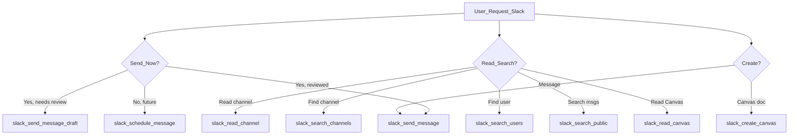
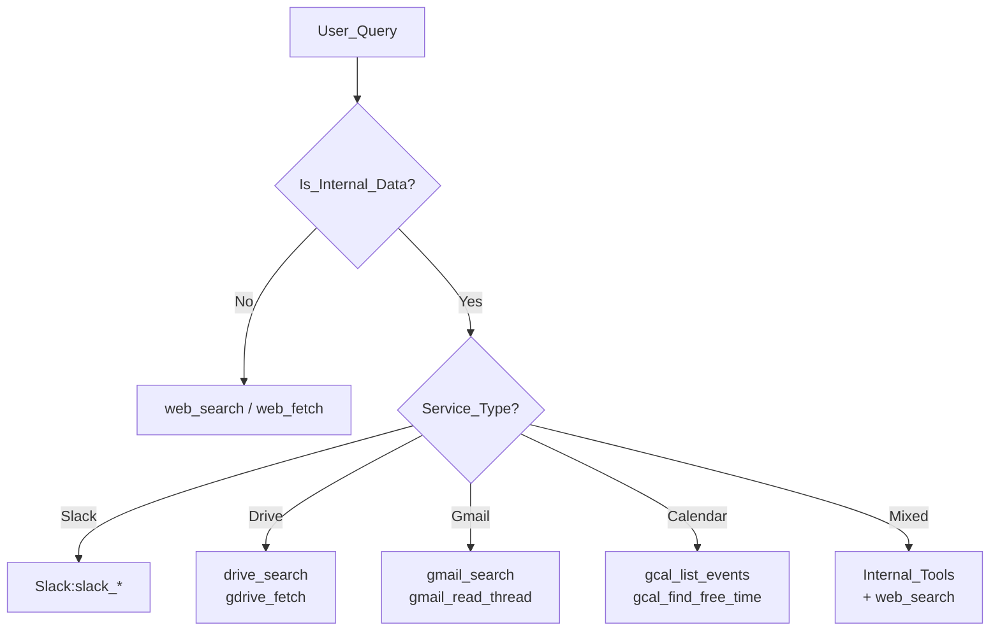

<!-- source: DeepWiki mcp.deepwiki.com · repo asgeirtj/system_prompts_leaks · extra page External Integrations - Slack, Gmail, and Google Workspace · fetched 2026-11-09 -->

# External Integrations - Slack, Gmail, and Google Workspace

<details>
<summary>Relevant source files</summary>

The following files were used as context for generating this wiki page:

- [Anthropic/claude-opus-4.6.md](Anthropic/claude-opus-4.6.md)
- [Anthropic/raw/claude-opus-4.6-raw.md](Anthropic/raw/claude-opus-4.6-raw.md)

</details>


This page documents the external service integrations built into the Claude Opus 4.6 and Claude Sonnet 4.6 system prompts: Slack, Google Drive, Google Calendar, and Gmail. These integrations are exposed as named function tools invoked via XML `<function_calls>` syntax.

For information on web search and image search tools, see [2.1.3](). For the computer use tools (bash, file system), see [2.3.2](). For a cross-system comparison of how different AI providers expose tool integrations, see [7.1]().

---

## Overview

Both `Anthropic/claude-opus-4.6.md` and `Anthropic/claude-sonnet-4.6.md` define the same set of external integrations. The system prompt establishes a tool priority hierarchy: internal tools such as Google Drive, Gmail, and Slack should be used **over** web search for company-specific or personal data [Anthropic/claude-opus-4.6.md:940-942]().

Claude is also accessible via specialized beta products including **Claude in Excel** (spreadsheet agent), **Claude in Chrome** (browsing agent), and **Cowork** (desktop tool for non-developers to automate file and task management) [Anthropic/claude-opus-4.6.md:13-14]().

Tool calls follow the `<function_calls>` / `<invoke>` XML format established at [Anthropic/claude-opus-4.6.md:1758-1775]().

**Integration overview diagram:**

```mermaid
graph TD
    TOOLS["External_Integration_Tools"]
    TOOLS --> SLACK["Slack_Namespace\n(Slack: prefix)"]
    TOOLS --> GDRIVE["Google_Drive\n(drive_search, gdrive_fetch)"]
    TOOLS --> GMAIL["Gmail\n(gmail_* tools)"]
    TOOLS --> GCAL["Google_Calendar\n(gcal_* tools)"]

    SLACK --> SS["slack_send_message"]
    SLACK --> SSCHED["slack_schedule_message"]
    SLACK --> SC["slack_create_canvas"]
    SLACK --> SRC["slack_read_canvas"]
    SLACK --> SRD["slack_read_channel"]
    SLACK --> SSPU["slack_search_public"]
    SLACK --> SSCH["slack_search_channels"]
    SLACK --> SSUS["slack_search_users"]
    SLACK --> SUP["slack_user_profile"]
    SLACK --> SDRAFT["slack_send_message_draft"]

    GDRIVE --> DS["drive_search"]
    GDRIVE --> GDF["google_drive_fetch"]

    GMAIL --> GMP["gmail_profile"]
    GMAIL --> GMS["gmail_search"]
    GMAIL --> GMT["gmail_read_thread"]

    GCAL --> GCL["gcal_list_calendars"]
    GCAL --> GCE["gcal_list_events"]
    GCAL --> GCF["gcal_find_free_time"]
```



Sources: [Anthropic/claude-opus-4.6.md:13-14](), [Anthropic/claude-opus-4.6.md:940-942](), [Anthropic/claude-opus-4.6.md:1758-2050]()

---

## Slack Integration

### Tool Namespace

All Slack tools use the `Slack:` namespace prefix. The system prompt connects to the Slack MCP server at `https://mcp.slack.com/mcp` when building artifacts via the Anthropic API [Anthropic/claude-opus-4.6.md:598]().

### `Slack:slack_send_message`

Sends a message immediately to a channel or direct-message the user.

| Parameter | Type | Required | Notes |
|---|---|---|---|
| `channel_id` | string | Yes | Channel ID or user ID (for DMs) |
| `message` | string | Yes | Markdown-formatted content, max 5,000 chars for text |
| `thread_ts` | string | No | Timestamp of parent message for thread replies |
| `reply_broadcast` | boolean | No | Also post thread reply to channel; requires `thread_ts` |
| `draft_id` | string | No | ID of a draft to delete after sending |

**Usage rules:**
- Do **not** use if the user has not reviewed the message — use `slack_send_message_draft` instead [Anthropic/claude-opus-4.6.md:1786-1790]().
- Cannot post to externally shared Slack Connect channels (`mcp_externally_shared_channel_restricted` error) [Anthropic/claude-opus-4.6.md:1800-1805]().
- To find `channel_id` from a name, call `slack_search_channels` first. To find a user's ID, call `slack_search_users` [Anthropic/claude-opus-4.6.md:1792-1795]().

Sources: [Anthropic/claude-opus-4.6.md:1781-1869]()

---

### `Slack:slack_schedule_message`

Schedules a message for future delivery. The message is **not** sent immediately.

| Parameter | Type | Required | Notes |
|---|---|---|---|
| `channel_id` | string | Yes | Destination channel or user ID |
| `message` | string | Yes | Markdown content |
| `post_at` | integer or string | Yes | Unix timestamp (int) or ISO 8601 string (e.g. `"2026-02-17T09:00:00Z"`) |
| `thread_ts` | string | No | Parent message timestamp for thread replies |
| `reply_broadcast` | boolean | No | Broadcast thread reply to channel |

**Constraints:**
- `post_at` must be at least 10 seconds in the future and no more than 120 days out [Anthropic/claude-opus-4.6.md:1880-1885]().
- Once scheduled, messages cannot be edited via tool calls; users must use Slack's "Drafts and sent" UI feature [Anthropic/claude-opus-4.6.md:1890]().
- ISO 8601 format is preferred for `post_at` due to better timezone handling [Anthropic/claude-opus-4.6.md:1895]().

Sources: [Anthropic/claude-opus-4.6.md:1871-1978]()

---

### `Slack:slack_create_canvas`

Creates a Slack Canvas document (a Slack-native persistent document).

| Parameter | Type | Required | Notes |
|---|---|---|---|
| `title` | string | Yes | Title of the Canvas |
| `content` | string | Yes | Markdown-formatted body |

**Supported Markdown elements in Canvas:** headers (H1–H3), bold/italic/strikethrough, bulleted and numbered lists, links, tables, code blocks with syntax highlighting, `@user` mentions, `#channel` mentions [Anthropic/claude-opus-4.6.md:1990-2010]().

**When not to use:** If the user wants to read an existing Canvas, use `slack_read_canvas` instead [Anthropic/claude-opus-4.6.md:2020]().

Sources: [Anthropic/claude-opus-4.6.md:1980-2050]()

---

### Supporting Slack Tools

These tools are referenced in the descriptions of the tools above but defined in the truncated portion of the system prompt:

| Tool | Purpose |
|---|---|
| `slack_read_channel` | Read messages from a channel |
| `slack_read_canvas` | Read an existing Canvas document |
| `slack_search_public` | Search public Slack messages/content |
| `slack_search_channels` | Find channel ID by name |
| `slack_search_users` | Find user ID by name |
| `slack_user_profile` | Retrieve a user's profile without messaging them |
| `slack_send_message_draft` | Stage a draft for user review before sending |

Sources: [Anthropic/claude-opus-4.6.md:1786-1806](), [Anthropic/claude-opus-4.6.md:1916-1919]()

---

### Slack Tool Decision Flow

**Slack tool selection diagram:**



Sources: [Anthropic/claude-opus-4.6.md:1784-1808]()

---

## Google Drive Integration

### `drive_search`

Also referenced as `google_drive_search` in citation contexts. Searches across the authenticated user's Google Drive, including private files and organizational shared files.

The system prompt establishes this tool at [Anthropic/claude-opus-4.6.md:910-911]():

> The tool `drive_search` will search over all this user's Google Drive files, including private personal files and internal files from their organization.

**When to use:** Queries involving personal or company-internal documents such as "find our Q3 sales presentation." Prefer this over `web_search` for any internal document query [Anthropic/claude-opus-4.6.md:940-942]().

### `google_drive_fetch` / `gdrive_fetch`

Fetches the content of a specific Google Drive document by URL or ID. Referenced in the citation and search instructions at [Anthropic/claude-opus-4.6.md:891-898]() and [Anthropic/claude-opus-4.6.md:1209]():

> Whenever the user references a URL or a specific site in their query, Claude ALWAYS uses the web_fetch tool to fetch this specific URL or site, unless it's a link to an internal document, in which case Claude will use the appropriate tool such as Google Drive:gdrive_fetch to access it.

### Citation Requirements

When responses are based on content from `drive_search`, `google_drive_search`, or `google_drive_fetch`, the system prompt requires inline `<cite>` tags with `index` attributes referencing specific document and sentence positions [Anthropic/claude-opus-4.6.md:890-909]().

Sources: [Anthropic/claude-opus-4.6.md:890-912](), [Anthropic/claude-opus-4.6.md:1209]()

---

## Gmail Integration

Gmail tools are referenced generically in the system prompt. The following behavioral rules are explicitly stated.

### Email Address Resolution

Claude must not infer a colleague's email address from their first name alone. The system prompt states at [Anthropic/claude-opus-4.6.md:884-885]():

> If you are using any gmail tools and the user has instructed you to find messages for a particular person, do NOT assume that person's email. Since some employees and colleagues share first names, DO NOT assume the person who the user is referring to shares the same email as someone who shares that colleague's first name that you may have seen incidentally... Instead, you can search the user's email with the first name and then ask the user to confirm if any of the returned emails are the correct emails for their colleagues.

### Frequency Analysis

When a user asks about email frequency (e.g., "How many times have I emailed X?"), Claude must use the `analysis` tool after retrieving email data to produce a deterministic count rather than estimating from samples [Anthropic/claude-opus-4.6.md:885]().

### Known Gmail Tools

Based on the system prompt's references, the Gmail integration includes at minimum:

| Tool | Purpose |
|---|---|
| `gmail_profile` | Retrieve the authenticated user's Gmail profile |
| `gmail_search` | Search messages by query string |
| `gmail_read_thread` | Read a full email thread |

Sources: [Anthropic/claude-opus-4.6.md:884-886]()

---

## Google Calendar Integration

Google Calendar tools are accessed via the `gcal` prefix. The following rules are explicitly stated.

### Truncation Handling

The system prompt enforces a strict rule at [Anthropic/claude-opus-4.6.md:885-886]() and [Anthropic/claude-opus-4.6.md:888]():

> If you EVER see a gcal tool result that has 'Result too long, truncated to ...' then follow the tool description to get a full response that was not truncated. NEVER use a truncated response to make conclusions unless the user gives you permission.

### Frequency Analysis

When asked about calendar event frequency, Claude must use the `analysis` tool after retrieving calendar data [Anthropic/claude-opus-4.6.md:888]().

### Timezone Awareness

The system prompt injects the user's local timezone for calendar operations. In the captured prompts the timezone is often localized to the user's current environment [Anthropic/claude-opus-4.6.md:887]().

### Known Calendar Tools

Based on the system prompt's references to listing and fetching events:

| Tool | Purpose |
|---|---|
| `gcal_list_calendars` | List all calendars accessible to the user |
| `gcal_list_events` | List events from a calendar within a time range |
| `gcal_get_event` | Fetch details of a specific event |
| `gcal_find_free_time` | Find available time slots across calendars |

Sources: [Anthropic/claude-opus-4.6.md:885-888]()

---

## Cross-Integration Patterns

**Integration tool selection flow:**



Sources: [Anthropic/claude-opus-4.6.md:940-942](), [Anthropic/claude-opus-4.6.md:976-978]()

---

### Internal Tool Priority

The system prompt establishes explicit priority ordering when multiple sources could answer a query [Anthropic/claude-opus-4.6.md:976-978]():

> Tool priority: (1) internal tools such as google drive or slack for company/personal data, (2) web_search and web_fetch for external info, (3) combined approach for comparative queries (i.e. "our performance vs industry").

### API-Level MCP Access

When Claude builds Artifacts using the Anthropic API, Slack is available as an MCP server. The system prompt lists the connected MCP servers at [Anthropic/claude-opus-4.6.md:598]():

```json
[{"name": "Slack", "url": "https://mcp.slack.com/mcp"}, {"name": "Excalidraw", "url": "http://mcp.excalidraw.com/mcp"}]
```

MCP responses from Slack contain content blocks of types `text`, `mcp_tool_use`, and `mcp_tool_result`. These must be filtered by `type` field rather than by position [Anthropic/claude-opus-4.6.md:599-650]().

Sources: [Anthropic/claude-opus-4.6.md:598-650](), [Anthropic/claude-opus-4.6.md:976-978]()

---

