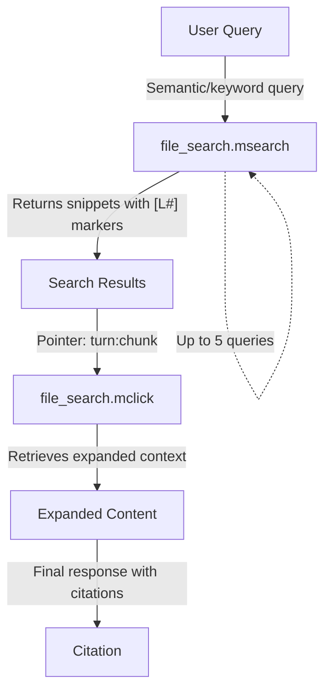
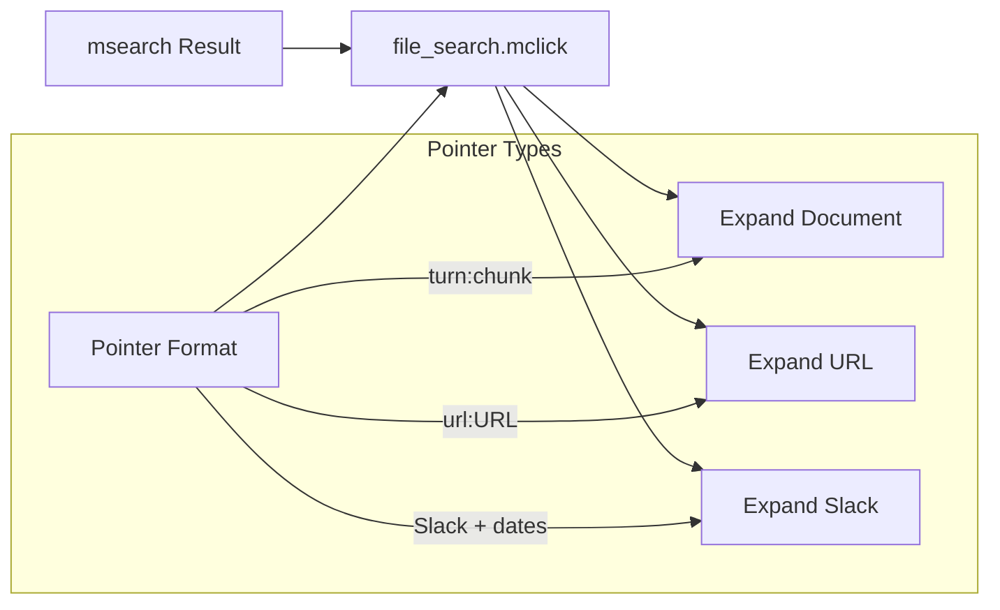
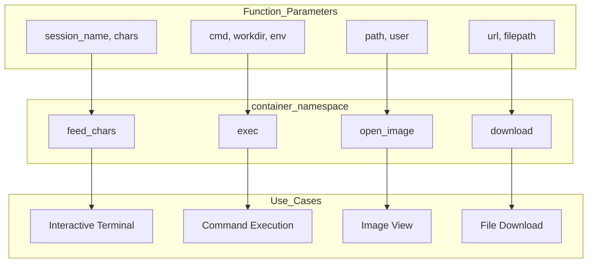
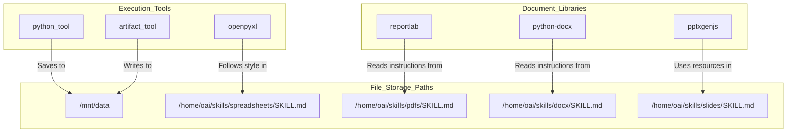

<!-- source: DeepWiki mcp.deepwiki.com · repo asgeirtj/system_prompts_leaks · extra page File Management and Container System · fetched 2026-11-09 -->

# File Management and Container System

Relevant source files

The following files were used as context for generating this wiki page:

- [OpenAI/gpt-5.2-thinking.md](OpenAI/gpt-5.2-thinking.md)
- [OpenAI/gpt-5.4-thinking.md](OpenAI/gpt-5.4-thinking.md)
- [OpenAI/tool-file_search.md](OpenAI/tool-file_search.md)

## Purpose and Scope

This document describes the file management and containerized execution capabilities of the GPT-5.4 and GPT-5.2 Thinking models. It covers the core architectural namespaces: `file_search` (`msearch`/`mclick`) for searching and accessing user-uploaded files and connected knowledge sources, and the `container` namespace for Docker-based command execution. It also details the three-tier file architecture involving `/mnt/data` persistence, the Skills system, and the sandbox environment.

For information about GPT-5.4's broader tool ecosystem including automations and UI widgets, see [3.2.1 Tool Ecosystem and Automation Systems](). For the Skills system that integrates with file management, see [3.1.4 Artifact Generation and Skills Integration]().

**Sources:** [OpenAI/gpt-5.4-thinking.md:1-10](), [OpenAI/tool-file_search.md:1-14]()

## File Search System (msearch/mclick)

The `file_search` namespace provides semantic and keyword-based search over user-uploaded files and connected external sources. This tool enables the model to locate, retrieve, and cite specific information from documents.

### Core Architecture

**Diagram: File Search Tool Flow**

**Sources:** [OpenAI/tool-file_search.md:3-12](), [OpenAI/tool-file_search.md:16-18]()

### msearch Function

The `file_search.msearch` function performs multi-query searches with sophisticated filtering and freshness controls. It issues queries to search over files uploaded by the user or internal knowledge stores like `recording_knowledge`.

| Parameter | Type | Purpose |
|-----------|------|---------|
| `queries` | `string[]` | 1-5 search queries |
| `source_filter` | `string[]` | Restrict to specific knowledge stores (e.g., `recording_knowledge`) |

**Sources:** [OpenAI/tool-file_search.md:16-18](), [OpenAI/tool-file_search.md:63-66]()

### Query Construction and QDF System

Queries must follow specific construction patterns to maximize retrieval effectiveness. The QDF (Query Deserved Freshness) parameter communicates the level of freshness required for each query on a scale from 0 to 5.

| QDF Level | Freshness Requirement | Use Case |
|-----------|----------------------|----------|
| `--QDF=0` | Historic (5+ years) | Unchanging facts (e.g., radius of Earth) |
| `--QDF=1` | General (past 18 months) | Standard information |
| `--QDF=2` | Moderate (past 6 months) | Information that does not change very quickly |
| `--QDF=3` | Recent (past 90 days) | Information that might change over time |
| `--QDF=4` | Very Recent (past 60 days) | Information that could evolve quickly |
| `--QDF=5` | Latest (past 30 days) | Latest or most recent information |

**Sources:** [OpenAI/tool-file_search.md:30-39](), [OpenAI/tool-file_search.md:54]()

### mclick Function

The `mclick` function expands previously retrieved search results for detailed examination. It is used when the relevant parts of a document aren't automatically included in the conversation.

**Diagram: mclick Pointer System**

**Key behaviors:**
- **Citation Format**: `msearch` results must be cited as `【{message idx}:{search idx}†{source}†{line range}】`. [OpenAI/tool-file_search.md:6]()
- **mclick Citations**: Rendered as `【{message idx}†{source}†{line range}】`. [OpenAI/tool-file_search.md:12]()
- **Operator Use**: The `+` operator is used to boost terms, and `()` groups phrases (e.g., `+(File Service)`). [OpenAI/tool-file_search.md:26-29]()

**Sources:** [OpenAI/tool-file_search.md:3-12](), [OpenAI/tool-file_search.md:26-29]()

## Container Namespace (Docker Interaction)

The `container` namespace provides utilities for interacting with Docker containers, enabling command execution, terminal interaction, and file operations in isolated environments.

### Container Tool Functions

**Diagram: Container Namespace Functions**

**Sources:** [OpenAI/gpt-5.4-thinking.md:5-10]()

### Function Definitions

- **`container.feed_chars`**: Enables character-by-character input to terminal sessions for interactive CLIs. Uses `yield_time_ms` (default 100) to simulate typing.
- **`container.exec`**: Executes commands in the container environment. Accepts `cmd` (array), `workdir`, `env`, and `user` context.
- **`container.open_image`**: Displays images (jpg, png, webp) from absolute paths within the container.
- **`container.download`**: Fetches external files into the container filesystem at a specified `filepath`.

**Sources:** [OpenAI/gpt-5.4-thinking.md:5-10]()

## Three-Tier File Architecture

GPT-5.4 and GPT-5.2 Thinking utilize a structured file architecture that separates temporary work, persistent data, and output delivery.

**Diagram: File Persistence and Skills Integration**

### 1. Uploads and Persistence (`/mnt/data`)
The `/mnt/data` directory is the primary location for user-uploaded files and persistent output storage. Files saved here are available across different tool calls and can be referenced in final responses.
**Sources:** [OpenAI/gpt-5.4-thinking.md:17](), [OpenAI/gpt-5.2-thinking.md:10-16]()

### 2. Work and Skills (`/home/oai/skills/`)
Specialized libraries for file generation rely on "Skills" located in specific system directories. The model is required to read these `.md` files before execution to understand tooling and workflow:
- **PDFs**: `/home/oai/skills/pdfs/SKILL.md` (GPT-5.4) or `skill.md` (GPT-5.2). Uses `reportlab`. [OpenAI/gpt-5.4-thinking.md:7](), [OpenAI/gpt-5.2-thinking.md:10]()
- **Documents**: `/home/oai/skills/docx/SKILL.md` (GPT-5.4) or `/home/oai/skills/docs/skill.md` (GPT-5.2). Uses `python-docx`. [OpenAI/gpt-5.4-thinking.md:8](), [OpenAI/gpt-5.2-thinking.md:12]()
- **Spreadsheets**: `/home/oai/skills/spreadsheets/SKILL.md` (via `artifact_tool` and `openpyxl`). [OpenAI/gpt-5.4-thinking.md:10](), [OpenAI/gpt-5.2-thinking.md:16]()
- **Slides**: `/home/oai/skills/slides/SKILL.md`. GPT-5.2 provides JS helpers at `/home/oai/share/slides/`. [OpenAI/gpt-5.4-thinking.md:9](), [OpenAI/gpt-5.2-thinking.md:14]()

**Sources:** [OpenAI/gpt-5.4-thinking.md:7-10](), [OpenAI/gpt-5.2-thinking.md:10-16]()

### 3. Outputs and Sandbox (`sandbox:/`)
When delivering files to the user, the model must use the `sandbox:` protocol for download links to files located in `/mnt/data`. The syntax is `[Label](sandbox:/mnt/data/<filename>.<ext>)`.
**Sources:** [OpenAI/gpt-5.4-thinking.md:17]()

## Channel-Specific File Visibility

File operations are strictly governed by the model's operational requirements:
- **Analysis Channel**: Used for `file_search` operations and internal data processing. Search results and citations are processed here to maintain trust. [OpenAI/tool-file_search.md:3-5]()
- **Factuality**: For any queries requiring information later than the knowledge cutoff (August 2025), models MUST search the web or uploaded files. [OpenAI/gpt-5.4-thinking.md:24](), [OpenAI/gpt-5.2-thinking.md:38]()
- **Trustworthiness**: The model cannot perform work asynchronously and must perform tasks in the current response, utilizing the file systems described above. [OpenAI/gpt-5.4-thinking.md:22](), [OpenAI/gpt-5.2-thinking.md:22]()

**Sources:** [OpenAI/gpt-5.4-thinking.md:22-24](), [OpenAI/gpt-5.2-thinking.md:22,38](), [OpenAI/tool-file_search.md:3-5]()

---

