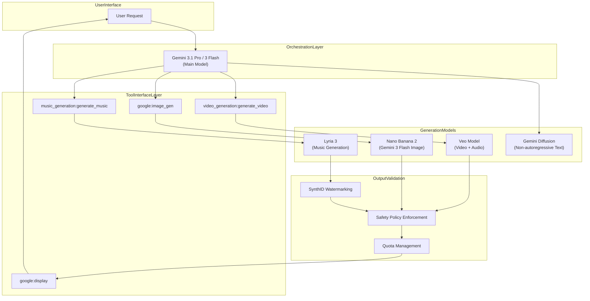
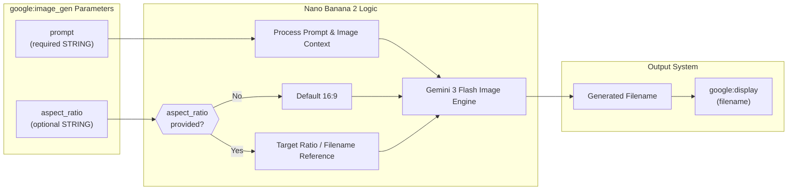
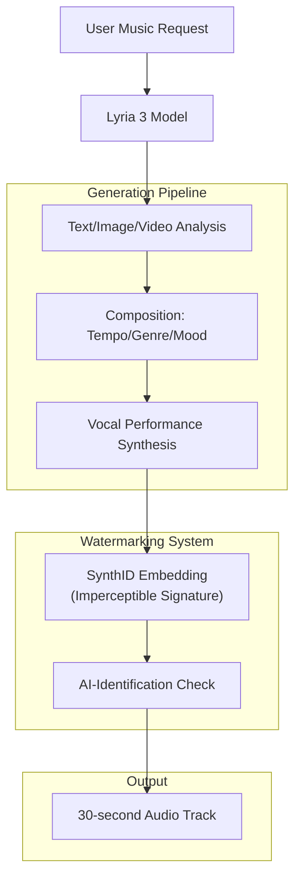

<!-- source: DeepWiki mcp.deepwiki.com · repo asgeirtj/system_prompts_leaks · extra page Image and Music Generation Systems · fetched 2026-11-09 -->

# Image and Music Generation Systems

Relevant source files

The following files were used as context for generating this wiki page:

- [Google/gemini-3.1-pro.md](Google/gemini-3.1-pro.md)
- [Google/nano-banana-2-api.md](Google/nano-banana-2-api.md)

## Purpose and Scope

This document details Google Gemini 3's specialized generation models that power multi-modal content creation. It covers three dedicated models: **Veo** (video generation with native audio), **Nano Banana 2** (image generation and editing), and **Lyria 3** (music generation with SynthID watermarking). This page also documents **Gemini Live Mode**, which extends multi-modal capabilities to mobile devices with real-time voice, camera, and screen sharing, and the underlying integration of **Gemini Diffusion** for non-autoregressive text generation.

For information about Gemini's video generation workflow and validation rules, see [4.1.1 Video Generation with Veo Model](). For search and browse tool integrations, see [4.2 Gemini API - Search and Browse Tools](). For overall Gemini architecture, see [4. Google Gemini Systems]().

---

## Multi-Modal Architecture Overview

Gemini 3 Flash and Gemini 3.1 Pro employ a **model specialization strategy** where distinct state-of-the-art models handle different generation tasks. Unlike unified multi-modal approaches, Gemini delegates to purpose-built models optimized for specific media types.

### Model Architecture Diagram

**Sources:** [Google/gemini-3.1-pro.md:11-25]()

---

## Capability and Quota Matrix

The following table summarizes model capabilities and tier-based quotas as defined in the system instructions for Gemini 3.1 Pro:

| Model | Official Name | Capabilities | Quota (Basic) | Quota (AI Plus) | Quota (Pro) | Quota (Ultra) |
|-------|--------------|--------------|---------------|-----------------|-------------|---------------|
| **Nano Banana 2** | Gemini 3 Flash Image | Text-to-image, image+text-to-image (editing), multi-image-to-image (composition, style transfer) | 20/day | 50/day | 100/day | 1000/day |
| **Nano Banana Pro** | N/A | Enhanced image generation (accessed via "Redo with Pro") | N/A | Available | Available | Available |
| **Veo** | Veo | Text-to-video with audio cues, video extension, frame interpolation, reference image guidance | N/A | N/A | 3/day | 5/day |
| **Lyria 3** | Lyria 3 | Text-to-music, image-to-music, video-to-music, automated lyric writing, multi-language vocals | N/A | N/A | N/A | N/A |

**Key Observations:**
- **Image generation** (`image_generation` & `image_edit`) quotas are combined for users across tiers [Google/gemini-3.1-pro.md:16]().
- **Video generation** via the Veo model is restricted to Pro and Ultra subscribers [Google/gemini-3.1-pro.md:20]().
- **Nano Banana Pro** is an exclusive upgrade path for paid users, triggered manually by selecting "Redo with Pro" in the UI after an initial generation [Google/gemini-3.1-pro.md:17]().

**Sources:** [Google/gemini-3.1-pro.md:11-25]()

---

## Nano Banana 2: Image Generation and Editing

### Model Specifications

**Nano Banana 2** (officially **Gemini 3 Flash Image**) is the successor to Nano Banana and Nano Banana Pro within the Gemini ecosystem [Google/gemini-3.1-pro.md:15](). It is a multimodal model supporting:

1.  **Text-to-image:** Generating new visual content from prompts.
2.  **Image+text-to-image (editing):** Modifying existing images.
3.  **Multi-image-to-image:** Performing complex compositions and style transfers.

### Tool Interface: `google:image_gen`

The model is invoked via the `google:image_gen` tool declaration [Google/nano-banana-2-api.md:6-22]().

### Tool Definition

The following parameters are used when calling the image generation tool [Google/nano-banana-2-api.md:10-17]():

-   **`prompt` (STRING):** The text description of the image to generate. This is a required field.
-   **`aspect_ratio` (STRING):** Optional aspect ratio in `w:h` format (e.g., `4:3`) or a filename of an image with the target aspect ratio. If not specified, the default is `16:9`.

### Image Display and Search

Once generated, images are managed and displayed via:
-   **`google:display`**: Used for displaying an image referenced by its `filename`. It includes an `end_turn` boolean parameter to signal the end of the Assistant's turn [Google/nano-banana-2-api.md:26-43]().
-   **`google:image_search`**: Searches for images based on a list of text queries, returning metadata including `image_url`, `landing_page_url`, and `rank` [Google/nano-banana-2-api.md:63-87]().

**Sources:** [Google/gemini-3.1-pro.md:14-17](), [Google/nano-banana-2-api.md:6-87]()

---

## Lyria 3: Music Generation with SynthID

### Model Capabilities

**Lyria 3** is a multimodal music generation model capable of producing high-fidelity tracks [Google/gemini-3.1-pro.md:22-25]():

-   **Input Modalities:** Supports text-to-music, image-to-music, and video-to-music generation.
-   **Output Features:** Produces 30-second tracks with granular control over tempo, genre, and emotional mood.
-   **Vocal Synthesis:** Supports professional-grade arrangements, including automated lyric writing and realistic vocal performances in multiple languages.

### SynthID Watermarking Architecture

All tracks generated by Lyria 3 include **SynthID watermarking** for AI identification [Google/gemini-3.1-pro.md:25]().

**Constraint:** SynthID is **mandatory and non-optional** for all music generation outputs to ensure tracks can be identified as AI-generated [Google/gemini-3.1-pro.md:25]().

**Sources:** [Google/gemini-3.1-pro.md:22-25]()

---

## Gemini Live Mode: Real-Time Multi-Modal Interaction

**Gemini Live** is a conversational mode available on **Android and iOS** mobile platforms [Google/gemini-3.1-pro.md:26](). It extends Gemini's multi-modal capabilities into real-time, voice-driven interactions.

### Feature Specifications

| Feature | Description | Source |
|---------|-------------|--------|
| **Natural Voice Conversation** | Real-time, back-and-forth dialogue; supports interruptions. | [Google/gemini-3.1-pro.md:29]() |
| **Camera Sharing** | Share phone's camera feed to ask questions about the physical environment. | [Google/gemini-3.1-pro.md:30]() |
| **Screen Sharing** | Share phone's screen for contextual help on apps or content. | [Google/gemini-3.1-pro.md:31]() |
| **Image/File Discussion** | Upload images or files to discuss their content in real-time. | [Google/gemini-3.1-pro.md:32]() |
| **YouTube Discussion** | Talk about YouTube videos. | [Google/gemini-3.1-pro.md:33]() |

**Use Cases:** Real-time assistance, brainstorming, language learning, and getting information about surroundings [Google/gemini-3.1-pro.md:34]().

**Sources:** [Google/gemini-3.1-pro.md:26-34]()

---

