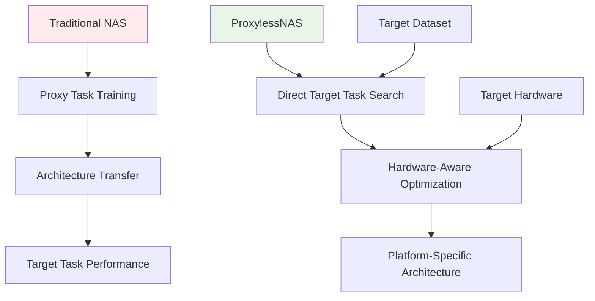
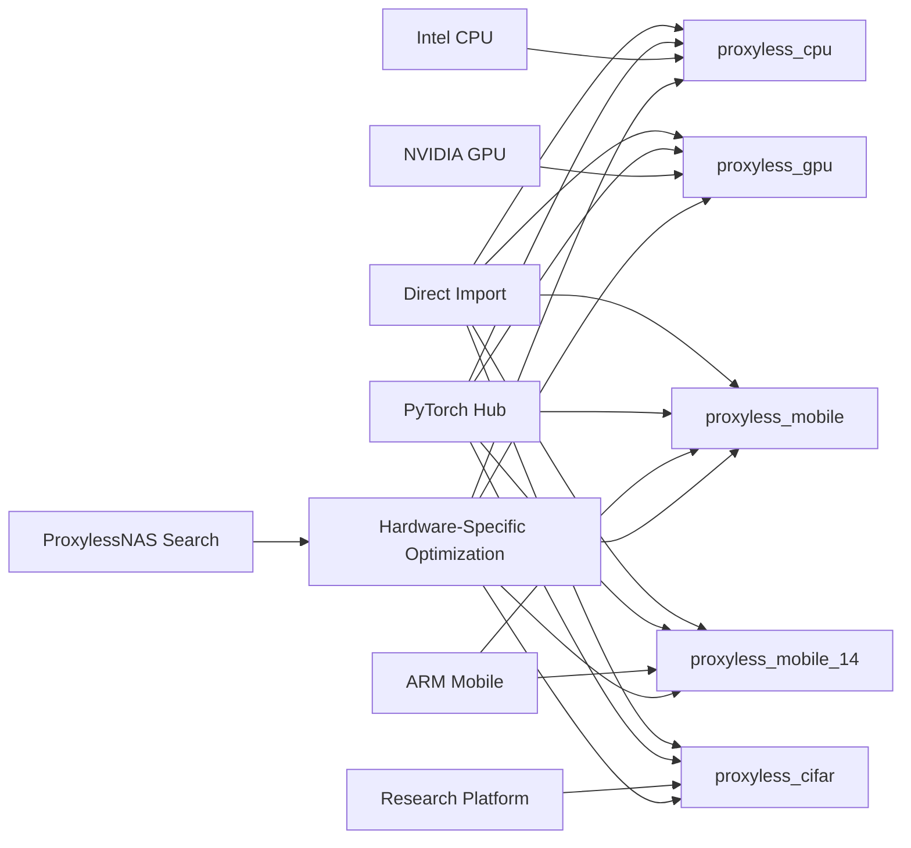
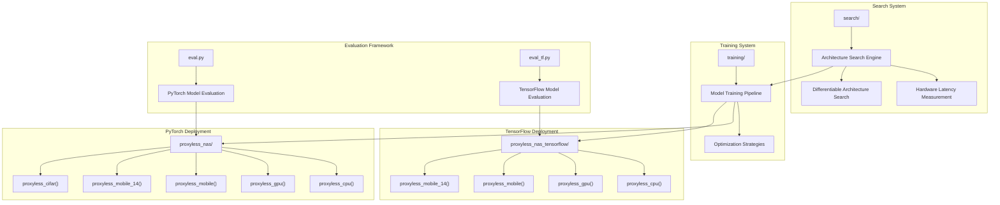
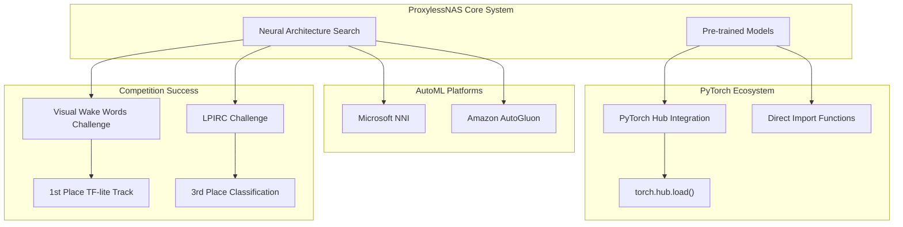
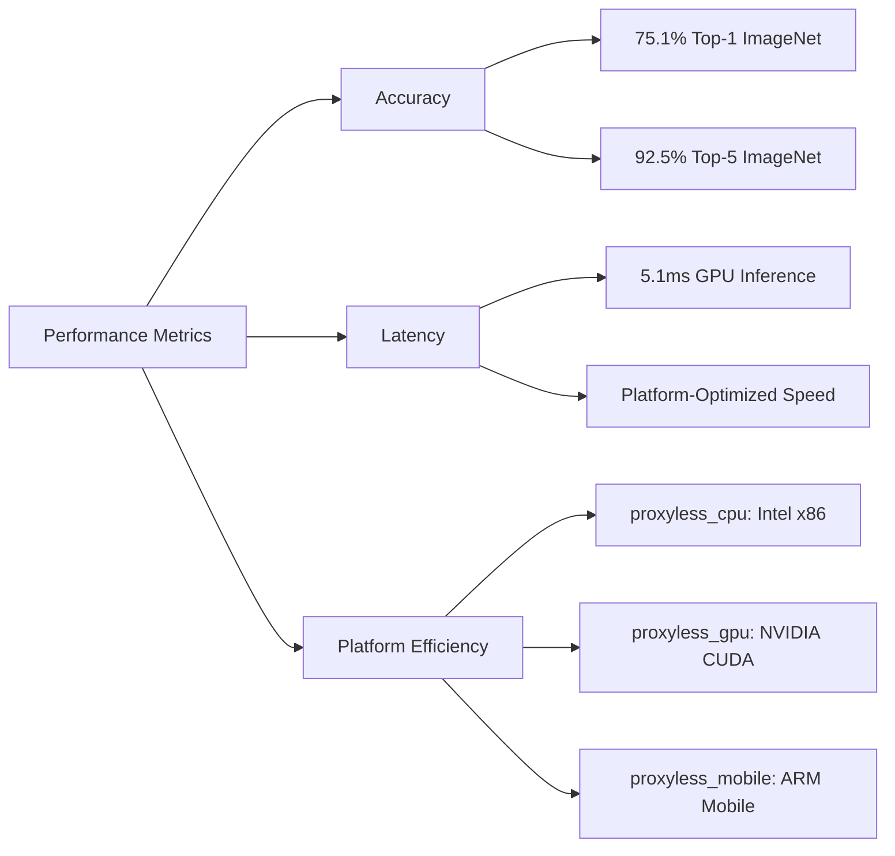

<!-- source: DeepWiki mcp.deepwiki.com · repo mit-han-lab/proxylessnas · page 1 Overview · fetched 2026-10-30 -->

# Overview

Relevant source files

The following files were used as context for generating this wiki page:

- [.gitignore](.gitignore)
- [LICENSE](LICENSE)
- [README.md](README.md)

This document provides a comprehensive overview of ProxylessNAS, a direct Neural Architecture Search framework that optimizes neural network architectures for specific target tasks and hardware platforms without using proxy tasks. This page covers the fundamental concepts, system architecture, and key innovations that make ProxylessNAS unique in the neural architecture search landscape.

For detailed information about using specific pre-trained models, see [Model Zoo](#3). For practical deployment examples, see [ProxylessGaze Application](#5). For academic context and research contributions, see [Research and Academic Context](#6).

## What is ProxylessNAS

ProxylessNAS is a neural architecture search method that directly optimizes architectures on target hardware and datasets, eliminating the need for proxy tasks that traditional NAS methods rely on. Published at ICLR 2019, it represents a significant advancement in making NAS practical for real-world deployment scenarios.

The key insight is that different hardware platforms (CPU, GPU, mobile devices) have vastly different computational characteristics, and a single "universal" architecture cannot be optimal for all platforms. ProxylessNAS addresses this by searching for platform-specific architectures that maximize efficiency for each target deployment scenario.

**Direct vs. Proxy-Based Architecture Search**

Sources: [README.md:1-124]()

## Core Innovation: Hardware Specialization

The fundamental innovation of ProxylessNAS is hardware specialization - the recognition that optimal neural architectures vary significantly across different deployment platforms. Instead of designing one architecture for all hardware, ProxylessNAS creates specialized architectures optimized for specific platforms.

| Platform Type | Target Hardware | Optimization Focus | Model Variant |
|---------------|----------------|-------------------|---------------|
| CPU | Intel x86, ARM CPUs | Memory bandwidth, cache efficiency | `proxyless_cpu` |
| GPU | NVIDIA GPUs, CUDA cores | Parallel computation, memory coalescing | `proxyless_gpu` |
| Mobile | ARM mobile processors | Power efficiency, inference speed | `proxyless_mobile` |
| Mobile (ImageNet) | Mobile with higher accuracy | Balanced accuracy/efficiency | `proxyless_mobile_14` |
| Research | CIFAR-10 experiments | Research validation | `proxyless_cifar` |

**Hardware Platform Specialization Architecture**

Sources: [README.md:67-73](), [README.md:26-29](), [README.md:78-87]()

## System Architecture and Code Organization

ProxylessNAS consists of several key components organized into distinct modules for search, training, and deployment across multiple frameworks.

**ProxylessNAS Code Organization and Data Flow**

Sources: [README.md:100-106](), [README.md:78-87]()

## External Ecosystem Integration

ProxylessNAS has been integrated into major machine learning frameworks and AutoML platforms, making it accessible to the broader research and industry community.

**External Integration and Recognition**

Sources: [README.md:15-19](), [README.md:24-29]()

## Performance Characteristics

ProxylessNAS demonstrates significant performance improvements over existing architectures across different hardware platforms, with specialized optimizations yielding measurable efficiency gains.

### Mobile Platform Performance
- **vs MobileNetV2**: Consistently outperforms across various latency constraints
- **Efficiency**: Better accuracy-latency trade-offs through hardware-aware search

### GPU Platform Performance
- **75.1% Top-1 accuracy** on ImageNet (vs 72.0% for MobileNetV2)
- **5.1ms latency** (20% faster than MobileNetV2's 6.1ms)
- **3.1% accuracy improvement** with faster inference

**Performance Metrics Across Platforms**

Sources: [README.md:40-66]()

## Practical Applications

ProxylessNAS includes practical demonstrations of its capabilities, most notably the ProxylessGaze application which showcases real-time gaze estimation using ProxylessNAS-optimized models for face detection, landmark detection, and gaze estimation components.

The framework supports multiple deployment paths:
- **PyTorch Hub**: Simple two-line model loading via `torch.hub.load()`
- **Direct Import**: Framework-specific imports from `proxyless_nas` and `proxyless_nas_tensorflow` modules
- **Cross-Platform**: Support for PyTorch, TensorFlow, ONNX, and mobile deployment frameworks

Sources: [README.md:107-111](), [README.md:78-87](), [README.md:24-29]()

---

