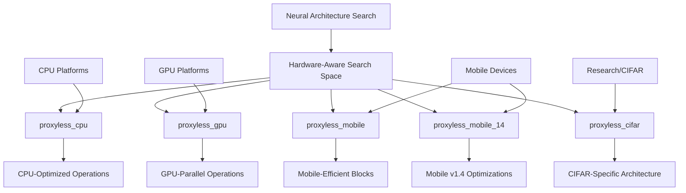
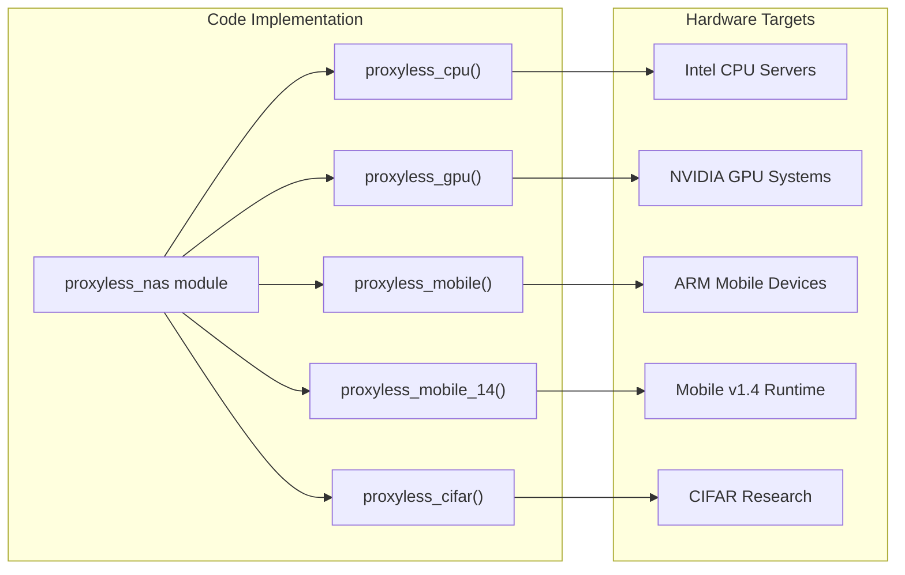
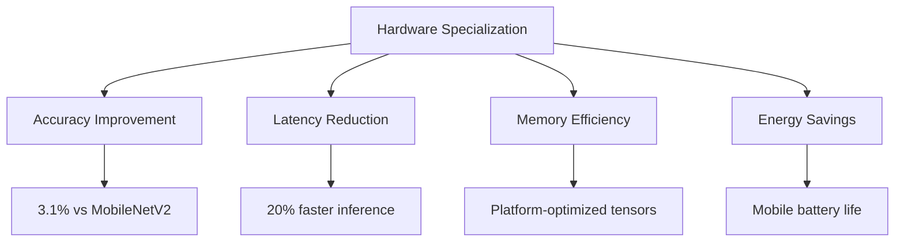
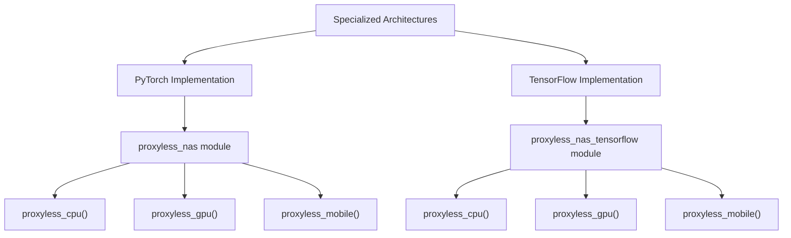

<!-- source: DeepWiki mcp.deepwiki.com · repo mit-han-lab/proxylessnas · page 1.1 Hardware Specialization Concept · fetched 2026-10-30 -->

# Hardware Specialization Concept

<details>
<summary>Relevant source files</summary>

The following files were used as context for generating this wiki page:

- [README.md](README.md)
- [assets/specialization.jpg](assets/specialization.jpg)
- [assets/specialized_archs.png](assets/specialized_archs.png)

</details>


## Purpose and Scope

This document explains the core concept of hardware-specific architecture optimization in ProxylessNAS and why specialized neural network architectures outperform generic one-size-fits-all models. It covers the theoretical foundation, available specialized variants, and implementation approach.

For technical details about the neural architecture search methodology, see [Neural Architecture Search Method](#2.1). For practical usage of specialized models, see [Available Models](#3.1).

## The One-Size-Fits-All Problem

Traditional neural network deployment uses a single model architecture across all hardware platforms. This approach fails to exploit the unique characteristics and constraints of different hardware environments, leading to suboptimal performance.

### Hardware Diversity Challenges

Different hardware platforms have distinct characteristics:

| Hardware Type | Key Constraints | Optimization Focus |
|---------------|-----------------|-------------------|
| Mobile CPU | Battery life, limited compute | Minimize operations, memory efficiency |
| Desktop GPU | Parallel processing, memory bandwidth | Maximize throughput, utilize parallelism |
| Edge devices | Real-time inference, power limits | Latency optimization, model size reduction |

**Traditional Approach Limitations:**
- Generic architectures cannot leverage platform-specific optimizations
- Performance bottlenecks vary across hardware types
- Resource utilization remains suboptimal

Sources: [README.md:67-71]()

## Hardware Specialization Approach

ProxylessNAS addresses this limitation by generating specialized neural architectures optimized for specific hardware platforms during the search process itself.

### Specialization Strategy



**Hardware Specialization Process:**
1. **Platform Analysis**: Characterize target hardware constraints and capabilities
2. **Search Space Adaptation**: Modify architecture search space for platform-specific operations
3. **Direct Optimization**: Search architectures directly on target hardware
4. **Performance Validation**: Validate specialized architectures against platform benchmarks

Sources: [README.md:67-73]()

## Available Specialized Variants

ProxylessNAS provides five specialized model variants, each optimized for specific deployment scenarios.

### Model Variant Mapping



### Specialization Characteristics

| Variant | Function Name | Target Hardware | Key Optimizations |
|---------|---------------|-----------------|-------------------|
| CPU | `proxyless_cpu` | Intel CPU servers | Sequential operations, cache efficiency |
| GPU | `proxyless_gpu` | NVIDIA GPU systems | Parallel blocks, memory coalescing |
| Mobile | `proxyless_mobile` | ARM mobile devices | Depthwise separable convolutions |
| Mobile 1.4 | `proxyless_mobile_14` | Mobile runtime v1.4 | Enhanced mobile optimizations |
| CIFAR | `proxyless_cifar` | Research/CIFAR-10 | Small-scale image classification |

Sources: [README.md:80-82](), [README.md:27-28]()

## Performance Benefits

Hardware specialization delivers measurable performance improvements across accuracy and efficiency metrics.

### Comparative Performance

**GPU Specialization Results:**
- **ProxylessNAS (GPU)**: 75.1% Top-1 accuracy, 5.1ms latency
- **MobileNetV2**: 72.0% Top-1 accuracy, 6.1ms latency
- **Performance Gain**: 3.1% accuracy improvement with 20% faster inference

**Mobile Specialization Benefits:**
- Consistently outperforms MobileNetV2 across various latency constraints
- Optimized for ARM processor architectures
- Reduced memory footprint and energy consumption

### Efficiency Metrics



Sources: [README.md:40-65]()

## Implementation Architecture

### PyTorch Hub Integration

The specialized models integrate seamlessly with PyTorch Hub for easy deployment:

```python
target_platform = "proxyless_cpu"  # Hardware-specific selection
model = torch.hub.load('mit-han-lab/ProxylessNAS', target_platform, pretrained=True)
```

### Direct Import Pattern

For direct usage without PyTorch Hub:

```python
from proxyless_nas import proxyless_cpu, proxyless_gpu, proxyless_mobile, proxyless_mobile_14, proxyless_cifar
net = proxyless_cpu(pretrained=True)
```

### Multi-Framework Support



**Framework Availability:**
- **PyTorch**: Full model zoo with pre-trained weights
- **TensorFlow**: Compatible implementations for production deployment
- **Cross-platform**: Consistent API across frameworks

Sources: [README.md:78-87](), [README.md:103-105]()

## Hardware Specialization Impact

The hardware specialization concept represents a paradigm shift from generic to targeted neural architecture design. By optimizing architectures during the search phase for specific hardware constraints, ProxylessNAS achieves superior performance compared to traditional one-size-fits-all approaches.

This specialization strategy enables:
- **Platform-specific optimizations** that leverage unique hardware capabilities
- **Improved resource utilization** through targeted architectural choices  
- **Better accuracy-efficiency trade-offs** for each deployment scenario
- **Simplified deployment** with pre-optimized models for common platforms

Sources: [README.md:22-29](), [README.md:67-74]()

---

