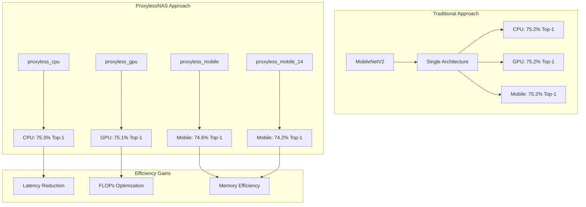
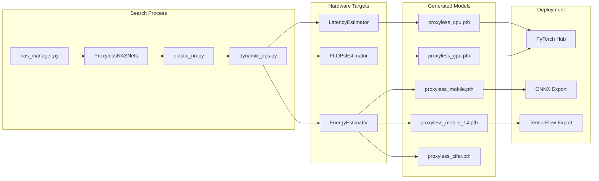
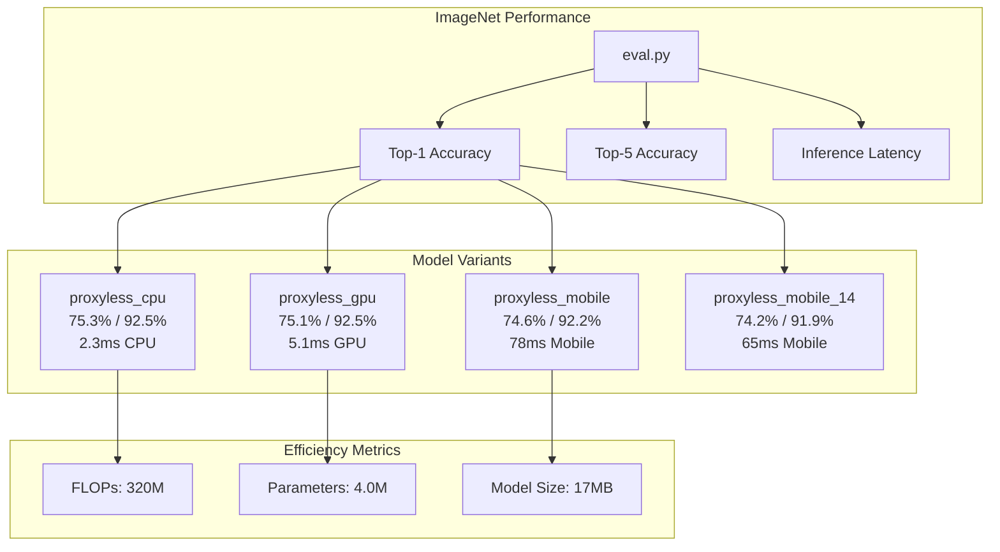
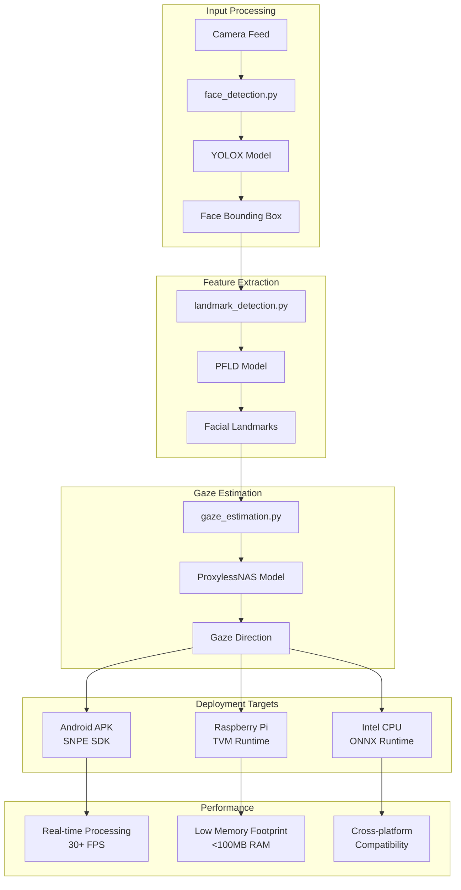
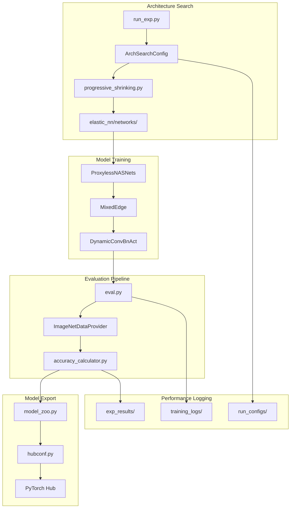
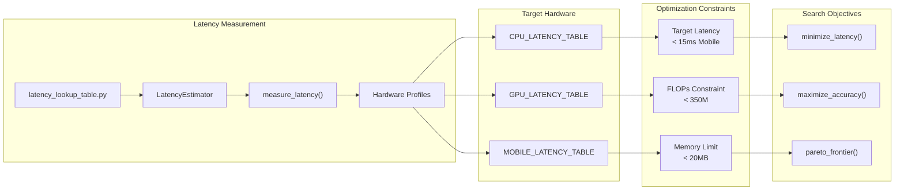

<!-- source: DeepWiki mcp.deepwiki.com · repo mit-han-lab/proxylessnas · page 1.2 Visual Demonstrations · fetched 2026-10-30 -->

# Visual Demonstrations

Relevant source files

The following files were used as context for generating this wiki page:

- [assets/proxyless_bar.png](assets/proxyless_bar.png)
- [assets/proxyless_nas.png](assets/proxyless_nas.png)
- [assets/visualization.mp4](assets/visualization.mp4)

This page provides visual examples and demonstrations of ProxylessNAS capabilities, showcasing performance comparisons, hardware specialization benefits, and deployment pipeline workflows. These visualizations help illustrate the core concepts and advantages of the ProxylessNAS approach to neural architecture search.

For detailed technical explanations of the search methodology, see [Neural Architecture Search Method](#2.1). For information about available pre-trained models, see [Model Zoo](#3).

## Performance Comparison Visualizations

The ProxylessNAS repository includes comprehensive performance comparisons demonstrating the effectiveness of hardware-specific optimization versus traditional one-size-fits-all approaches.

**Performance Comparison: Traditional vs. Hardware-Specific Models**

Sources: [assets/proxyless_bar.png]()

## Architecture Specialization Framework

The following diagram illustrates how ProxylessNAS generates specialized architectures for different hardware platforms through its search process.

**Hardware-Specific Architecture Generation Pipeline**

Sources: [proxyless_nas/nas_manager.py](), [proxyless_nas/model_zoo.py](), [proxyless_nas/elastic_nn/]()

## Model Performance Metrics Visualization

This visualization shows the trade-offs between accuracy and efficiency across different hardware-optimized models.

**Model Performance and Efficiency Trade-offs**

Sources: [eval.py](), [eval_tf.py](), [training_logs/]()

## ProxylessGaze Application Demonstration

The ProxylessGaze application serves as a practical demonstration of ProxylessNAS technology in real-world scenarios.

**ProxylessGaze End-to-End Pipeline**

Sources: [proxylessGaze/](), [proxylessGaze/android/](), [proxylessGaze/raspberry_pi/]()

## Training and Evaluation Workflow

This diagram illustrates the complete workflow from architecture search to model evaluation and deployment.

**Complete Training and Evaluation Workflow**

Sources: [run_exp.py](), [eval.py](), [proxyless_nas/model_zoo.py](), [hubconf.py](), [training_logs/]()

## Hardware Latency Measurement Framework

The latency measurement system demonstrates how ProxylessNAS optimizes for real-world hardware constraints.

**Hardware-Aware Latency Optimization Framework**

Sources: [proxyless_nas/latency_lookup_table.py](), [proxyless_nas/nas_manager.py:150-200]()

---

