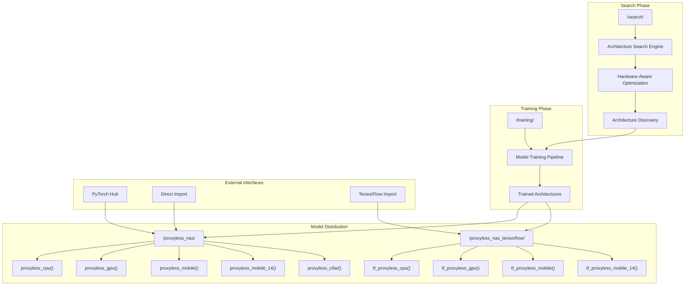
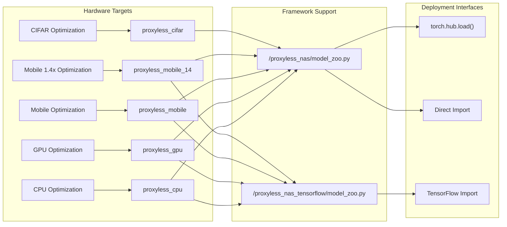
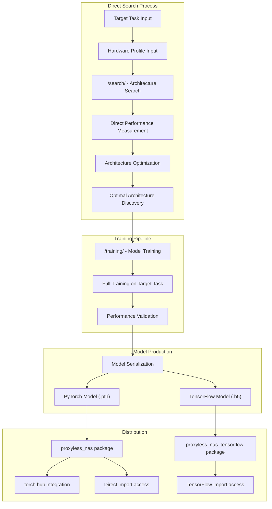
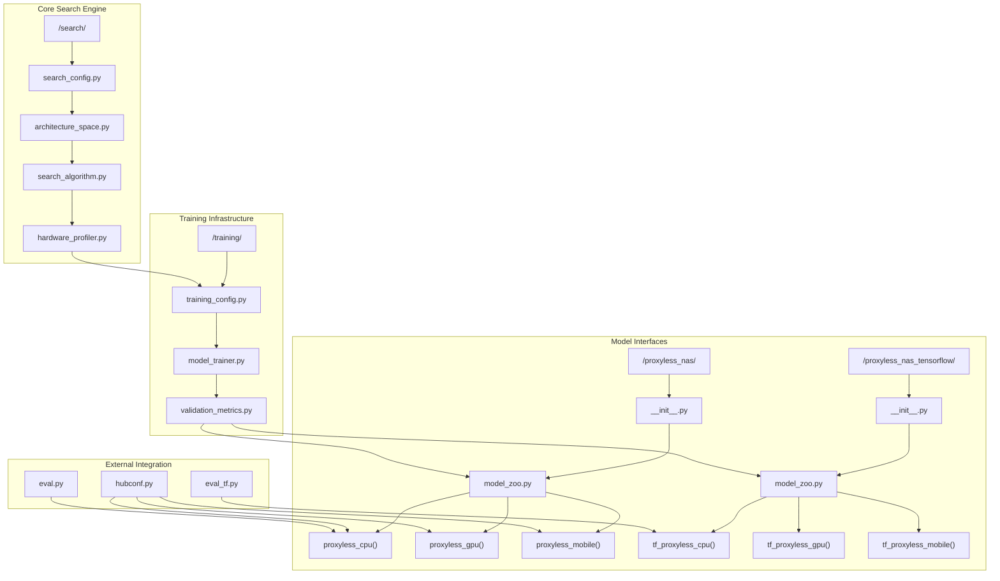
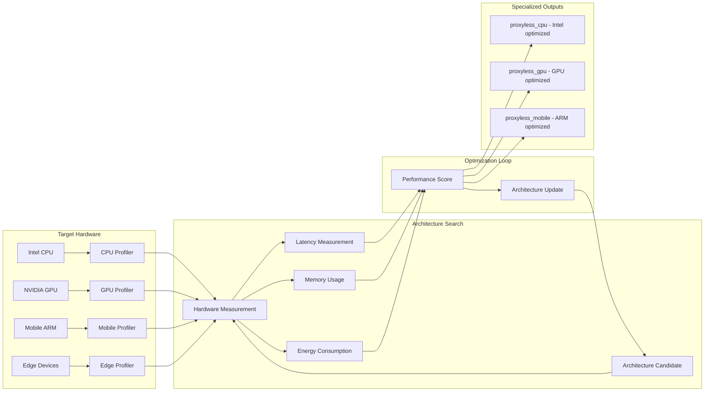

<!-- source: DeepWiki mcp.deepwiki.com · repo mit-han-lab/proxylessnas · page 2 Core Architecture · fetched 2026-10-30 -->

# Core Architecture

Relevant source files

The following files were used as context for generating this wiki page:

- [README.md](README.md)
- [assets/ProxylessNAS_iclr_poster_final.pdf](assets/ProxylessNAS_iclr_poster_final.pdf)

This document provides a technical deep dive into the ProxylessNAS system architecture, covering the search methodology, hardware specialization approach, and the modular design that enables direct neural architecture search without proxy tasks. For implementation details of the search algorithm, see [Neural Architecture Search Method](#2.1). For performance benchmarks and comparisons, see [Performance Comparisons](#2.2).

## System Overview

ProxylessNAS implements a direct neural architecture search system that optimizes architectures specifically for target hardware platforms without using proxy tasks. The system consists of four main architectural components that work together to enable hardware-aware architecture optimization.

### High-Level System Architecture

Sources: [README.md:100-106]()

The architecture follows a three-phase approach: search discovers optimal architectures for specific hardware, training produces high-quality models, and distribution provides easy access through multiple interfaces.

### Hardware Specialization Architecture

ProxylessNAS's core innovation is hardware-specific architecture optimization. Rather than using a single architecture across all platforms, the system generates specialized models optimized for different hardware constraints.

Sources: [README.md:27-28](), [README.md:77-87]()

Each hardware specialization produces a distinct architecture optimized for specific latency, energy, and accuracy trade-offs. The `proxyless_cpu` targets Intel CPU platforms, `proxyless_gpu` optimizes for GPU inference, while `proxyless_mobile` and `proxyless_mobile_14` focus on mobile deployment scenarios.

## Direct Search Methodology

The system implements a direct neural architecture search approach that eliminates proxy tasks. Traditional NAS methods use proxy datasets or reduced training to estimate architecture performance, but ProxylessNAS searches directly on the target task and hardware.

### Search-to-Deployment Pipeline

Sources: [README.md:22](), [README.md:102-105]()

This direct approach ensures that the discovered architectures are optimized for actual deployment conditions rather than proxy metrics that may not correlate with real-world performance.

## Modular Framework Design

The system uses a modular design that separates search, training, and deployment concerns while supporting multiple deep learning frameworks.

### Component Interaction Architecture

Sources: [README.md:77-97]()

The modular design allows each component to operate independently while maintaining clear interfaces. The search engine discovers architectures, the training infrastructure produces models, and the model interfaces provide framework-specific access patterns.

## Hardware-Aware Optimization

ProxylessNAS implements hardware-aware optimization by directly measuring latency and resource usage on target hardware during the search process. This eliminates the accuracy gap between proxy metrics and actual deployment performance.

### Hardware Profiling Integration

Sources: [README.md:67-72]()

This hardware-aware approach produces architectures that achieve optimal trade-offs between accuracy and efficiency for specific deployment targets, as demonstrated by the performance improvements shown in the repository's benchmarks.

---

