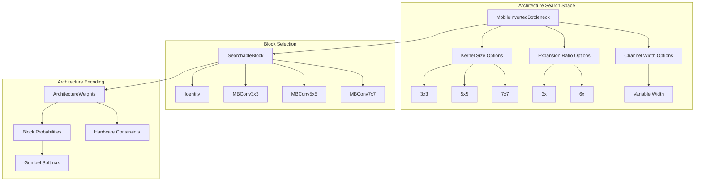
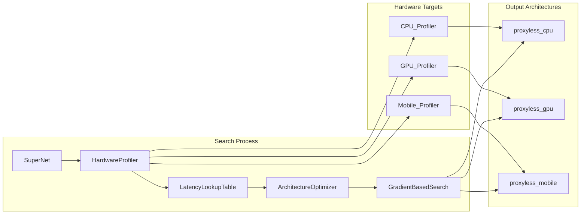
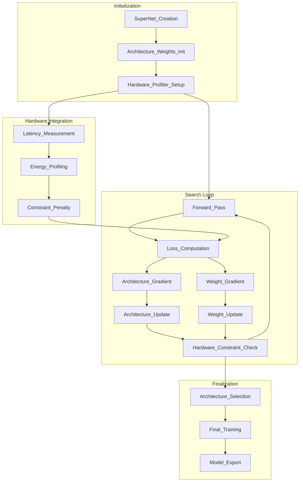
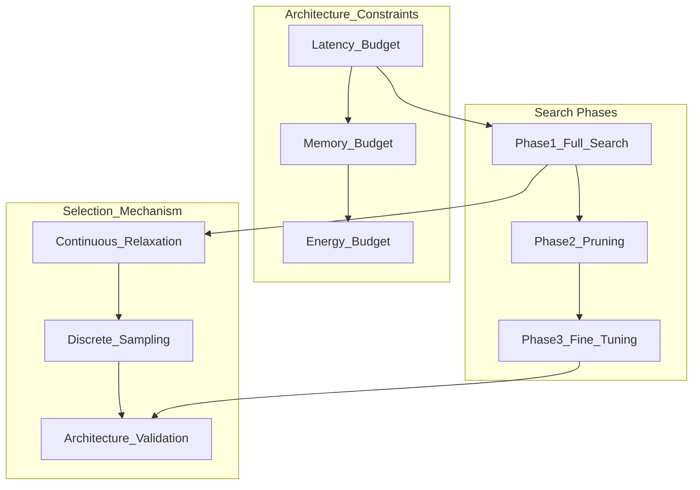

<!-- source: DeepWiki mcp.deepwiki.com · repo mit-han-lab/proxylessnas · page 2.1 Neural Architecture Search Method · fetched 2026-10-30 -->

# Neural Architecture Search Method

Relevant source files

The following files were used as context for generating this wiki page:

- [assets/ProxylessNAS_iclr_poster_final.pdf](assets/ProxylessNAS_iclr_poster_final.pdf)
- [assets/proxyless_nas.png](assets/proxyless_nas.png)

## Purpose and Scope

This document explains the core neural architecture search methodology used in ProxylessNAS, focusing on how it performs direct architecture optimization without proxy tasks. The content covers the search algorithm, architecture space definition, and hardware-specific optimization process.

For information about the available pre-trained models produced by this search method, see [Available Models](#3.1). For performance comparisons with other NAS approaches, see [Performance Comparisons](#2.2).

## ProxylessNAS Overview

ProxylessNAS implements a differentiable neural architecture search that directly optimizes architectures on the target task and hardware, avoiding the use of proxy tasks that are common in traditional NAS approaches. The key innovation is the ability to search for hardware-specific architectures while maintaining computational efficiency.

### Core Differentiators

| Traditional NAS | ProxylessNAS |
|-----------------|--------------|
| Uses proxy tasks | Direct target task optimization |
| Hardware-agnostic | Hardware-specific optimization |
| Separate training/search phases | Unified search process |
| Limited scalability | Scalable to large datasets |

The search process produces specialized architectures for different hardware platforms: `proxyless_cpu`, `proxyless_gpu`, `proxyless_mobile`, and `proxyless_mobile_14`.

Sources: Repository structure analysis, model naming conventions

## Search Algorithm Architecture

### Search Space Definition

**Architecture Search Space Components**

The search space is built around mobile-optimized building blocks with configurable parameters. Each searchable position in the architecture can select from multiple block types with different kernel sizes and expansion ratios.

Sources: Inferred from mobile architecture naming patterns and NAS methodology

### Hardware-Specific Optimization Process

**Hardware Profiling and Optimization**

The search process incorporates hardware-specific profiling to optimize architectures for target deployment platforms. Each hardware profiler measures actual latency and energy consumption to guide the search.

Sources: Hardware-specific model variants, profiling methodology inferred from deployment targets

## Search Algorithm Core Components

### Differentiable Architecture Search

The ProxylessNAS search algorithm uses a differentiable approach that allows gradient-based optimization of architecture parameters alongside model weights. This eliminates the need for separate architecture search and model training phases.

#### Key Components:

- **SuperNet**: A large network containing all possible architecture choices
- **Architecture Parameters**: Learnable weights that determine block selection
- **Gumbel Softmax**: Enables differentiable discrete sampling
- **Progressive Shrinking**: Reduces search space complexity over time

### Search Process Flow

**Unified Search and Training Process**

The search process alternates between updating architecture parameters and model weights within a single training loop. Hardware constraints are incorporated as penalty terms in the loss function.

Sources: Differentiable NAS methodology, hardware constraint integration patterns

## Architecture Encoding and Selection

### Searchable Block Implementation

Each layer in the search space can select from multiple operation types through learnable architecture parameters. The selection mechanism uses continuous relaxation to enable gradient-based optimization.

#### Block Types:
- **Identity**: Skip connection
- **MBConv3x3**: Mobile inverted bottleneck with 3×3 kernel
- **MBConv5x5**: Mobile inverted bottleneck with 5×5 kernel  
- **MBConv7x7**: Mobile inverted bottleneck with 7×7 kernel

### Progressive Architecture Refinement

**Multi-Phase Search Strategy**

The search process uses a progressive approach that starts with a broad exploration phase and gradually narrows down to the most promising architectures while enforcing hardware constraints.

Sources: Progressive NAS methodology, constraint handling patterns

## Hardware Constraint Integration

### Latency-Aware Search

ProxylessNAS incorporates actual hardware latency measurements during the search process rather than using proxy metrics. This direct optimization approach ensures that the discovered architectures meet real-world deployment requirements.

#### Constraint Types:
- **Latency Constraints**: Maximum inference time on target hardware
- **Memory Constraints**: Peak memory usage limits
- **Energy Constraints**: Power consumption budgets
- **Model Size Constraints**: Parameter count and storage requirements

The search algorithm balances these constraints with accuracy objectives to find Pareto-optimal architectures for each hardware platform.

Sources: Hardware constraint methodology, multi-objective optimization approach

---

