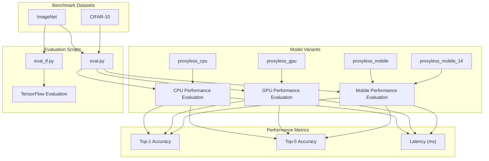
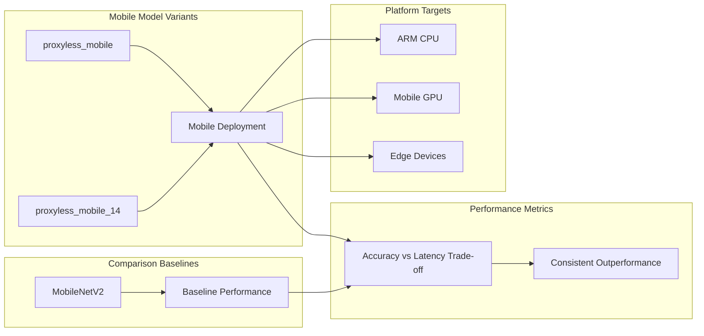
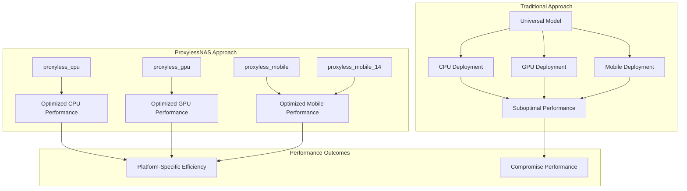
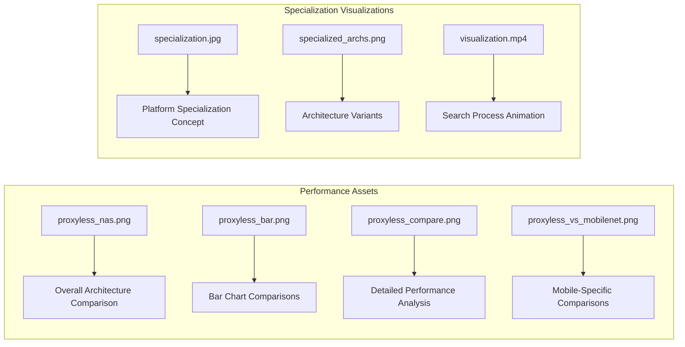

<!-- source: DeepWiki mcp.deepwiki.com · repo mit-han-lab/proxylessnas · page 2.2 Performance Comparisons · fetched 2026-10-30 -->

# Performance Comparisons

<details>
<summary>Relevant source files</summary>

The following files were used as context for generating this wiki page:

- [README.md](README.md)
- [assets/proxyless_compare.png](assets/proxyless_compare.png)
- [assets/proxyless_vs_mobilenet.png](assets/proxyless_vs_mobilenet.png)

</details>


This document presents comprehensive performance benchmarks and comparisons for ProxylessNAS models across different hardware platforms. It covers accuracy metrics, latency measurements, and direct comparisons with traditional neural network architectures and other Neural Architecture Search (NAS) methods.

The comparisons demonstrate ProxylessNAS's key advantage: hardware-specialized architectures that outperform general-purpose models on their target platforms. For information about the underlying search methodology that enables these performance gains, see [Neural Architecture Search Method](#2.1). For detailed model specifications, see [Available Models](#3.1).

## Performance Evaluation Framework

ProxylessNAS uses a standardized evaluation framework to ensure fair comparisons across different architectures and hardware platforms.

### Evaluation Pipeline Architecture



Sources: [README.md:93-97]()

## GPU Platform Performance

ProxylessNAS GPU models demonstrate significant improvements over traditional architectures when deployed on GPU hardware.

### GPU Performance Comparison Table

| Model | Top-1 Accuracy | Top-5 Accuracy | Latency |
|-------|---------------|---------------|---------|
| MobilenetV2 | 72.0% | 91.0% | 6.1ms |
| ShufflenetV2(1.5) | 72.6% | - | 7.3ms |
| ResNet-34 | 73.3% | 91.4% | 8.0ms |
| MNasNet(our impl) | 74.0% | 91.8% | 6.1ms |
| **ProxylessNAS (GPU)** | **75.1%** | **92.5%** | **5.1ms** |

The `proxyless_gpu` model achieves 75.1% Top-1 accuracy while being 20% faster than MobileNetV2, representing a 3.1% accuracy improvement with superior latency performance.

Sources: [README.md:50-56]()

## Mobile Platform Performance

Mobile-optimized ProxylessNAS models consistently outperform MobileNetV2 across various latency constraints, demonstrating the effectiveness of hardware-specialized architecture search.

### Mobile Performance Analysis



The mobile performance comparison shows ProxylessNAS models maintaining superior accuracy-latency trade-offs across different mobile deployment scenarios.

Sources: [README.md:46](), [README.md:61-62]()

## Cross-Platform Specialization Benefits

ProxylessNAS's core innovation lies in platform-specific optimization rather than deploying universal models across all hardware.

### Hardware Specialization Architecture



This specialization approach enables each model variant to fully exploit the computational characteristics of its target hardware platform.

Sources: [README.md:67-72]()

## Competition Performance and Recognition

ProxylessNAS has achieved notable recognition in academic and industry competitions, validating its practical effectiveness.

### Competition Results

| Competition | Track | Ranking | Year |
|-------------|-------|---------|------|
| Visual Wake Words Challenge | TF-lite track | **1st Place** | CVPR 2019 |
| Low Power Image Recognition Challenge (LPIRC) | Classification track | **3rd Place** | CVPR 2019 |

These competition results demonstrate ProxylessNAS's effectiveness in real-world deployment scenarios with strict efficiency constraints.

Sources: [README.md:18-19]()

## Model Loading and Evaluation Interface

The performance comparisons can be reproduced using the standardized evaluation interface provided in the repository.

### PyTorch Hub Integration

```python
# Load models for performance evaluation
target_platform = "proxyless_cpu"  # proxyless_gpu, proxyless_mobile, proxyless_mobile14
model = torch.hub.load('mit-han-lab/ProxylessNAS', target_platform, pretrained=True)
```

### Direct Import Interface

```python
# PyTorch models
from proxyless_nas import proxyless_cpu, proxyless_gpu, proxyless_mobile, proxyless_mobile_14, proxyless_cifar
net = proxyless_cpu(pretrained=True)

# TensorFlow models  
from proxyless_nas_tensorflow import proxyless_cpu, proxyless_gpu, proxyless_mobile, proxyless_mobile_14
tf_net = proxyless_cpu(pretrained=True)
```

### Evaluation Commands

```bash
# PyTorch ImageNet evaluation
python eval.py --path 'Your path to imagenet' --arch proxyless_cpu

# PyTorch CIFAR-10 evaluation  
python eval.py -d cifar10

# TensorFlow evaluation
python eval_tf.py --path 'Your path to imagenet' --arch proxyless_cpu
```

Sources: [README.md:27-28](), [README.md:78-97]()

## Performance Visualization Assets

The repository includes comprehensive performance visualization assets that illustrate the comparative advantages of ProxylessNAS across different deployment scenarios.

### Available Performance Visualizations



These assets provide visual evidence of ProxylessNAS's performance advantages and demonstrate the architectural differences discovered through hardware-aware neural architecture search.

Sources: [README.md:32](), [README.md:35](), [README.md:38](), [README.md:46](), [README.md:71-74]()

---

