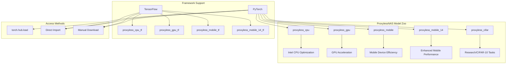
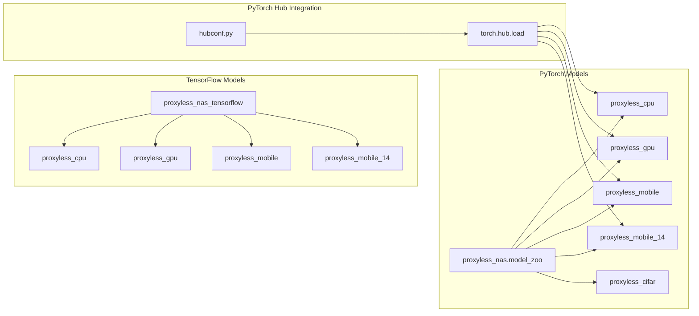
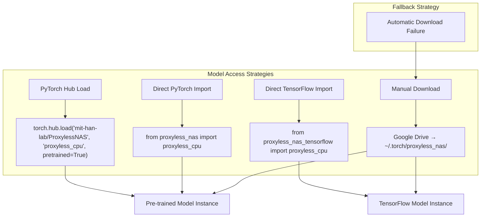

<!-- source: DeepWiki mcp.deepwiki.com · repo mit-han-lab/proxylessnas · page 3 Model Zoo · fetched 2026-10-30 -->

# Model Zoo

Relevant source files

The following files were used as context for generating this wiki page:

- [README.md](README.md)
- [hubconf.py](hubconf.py)

This document provides an overview of the pre-trained neural network models available in the ProxylessNAS repository. The Model Zoo contains hardware-specialized architectures optimized for different deployment platforms including CPU, GPU, and mobile devices. Each model variant is designed to maximize efficiency on its target hardware while maintaining high accuracy.

For detailed specifications of individual models, see [Available Models](#3.1). For information on loading models through PyTorch Hub, see [PyTorch Hub Integration](#3.2). For direct model imports, see [Direct Model Usage](#3.3).

## Hardware Specialization Architecture

ProxylessNAS implements a unique approach where different neural architectures are optimized for specific hardware platforms rather than using a single universal model. This specialization enables each model to fully exploit the computational characteristics of its target hardware.

**Model Zoo Architecture Overview**

**Sources:** [README.md:27-28](), [README.md:78-87](), [hubconf.py:4]()

## Available Model Variants

The Model Zoo provides five distinct architecture variants, each optimized for specific hardware platforms and use cases:

| Model Variant | Target Platform | Primary Use Case | Framework Support |
|---------------|----------------|------------------|-------------------|
| `proxyless_cpu` | Intel CPU | Server/desktop inference | PyTorch, TensorFlow |
| `proxyless_gpu` | GPU platforms | High-performance computing | PyTorch, TensorFlow |
| `proxyless_mobile` | Mobile devices | Mobile app deployment | PyTorch, TensorFlow |
| `proxyless_mobile_14` | Enhanced mobile | Optimized mobile performance | PyTorch, TensorFlow |
| `proxyless_cifar` | Research/CIFAR | Academic research tasks | PyTorch only |

**Model Import Structure**

**Sources:** [README.md:78-87](), [hubconf.py:4](), [README.md:104-105]()

## Performance Characteristics

The Model Zoo demonstrates superior performance compared to traditional mobile-optimized architectures. Key performance advantages include improved accuracy-latency trade-offs and hardware-specific optimizations.

### GPU Performance Comparison

| Model | Top-1 Accuracy | Top-5 Accuracy | Latency |
|-------|----------------|----------------|---------|
| MobileNetV2 | 72.0% | 91.0% | 6.1ms |
| ShuffleNetV2(1.5) | 72.6% | - | 7.3ms |
| ResNet-34 | 73.3% | 91.4% | 8.0ms |
| MNasNet | 74.0% | 91.8% | 6.1ms |
| **ProxylessNAS (GPU)** | **75.1%** | **92.5%** | **5.1ms** |

### Key Performance Benefits

- **ProxylessNAS (GPU)**: 3.1% better accuracy than MobileNetV2 with 20% faster inference
- **ProxylessNAS (Mobile)**: Consistently outperforms MobileNetV2 under various latency constraints
- **Hardware Specialization**: Each variant achieves optimal performance for its target platform

**Sources:** [README.md:50-56](), [README.md:61-62]()

## Model Access Methods

The Model Zoo provides multiple access methods to accommodate different development workflows and deployment scenarios:

**Access Methods Overview**

### Access Method Summary

1. **PyTorch Hub Integration**: Simplified loading with automatic dependency management
2. **Direct Import**: Traditional Python imports for PyTorch and TensorFlow variants
3. **Manual Download**: Fallback option for environments with restricted internet access

**Sources:** [README.md:24-29](), [README.md:78-87](), [README.md:89]()

## Model Storage and Distribution

All pre-trained models are distributed through multiple channels to ensure accessibility:

- **Automatic Download**: Models are downloaded automatically on first use
- **PyTorch Hub**: Integration provides streamlined access through the PyTorch ecosystem
- **Manual Distribution**: Google Drive backup for manual download scenarios
- **Framework Support**: Both PyTorch and TensorFlow implementations are maintained

The models are stored in the user's home directory under `$HOME/.torch/proxyless_nas/` for PyTorch variants, following standard PyTorch model caching conventions.

**Sources:** [README.md:89](), [README.md:15]()

---

