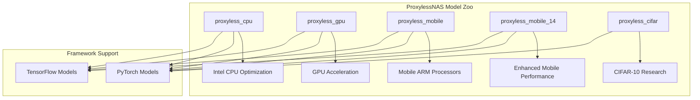
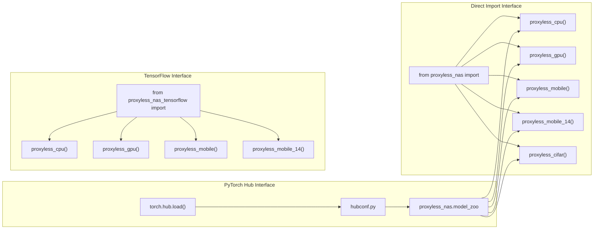
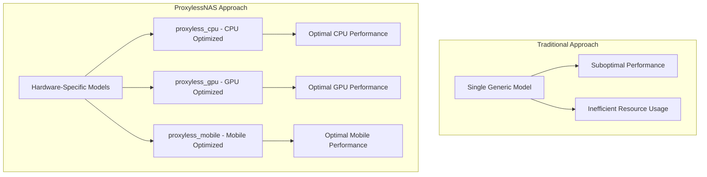

<!-- source: DeepWiki mcp.deepwiki.com · repo mit-han-lab/proxylessnas · page 3.1 Available Models · fetched 2026-10-30 -->

# Available Models

Relevant source files

The following files were used as context for generating this wiki page:

- [README.md](README.md)
- [hubconf.py](hubconf.py)

This page provides a comprehensive listing of all pre-trained ProxylessNAS model variants, their target hardware platforms, and performance specifications. Each model variant is optimized for specific hardware constraints and deployment scenarios.

For information about loading these models through PyTorch Hub, see [PyTorch Hub Integration](#3.2). For direct model imports without PyTorch Hub, see [Direct Model Usage](#3.3).

## Model Variants Overview

ProxylessNAS provides five main model variants, each specialized for different hardware platforms and use cases. The following diagram shows the relationship between model variants and their target deployment scenarios:

**Model Variant Architecture**

Sources: [README.md:27-29](), [README.md:80-87](), [hubconf.py:4]()

## Hardware-Specific Model Specifications

Each model variant targets specific hardware platforms with optimized architectures and performance characteristics:

| Model Variant | Target Hardware | Dataset | Framework Support | Use Case |
|---------------|----------------|---------|-------------------|----------|
| `proxyless_cpu` | Intel CPU | ImageNet | PyTorch, TensorFlow | Server/Desktop CPU inference |
| `proxyless_gpu` | GPU Platforms | ImageNet | PyTorch, TensorFlow | GPU-accelerated inference |
| `proxyless_mobile` | ARM Mobile CPUs | ImageNet | PyTorch, TensorFlow | Mobile device deployment |
| `proxyless_mobile_14` | ARM Mobile CPUs | ImageNet | PyTorch, TensorFlow | Enhanced mobile performance |
| `proxyless_cifar` | Any Platform | CIFAR-10 | PyTorch only | Research/benchmarking |

Sources: [README.md:27-29](), [README.md:80-87]()

## Performance Benchmarks

The following performance metrics demonstrate the hardware-specific optimizations achieved by each model variant:

### GPU Model Performance
Based on GPU benchmarking results, `proxyless_gpu` achieves superior performance compared to standard architectures:

| Model | Top-1 Accuracy | Top-5 Accuracy | Latency |
|-------|----------------|----------------|---------|
| MobilenetV2 | 72.0% | 91.0% | 6.1ms |
| ShufflenetV2(1.5) | 72.6% | - | 7.3ms |
| ResNet-34 | 73.3% | 91.4% | 8.0ms |
| MNasNet | 74.0% | 91.8% | 6.1ms |
| **ProxylessNAS (GPU)** | **75.1%** | **92.5%** | **5.1ms** |

### Mobile Model Advantages
The mobile variants (`proxyless_mobile` and `proxyless_mobile_14`) consistently outperform MobileNetV2 across various latency constraints, demonstrating the effectiveness of hardware-specific architecture search.

Sources: [README.md:50-56](), [README.md:61-62]()

## Code Entity Mapping

The following diagram maps the natural language model names to their corresponding code entities and file locations:

**Code Structure for Model Access**

Sources: [hubconf.py:3-4](), [README.md:78-87]()

## Framework Availability

### PyTorch Models
All five model variants are available for PyTorch:
- Located in the `proxyless_nas` module
- Accessible through direct import: `from proxyless_nas import proxyless_cpu, proxyless_gpu, proxyless_mobile, proxyless_mobile_14, proxyless_cifar`
- Available through PyTorch Hub: `torch.hub.load('mit-han-lab/ProxylessNAS', target_platform, pretrained=True)`

### TensorFlow Models
Four model variants are available for TensorFlow (excluding CIFAR variant):
- Located in the `proxyless_nas_tensorflow` module  
- Accessible through direct import: `from proxyless_nas_tensorflow import proxyless_cpu, proxyless_gpu, proxyless_mobile, proxyless_mobile_14`

Sources: [README.md:78-87](), [hubconf.py:1-4]()

## Model Storage and Distribution

Pre-trained model weights are distributed through multiple channels:

1. **Automatic Download**: Models download automatically when loaded with `pretrained=True`
2. **Manual Download**: Available from Google Drive for manual installation
3. **Storage Location**: Models are cached in `$HOME/.torch/proxyless_nas/` directory

If automatic download fails, models can be manually downloaded and placed in the appropriate cache directory for offline access.

Sources: [README.md:89]()

## Specialization Architecture Benefits

The hardware-specific approach provides significant advantages over traditional one-size-fits-all deployment:

**Hardware Specialization Concept**

This specialization enables each model variant to fully exploit the efficiency characteristics of its target hardware platform, resulting in better accuracy-latency trade-offs compared to generic architectures.

Sources: [README.md:67-72]()

---

