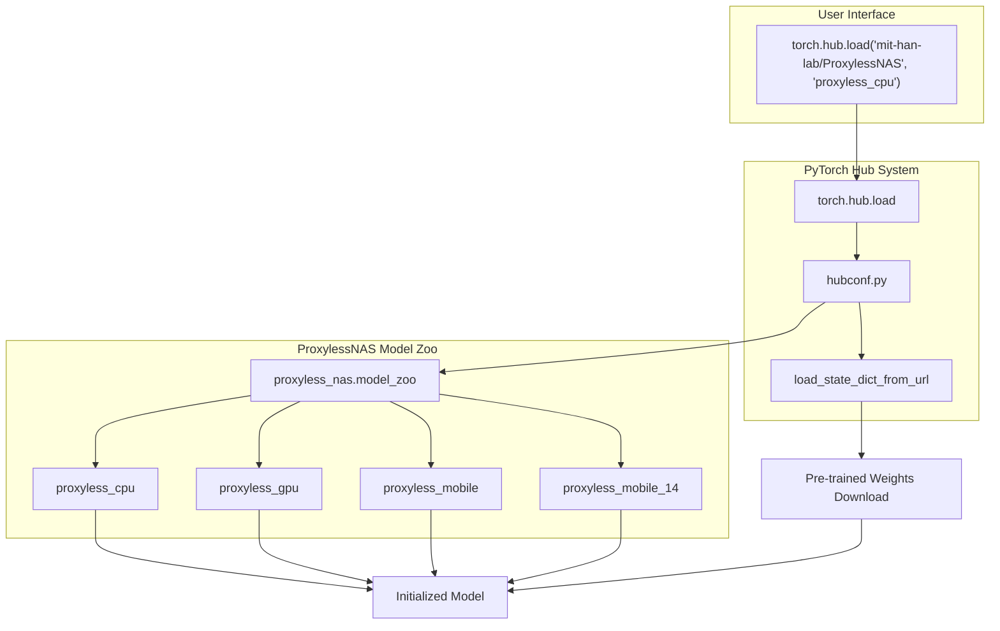
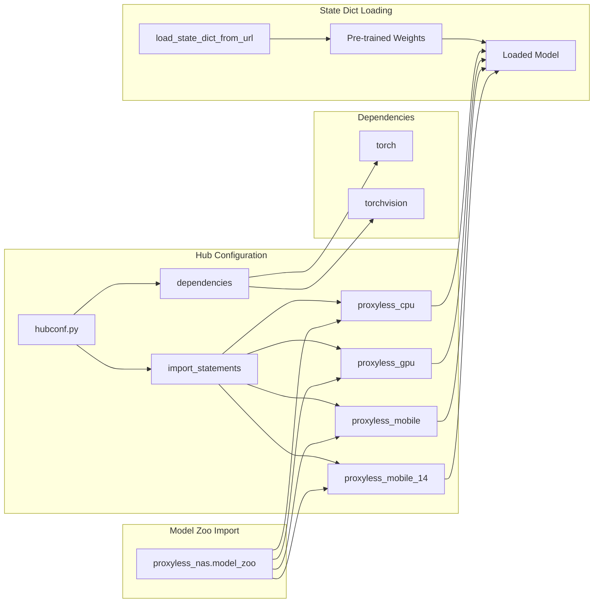
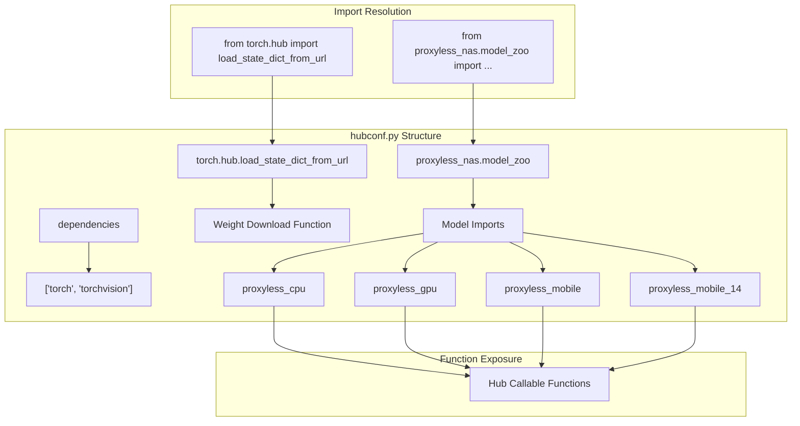

<!-- source: DeepWiki mcp.deepwiki.com · repo mit-han-lab/proxylessnas · page 3.2 PyTorch Hub Integration · fetched 2026-10-30 -->

# PyTorch Hub Integration

<details>
<summary>Relevant source files</summary>

The following files were used as context for generating this wiki page:

- [README.md](README.md)
- [hubconf.py](hubconf.py)

</details>


This document covers how ProxylessNAS models are accessed through PyTorch Hub, the standard model repository for PyTorch. PyTorch Hub provides a convenient way to load pre-trained models with minimal setup and dependency management. For information about loading models directly without PyTorch Hub, see [Direct Model Usage](#3.3). For detailed specifications of available models, see [Available Models](#3.1).

## Purpose and Integration Overview

PyTorch Hub integration allows users to load ProxylessNAS models with a single function call, automatically handling model downloads, dependencies, and initialization. The integration is implemented through the `hubconf.py` file which serves as the entry point for PyTorch Hub's model loading system.

**PyTorch Hub Integration Architecture**



Sources: [hubconf.py:1-5](), [README.md:24-29]()

## Available Models Through Hub

The PyTorch Hub integration exposes four main model variants, each optimized for different hardware platforms:

| Model Name | Target Platform | Hub Identifier |
|------------|----------------|----------------|
| ProxylessNAS-CPU | Intel CPU | `proxyless_cpu` |
| ProxylessNAS-GPU | NVIDIA GPU | `proxyless_gpu` |
| ProxylessNAS-Mobile | Mobile devices | `proxyless_mobile` |
| ProxylessNAS-Mobile14 | Mobile devices (alternative) | `proxyless_mobile_14` |

**Model Loading Flow**



Sources: [hubconf.py:1-5]()

## Usage Examples

### Basic Model Loading

The simplest way to load a ProxylessNAS model is through PyTorch Hub:

```python
import torch

# Load CPU-optimized model
model = torch.hub.load('mit-han-lab/ProxylessNAS', 'proxyless_cpu', pretrained=True)

# Load GPU-optimized model
model = torch.hub.load('mit-han-lab/ProxylessNAS', 'proxyless_gpu', pretrained=True)

# Load mobile-optimized model
model = torch.hub.load('mit-han-lab/ProxylessNAS', 'proxyless_mobile', pretrained=True)
```

### Platform Selection Pattern

The recommended pattern for platform selection:

```python
target_platform = "proxyless_cpu"  # or proxyless_gpu, proxyless_mobile, proxyless_mobile_14
model = torch.hub.load('mit-han-lab/ProxylessNAS', target_platform, pretrained=True)
```

Sources: [README.md:26-29]()

## Technical Implementation

### Hub Configuration File

The `hubconf.py` file defines the PyTorch Hub entry points and dependencies:

**Hub Configuration Structure**



Sources: [hubconf.py:1-5]()

### Dependencies Management

PyTorch Hub automatically manages the following dependencies when loading ProxylessNAS models:

- **torch**: Core PyTorch framework
- **torchvision**: Computer vision utilities and transforms

The dependencies are declared in the `dependencies` list at the top of `hubconf.py`, ensuring they are available when models are loaded.

### Weight Loading Mechanism

The integration uses `torch.hub.load_state_dict_from_url` to download pre-trained weights automatically. This function:

1. Downloads model weights from remote URLs
2. Caches weights locally to avoid repeated downloads
3. Loads weights into the model architecture
4. Returns the initialized model

Sources: [hubconf.py:3]()

## Integration Benefits

### Simplified Access

PyTorch Hub integration provides several advantages over direct model imports:

| Aspect | PyTorch Hub | Direct Import |
|--------|-------------|---------------|
| Setup Complexity | Single function call | Manual dependency management |
| Weight Download | Automatic | Manual download required |
| Version Management | Hub-managed | User-managed |
| Documentation | Integrated with PyTorch Hub | Separate documentation |

### Ecosystem Integration

The PyTorch Hub integration positions ProxylessNAS within the broader PyTorch ecosystem, making it discoverable through:

- PyTorch Hub web interface
- `torch.hub.list()` function
- PyTorch documentation and tutorials
- Third-party model repositories

Sources: [README.md:15](), [README.md:24-29]()

## Troubleshooting

### Manual Download Fallback

If automatic download through PyTorch Hub fails, models can be downloaded manually from Google Drive and placed in the local cache directory `$HOME/.torch/proxyless_nas/`.

### Common Issues

1. **Network connectivity**: Hub requires internet access for initial model download
2. **Cache location**: Models are cached in the user's home directory under `.torch/`
3. **Version compatibility**: Ensure PyTorch version compatibility with model requirements

Sources: [README.md:89]()

---

