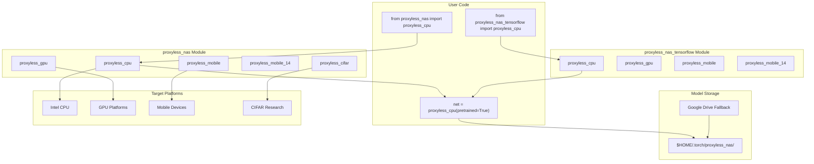
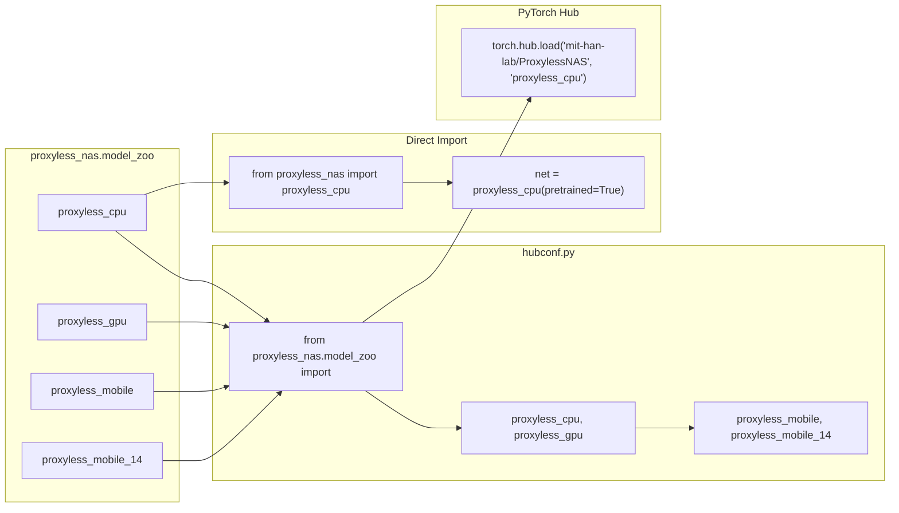

<!-- source: DeepWiki mcp.deepwiki.com · repo mit-han-lab/proxylessnas · page 3.3 Direct Model Usage · fetched 2026-10-30 -->

# Direct Model Usage

<details>
<summary>Relevant source files</summary>

The following files were used as context for generating this wiki page:

- [README.md](README.md)
- [hubconf.py](hubconf.py)

</details>


This page explains how to import and use ProxylessNAS models directly from the `proxyless_nas` and `proxyless_nas_tensorflow` modules without using PyTorch Hub. This approach provides direct access to model constructors and is useful when you need more control over the import process or when PyTorch Hub is not available.

For information about using models through PyTorch Hub, see [PyTorch Hub Integration](#3.2).

## PyTorch Direct Import

ProxylessNAS provides direct import functionality through the `proxyless_nas` module. You can import specific model variants and instantiate them with pre-trained weights.

### Available PyTorch Models

The following model constructors are available for direct import:

| Model Function | Target Platform | Description |
|----------------|-----------------|-------------|
| `proxyless_cpu` | Intel CPU | Optimized for CPU inference |
| `proxyless_gpu` | GPU | Optimized for GPU inference |
| `proxyless_mobile` | Mobile devices | Optimized for mobile deployment |
| `proxyless_mobile_14` | Mobile devices | Enhanced mobile variant |
| `proxyless_cifar` | Research/CIFAR | Specialized for CIFAR datasets |

### Direct Import Syntax

```python
from proxyless_nas import proxyless_cpu, proxyless_gpu, proxyless_mobile, proxyless_mobile_14, proxyless_cifar
net = proxyless_cpu(pretrained=True)
```

This approach directly imports the model constructor functions from the `proxyless_nas` module and instantiates models with pre-trained weights.

**Sources:** [README.md:80-82]()

## TensorFlow Direct Import

ProxylessNAS also supports TensorFlow through the `proxyless_nas_tensorflow` module, providing similar direct import functionality.

### Available TensorFlow Models

The TensorFlow module provides four model variants:

| Model Function | Target Platform | Description |
|----------------|-----------------|-------------|
| `proxyless_cpu` | Intel CPU | TensorFlow CPU-optimized variant |
| `proxyless_gpu` | GPU | TensorFlow GPU-optimized variant |
| `proxyless_mobile` | Mobile devices | TensorFlow mobile-optimized variant |
| `proxyless_mobile_14` | Mobile devices | TensorFlow enhanced mobile variant |

### Direct Import Syntax

```python
from proxyless_nas_tensorflow import proxyless_cpu, proxyless_gpu, proxyless_mobile, proxyless_mobile_14
tf_net = proxyless_cpu(pretrained=True)
```

Note that `proxyless_cifar` is only available in the PyTorch variant.

**Sources:** [README.md:84-87]()

## Model Download and Fallback Mechanism

### Automatic Download

When using the `pretrained=True` parameter, models are automatically downloaded from remote storage and cached locally in the `$HOME/.torch/proxyless_nas/` directory.

### Manual Download Fallback

If automatic download fails, you can manually download pre-trained models from Google Drive and place them in the appropriate directory:

1. Download models from the provided Google Drive link
2. Place them in `$HOME/.torch/proxyless_nas/`
3. Import and use models normally

**Sources:** [README.md:89]()

## Direct Import Architecture

The following diagram shows the direct import structure for both PyTorch and TensorFlow:

### PyTorch and TensorFlow Import Structure



**Sources:** [README.md:80-87](), [hubconf.py:4]()

### Model Zoo Integration



**Sources:** [hubconf.py:4](), [README.md:26-29]()

## Comparison with PyTorch Hub Method

| Aspect | Direct Import | PyTorch Hub |
|--------|---------------|-------------|
| Import syntax | `from proxyless_nas import proxyless_cpu` | `torch.hub.load('mit-han-lab/ProxylessNAS', 'proxyless_cpu')` |
| Dependencies | Requires local installation | Built into PyTorch |
| Control | Direct access to module | Managed by Hub |
| Availability | All variants including CIFAR | Standard variants only |
| Caching | `$HOME/.torch/proxyless_nas/` | PyTorch Hub cache |

The direct import method provides more control and access to all model variants, while PyTorch Hub offers simplified access for standard use cases.

**Sources:** [README.md:26-29](), [README.md:80-87](), [hubconf.py:4]()

---

