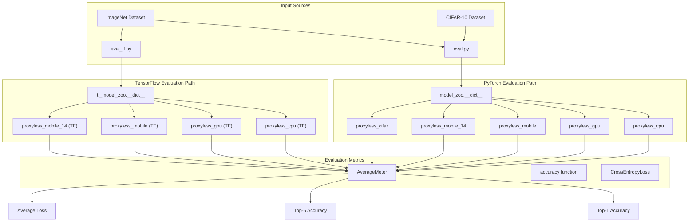
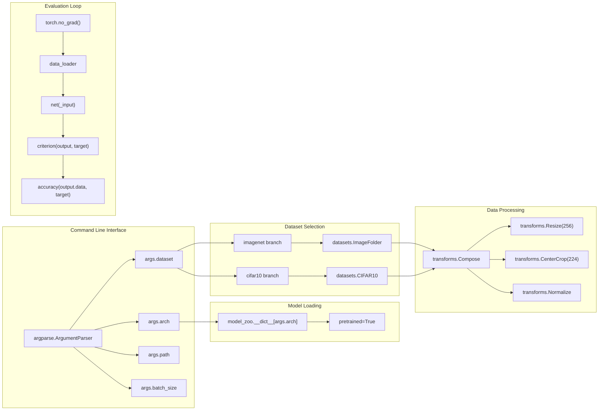
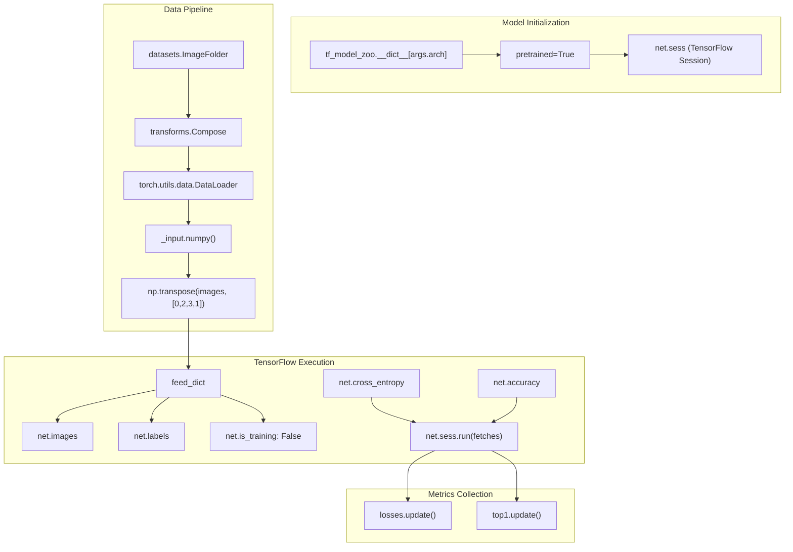
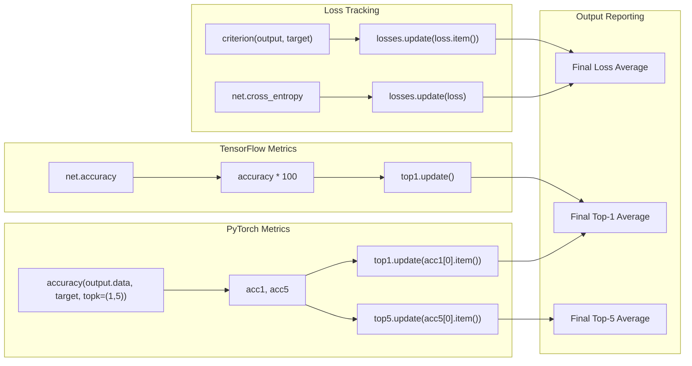

<!-- source: DeepWiki mcp.deepwiki.com · repo mit-han-lab/proxylessnas · page 4 Evaluation Framework · fetched 2026-10-30 -->

# Evaluation Framework

<details>
<summary>Relevant source files</summary>

The following files were used as context for generating this wiki page:

- [README.md](README.md)
- [eval.py](eval.py)
- [eval_tf.py](eval_tf.py)

</details>


The Evaluation Framework provides a standardized system for testing the performance of ProxylessNAS pre-trained models on common computer vision datasets. This framework supports both PyTorch and TensorFlow implementations, enabling researchers and practitioners to validate model accuracy on ImageNet and CIFAR-10 datasets.

For information about the available pre-trained models themselves, see [Model Zoo](#3). For documented performance results from training logs, see [Performance Results](#4.3).

## System Overview

The evaluation framework consists of two main evaluation scripts that provide standardized testing procedures for different deep learning frameworks. Both scripts implement similar evaluation workflows but are optimized for their respective framework ecosystems.

**Evaluation Framework Architecture**


Sources: [eval.py:15-19](), [eval_tf.py:13-15](), [README.md:93-97]()

## PyTorch Evaluation System

The PyTorch evaluation system is implemented in `eval.py` and provides comprehensive model testing capabilities for both ImageNet and CIFAR-10 datasets.

**PyTorch Evaluation Pipeline**


Sources: [eval.py:21-63](), [eval.py:72-76](), [eval.py:82-123](), [eval.py:137-160]()

### Model Architecture Selection

The evaluation script supports all available ProxylessNAS model variants through the `model_zoo` module. The architecture selection is controlled by the `--arch` parameter:

| Parameter Value | Model Variant | Target Platform |
|-----------------|---------------|-----------------|
| `proxyless_cpu` | CPU-optimized | Intel CPU |
| `proxyless_gpu` | GPU-optimized | NVIDIA GPU |
| `proxyless_mobile` | Mobile-optimized | ARM mobile devices |
| `proxyless_mobile_14` | Mobile v1.4 | ARM mobile devices |
| `proxyless_cifar` | CIFAR-optimized | Research/CIFAR-10 |

Sources: [eval.py:47-54](), [eval.py:72-75]()

### Dataset Configuration

The evaluation system automatically configures dataset-specific preprocessing based on the `--dataset` parameter:

**ImageNet Configuration:**
- Input resolution: 224×224 (center crop from 256×256 resize)
- Normalization: ImageNet standard (mean=[0.485, 0.456, 0.406], std=[0.229, 0.224, 0.225])
- Data path: `{args.path}/val` directory structure

**CIFAR-10 Configuration:**
- Input resolution: 32×32 (native CIFAR-10 size)
- Normalization: CIFAR-10 standard (mean=[125.3, 123.0, 113.9]/255, std=[63.0, 62.1, 66.7]/255)
- Automatic download: Enabled via `download=True`

Sources: [eval.py:81-107](), [eval.py:108-123]()

## TensorFlow Evaluation System

The TensorFlow evaluation system in `eval_tf.py` provides ImageNet validation for TensorFlow model variants using the TensorFlow session-based execution model.

**TensorFlow Evaluation Workflow**


Sources: [eval_tf.py:48](), [eval_tf.py:50-75](), [eval_tf.py:79-96]()

### TensorFlow-Specific Implementation Details

The TensorFlow evaluation differs from PyTorch in several key aspects:

1. **Data Format Conversion:** Images are transposed from PyTorch format `[N,C,H,W]` to TensorFlow format `[N,H,W,C]` using `np.transpose(images, axes=[0, 2, 3, 1])`

2. **Label Processing:** Labels are converted to one-hot encoding using `net.labels_to_one_hot(1000, target.numpy())`

3. **Session-Based Execution:** Model inference uses TensorFlow session execution with feed dictionaries containing `net.images`, `net.labels`, and `net.is_training`

4. **Limited Dataset Support:** Only supports ImageNet evaluation (no CIFAR-10 support)

Sources: [eval_tf.py:80-82](), [eval_tf.py:84-90]()

## Evaluation Metrics and Utilities

Both evaluation scripts utilize the `AverageMeter` utility class for tracking running averages of loss and accuracy metrics throughout the evaluation process.

**Metrics Calculation Pipeline**


Sources: [eval.py:148-151](), [eval_tf.py:92-96](), [proxyless_nas/utils.py (referenced)]()

### Usage Examples

The evaluation framework supports flexible configuration through command-line arguments:

**ImageNet Evaluation (PyTorch):**
```bash
python eval.py --path '/path/to/imagenet' --arch proxyless_cpu --batch-size 32 --gpu all
```

**CIFAR-10 Evaluation (PyTorch):**
```bash
python eval.py --dataset cifar10 --arch proxyless_cifar
```

**ImageNet Evaluation (TensorFlow):**
```bash
python eval_tf.py --path '/path/to/imagenet' --arch proxyless_mobile_14 --batch-size 64
```

Sources: [README.md:93-97](), [eval.py:21-63](), [eval_tf.py:17-46]()

---

