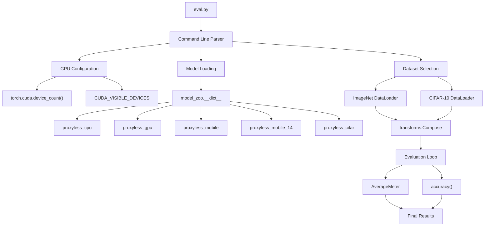
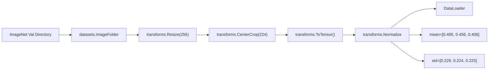
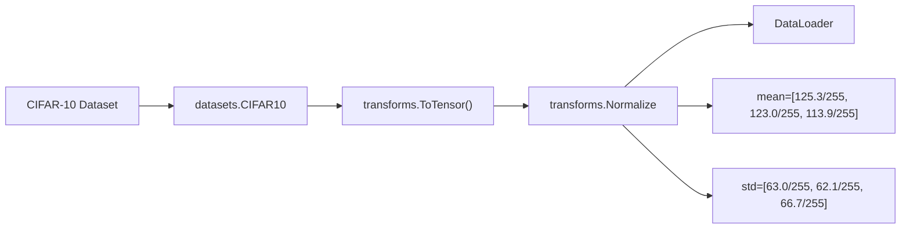
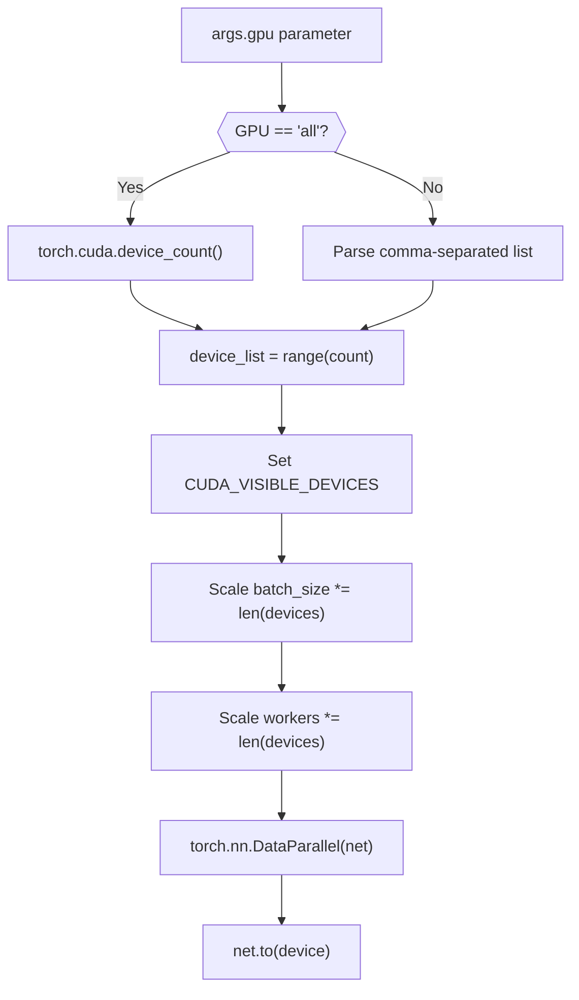
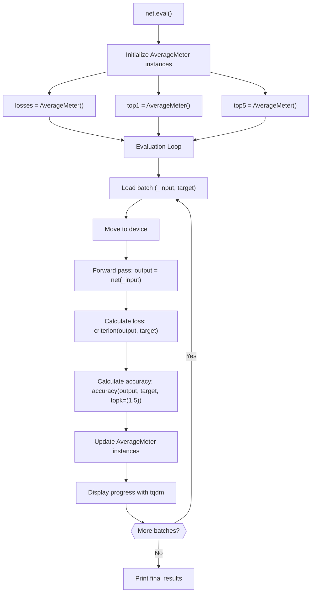

<!-- source: DeepWiki mcp.deepwiki.com · repo mit-han-lab/proxylessnas · page 4.1 PyTorch Evaluation · fetched 2026-10-30 -->

# PyTorch Evaluation

<details>
<summary>Relevant source files</summary>

The following files were used as context for generating this wiki page:

- [README.md](README.md)
- [eval.py](eval.py)

</details>


This document describes the PyTorch evaluation framework for ProxylessNAS models, specifically covering the `eval.py` script and its capabilities for evaluating pre-trained models on ImageNet and CIFAR-10 datasets.

The evaluation system provides a standardized way to test ProxylessNAS model performance on standard computer vision benchmarks. For TensorFlow evaluation capabilities, see [TensorFlow Evaluation](#4.2). For detailed performance results and benchmarks, see [Performance Results](#4.3).

## Overview

The PyTorch evaluation framework centers around the `eval.py` script, which provides a command-line interface for evaluating any ProxylessNAS model variant on either ImageNet or CIFAR-10 datasets. The system automatically handles model loading, data preprocessing, multi-GPU execution, and performance measurement.

**Evaluation System Architecture**



Sources: [eval.py:1-161]()

## Command Line Interface

The evaluation script accepts several command-line arguments that control the evaluation process:

| Argument | Short Form | Default | Description |
|----------|------------|---------|-------------|
| `--path` | `-p` | `/dataset/imagenet` | Path to ImageNet dataset directory |
| `--gpu` | `-g` | `all` | GPU devices to use (comma-separated or 'all') |
| `--batch-size` | `-b` | `32` | Batch size per device |
| `--workers` | `-j` | `4` | Number of data loader workers |
| `--arch` | `-a` | `proxyless_mobile_14` | Model architecture to evaluate |
| `--dataset` | `-d` | `imagenet` | Dataset choice: `imagenet` or `cifar10` |
| `--manual_seed` | - | `0` | Random seed for reproducibility |

**Available Model Architectures**

The `--arch` parameter accepts any model name from the `model_zoo` module. Available options are dynamically determined from the model zoo:

```python
model_names = sorted(name for name in model_zoo.__dict__
                     if name.islower() and not name.startswith("__")
                     and callable(model_zoo.__dict__[name]))
```

Sources: [eval.py:21-63](), [eval.py:17-19]()

## Dataset Support

The evaluation framework supports two datasets with different preprocessing pipelines:

**ImageNet Dataset Processing**



**CIFAR-10 Dataset Processing**



The ImageNet evaluation requires the dataset to be organized in the standard format with a `val/` subdirectory containing class folders. CIFAR-10 is automatically downloaded if not present.

Sources: [eval.py:81-107](), [eval.py:108-123]()

## Model Loading and GPU Configuration

The evaluation system dynamically loads models from the `model_zoo` and configures multi-GPU execution:

**GPU Device Configuration Flow**



**Model Selection Logic**

For ImageNet evaluation, the specified architecture is loaded directly:
```python
net = model_zoo.__dict__[args.arch](pretrained=True)
```

For CIFAR-10 evaluation, only the CIFAR-specific model is used regardless of the `--arch` parameter:
```python
net = model_zoo.__dict__['proxyless_cifar'](pretrained=True)
```

Sources: [eval.py:65-80](), [eval.py:72-75]()

## Evaluation Process

The evaluation loop implements standard computer vision evaluation practices with comprehensive metrics tracking:

**Evaluation Loop Architecture**



The evaluation uses `torch.no_grad()` context to disable gradient computation for efficiency. Progress is tracked using `tqdm` with real-time loss and accuracy updates.

Sources: [eval.py:131-160]()

## Metrics and Output

The evaluation framework tracks three key metrics:

- **Loss**: Cross-entropy loss using `nn.CrossEntropyLoss`
- **Top-1 Accuracy**: Percentage of samples where the highest predicted class matches the true label  
- **Top-5 Accuracy**: Percentage of samples where the true label is in the top 5 predictions

The `accuracy` function from `proxyless_nas.utils` calculates both Top-1 and Top-5 accuracies simultaneously. Results are continuously updated using `AverageMeter` instances that maintain running averages across all batches.

**Final output format:**
```
Loss: [average_loss] 	 Top1: [top1_accuracy] 	 Top5: [top5_accuracy]
```

Sources: [eval.py:13](), [eval.py:129](), [eval.py:148-151](), [eval.py:160]()

## Usage Examples

**Basic ImageNet Evaluation:**
```bash
python eval.py --path /path/to/imagenet --arch proxyless_cpu
```

**CIFAR-10 Evaluation:**
```bash
python eval.py -d cifar10
```

**Multi-GPU Evaluation with Custom Settings:**
```bash
python eval.py --path /dataset/imagenet --gpu 0,1,2,3 --batch-size 64 --arch proxyless_gpu
```

**Specific GPU Selection:**
```bash
python eval.py --gpu 0,2 --arch proxyless_mobile --workers 8
```

The evaluation script automatically handles model downloading if pre-trained weights are not already cached. Models are downloaded to `$HOME/.torch/proxyless_nas/` by default.

Sources: [README.md:93-97](), [README.md:89]()

---

