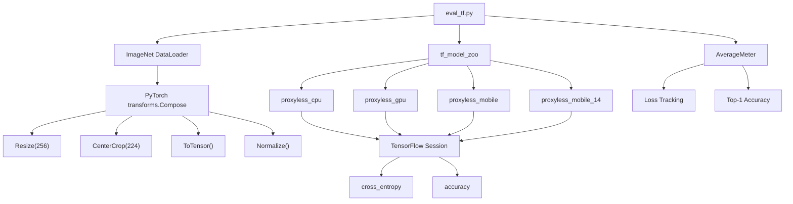
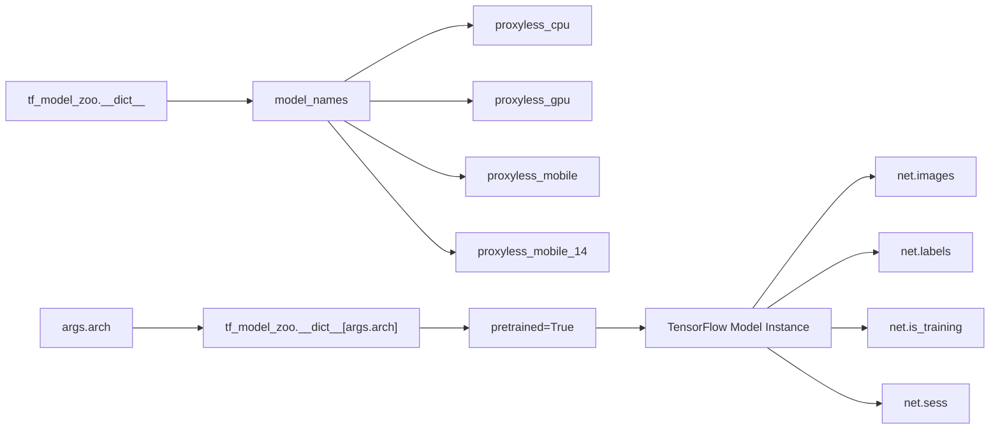
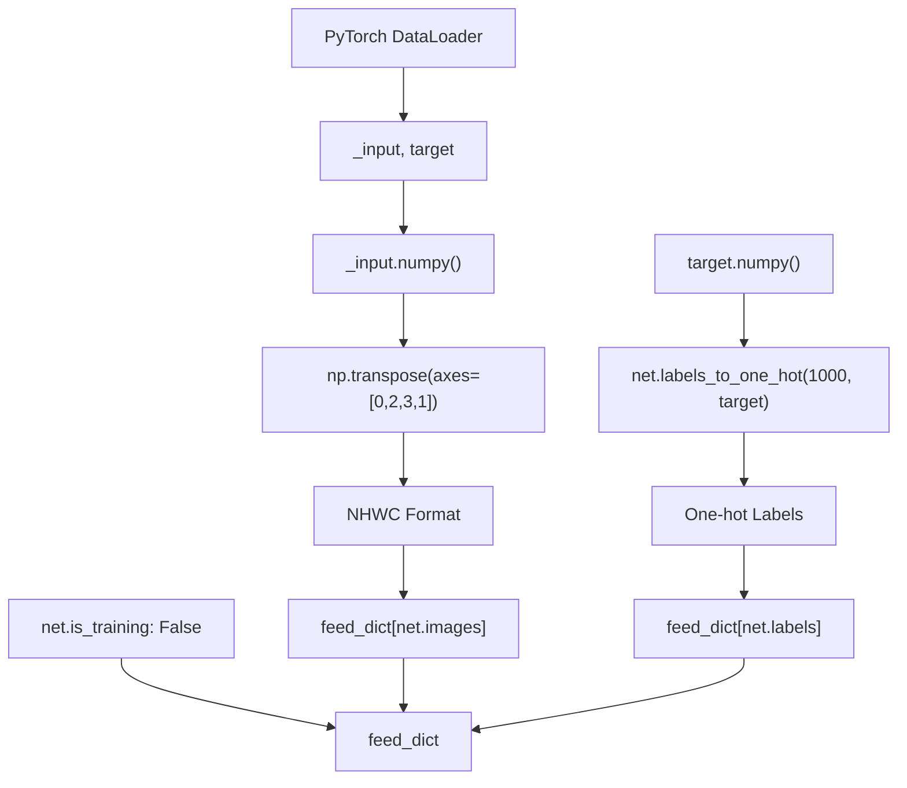
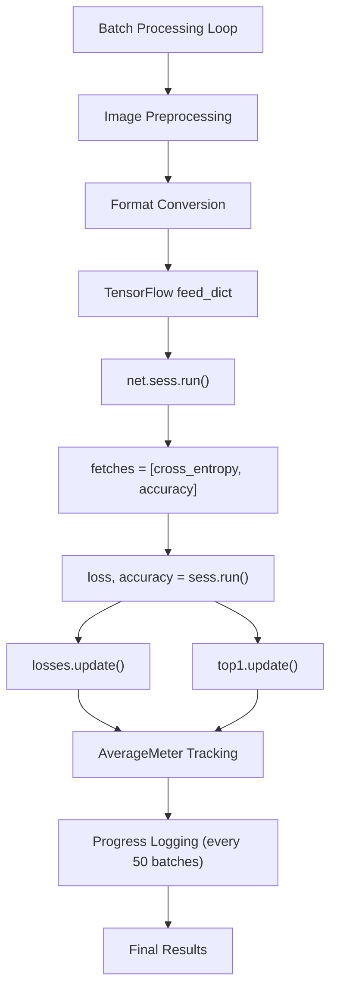

<!-- source: DeepWiki mcp.deepwiki.com · repo mit-han-lab/proxylessnas · page 4.2 TensorFlow Evaluation · fetched 2026-10-30 -->

# TensorFlow Evaluation

<details>
<summary>Relevant source files</summary>

The following files were used as context for generating this wiki page:

- [README.md](README.md)
- [eval_tf.py](eval_tf.py)

</details>


This document covers the TensorFlow evaluation system for ProxylessNAS models, specifically focusing on the `eval_tf.py` script that evaluates pre-trained TensorFlow models on the ImageNet validation dataset. This system provides a standardized way to benchmark TensorFlow-based ProxylessNAS architectures across different hardware configurations.

For PyTorch model evaluation, see [PyTorch Evaluation](#4.1). For comprehensive performance results across all models, see [Performance Results](#4.3).

## Purpose and Scope

The TensorFlow evaluation framework serves to validate the performance of ProxylessNAS models that have been converted to TensorFlow format. Unlike the PyTorch evaluation system, this framework specifically targets TensorFlow deployment scenarios and uses TensorFlow's session-based execution model for inference.

## System Architecture

The TensorFlow evaluation system employs a hybrid approach, combining PyTorch's efficient data loading capabilities with TensorFlow's model execution:



**TensorFlow Evaluation Pipeline Architecture**

Sources: [eval_tf.py:1-98]()

## Model Loading and Configuration

The evaluation system loads TensorFlow models through the `tf_model_zoo` interface, which provides access to all available ProxylessNAS architectures:



**Model Loading and TensorFlow Graph Structure**

The system dynamically selects models based on the architecture specification provided via command-line arguments. Each model provides a TensorFlow session (`net.sess`) and predefined input/output tensors for evaluation.

Sources: [eval_tf.py:11-48]()

## Data Preprocessing Pipeline

The evaluation system uses PyTorch's data loading infrastructure with ImageNet-standard preprocessing:

| Preprocessing Step | Configuration | Purpose |
|-------------------|---------------|----------|
| `Resize(256)` | Resize shorter edge to 256px | Standard ImageNet preprocessing |
| `CenterCrop(224)` | Crop to 224x224 pixels | Match training input size |
| `ToTensor()` | Convert PIL to tensor, scale [0,1] | Tensor format conversion |
| `Normalize()` | mean=[0.485,0.456,0.406], std=[0.229,0.224,0.225] | ImageNet normalization |

The preprocessing pipeline transforms PyTorch tensors to TensorFlow-compatible format through numpy array conversion and axis transposition:



**Data Format Conversion Pipeline**

Sources: [eval_tf.py:50-88]()

## Command-Line Interface

The evaluation script accepts the following parameters:

| Parameter | Short | Default | Description |
|-----------|-------|---------|-------------|
| `--path` | `-p` | `/ssd/dataset/imagenet` | Path to ImageNet dataset |
| `--batch-size` | `-b` | `64` | Batch size for validation |
| `--workers` | `-j` | `4` | Number of data loading workers |
| `--arch` | `-a` | `proxyless_mobile_14` | Model architecture to evaluate |
| `--manual_seed` | | `0` | Random seed for reproducibility |

The architecture parameter supports all models available in the `tf_model_zoo`, dynamically populated from the module's callable attributes.

Sources: [eval_tf.py:17-46]()

## Evaluation Process

The evaluation loop processes batches through the TensorFlow computation graph:



**TensorFlow Session Evaluation Flow**

The evaluation process uses TensorFlow's session-based execution model, running inference through predefined computation graphs. The `AverageMeter` utility tracks cumulative performance metrics across all batches.

Sources: [eval_tf.py:77-97]()

## Performance Metrics

The system tracks two primary metrics:

- **Cross-entropy Loss**: Computed via `net.cross_entropy` tensor
- **Top-1 Accuracy**: Computed via `net.accuracy` tensor, scaled to percentage

Progress is logged every 50 batches with current and average values for both metrics. Final results provide overall performance across the entire validation set.

## Usage Example

Basic evaluation command:
```bash
python eval_tf.py --path '/path/to/imagenet' --arch proxyless_cpu
```

The system automatically loads the specified pre-trained TensorFlow model and evaluates it on the ImageNet validation set, providing standardized performance metrics for comparison across different ProxylessNAS architectures.

Sources: [README.md:97](), [eval_tf.py:1-98]()

---

