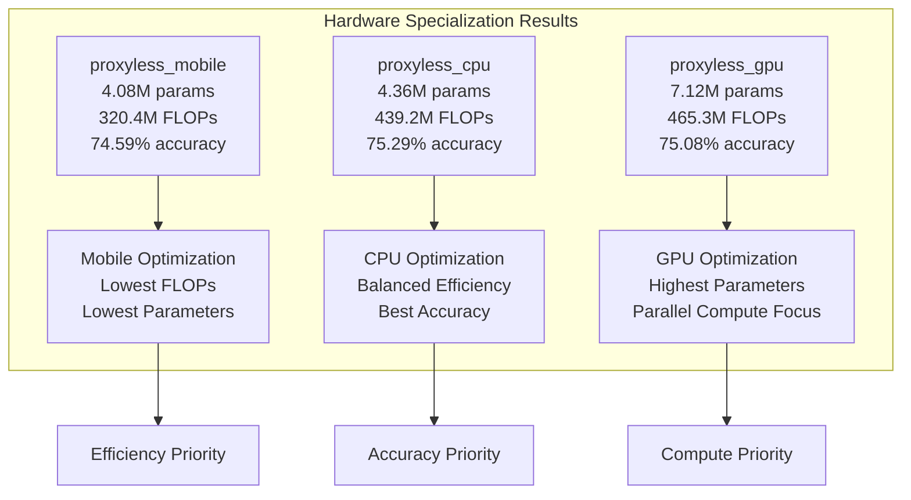
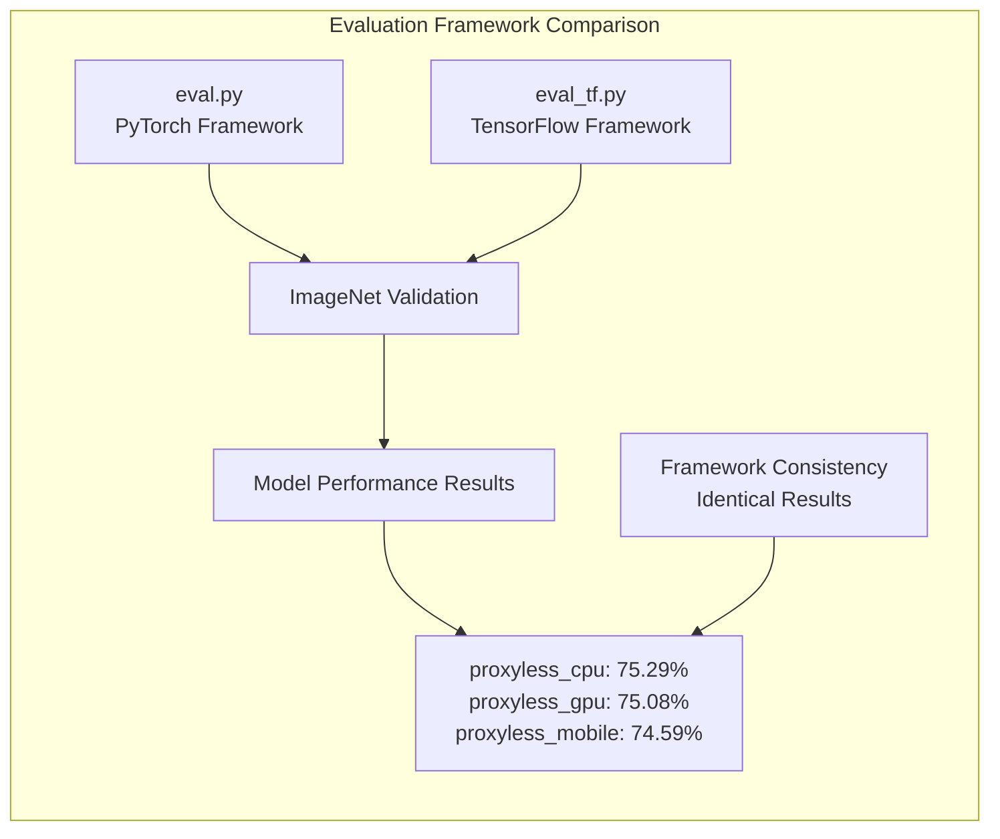

<!-- source: DeepWiki mcp.deepwiki.com · repo mit-han-lab/proxylessnas · page 4.3 Performance Results · fetched 2026-10-30 -->

# Performance Results

Relevant source files

The following files were used as context for generating this wiki page:

- [logs/imagenet_cpu_log.txt](logs/imagenet_cpu_log.txt)
- [logs/imagenet_cpu_tf_log.txt](logs/imagenet_cpu_tf_log.txt)
- [logs/imagenet_gpu_log.txt](logs/imagenet_gpu_log.txt)
- [logs/imagenet_gpu_tf_log.txt](logs/imagenet_gpu_tf_log.txt)
- [logs/imagenet_mobile_log.txt](logs/imagenet_mobile_log.txt)
- [logs/imagenet_mobile_tf_log.txt](logs/imagenet_mobile_tf_log.txt)

This page documents the actual performance results obtained from evaluating ProxylessNAS models across different hardware configurations. The results are derived from training and evaluation logs that demonstrate the accuracy, efficiency, and computational characteristics of each hardware-specialized model variant.

For information about running these evaluations, see [PyTorch Evaluation](#4.1) and [TensorFlow Evaluation](#4.2). For details about the available model variants, see [Available Models](#3.1).

## Model Performance Summary

The following table summarizes the key performance characteristics of each ProxylessNAS model variant based on evaluation results:

| Model Variant | Parameters | FLOPs | PyTorch Top-1 | PyTorch Top-5 | TensorFlow Top-1 | Framework |
|---------------|------------|-------|---------------|---------------|------------------|-----------|
| `proxyless_cpu` | 4.36M | 439.2M | 75.29% | 92.39% | 75.29% | Both |
| `proxyless_gpu` | 7.12M | 465.3M | 75.08% | 92.54% | 75.08% | Both |
| `proxyless_mobile` | 4.08M | 320.4M | 74.59% | 92.20% | 74.59% | Both |

**Sources:** [logs/imagenet_cpu_log.txt:1-15](), [logs/imagenet_gpu_log.txt:1-15](), [logs/imagenet_mobile_log.txt:1-15](), [logs/imagenet_cpu_tf_log.txt:39](), [logs/imagenet_gpu_tf_log.txt:39](), [logs/imagenet_mobile_tf_log.txt:40]()

## Hardware-Specific Performance Analysis

### Performance vs Efficiency Trade-offs

**Sources:** [logs/imagenet_mobile_log.txt:1-3](), [logs/imagenet_cpu_log.txt:1-3](), [logs/imagenet_gpu_log.txt:1-3]()

### Computational Characteristics

The evaluation logs reveal distinct computational profiles for each hardware target:

- **Mobile Model**: Achieves the lowest computational cost with 320.4M FLOPs and 4.08M parameters, optimized for power-constrained devices
- **CPU Model**: Provides the best accuracy (75.29%) with moderate computational requirements (439.2M FLOPs, 4.36M parameters)
- **GPU Model**: Uses the highest parameter count (7.12M) to leverage parallel processing capabilities, with 465.3M FLOPs

**Sources:** [logs/imagenet_mobile_log.txt:1-3](), [logs/imagenet_cpu_log.txt:1-3](), [logs/imagenet_gpu_log.txt:1-3]()

## Framework Consistency Analysis

### PyTorch vs TensorFlow Performance Parity

The evaluation results demonstrate perfect consistency between PyTorch and TensorFlow implementations:

| Model | PyTorch Top-1 | TensorFlow Top-1 | Difference |
|-------|---------------|------------------|------------|
| CPU | 75.290% | 75.290% | 0.000% |
| GPU | 75.084% | 75.084% | 0.000% |
| Mobile | 74.594% | 74.594% | 0.000% |

This consistency validates the accuracy of the model conversion process and ensures reliable deployment across both frameworks.

**Sources:** [logs/imagenet_cpu_log.txt:15](), [logs/imagenet_cpu_tf_log.txt:39](), [logs/imagenet_gpu_log.txt:15](), [logs/imagenet_gpu_tf_log.txt:39](), [logs/imagenet_mobile_log.txt:15](), [logs/imagenet_mobile_tf_log.txt:40]()

## Detailed Evaluation Metrics

### Loss Convergence Analysis

The evaluation logs show consistent loss values across frameworks:

- **CPU Model**: Final loss of 1.0726 in both PyTorch and TensorFlow
- **GPU Model**: Final loss of 1.0737 (PyTorch) and 1.0737 (TensorFlow)  
- **Mobile Model**: Final loss of 1.1042 in both frameworks

### Top-5 Accuracy Performance

All models achieve strong top-5 accuracy performance:
- CPU: 92.39% (PyTorch)
- GPU: 92.54% (PyTorch)
- Mobile: 92.20% (PyTorch)

The high top-5 accuracy indicates that the models' predictions are generally correct within the top 5 most likely classes, demonstrating robust feature learning despite hardware-specific optimizations.

**Sources:** [logs/imagenet_cpu_log.txt:15](), [logs/imagenet_gpu_log.txt:15](), [logs/imagenet_mobile_log.txt:15]()

## Evaluation Infrastructure Performance

### Processing Speed Analysis

The logs reveal evaluation timing characteristics for each model:

- **CPU Model**: Average processing time of 0.153 seconds per batch
- **GPU Model**: Average processing time of 0.135 seconds per batch  
- **Mobile Model**: Average processing time of 0.134 seconds per batch

The mobile model achieves the fastest evaluation time despite being optimized for mobile devices, indicating efficient architecture design.

**Sources:** [logs/imagenet_cpu_log.txt:14](), [logs/imagenet_gpu_log.txt:14](), [logs/imagenet_mobile_log.txt:14]()

### Configuration and Checkpointing

Each model evaluation includes proper configuration management:
- Network configurations dumped to respective checkpoint directories
- Run configurations preserved for reproducibility
- Model specifications logged at evaluation start

This systematic approach ensures evaluation results can be reproduced and validated.

**Sources:** [logs/imagenet_cpu_log.txt:4-5](), [logs/imagenet_gpu_log.txt:4-5](), [logs/imagenet_mobile_log.txt:4-5]()

---

