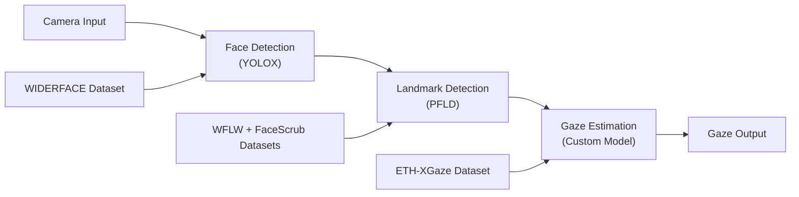
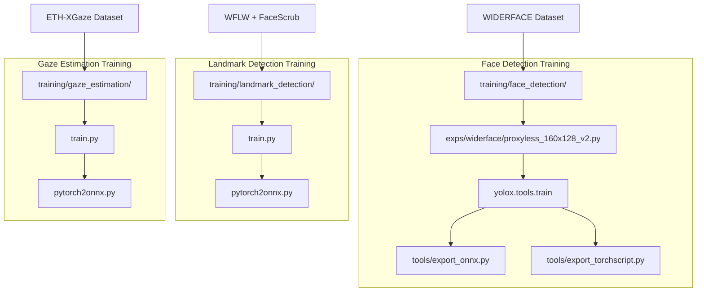
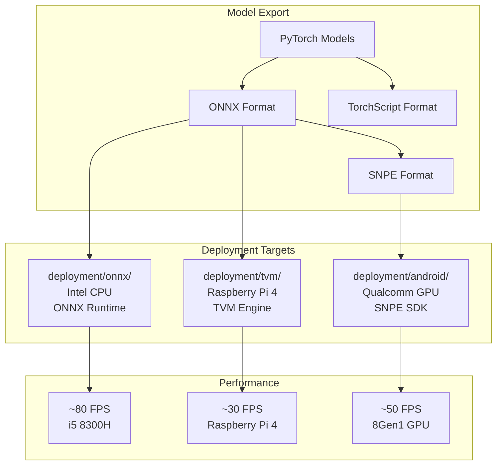
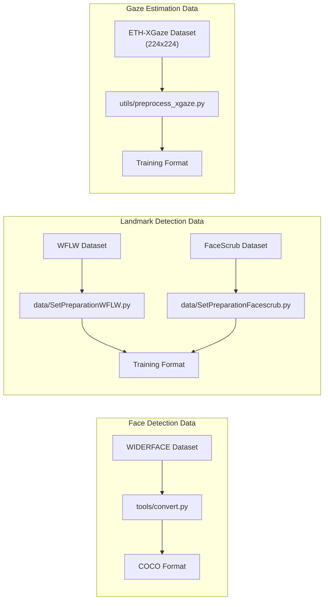

<!-- source: DeepWiki mcp.deepwiki.com · repo mit-han-lab/proxylessnas · page 5 ProxylessGaze Application · fetched 2026-10-30 -->

# ProxylessGaze Application

Relevant source files

The following files were used as context for generating this wiki page:

- [proxyless_gaze/README.md](proxyless_gaze/README.md)
- [proxyless_gaze/assets/android_demo.gif](proxyless_gaze/assets/android_demo.gif)
- [proxyless_gaze/assets/rpi4_demo.gif](proxyless_gaze/assets/rpi4_demo.gif)

## Purpose and Scope

This document covers the ProxylessGaze application, a practical demonstration of ProxylessNAS technology for real-time gaze estimation. ProxylessGaze implements a complete computer vision pipeline that runs efficiently on multiple hardware platforms including Intel CPU, ARM CPU, and Qualcomm GPU. For information about the core ProxylessNAS architecture search methodology, see [Core Architecture](#2). For details about other pre-trained models in the model zoo, see [Model Zoo](#3).

## System Overview

ProxylessGaze is a real-time gaze estimation system that demonstrates the practical application of ProxylessNAS-optimized models in a multi-stage computer vision pipeline. The system achieves high performance across different hardware platforms: approximately 80 FPS on Intel i5 8300H, 30 FPS on Raspberry Pi 4, and 50 FPS on Qualcomm 8Gen1.

The application consists of three main components working in sequence: face detection using YOLOX, facial landmark detection using PFLD, and gaze estimation using a custom model trained on ETH-XGaze dataset. Each component can be deployed using different optimization frameworks depending on the target hardware platform.

**Sources**: [proxyless_gaze/README.md:1-211]()

## Architecture Pipeline

### Three-Stage Processing Pipeline

**ProxylessGaze Processing Pipeline**

The pipeline processes camera input through three sequential stages, each using datasets optimized for their specific task. Face detection uses the `YOLOX` framework trained on `WIDERFACE` dataset, landmark detection employs `PFLD` trained on `WFLW` and `FaceScrub` datasets, and gaze estimation uses a custom model trained on `ETH-XGaze` dataset.

**Sources**: [proxyless_gaze/README.md:23-133]()

### Training Architecture

**Training Component Architecture**

Each training component has its own directory structure with dedicated training scripts and export utilities. The face detection component uses the `yolox.tools.train` module with configuration in `proxyless_160x128_v2.py`. Both landmark detection and gaze estimation use standalone `train.py` scripts with corresponding `pytorch2onnx.py` export utilities.

**Sources**: [proxyless_gaze/README.md:25-132]()

## Deployment Platforms

### Multi-Platform Deployment Architecture

**Deployment Platform Architecture**

The system supports three primary deployment paths, each optimized for different hardware platforms. The ONNX deployment path uses `deployment/onnx/main.py` for Intel CPU execution, TVM deployment uses `deployment/tvm/demo.py` for ARM processors, and Android deployment uses SNPE SDK for Qualcomm GPU acceleration.

**Sources**: [proxyless_gaze/README.md:134-186]()

### TVM Engine Build Process

| Component | Build Script | Engine Builder | Target Platform |
|-----------|-------------|----------------|-----------------|
| Face Detection | `build_engine/face_detection/convert.py` | `build_engine/face_detection/build_engine.py` | Raspberry Pi 4 |
| Landmark Detection | `build_engine/landmark_detection/convert.py` | `build_engine/landmark_detection/build_engine.py` | Raspberry Pi 4 |
| Gaze Estimation | `build_engine/gaze_estimation/convert.py` | `build_engine/gaze_estimation/build_engine.py` | Raspberry Pi 4 |

The TVM deployment process involves two steps: `convert.py` performs autotuning to find optimal configurations generating `log.json`, then `build_engine.py` builds the final TVM engine using the tuning results. The system supports RPI4 farm setups for accelerated tuning.

**Sources**: [proxyless_gaze/README.md:162-176]()

## Training Components

### Dataset Preparation Pipeline

**Dataset Preparation Architecture**

Each training component requires specific dataset preprocessing. Face detection converts WIDERFACE to COCO format using `tools/convert.py`, landmark detection processes WFLW and FaceScrub datasets using dedicated preparation scripts in the `data/` directory, and gaze estimation preprocesses ETH-XGaze 224x224 images using `utils/preprocess_xgaze.py`.

**Sources**: [proxyless_gaze/README.md:35-120]()

### Training Configuration

| Component | Training Command | Configuration File | Export Script |
|-----------|-----------------|-------------------|---------------|
| Face Detection | `python3 -m yolox.tools.train -f exps/widerface/proxyless_160x128_v2.py -d 2 -b 64` | `proxyless_160x128_v2.py` | `tools/export_onnx.py` |
| Landmark Detection | `python3 train.py` | Command-line arguments | `pytorch2onnx.py` |
| Gaze Estimation | `python3 train.py` | Command-line arguments | `pytorch2onnx.py` |

The face detection training uses the YOLOX framework with multi-GPU support (`-d 2`) and configurable batch size (`-b 64`). The configuration is specified in `exps/widerface/proxyless_160x128_v2.py`. Both landmark detection and gaze estimation use standalone training scripts with command-line configuration options.

**Sources**: [proxyless_gaze/README.md:47-131]()

## Deployment Implementation

### Runtime Dependencies

| Deployment Type | Requirements | Main Script | Key Dependencies |
|----------------|-------------|-------------|------------------|
| ONNX Runtime | `pip3 install -r requirements.txt` | `deployment/onnx/main.py` | ONNX Runtime |
| TVM | TVM installation | `deployment/tvm/demo.py` | Apache TVM |
| Android SNPE | SNPE SDK | Android App | Qualcomm SNPE SDK |

Each deployment option has specific runtime requirements and entry points. The ONNX deployment uses standard Python packages, TVM requires manual installation following official guidance, and Android deployment requires the Qualcomm SNPE SDK for GPU acceleration.

**Sources**: [proxyless_gaze/README.md:142-186]()

### Performance Characteristics

The system demonstrates hardware-specific optimization benefits of ProxylessNAS:

- **Intel CPU (ONNX Runtime)**: ~80 FPS on i5 8300H using `deployment/onnx/main.py`
- **ARM CPU (TVM)**: ~30 FPS on Raspberry Pi 4 using `deployment/tvm/demo.py`  
- **Qualcomm GPU (SNPE)**: ~50 FPS on 8Gen1 using Android app with SNPE SDK

These performance results demonstrate the effectiveness of hardware-specific model optimization, with each deployment path achieving real-time performance on its target platform.

**Sources**: [proxyless_gaze/README.md:3-4]()

---

