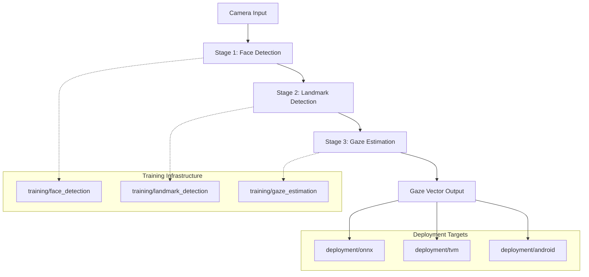
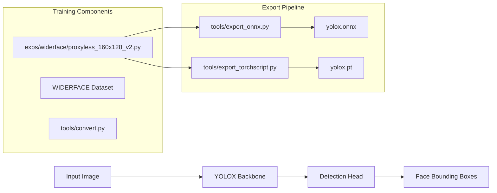
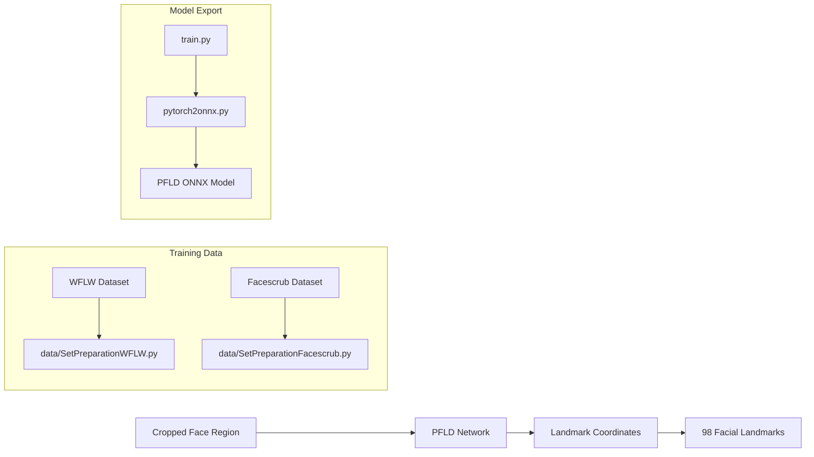
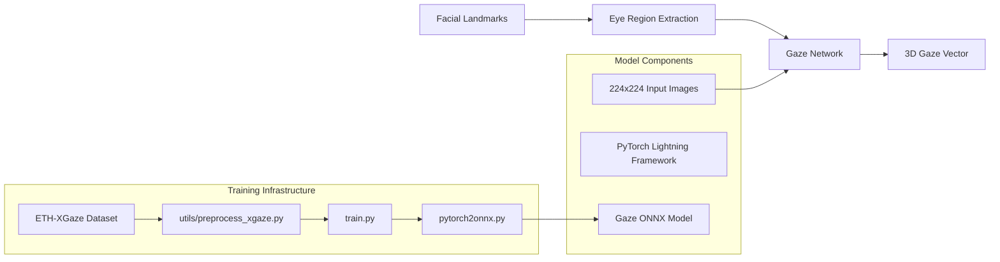
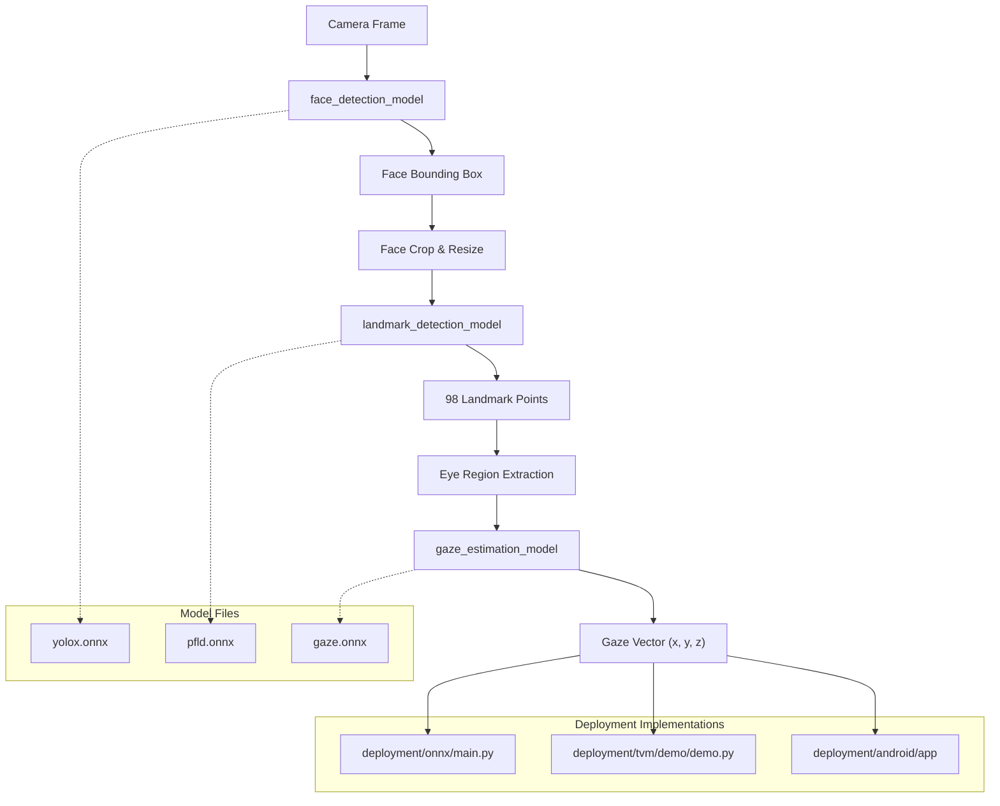

<!-- source: DeepWiki mcp.deepwiki.com · repo mit-han-lab/proxylessnas · page 5.1 Architecture and Pipeline · fetched 2026-10-30 -->

# Architecture and Pipeline

Relevant source files

The following files were used as context for generating this wiki page:

- [proxyless_gaze/README.md](proxyless_gaze/README.md)

This document explains the three-stage pipeline architecture of ProxylessGaze, a real-time gaze estimation system that demonstrates practical application of ProxylessNAS technology. The pipeline consists of face detection, facial landmark detection, and gaze estimation stages, each optimized for different hardware deployment targets.

For information about deploying ProxylessGaze on specific platforms, see [Android Deployment](#5.2) and [Cross-Platform Deployment](#5.3).

## Pipeline Overview

ProxylessGaze implements a sequential three-stage pipeline where each stage feeds into the next to produce real-time gaze estimation from camera input. The system is designed to achieve real-time performance across multiple hardware platforms with varying computational capabilities.

### High-Level Architecture

Sources: [proxyless_gaze/README.md:1-211]()

### Performance Characteristics

| Platform | Framework | Performance | Hardware Target |
|----------|-----------|-------------|-----------------|
| Intel CPU | ONNX Runtime | ~80 FPS | i5 8300H |
| Raspberry Pi 4 | TVM | ~30 FPS | ARM CPU |
| Qualcomm Mobile | SNPE SDK | ~50 FPS | 8Gen1 GPU |

Sources: [proxyless_gaze/README.md:3-3]()

## Stage 1: Face Detection

The face detection stage uses a modified YOLOX architecture optimized for real-time performance on mobile and embedded devices. This stage identifies and localizes faces in the input image to provide bounding box coordinates for subsequent processing.

### Face Detection Architecture

### Training Configuration

The face detection model is trained using the WIDERFACE dataset with specific configuration parameters optimized for the ProxylessGaze pipeline:

- **Model Configuration**: `exps/widerface/proxyless_160x128_v2.py`
- **Input Resolution**: 160x128 pixels
- **Training Command**: `python3 -m yolox.tools.train -f exps/widerface/proxyless_160x128_v2.py -d 2 -b 64`
- **Dataset**: WIDERFACE converted to COCO format using `tools/convert.py`

Sources: [proxyless_gaze/README.md:25-63]()

## Stage 2: Facial Landmark Detection

The facial landmark detection stage uses a PFLD (Practical Facial Landmark Detection) model to identify key facial landmarks within the detected face region. These landmarks are essential for accurate gaze estimation as they provide precise localization of eye regions and facial orientation.

### Landmark Detection Architecture

### Training Process

The landmark detection model is trained on a combination of WFLW and Facescrub datasets:

- **Training Script**: `train.py` in `training/landmark_detection`
- **Data Preparation**: `data/SetPreparationWFLW.py` and `data/SetPreparationFacescrub.py`
- **Export Command**: `python3 pytorch2onnx.py --torch_model CHECKPOINT_PATH`
- **Output**: 98 facial landmark coordinates

Sources: [proxyless_gaze/README.md:65-99]()

## Stage 3: Gaze Estimation

The final stage estimates gaze direction using the detected facial landmarks and cropped eye regions. This stage outputs a 3D gaze vector that represents the person's looking direction.

### Gaze Estimation Architecture

### Training Configuration

The gaze estimation model uses the ETH-XGaze dataset with specific preprocessing:

- **Dataset**: ETH-XGaze with 224x224 images  
- **Preprocessing**: `utils/preprocess_xgaze.py`
- **Framework**: PyTorch Lightning
- **Training**: `python3 train.py` in `training/gaze_estimation`
- **Export**: `python3 pytorch2onnx.py --torch_model CHECKPOINT_PATH`

Sources: [proxyless_gaze/README.md:101-132]()

## End-to-End Data Flow

The complete pipeline processes camera input through all three stages to produce real-time gaze estimation:

### Model Export Pipeline

All three models follow a consistent export pipeline to support multiple deployment frameworks:

1. **ONNX Export**: Primary format for cross-platform deployment
2. **TorchScript Export**: Alternative PyTorch-native format
3. **SNPE Conversion**: Qualcomm-specific format for mobile GPU deployment

The export commands are standardized across all three stages:
- Face Detection: `tools/export_onnx.py --output-name yolox.onnx`
- Landmark Detection: `pytorch2onnx.py --torch_model CHECKPOINT_PATH`
- Gaze Estimation: `pytorch2onnx.py --torch_model CHECKPOINT_PATH`

Sources: [proxyless_gaze/README.md:53-57](), [proxyless_gaze/README.md:95-99](), [proxyless_gaze/README.md:128-132](), [proxyless_gaze/README.md:134-186]()

---

