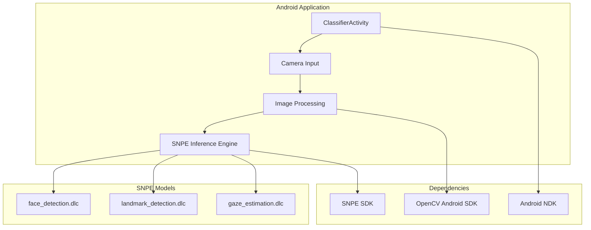
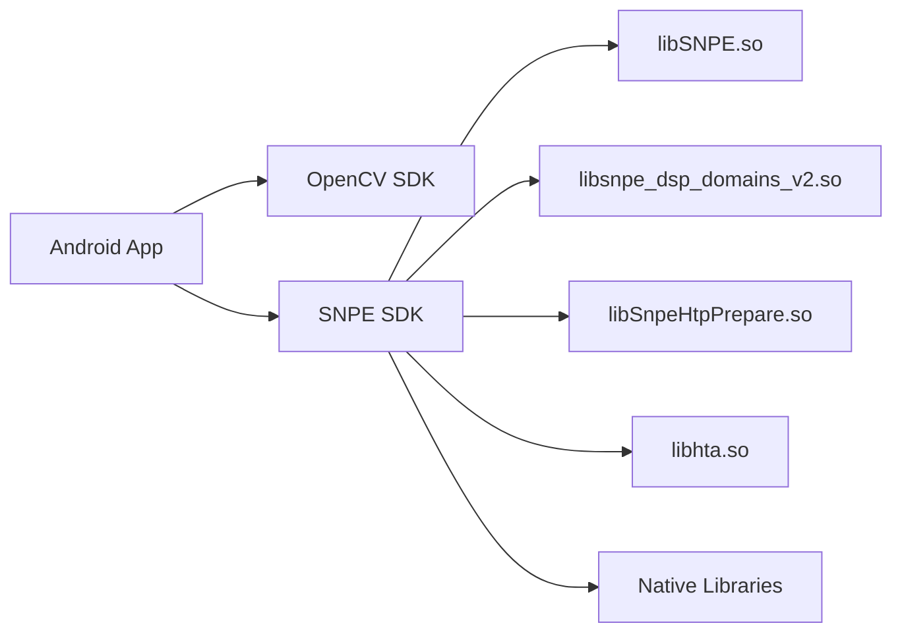
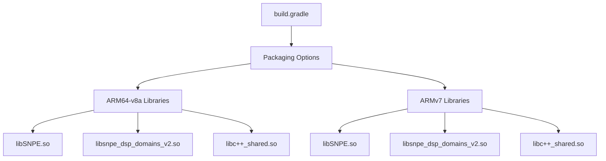
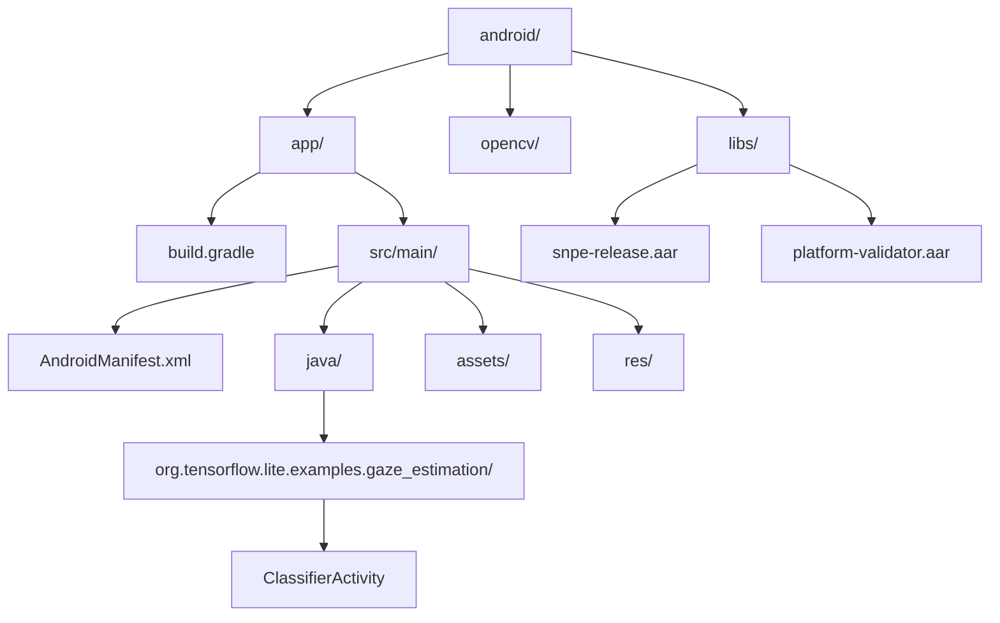
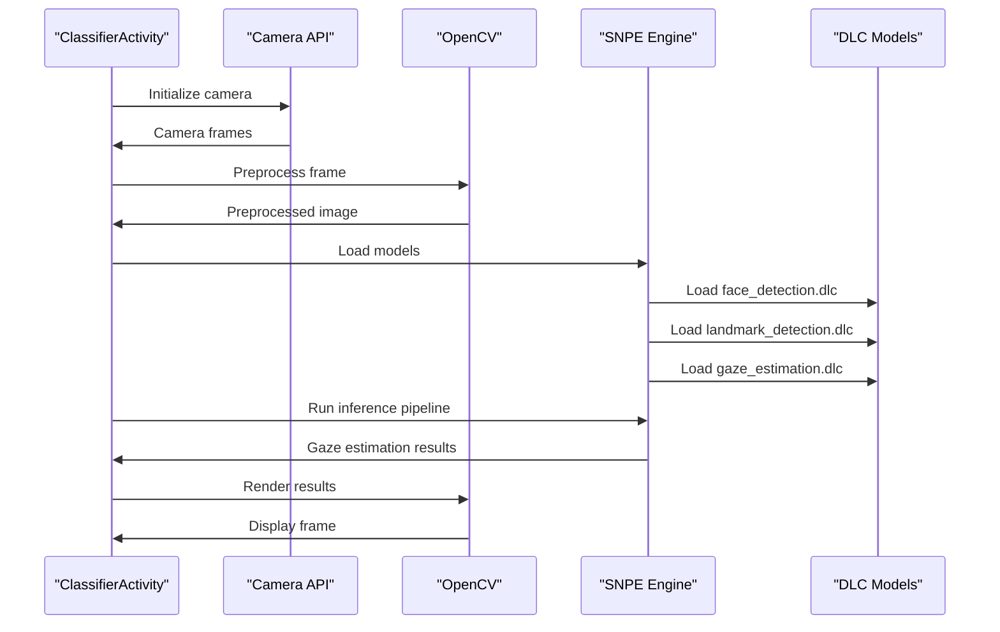

<!-- source: DeepWiki mcp.deepwiki.com · repo mit-han-lab/proxylessnas · page 5.2 Android Deployment · fetched 2026-10-30 -->

# Android Deployment

<details>
<summary>Relevant source files</summary>

The following files were used as context for generating this wiki page:

- [proxyless_gaze/assets/android_demo.gif](proxyless_gaze/assets/android_demo.gif)
- [proxyless_gaze/deployment/android/LICENSE](proxyless_gaze/deployment/android/LICENSE)
- [proxyless_gaze/deployment/android/README.md](proxyless_gaze/deployment/android/README.md)
- [proxyless_gaze/deployment/android/app/.gitignore](proxyless_gaze/deployment/android/app/.gitignore)
- [proxyless_gaze/deployment/android/app/build.gradle](proxyless_gaze/deployment/android/app/build.gradle)
- [proxyless_gaze/deployment/android/app/download.gradle](proxyless_gaze/deployment/android/app/download.gradle)
- [proxyless_gaze/deployment/android/app/proguard-rules.pro](proxyless_gaze/deployment/android/app/proguard-rules.pro)
- [proxyless_gaze/deployment/android/app/src/main/AndroidManifest.xml](proxyless_gaze/deployment/android/app/src/main/AndroidManifest.xml)

</details>


This document covers the deployment of ProxylessGaze to Android devices using the Qualcomm Snapdragon Neural Processing Engine (SNPE) SDK. This deployment specifically targets Android devices with Qualcomm GPUs for hardware-accelerated inference. For deployment to other platforms, see [Cross-Platform Deployment](#5.3).

## Overview

The Android deployment provides a real-time gaze estimation application that runs the complete ProxylessGaze pipeline on Android devices. The implementation leverages Qualcomm's SNPE SDK for optimized inference on Qualcomm hardware and OpenCV for camera input and image processing.



**Android Application Architecture**

Sources: [proxyless_gaze/deployment/android/app/src/main/AndroidManifest.xml](), [proxyless_gaze/deployment/android/README.md]()

## Hardware Requirements

The Android deployment has specific hardware constraints due to its use of SNPE SDK:

| Component | Requirement |
|-----------|-------------|
| GPU | Qualcomm Adreno GPU (mandatory) |
| Android Version | API Level 21+ (Android 5.0+) |
| Architecture | ARM64-v8a or ARMv7 |
| Storage | ~50MB for models and app |

**NOTICE: This demo can only run on Qualcomm GPU.**

Sources: [proxyless_gaze/deployment/android/README.md:13]()

## Dependencies

The Android deployment requires two primary external SDKs:

### OpenCV Android SDK
Used for camera input handling, image preprocessing, and basic computer vision operations.

### Snapdragon Neural Processing Engine SDK
Provides hardware-accelerated inference on Qualcomm platforms. The SNPE integration includes multiple native libraries for different hardware targets.



**SNPE SDK Integration**

Sources: [proxyless_gaze/deployment/android/app/build.gradle:23-46](), [proxyless_gaze/deployment/android/README.md:7-9]()

## Model Files

The deployment uses three separate DLC (Deep Learning Container) files optimized for SNPE:

| Model File | Purpose | Location |
|------------|---------|----------|
| `face_detection.dlc` | YOLOX face detection | `/data/local/tmp/` |
| `landmark_detection.dlc` | PFLD facial landmarks | `/data/local/tmp/` |
| `gaze_estimation.dlc` | Gaze direction estimation | `/data/local/tmp/` |

### Model Deployment Process

1. **Download Models**: Obtain DLC files from Google Drive repository
2. **Push to Device**: Use ADB to transfer models to device storage
3. **Runtime Loading**: Application loads models from device filesystem

```bash
adb push face_detection.dlc /data/local/tmp/
adb push landmark_detection.dlc /data/local/tmp/  
adb push gaze_estimation.dlc /data/local/tmp/
```

Sources: [proxyless_gaze/deployment/android/README.md:15-17]()

## Build Configuration

The Android project uses Gradle build system with specific configurations for SNPE integration:

### Application Configuration
```
applicationId: org.tensorflow.lite.examples.gaze_estimation
minSdkVersion: 21
targetSdkVersion: 30
compileSdkVersion: 30
```

### Native Library Handling
The build configuration handles multiple SNPE native libraries using `packagingOptions` with `pickFirst` directives to resolve conflicts between ARM architectures.



**Native Library Resolution**

Sources: [proxyless_gaze/deployment/android/app/build.gradle:22-47]()

## Project Structure

The Android project follows standard Android Studio structure:



**Android Project Structure**

### Key Components

- **ClassifierActivity**: Main activity handling camera and inference
- **SNPE AAR files**: Pre-built SNPE SDK components  
- **OpenCV module**: Integrated as Android library project
- **Assets directory**: Contains model files (if bundled)

Sources: [proxyless_gaze/deployment/android/app/src/main/AndroidManifest.xml:20](), [proxyless_gaze/deployment/android/app/build.gradle:67-70]()

## Installation Options

### Option 1: Build from Source
1. Import project into Android Studio
2. Connect device with Qualcomm GPU
3. Build and install via Android Studio

### Option 2: Pre-built APK
Download and install the pre-built APK directly:
- APK available from Google Drive repository
- Requires manual model file deployment via ADB

### Permissions Required
The application requires camera permissions as specified in the manifest:

```xml
<uses-permission android:name="android.permission.CAMERA" />
<uses-feature android:name="android.hardware.camera" />
<uses-feature android:name="android.hardware.camera.autofocus" />
```

Sources: [proxyless_gaze/deployment/android/README.md:19](), [proxyless_gaze/deployment/android/app/src/main/AndroidManifest.xml:5-8]()

## Runtime Architecture

The Android application implements a complete inference pipeline optimized for mobile deployment:



**Android Runtime Sequence**

The application integrates TensorFlow Lite components alongside SNPE, though the primary inference engine is SNPE for Qualcomm hardware optimization.

Sources: [proxyless_gaze/deployment/android/app/build.gradle:64-66](), [proxyless_gaze/deployment/android/app/src/main/AndroidManifest.xml:20-23]()

---

