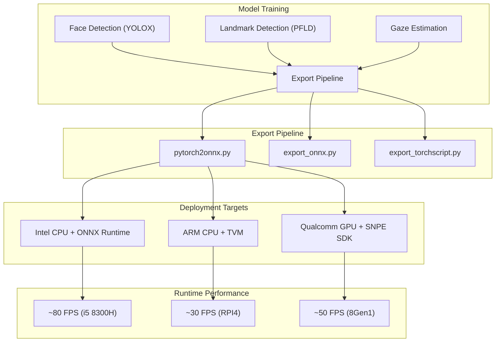
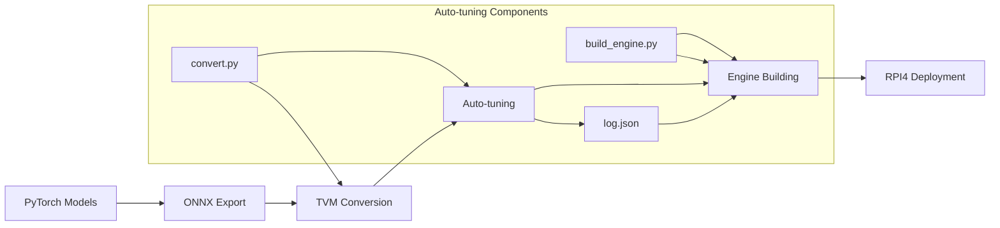
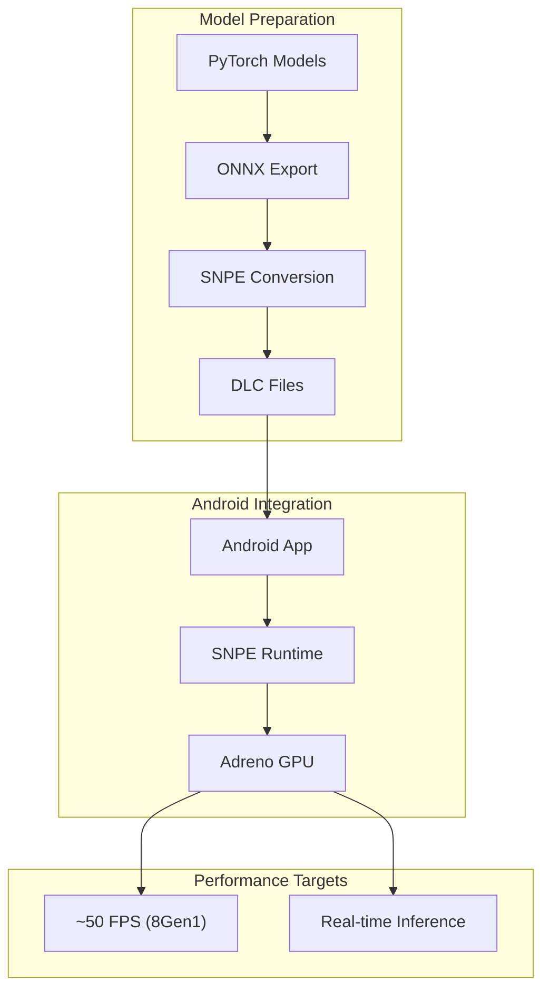
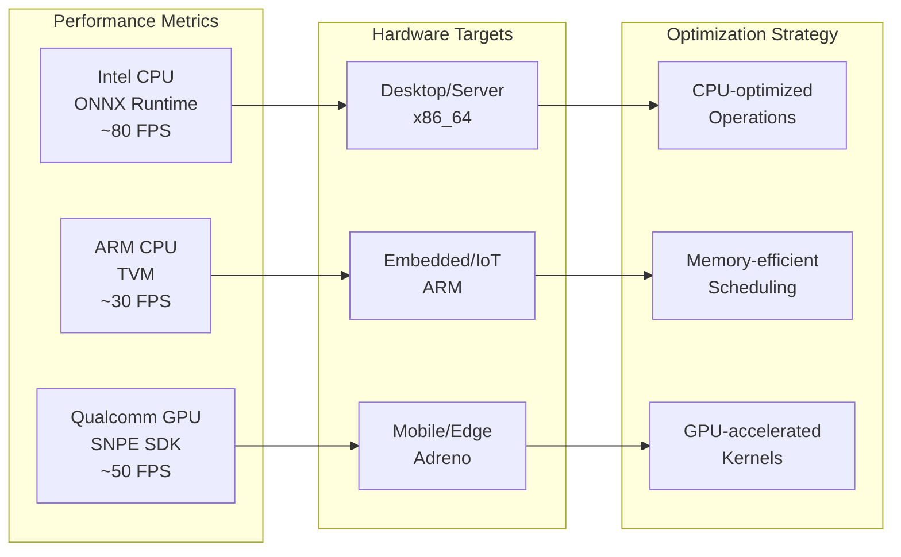

<!-- source: DeepWiki mcp.deepwiki.com · repo mit-han-lab/proxylessnas · page 5.3 Cross-Platform Deployment · fetched 2026-10-30 -->

# Cross-Platform Deployment

<details>
<summary>Relevant source files</summary>

The following files were used as context for generating this wiki page:

- [proxyless_gaze/README.md](proxyless_gaze/README.md)
- [proxyless_gaze/assets/rpi4_demo.gif](proxyless_gaze/assets/rpi4_demo.gif)

</details>


This document covers the deployment options for ProxylessGaze across different hardware platforms including Intel CPU, ARM CPU, and Qualcomm GPU. It explains the technical implementation details for each deployment method and the associated performance characteristics.

For information about the ProxylessGaze architecture and pipeline components, see [Architecture and Pipeline](#5.1). For Android-specific deployment details, see [Android Deployment](#5.2).

## Overview

ProxylessGaze supports deployment across three distinct hardware platforms using different optimization frameworks. Each platform achieves real-time performance with hardware-specific optimizations:

| Platform | Framework | Performance | Target Hardware |
|----------|-----------|-------------|-----------------|
| Intel CPU | ONNX Runtime | ~80 FPS on i5 8300H | x86_64 processors |
| ARM CPU | TVM | ~30 FPS on Raspberry Pi 4 | ARM-based devices |
| Qualcomm GPU | SNPE SDK | ~50 FPS on 8Gen1 | Adreno GPUs |

**Cross-Platform Deployment Architecture**



Sources: [proxyless_gaze/README.md:1-141]()

## Intel CPU Deployment with ONNX Runtime

Intel CPU deployment uses ONNX Runtime for optimized inference on x86_64 processors. The deployment code is located in the `deployment/onnx` directory.

### Implementation Details

The ONNX deployment requires conversion of PyTorch models to ONNX format using dedicated export scripts:

- Face detection: `tools/export_onnx.py` converts YOLOX models
- Landmark detection: `pytorch2onnx.py` converts PFLD models  
- Gaze estimation: `pytorch2onnx.py` converts gaze estimation models

### Runtime Setup

```bash
# Install ONNX Runtime dependencies
pip3 install -r requirements.txt

# Run the deployment demo
python3 main.py
```

The main inference loop is implemented in `deployment/onnx/main.py` and achieves approximately 80 FPS on Intel i5 8300H processors.

Sources: [proxyless_gaze/README.md:142-156]()

## ARM CPU Deployment with TVM

ARM CPU deployment uses Apache TVM for optimized inference on ARM-based devices like Raspberry Pi 4. TVM provides hardware-specific optimizations through auto-tuning.

### TVM Engine Building Process



### Build Process

The TVM deployment requires building optimized engines for each model component:

1. **Auto-tuning Phase**: `convert.py` performs hardware-specific optimization
2. **Engine Building**: `build_engine.py` generates deployment-ready engines using tuning results
3. **Demo Execution**: `demo.py` runs the complete pipeline

```bash
# Navigate to specific model directory
cd build_engine/${task_name}

# Perform auto-tuning for RPI4
python3 convert.py

# Build optimized engine
python3 build_engine.py

# Run deployment demo
cd demo
python3 demo.py
```

The system achieves approximately 30 FPS on Raspberry Pi 4 hardware.

Sources: [proxyless_gaze/README.md:158-182]()

## Qualcomm GPU Deployment with SNPE SDK

Qualcomm GPU deployment uses the Snapdragon Neural Processing Engine (SNPE) SDK for optimized inference on Adreno GPUs. This deployment method is integrated into the Android application.

### SNPE Integration Architecture



### Deployment Characteristics

The SNPE SDK deployment provides:

- **Target Hardware**: Qualcomm Adreno GPUs (demonstrated on 8Gen1)
- **Performance**: Approximately 50 FPS on flagship mobile processors
- **Integration**: Native Android application with camera input
- **Model Format**: DLC (Deep Learning Container) files optimized for Snapdragon

The complete Android implementation details are covered in the Android deployment documentation at `deployment/android/README.md`.

Sources: [proxyless_gaze/README.md:184-186]()

## Performance Comparison

The cross-platform deployment demonstrates ProxylessNAS's effectiveness in hardware-specific optimization:

**Platform Performance Summary**



Each deployment method leverages hardware-specific optimizations:

- **Intel CPU**: ONNX Runtime's CPU-optimized operators and threading
- **ARM CPU**: TVM's auto-tuning for ARM instruction sets and memory hierarchy
- **Qualcomm GPU**: SNPE SDK's GPU kernel optimization and mobile-specific scheduling

This demonstrates ProxylessNAS's core principle of hardware-aware architecture optimization, where the same model architecture achieves optimal performance across different deployment targets through framework-specific optimizations.

Sources: [proxyless_gaze/README.md:1-141]()

---

