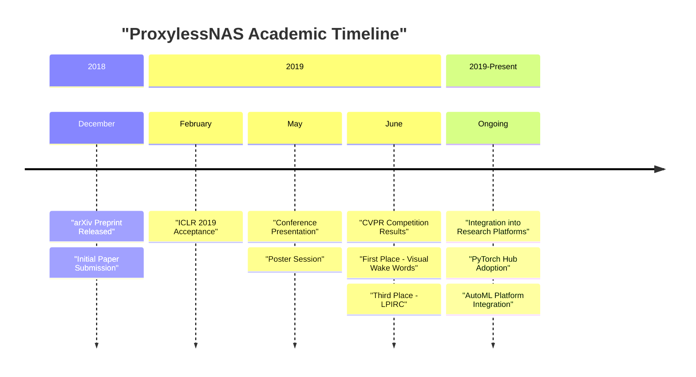
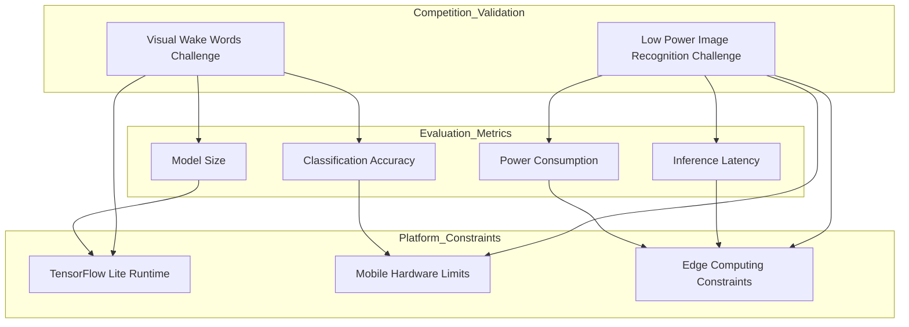
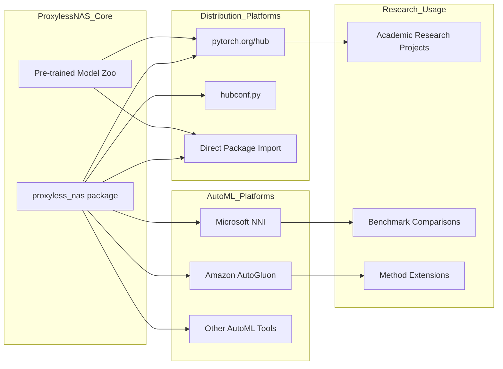
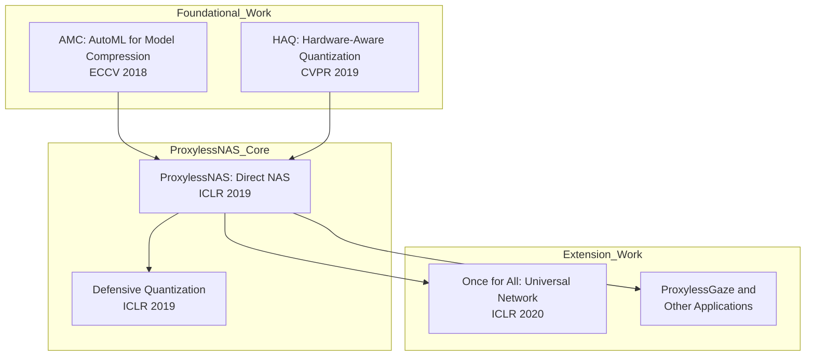
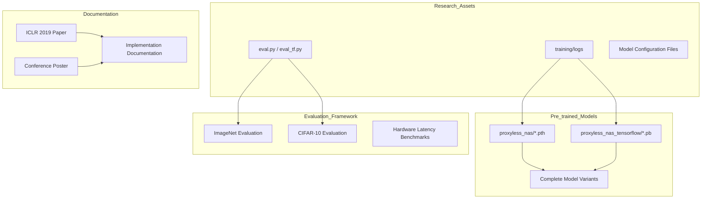

<!-- source: DeepWiki mcp.deepwiki.com · repo mit-han-lab/proxylessnas · page 6 Research and Academic Context · fetched 2026-10-30 -->

# Research and Academic Context

<details>
<summary>Relevant source files</summary>

The following files were used as context for generating this wiki page:

- [README.md](README.md)
- [assets/ProxylessNAS_iclr_poster_final.pdf](assets/ProxylessNAS_iclr_poster_final.pdf)

</details>


This document covers the academic foundations, research contributions, and scholarly impact of ProxylessNAS. It details the core publications, competition achievements, integration with research platforms, and the broader academic ecosystem surrounding the project.

For technical implementation details, see [Core Architecture](#2). For practical applications, see [ProxylessGaze Application](#5).

## Core Publication and Citation

ProxylessNAS was introduced in the paper "Proxyless{NAS}: Direct Neural Architecture Search on Target Task and Hardware" published at the International Conference on Learning Representations (ICLR) 2019. The research addresses the fundamental limitation of existing neural architecture search methods that rely on proxy tasks rather than directly optimizing for the target hardware and dataset.

**Primary Citation Format:**
```bibtex
@inproceedings{
  cai2018proxylessnas,
  title={Proxyless{NAS}: Direct Neural Architecture Search on Target Task and Hardware},
  author={Han Cai and Ligeng Zhu and Song Han},
  booktitle={International Conference on Learning Representations},
  year={2019},
  url={https://arxiv.org/pdf/1812.00332.pdf},
}
```

The research was authored by Han Cai, Ligeng Zhu, and Song Han, representing a collaboration that established new benchmarks for hardware-aware neural architecture search.

### Academic Timeline and Publication Impact



**Sources:** [README.md:2-12]()

## Competition Achievements and Recognition

ProxylessNAS demonstrated its practical effectiveness through strong performance in academic competitions, establishing credibility for the approach in real-world deployment scenarios.

### Competition Results Summary

| Competition | Event | Year | Track | Achievement | Performance Impact |
|-------------|-------|------|-------|-------------|-------------------|
| Visual Wake Words Challenge | CVPR | 2019 | TensorFlow Lite | **1st Place** | Demonstrated mobile efficiency |
| Low Power Image Recognition Challenge (LPIRC) | CVPR | 2019 | Classification | **3rd Place** | Validated power efficiency claims |

### Competition Performance Architecture



These competition results validated ProxylessNAS's core thesis that hardware-specific architecture optimization provides measurable advantages over general-purpose models in constrained deployment environments.

**Sources:** [README.md:18-19]()

## Research Ecosystem Integration

ProxylessNAS has been integrated into major AutoML and deep learning platforms, facilitating broader adoption in the research community.

### Platform Integration Architecture



### Integration Details

**PyTorch Hub Integration:**
- Accessible via `torch.hub.load('mit-han-lab/ProxylessNAS', target_platform, pretrained=True)`
- Provides standardized interface for model loading
- Enables seamless integration into existing PyTorch workflows

**AutoML Platform Support:**
- **Microsoft NNI**: Provides ProxylessNAS as a built-in NAS algorithm for automated hyperparameter optimization
- **Amazon AutoGluon**: Includes ProxylessNAS in its neural architecture search capabilities for automated model selection

**Sources:** [README.md:15-17](), [README.md:24-29]()

## Related Research and Academic Impact

ProxylessNAS is part of a broader research program on automated model compression and acceleration, contributing to a growing body of work on hardware-aware machine learning.

### Research Lineage and Related Work



### Key Research Contributions

| Publication | Venue | Year | Core Contribution | Relationship to ProxylessNAS |
|-------------|-------|------|-------------------|------------------------------|
| AMC: AutoML for Model Compression | ECCV | 2018 | Automated model compression framework | Foundation for hardware-aware optimization |
| ProxylessNAS | ICLR | 2019 | **Direct architecture search without proxies** | **Core contribution** |
| HAQ: Hardware-Aware Quantization | CVPR | 2019 | Hardware-aware quantization methods | Complementary optimization technique |
| Defensive Quantization | ICLR | 2019 | Robust quantization under adversarial settings | Robustness extension |
| Once for All | ICLR | 2020 | Universal network training for multiple deployments | Successor approach with broader scope |

### Academic Impact Metrics

The research has influenced multiple areas of machine learning:

1. **Neural Architecture Search**: Established direct optimization as preferred over proxy-based methods
2. **Hardware-Aware ML**: Demonstrated the importance of platform-specific optimization
3. **Mobile AI**: Provided practical architectures for resource-constrained deployment
4. **AutoML Tooling**: Integrated into major automated machine learning platforms

**Sources:** [README.md:115-124]()

## Research Reproducibility and Assets

The ProxylessNAS research provides comprehensive reproducibility assets, including training logs, evaluation scripts, and pre-trained models across multiple frameworks.

### Reproducibility Infrastructure



The research assets enable full reproduction of reported results and facilitate extension work by providing baseline implementations and evaluation protocols.

**Sources:** [README.md:91-98](), [README.md:102-106]()

---

