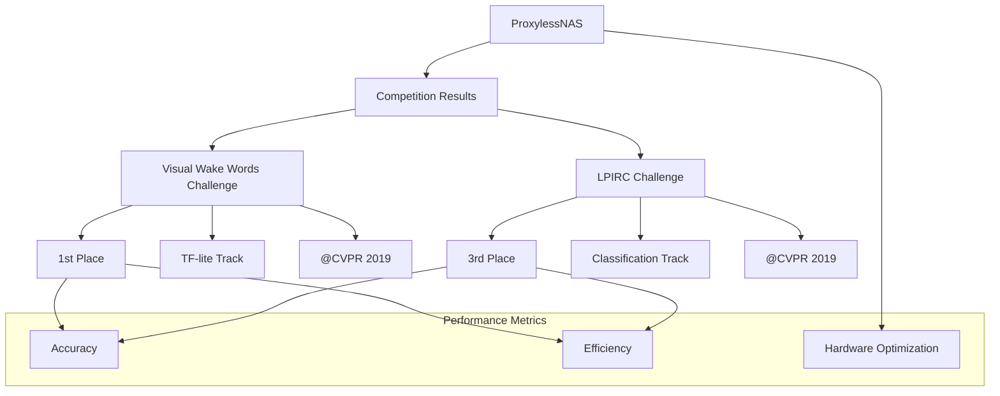
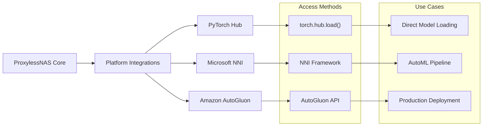
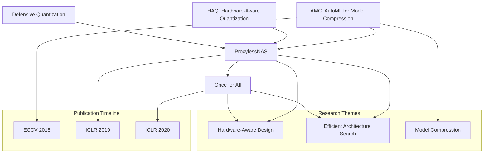

<!-- source: DeepWiki mcp.deepwiki.com · repo mit-han-lab/proxylessnas · page 6.1 Publications and Citations · fetched 2026-10-30 -->

# Publications and Citations

<details>
<summary>Relevant source files</summary>

The following files were used as context for generating this wiki page:

- [README.md](README.md)
- [assets/ProxylessNAS_iclr_poster_final.pdf](assets/ProxylessNAS_iclr_poster_final.pdf)

</details>


This document provides the official citation information for ProxylessNAS, academic recognition, and related publications. It serves as the definitive reference for properly citing the ProxylessNAS work in academic contexts and understanding its impact in the research community.

For technical details about the ProxylessNAS architecture search method, see [Neural Architecture Search Method](#2.1). For competition performance details, see [Competition Results](#6.2).

## Core Publication

The primary ProxylessNAS research is published in the International Conference on Learning Representations (ICLR) 2019. The work introduces direct neural architecture search on target tasks and hardware without requiring proxy tasks.

### Citation Format

The official BibTeX citation format is:

```bibtex
@inproceedings{
  cai2018proxylessnas,
  title={Proxyless{NAS}: Direct Neural Architecture Search on Target Task and Hardware},
  author={Han Cai and Ligeng Zhu and Song Han},
  booktitle={International Conference on Learning Representations},
  year={2019},
  url={https://arxiv.org/pdf/1812.00332.pdf},
}
```

### Publication Details

| Field | Value |
|-------|-------|
| **Title** | ProxylessNAS: Direct Neural Architecture Search on Target Task and Hardware |
| **Authors** | Han Cai, Ligeng Zhu, Song Han |
| **Venue** | International Conference on Learning Representations (ICLR) |
| **Year** | 2019 |
| **arXiv** | https://arxiv.org/abs/1812.00332 |

Sources: [README.md:2-12]()

## Academic Recognition and Competition Results

ProxylessNAS has achieved significant recognition in academic competitions and industry challenges, demonstrating its practical effectiveness for efficient neural architecture design.

### Competition Performance



**Competition Results Summary**

| Competition | Placement | Track | Venue | Year |
|-------------|-----------|-------|--------|------|
| Visual Wake Words Challenge | 1st Place | TF-lite Track | CVPR | 2019 |
| Low Power Image Recognition Challenge (LPIRC) | 3rd Place | Classification Track | CVPR | 2019 |

Sources: [README.md:18-19]()

## Platform Integrations and Ecosystem Impact

ProxylessNAS has been integrated into major machine learning platforms, demonstrating its broad adoption and practical utility in the ML ecosystem.

### Platform Integration Architecture



**Integration Details**

| Platform | Organization | Purpose | Status |
|----------|--------------|---------|--------|
| PyTorch Hub | PyTorch | Direct model loading | Active |
| NNI | Microsoft | AutoML framework integration | Active |
| AutoGluon | Amazon | Automated machine learning | Active |

Sources: [README.md:15-17]()

## Presentation Materials

Academic presentation materials are available to support research and educational use.

### Available Materials

- **Conference Poster**: [assets/ProxylessNAS_iclr_poster_final.pdf]()
- **Paper PDF**: Available via arXiv link
- **Search Visualization**: [assets/visualization.mp4]()

Sources: [README.md:2](), [README.md:74]()

## Related Work and Research Context

ProxylessNAS is part of a broader research program on automated model compression and acceleration. The following related publications from the same research group provide additional context and build upon the core ProxylessNAS concepts.

### Research Lineage



### Related Publications

| Title | Venue | Year | Focus Area |
|-------|-------|------|------------|
| AMC: AutoML for Model Compression and Acceleration on Mobile Devices | ECCV | 2018 | Model Compression |
| ProxylessNAS: Direct Neural Architecture Search on Target Task and Hardware | ICLR | 2019 | Architecture Search |
| HAQ: Hardware-Aware Automated Quantization | CVPR (oral) | 2019 | Quantization |
| Defensive Quantization: When Efficiency Meets Robustness | ICLR | 2019 | Robust Quantization |
| Once for All: Train One Network and Specialize it for Efficient Deployment | ICLR | 2020 | Universal Architecture |

Sources: [README.md:113-124]()

## Citation Guidelines

When citing ProxylessNAS in academic work:

1. **Use the official BibTeX format** provided above for consistency
2. **Reference the ICLR 2019 publication** as the primary source
3. **Include arXiv link** for open access: https://arxiv.org/abs/1812.00332
4. **Mention hardware specialization** when discussing the core contribution
5. **Credit competition results** when referencing practical performance

For software implementations, additionally cite the GitHub repository: https://github.com/mit-han-lab/proxylessnas

Sources: [README.md:2-12]()

---

