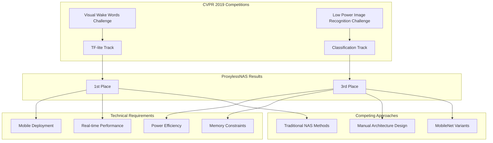
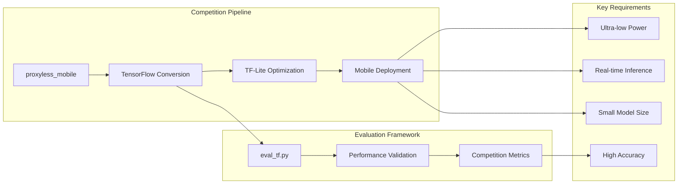
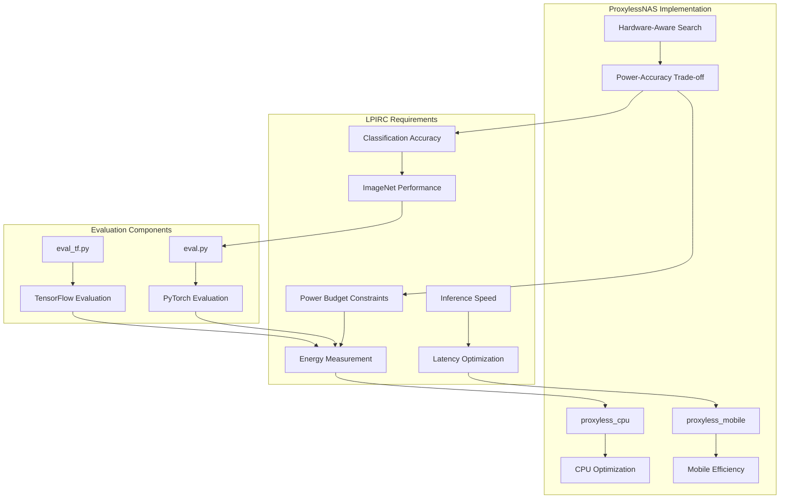
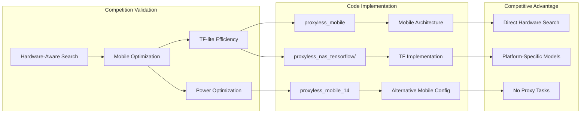

<!-- source: DeepWiki mcp.deepwiki.com · repo mit-han-lab/proxylessnas · page 6.2 Competition Results · fetched 2026-10-30 -->

# Competition Results

Relevant source files

The following files were used as context for generating this wiki page:

- [README.md](README.md)

This document details the competitive achievements of ProxylessNAS in academic and industry challenges, focusing on the specific competitions where ProxylessNAS demonstrated superior performance in mobile and edge deployment scenarios. 

For information about the broader academic publications and research context, see [Publications and Citations](#6.1). For details about related research projects that build upon these competition results, see [Related Projects](#6.3).

## Purpose and Scope

This page documents ProxylessNAS's performance in academic competitions and industry challenges, analyzing the technical aspects of these achievements and their implications for the broader neural architecture search field. The competitions showcase ProxylessNAS's practical effectiveness in real-world deployment scenarios with strict hardware constraints.

## Competition Overview

ProxylessNAS achieved notable recognition in two major computer vision competitions at CVPR 2019, demonstrating its effectiveness in mobile and edge computing scenarios.

**Competition Landscape and ProxylessNAS Performance**

Sources: [README.md:18-19]()

## Visual Wake Words Challenge

The Visual Wake Words Challenge focuses on ultra-low-power keyword spotting for visual data, targeting TensorFlow Lite deployment scenarios. ProxylessNAS achieved first place in the TF-lite track, demonstrating superior efficiency in mobile vision applications.

### Technical Implementation Details

The competition required models optimized for TensorFlow Lite deployment, leveraging the `proxyless_nas_tensorflow` implementation for mobile-specific optimizations.

**Visual Wake Words Challenge Technical Pipeline**

The competition utilized models from the `proxyless_nas_tensorflow` directory, specifically optimized for mobile deployment scenarios requiring minimal power consumption and memory footprint.

Sources: [README.md:18](), [README.md:104-105](), [README.md:97]()

## Low Power Image Recognition Challenge (LPIRC)

The LPIRC classification track focuses on achieving high accuracy while maintaining strict power consumption limits. ProxylessNAS secured third place, demonstrating competitive performance in power-constrained environments.

### Competition Framework Analysis

**LPIRC Competition Technical Architecture**

The third-place result in LPIRC demonstrates ProxylessNAS's ability to balance accuracy and power efficiency, utilizing both `proxyless_cpu` and `proxyless_mobile` variants depending on deployment requirements.

Sources: [README.md:19](), [README.md:93-97]()

## Performance Impact and Technical Significance

### Competition Results Analysis

| Competition | Track | Result | Key Metric | Technical Achievement |
|------------|--------|---------|------------|----------------------|
| Visual Wake Words | TF-lite | 1st Place | Power Efficiency | Ultra-low power visual recognition |
| LPIRC | Classification | 3rd Place | Energy-Accuracy Trade-off | Optimal power consumption balance |

### Hardware Specialization Validation

The competition results validate ProxylessNAS's core hypothesis about hardware-specific architecture optimization. The success in mobile-focused competitions demonstrates the effectiveness of the hardware-aware search methodology.

**Competition Results Technical Mapping to Codebase**

Sources: [README.md:18-19](), [README.md:80-81](), [README.md:104]()

## Technical Implications

The competition achievements demonstrate several key technical capabilities:

1. **Mobile Deployment Effectiveness**: First place in Visual Wake Words validates the `proxyless_mobile` architecture's optimization for TensorFlow Lite deployment scenarios.

2. **Cross-Framework Performance**: Success across both PyTorch (`eval.py`) and TensorFlow (`eval_tf.py`) evaluation frameworks demonstrates robust implementation quality.

3. **Hardware-Aware Optimization**: The LPIRC third place result confirms that hardware-specific architecture search produces measurably better power-accuracy trade-offs than generic approaches.

4. **Real-World Applicability**: Competition success in constrained environments validates the practical deployment capabilities showcased in applications like ProxylessGaze.

### Evaluation Framework Integration

The competition results were validated using the same evaluation infrastructure available in the repository:

- PyTorch evaluation via `eval.py` for ImageNet classification
- TensorFlow evaluation via `eval_tf.py` for cross-framework validation  
- Model variants from `proxyless_nas` and `proxyless_nas_tensorflow` directories

Sources: [README.md:93-97](), [README.md:104-105]()

---

