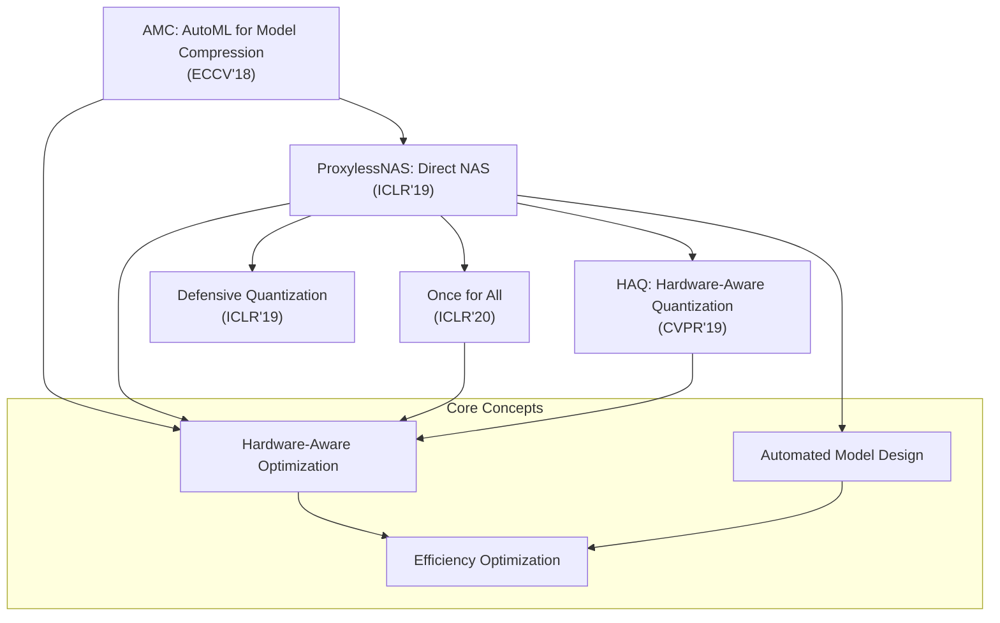
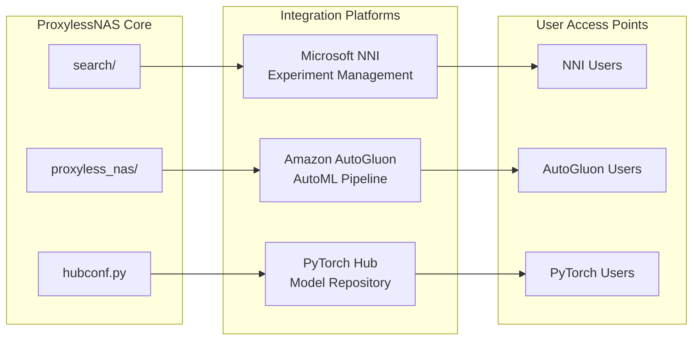
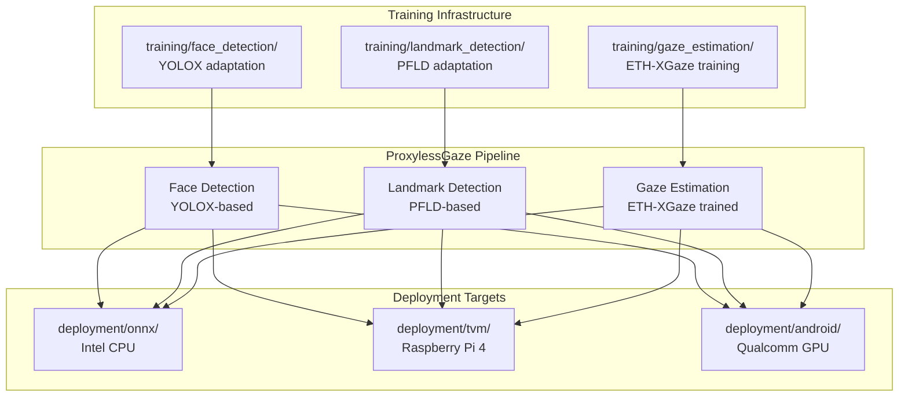
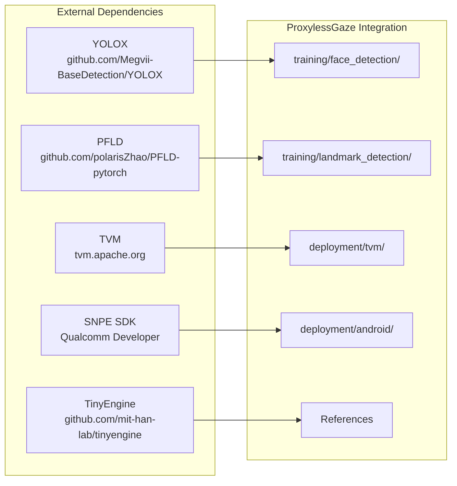
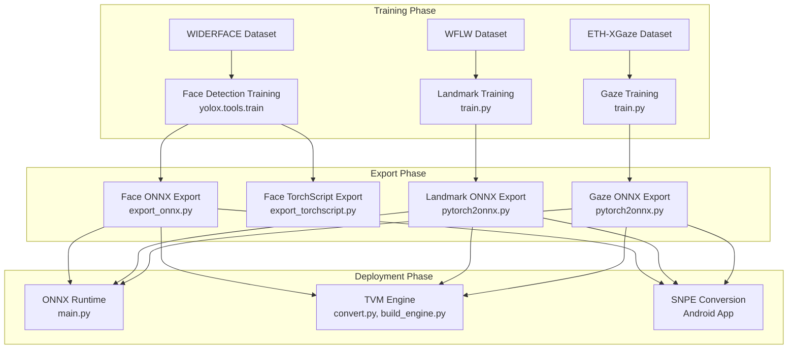
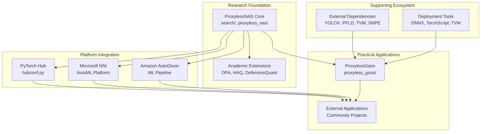

<!-- source: DeepWiki mcp.deepwiki.com · repo mit-han-lab/proxylessnas · page 6.3 Related Projects · fetched 2026-10-30 -->

# Related Projects

Relevant source files

The following files were used as context for generating this wiki page:

- [README.md](README.md)
- [proxyless_gaze/README.md](proxyless_gaze/README.md)

This page documents projects that are related to ProxylessNAS, including academic research that builds upon or extends the ProxylessNAS approach, integration platforms that incorporate ProxylessNAS, and application projects that demonstrate practical usage. For information about ProxylessNAS's own academic publications, see [Publications and Citations](#6.1). For competition achievements, see [Competition Results](#6.2).

## Academic Research Lineage

ProxylessNAS is part of a broader research program in automated model compression and acceleration. The following projects represent the evolution and extension of the core ideas:

### Predecessor and Successor Projects

**Once for All (OFA)** represents the next generation of the ProxylessNAS approach, extending the concept of hardware-aware architecture search to training a single "super-network" that can be specialized for different deployment scenarios without retraining.

**AutoML for Model Compression (AMC)** laid the groundwork for automated model optimization on mobile devices, focusing on compression techniques rather than architecture search.

**Hardware-Aware Automated Quantization (HAQ)** applies similar hardware-awareness principles to the quantization domain, optimizing bit-width assignments based on target hardware characteristics.

**Defensive Quantization** extends the quantization approach to consider robustness alongside efficiency, addressing security concerns in quantized models.

Sources: [README.md:113-124]()

## Platform Integration Projects

ProxylessNAS has been integrated into several major AutoML and machine learning platforms, making it accessible to broader user communities:

### Microsoft NNI Integration

**Neural Network Intelligence (NNI)** is Microsoft's open-source AutoML toolkit that includes ProxylessNAS as one of its supported architecture search algorithms. The integration allows users to leverage NNI's experiment management and hyperparameter tuning capabilities alongside ProxylessNAS.

### Amazon AutoGluon Integration

**AutoGluon** incorporates ProxylessNAS as part of its automated machine learning pipeline, enabling users to automatically search for optimal architectures as part of the broader model selection and hyperparameter optimization process.

### PyTorch Hub Integration

The **PyTorch Hub** integration provides the most direct access to pre-trained ProxylessNAS models through the standard PyTorch ecosystem, implemented via the `hubconf.py` configuration.

Sources: [README.md:15-17](), [README.md:24-29]()

## Application and Demonstration Projects

### ProxylessGaze: Real-time Gaze Estimation

**ProxylessGaze** is a comprehensive application that demonstrates ProxylessNAS in a practical computer vision pipeline. It implements a three-stage gaze estimation system optimized for real-time performance across multiple hardware platforms.

The project showcases several key technical integrations:

#### Component Architecture

Sources: [proxyless_gaze/README.md:1-3](), [proxyless_gaze/README.md:134-141]()

#### External Project Dependencies

ProxylessGaze integrates several external projects as foundational components:

| Component | External Project | Integration Point | Purpose |
|-----------|------------------|-------------------|---------|
| Face Detection | YOLOX | `training/face_detection` | High-performance object detection backbone |
| Landmark Detection | PFLD | `training/landmark_detection` | Lightweight facial landmark estimation |
| Deployment Runtime | TVM | `deployment/tvm` | Cross-platform deep learning compiler |
| Mobile Deployment | SNPE SDK | `deployment/android` | Qualcomm neural processing SDK |
| Reference Implementation | TinyEngine | Referenced in docs | Efficient neural network inference engine |

Sources: [proxyless_gaze/README.md:25](), [proxyless_gaze/README.md:67](), [proxyless_gaze/README.md:160](), [proxyless_gaze/README.md:188-195]()

### Training and Export Pipeline

The ProxylessGaze project demonstrates a complete training-to-deployment pipeline that can serve as a template for other applications:

#### Model Export Flow

Sources: [proxyless_gaze/README.md:50-63](), [proxyless_gaze/README.md:95-99](), [proxyless_gaze/README.md:128-132](), [proxyless_gaze/README.md:162-173]()

## Integration Architecture Overview

The relationship between ProxylessNAS and its related projects forms a comprehensive ecosystem for hardware-aware neural architecture optimization:

Sources: [README.md:107-124](), [README.md:15-17](), [proxyless_gaze/README.md:188-195]()