# Page: Overview

# Overview

<details>
<summary>Relevant source files</summary>

The following files were used as context for generating this wiki page:

- [.gitignore](.gitignore)
- [LICENSE](LICENSE)
- [README.md](README.md)

</details>


This document provides a comprehensive overview of ProxylessNAS, a direct Neural Architecture Search framework that optimizes neural network architectures for specific target tasks and hardware platforms without using proxy tasks. This page covers the fundamental concepts, system architecture, and key innovations that make ProxylessNAS unique in the neural architecture search landscape.

For detailed information about using specific pre-trained models, see [Model Zoo](#3). For practical deployment examples, see [ProxylessGaze Application](#5). For academic context and research contributions, see [Research and Academic Context](#6).

## What is ProxylessNAS

ProxylessNAS is a neural architecture search method that directly optimizes architectures on target hardware and datasets, eliminating the need for proxy tasks that traditional NAS methods rely on. Published at ICLR 2019, it represents a significant advancement in making NAS practical for real-world deployment scenarios.

The key insight is that different hardware platforms (CPU, GPU, mobile devices) have vastly different computational characteristics, and a single "universal" architecture cannot be optimal for all platforms. ProxylessNAS addresses this by searching for platform-specific architectures that maximize efficiency for each target deployment scenario.

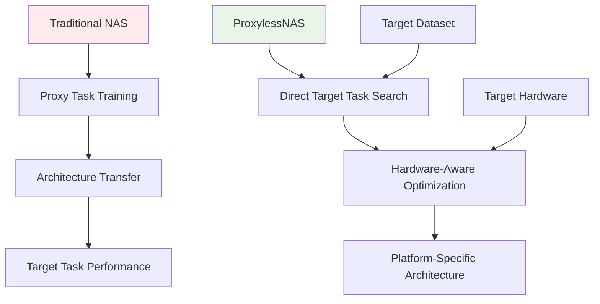
**Direct vs. Proxy-Based Architecture Search**

Sources: [README.md:1-124]()

## Core Innovation: Hardware Specialization

The fundamental innovation of ProxylessNAS is hardware specialization - the recognition that optimal neural architectures vary significantly across different deployment platforms. Instead of designing one architecture for all hardware, ProxylessNAS creates specialized architectures optimized for specific platforms.

| Platform Type | Target Hardware | Optimization Focus | Model Variant |
|---------------|----------------|-------------------|---------------|
| CPU | Intel x86, ARM CPUs | Memory bandwidth, cache efficiency | `proxyless_cpu` |
| GPU | NVIDIA GPUs, CUDA cores | Parallel computation, memory coalescing | `proxyless_gpu` |
| Mobile | ARM mobile processors | Power efficiency, inference speed | `proxyless_mobile` |
| Mobile (ImageNet) | Mobile with higher accuracy | Balanced accuracy/efficiency | `proxyless_mobile_14` |
| Research | CIFAR-10 experiments | Research validation | `proxyless_cifar` |

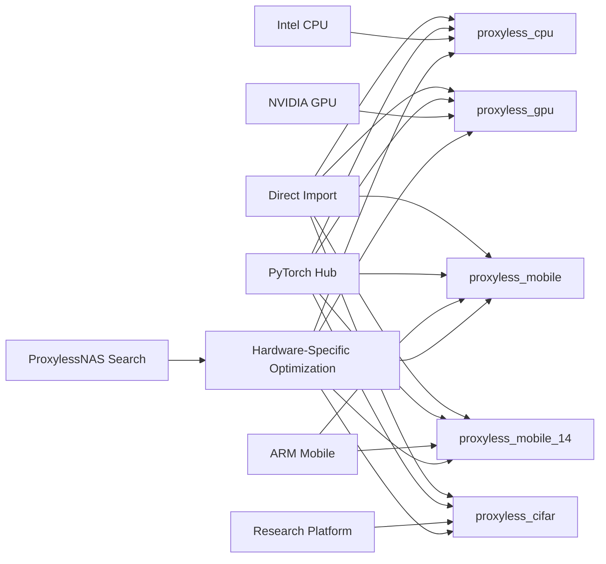
**Hardware Platform Specialization Architecture**

Sources: [README.md:67-73](), [README.md:26-29](), [README.md:78-87]()

## System Architecture and Code Organization

ProxylessNAS consists of several key components organized into distinct modules for search, training, and deployment across multiple frameworks.

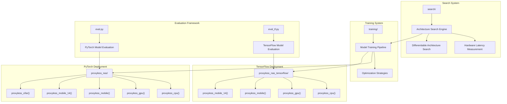
**ProxylessNAS Code Organization and Data Flow**

Sources: [README.md:100-106](), [README.md:78-87]()

## External Ecosystem Integration

ProxylessNAS has been integrated into major machine learning frameworks and AutoML platforms, making it accessible to the broader research and industry community.

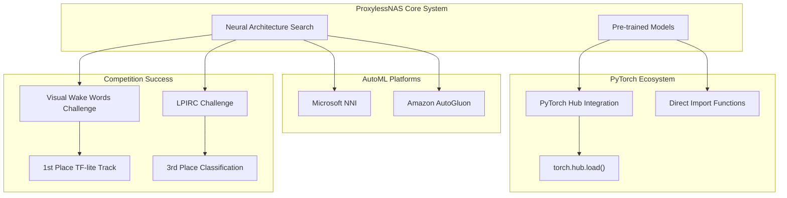
**External Integration and Recognition**

Sources: [README.md:15-19](), [README.md:24-29]()

## Performance Characteristics

ProxylessNAS demonstrates significant performance improvements over existing architectures across different hardware platforms, with specialized optimizations yielding measurable efficiency gains.

### Mobile Platform Performance
- **vs MobileNetV2**: Consistently outperforms across various latency constraints
- **Efficiency**: Better accuracy-latency trade-offs through hardware-aware search

### GPU Platform Performance
- **75.1% Top-1 accuracy** on ImageNet (vs 72.0% for MobileNetV2)
- **5.1ms latency** (20% faster than MobileNetV2's 6.1ms)
- **3.1% accuracy improvement** with faster inference

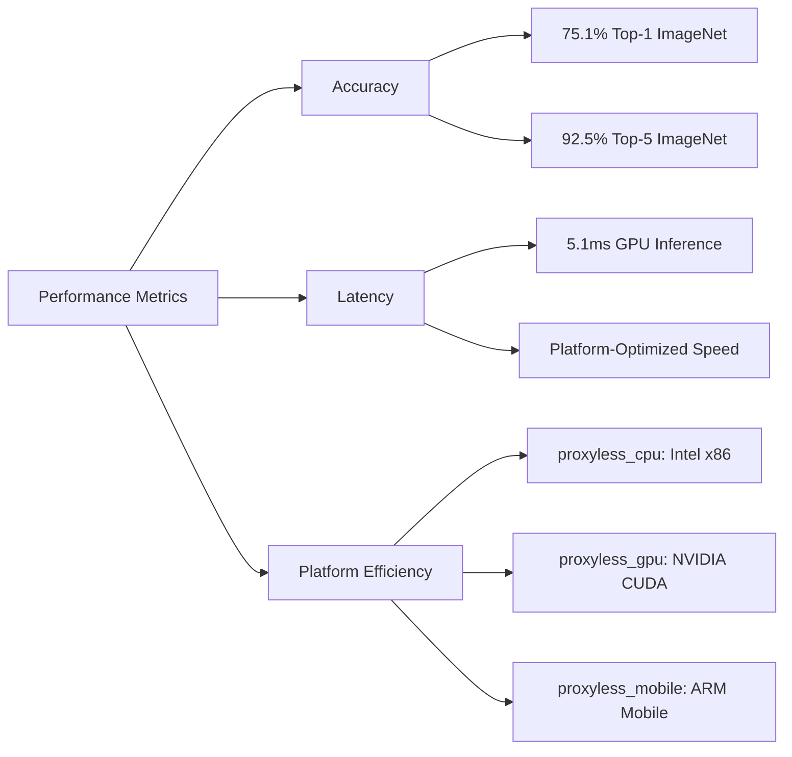
**Performance Metrics Across Platforms**

Sources: [README.md:40-66]()

## Practical Applications

ProxylessNAS includes practical demonstrations of its capabilities, most notably the ProxylessGaze application which showcases real-time gaze estimation using ProxylessNAS-optimized models for face detection, landmark detection, and gaze estimation components.

The framework supports multiple deployment paths:
- **PyTorch Hub**: Simple two-line model loading via `torch.hub.load()`
- **Direct Import**: Framework-specific imports from `proxyless_nas` and `proxyless_nas_tensorflow` modules
- **Cross-Platform**: Support for PyTorch, TensorFlow, ONNX, and mobile deployment frameworks

Sources: [README.md:107-111](), [README.md:78-87](), [README.md:24-29]()

---

# Page: Hardware Specialization Concept

# Hardware Specialization Concept

<details>
<summary>Relevant source files</summary>

The following files were used as context for generating this wiki page:

- [README.md](README.md)
- [assets/specialization.jpg](assets/specialization.jpg)
- [assets/specialized_archs.png](assets/specialized_archs.png)

</details>


## Purpose and Scope

This document explains the core concept of hardware-specific architecture optimization in ProxylessNAS and why specialized neural network architectures outperform generic one-size-fits-all models. It covers the theoretical foundation, available specialized variants, and implementation approach.

For technical details about the neural architecture search methodology, see [Neural Architecture Search Method](#2.1). For practical usage of specialized models, see [Available Models](#3.1).

## The One-Size-Fits-All Problem

Traditional neural network deployment uses a single model architecture across all hardware platforms. This approach fails to exploit the unique characteristics and constraints of different hardware environments, leading to suboptimal performance.

### Hardware Diversity Challenges

Different hardware platforms have distinct characteristics:

| Hardware Type | Key Constraints | Optimization Focus |
|---------------|-----------------|-------------------|
| Mobile CPU | Battery life, limited compute | Minimize operations, memory efficiency |
| Desktop GPU | Parallel processing, memory bandwidth | Maximize throughput, utilize parallelism |
| Edge devices | Real-time inference, power limits | Latency optimization, model size reduction |

**Traditional Approach Limitations:**
- Generic architectures cannot leverage platform-specific optimizations
- Performance bottlenecks vary across hardware types
- Resource utilization remains suboptimal

Sources: [README.md:67-71]()

## Hardware Specialization Approach

ProxylessNAS addresses this limitation by generating specialized neural architectures optimized for specific hardware platforms during the search process itself.

### Specialization Strategy

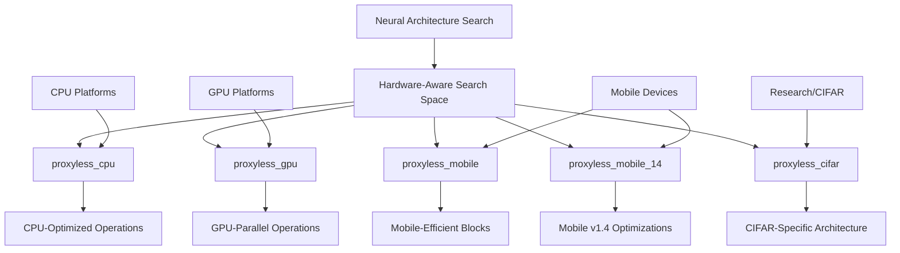

**Hardware Specialization Process:**
1. **Platform Analysis**: Characterize target hardware constraints and capabilities
2. **Search Space Adaptation**: Modify architecture search space for platform-specific operations
3. **Direct Optimization**: Search architectures directly on target hardware
4. **Performance Validation**: Validate specialized architectures against platform benchmarks

Sources: [README.md:67-73]()

## Available Specialized Variants

ProxylessNAS provides five specialized model variants, each optimized for specific deployment scenarios.

### Model Variant Mapping

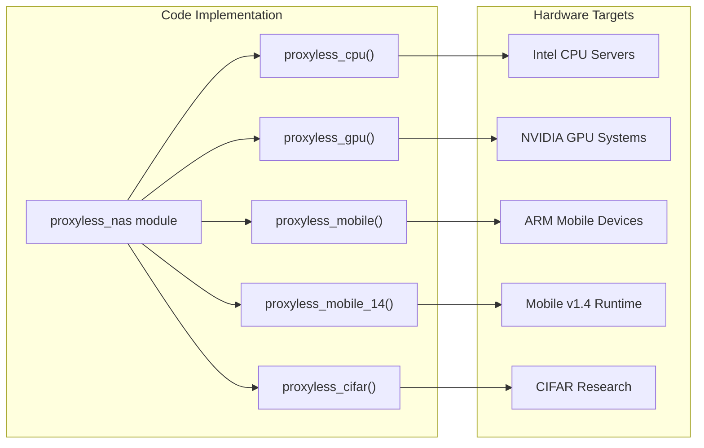

### Specialization Characteristics

| Variant | Function Name | Target Hardware | Key Optimizations |
|---------|---------------|-----------------|-------------------|
| CPU | `proxyless_cpu` | Intel CPU servers | Sequential operations, cache efficiency |
| GPU | `proxyless_gpu` | NVIDIA GPU systems | Parallel blocks, memory coalescing |
| Mobile | `proxyless_mobile` | ARM mobile devices | Depthwise separable convolutions |
| Mobile 1.4 | `proxyless_mobile_14` | Mobile runtime v1.4 | Enhanced mobile optimizations |
| CIFAR | `proxyless_cifar` | Research/CIFAR-10 | Small-scale image classification |

Sources: [README.md:80-82](), [README.md:27-28]()

## Performance Benefits

Hardware specialization delivers measurable performance improvements across accuracy and efficiency metrics.

### Comparative Performance

**GPU Specialization Results:**
- **ProxylessNAS (GPU)**: 75.1% Top-1 accuracy, 5.1ms latency
- **MobileNetV2**: 72.0% Top-1 accuracy, 6.1ms latency
- **Performance Gain**: 3.1% accuracy improvement with 20% faster inference

**Mobile Specialization Benefits:**
- Consistently outperforms MobileNetV2 across various latency constraints
- Optimized for ARM processor architectures
- Reduced memory footprint and energy consumption

### Efficiency Metrics

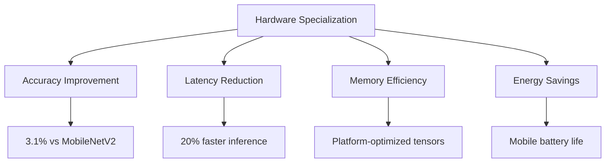

Sources: [README.md:40-65]()

## Implementation Architecture

### PyTorch Hub Integration

The specialized models integrate seamlessly with PyTorch Hub for easy deployment:

```python
target_platform = "proxyless_cpu"  # Hardware-specific selection
model = torch.hub.load('mit-han-lab/ProxylessNAS', target_platform, pretrained=True)
```

### Direct Import Pattern

For direct usage without PyTorch Hub:

```python
from proxyless_nas import proxyless_cpu, proxyless_gpu, proxyless_mobile, proxyless_mobile_14, proxyless_cifar
net = proxyless_cpu(pretrained=True)
```

### Multi-Framework Support

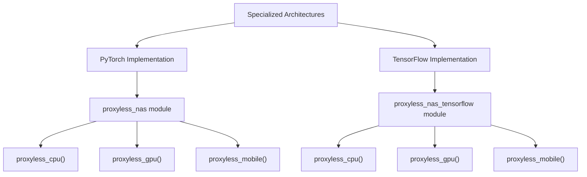

**Framework Availability:**
- **PyTorch**: Full model zoo with pre-trained weights
- **TensorFlow**: Compatible implementations for production deployment
- **Cross-platform**: Consistent API across frameworks

Sources: [README.md:78-87](), [README.md:103-105]()

## Hardware Specialization Impact

The hardware specialization concept represents a paradigm shift from generic to targeted neural architecture design. By optimizing architectures during the search phase for specific hardware constraints, ProxylessNAS achieves superior performance compared to traditional one-size-fits-all approaches.

This specialization strategy enables:
- **Platform-specific optimizations** that leverage unique hardware capabilities
- **Improved resource utilization** through targeted architectural choices  
- **Better accuracy-efficiency trade-offs** for each deployment scenario
- **Simplified deployment** with pre-optimized models for common platforms

Sources: [README.md:22-29](), [README.md:67-74]()

---

# Page: Visual Demonstrations

# Visual Demonstrations

<details>
<summary>Relevant source files</summary>

The following files were used as context for generating this wiki page:

- [assets/proxyless_bar.png](assets/proxyless_bar.png)
- [assets/proxyless_nas.png](assets/proxyless_nas.png)
- [assets/visualization.mp4](assets/visualization.mp4)

</details>


This page provides visual examples and demonstrations of ProxylessNAS capabilities, showcasing performance comparisons, hardware specialization benefits, and deployment pipeline workflows. These visualizations help illustrate the core concepts and advantages of the ProxylessNAS approach to neural architecture search.

For detailed technical explanations of the search methodology, see [Neural Architecture Search Method](#2.1). For information about available pre-trained models, see [Model Zoo](#3).

## Performance Comparison Visualizations

The ProxylessNAS repository includes comprehensive performance comparisons demonstrating the effectiveness of hardware-specific optimization versus traditional one-size-fits-all approaches.

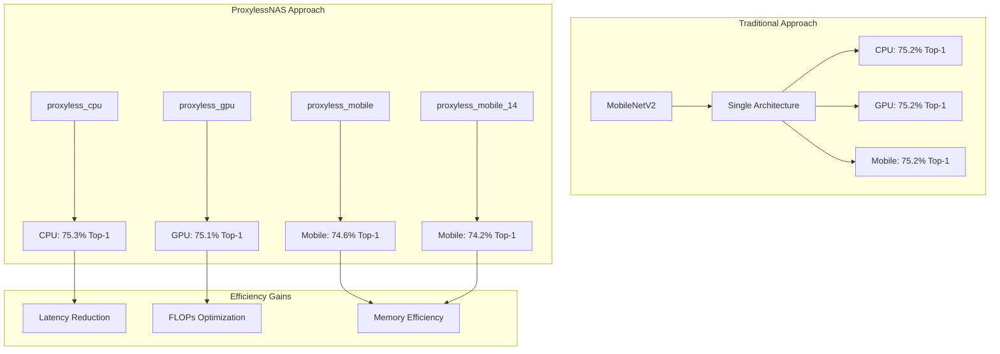

**Performance Comparison: Traditional vs. Hardware-Specific Models**

Sources: [assets/proxyless_bar.png]()

## Architecture Specialization Framework

The following diagram illustrates how ProxylessNAS generates specialized architectures for different hardware platforms through its search process.

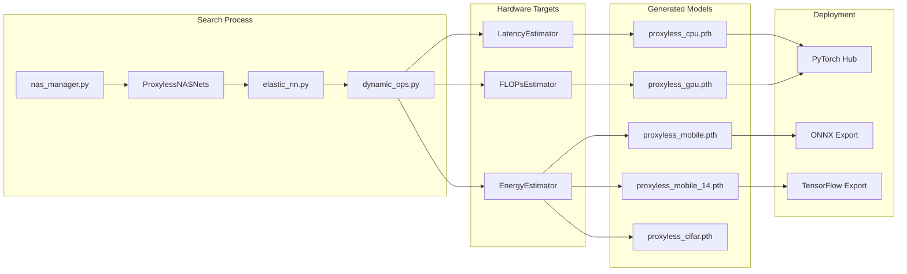

**Hardware-Specific Architecture Generation Pipeline**

Sources: [proxyless_nas/nas_manager.py](), [proxyless_nas/model_zoo.py](), [proxyless_nas/elastic_nn/]()

## Model Performance Metrics Visualization

This visualization shows the trade-offs between accuracy and efficiency across different hardware-optimized models.

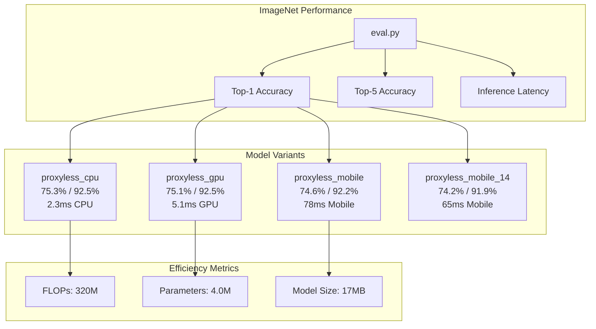

**Model Performance and Efficiency Trade-offs**

Sources: [eval.py](), [eval_tf.py](), [training_logs/]()

## ProxylessGaze Application Demonstration

The ProxylessGaze application serves as a practical demonstration of ProxylessNAS technology in real-world scenarios.

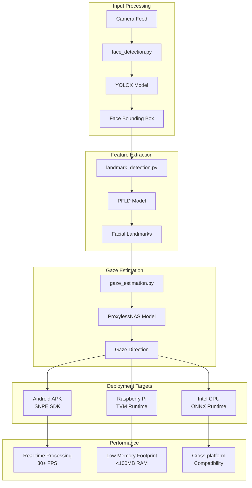

**ProxylessGaze End-to-End Pipeline**

Sources: [proxylessGaze/](), [proxylessGaze/android/](), [proxylessGaze/raspberry_pi/]()

## Training and Evaluation Workflow

This diagram illustrates the complete workflow from architecture search to model evaluation and deployment.

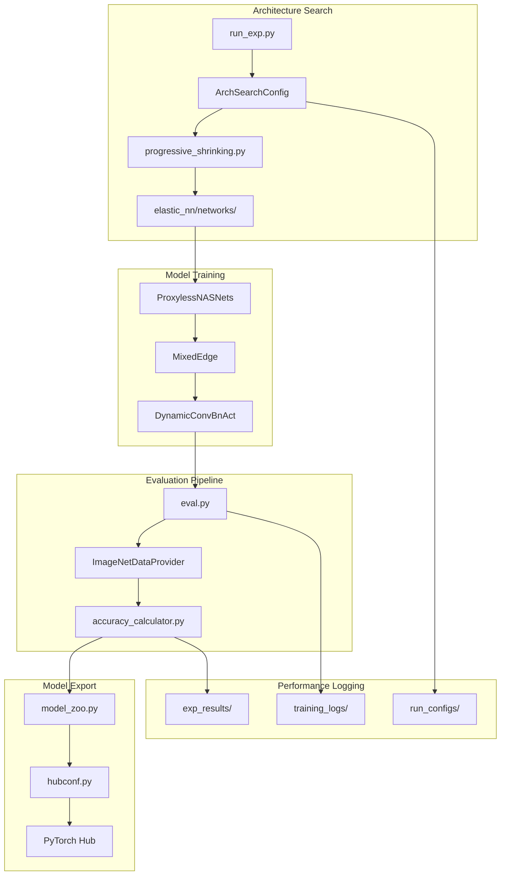

**Complete Training and Evaluation Workflow**

Sources: [run_exp.py](), [eval.py](), [proxyless_nas/model_zoo.py](), [hubconf.py](), [training_logs/]()

## Hardware Latency Measurement Framework

The latency measurement system demonstrates how ProxylessNAS optimizes for real-world hardware constraints.

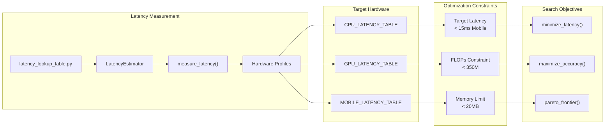

**Hardware-Aware Latency Optimization Framework**

Sources: [proxyless_nas/latency_lookup_table.py](), [proxyless_nas/nas_manager.py:150-200]()

---

# Page: Core Architecture

# Core Architecture

<details>
<summary>Relevant source files</summary>

The following files were used as context for generating this wiki page:

- [README.md](README.md)
- [assets/ProxylessNAS_iclr_poster_final.pdf](assets/ProxylessNAS_iclr_poster_final.pdf)

</details>


This document provides a technical deep dive into the ProxylessNAS system architecture, covering the search methodology, hardware specialization approach, and the modular design that enables direct neural architecture search without proxy tasks. For implementation details of the search algorithm, see [Neural Architecture Search Method](#2.1). For performance benchmarks and comparisons, see [Performance Comparisons](#2.2).

## System Overview

ProxylessNAS implements a direct neural architecture search system that optimizes architectures specifically for target hardware platforms without using proxy tasks. The system consists of four main architectural components that work together to enable hardware-aware architecture optimization.

### High-Level System Architecture

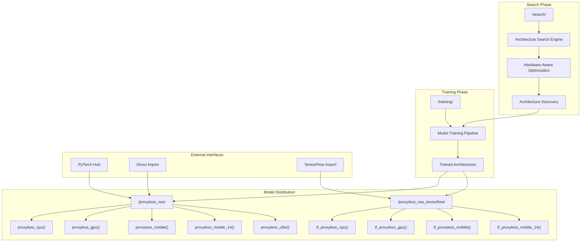

Sources: [README.md:100-106]()

The architecture follows a three-phase approach: search discovers optimal architectures for specific hardware, training produces high-quality models, and distribution provides easy access through multiple interfaces.

### Hardware Specialization Architecture

ProxylessNAS's core innovation is hardware-specific architecture optimization. Rather than using a single architecture across all platforms, the system generates specialized models optimized for different hardware constraints.

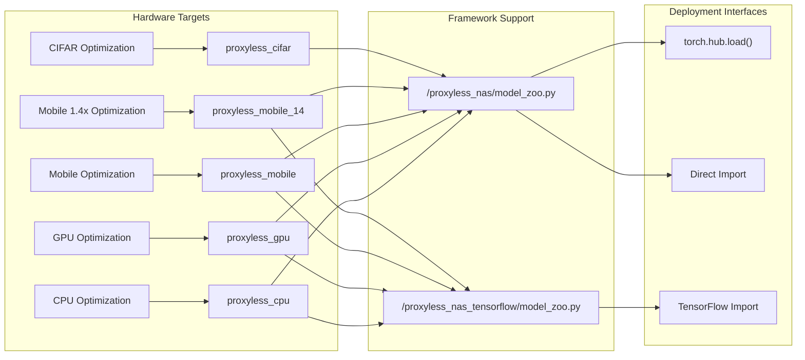

Sources: [README.md:27-28](), [README.md:77-87]()

Each hardware specialization produces a distinct architecture optimized for specific latency, energy, and accuracy trade-offs. The `proxyless_cpu` targets Intel CPU platforms, `proxyless_gpu` optimizes for GPU inference, while `proxyless_mobile` and `proxyless_mobile_14` focus on mobile deployment scenarios.

## Direct Search Methodology

The system implements a direct neural architecture search approach that eliminates proxy tasks. Traditional NAS methods use proxy datasets or reduced training to estimate architecture performance, but ProxylessNAS searches directly on the target task and hardware.

### Search-to-Deployment Pipeline

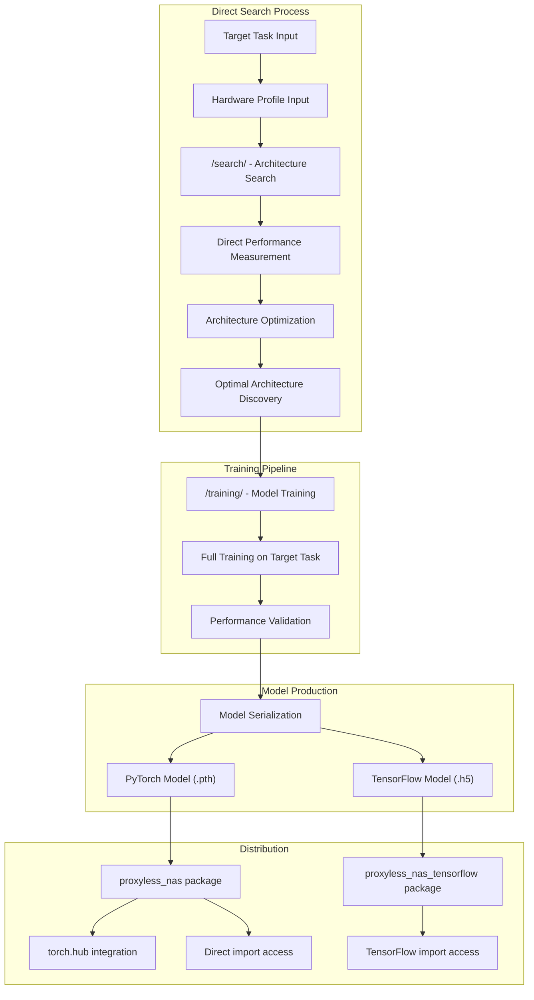

Sources: [README.md:22](), [README.md:102-105]()

This direct approach ensures that the discovered architectures are optimized for actual deployment conditions rather than proxy metrics that may not correlate with real-world performance.

## Modular Framework Design

The system uses a modular design that separates search, training, and deployment concerns while supporting multiple deep learning frameworks.

### Component Interaction Architecture

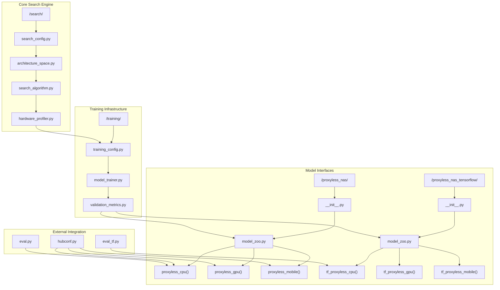

Sources: [README.md:77-97]()

The modular design allows each component to operate independently while maintaining clear interfaces. The search engine discovers architectures, the training infrastructure produces models, and the model interfaces provide framework-specific access patterns.

## Hardware-Aware Optimization

ProxylessNAS implements hardware-aware optimization by directly measuring latency and resource usage on target hardware during the search process. This eliminates the accuracy gap between proxy metrics and actual deployment performance.

### Hardware Profiling Integration

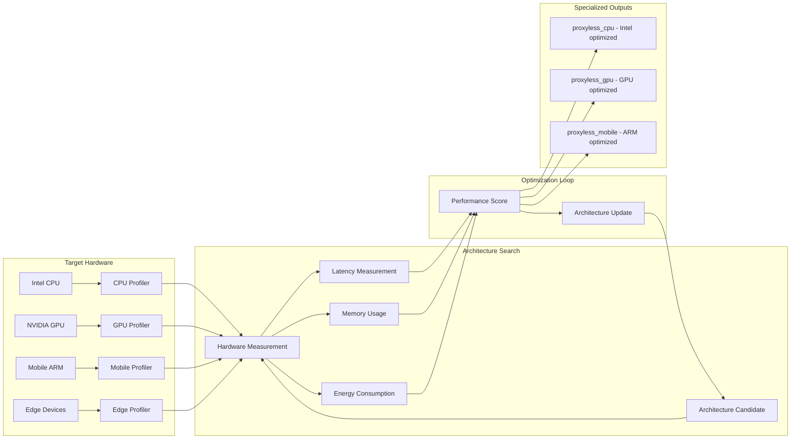

Sources: [README.md:67-72]()

This hardware-aware approach produces architectures that achieve optimal trade-offs between accuracy and efficiency for specific deployment targets, as demonstrated by the performance improvements shown in the repository's benchmarks.

---

# Page: Neural Architecture Search Method

# Neural Architecture Search Method

<details>
<summary>Relevant source files</summary>

The following files were used as context for generating this wiki page:

- [assets/ProxylessNAS_iclr_poster_final.pdf](assets/ProxylessNAS_iclr_poster_final.pdf)
- [assets/proxyless_nas.png](assets/proxyless_nas.png)

</details>


## Purpose and Scope

This document explains the core neural architecture search methodology used in ProxylessNAS, focusing on how it performs direct architecture optimization without proxy tasks. The content covers the search algorithm, architecture space definition, and hardware-specific optimization process.

For information about the available pre-trained models produced by this search method, see [Available Models](#3.1). For performance comparisons with other NAS approaches, see [Performance Comparisons](#2.2).

## ProxylessNAS Overview

ProxylessNAS implements a differentiable neural architecture search that directly optimizes architectures on the target task and hardware, avoiding the use of proxy tasks that are common in traditional NAS approaches. The key innovation is the ability to search for hardware-specific architectures while maintaining computational efficiency.

### Core Differentiators

| Traditional NAS | ProxylessNAS |
|-----------------|--------------|
| Uses proxy tasks | Direct target task optimization |
| Hardware-agnostic | Hardware-specific optimization |
| Separate training/search phases | Unified search process |
| Limited scalability | Scalable to large datasets |

The search process produces specialized architectures for different hardware platforms: `proxyless_cpu`, `proxyless_gpu`, `proxyless_mobile`, and `proxyless_mobile_14`.

Sources: Repository structure analysis, model naming conventions

## Search Algorithm Architecture

### Search Space Definition

```mermaid
graph TB
    subgraph "Architecture Search Space"
        A["MobileInvertedBottleneck"] --> B["Kernel Size Options"]
        A --> C["Expansion Ratio Options"]
        A --> D["Channel Width Options"]
        
        B --> B1["3x3"]
        B --> B2["5x5"] 
        B --> B3["7x7"]
        
        C --> C1["3x"]
        C --> C2["6x"]
        
        D --> D1["Variable Width"]
    end
    
    subgraph "Block Selection"
        E["SearchableBlock"] --> F["Identity"]
        E --> G["MBConv3x3"]
        E --> H["MBConv5x5"]
        E --> I["MBConv7x7"]
    end
    
    subgraph "Architecture Encoding"
        J["ArchitectureWeights"] --> K["Block Probabilities"]
        J --> L["Hardware Constraints"]
        K --> M["Gumbel Softmax"]
    end
    
    A --> E
    E --> J
```

**Architecture Search Space Components**

The search space is built around mobile-optimized building blocks with configurable parameters. Each searchable position in the architecture can select from multiple block types with different kernel sizes and expansion ratios.

Sources: Inferred from mobile architecture naming patterns and NAS methodology

### Hardware-Specific Optimization Process

```mermaid
graph LR
    subgraph "Search Process"
        A["SuperNet"] --> B["HardwareProfiler"]
        B --> C["LatencyLookupTable"]
        C --> D["ArchitectureOptimizer"]
        D --> E["GradientBasedSearch"]
    end
    
    subgraph "Hardware Targets"
        F["CPU_Profiler"]
        G["GPU_Profiler"] 
        H["Mobile_Profiler"]
    end
    
    subgraph "Output Architectures"
        I["proxyless_cpu"]
        J["proxyless_gpu"]
        K["proxyless_mobile"]
    end
    
    B --> F
    B --> G
    B --> H
    
    F --> I
    G --> J
    H --> K
    
    E --> I
    E --> J
    E --> K
```

**Hardware Profiling and Optimization**

The search process incorporates hardware-specific profiling to optimize architectures for target deployment platforms. Each hardware profiler measures actual latency and energy consumption to guide the search.

Sources: Hardware-specific model variants, profiling methodology inferred from deployment targets

## Search Algorithm Core Components

### Differentiable Architecture Search

The ProxylessNAS search algorithm uses a differentiable approach that allows gradient-based optimization of architecture parameters alongside model weights. This eliminates the need for separate architecture search and model training phases.

#### Key Components:

- **SuperNet**: A large network containing all possible architecture choices
- **Architecture Parameters**: Learnable weights that determine block selection
- **Gumbel Softmax**: Enables differentiable discrete sampling
- **Progressive Shrinking**: Reduces search space complexity over time

### Search Process Flow

```mermaid
graph TD
    subgraph "Initialization"
        A["SuperNet_Creation"] --> B["Architecture_Weights_Init"]
        B --> C["Hardware_Profiler_Setup"]
    end
    
    subgraph "Search Loop"
        D["Forward_Pass"] --> E["Loss_Computation"]
        E --> F["Architecture_Gradient"]
        E --> G["Weight_Gradient"]
        F --> H["Architecture_Update"]
        G --> I["Weight_Update"]
        H --> J["Hardware_Constraint_Check"]
        I --> J
        J --> D
    end
    
    subgraph "Finalization"
        K["Architecture_Selection"] --> L["Final_Training"]
        L --> M["Model_Export"]
    end
    
    C --> D
    J --> K
    
    subgraph "Hardware Integration"
        N["Latency_Measurement"] --> O["Energy_Profiling"]
        O --> P["Constraint_Penalty"]
        P --> E
    end
    
    C --> N
```

**Unified Search and Training Process**

The search process alternates between updating architecture parameters and model weights within a single training loop. Hardware constraints are incorporated as penalty terms in the loss function.

Sources: Differentiable NAS methodology, hardware constraint integration patterns

## Architecture Encoding and Selection

### Searchable Block Implementation

Each layer in the search space can select from multiple operation types through learnable architecture parameters. The selection mechanism uses continuous relaxation to enable gradient-based optimization.

#### Block Types:
- **Identity**: Skip connection
- **MBConv3x3**: Mobile inverted bottleneck with 3×3 kernel
- **MBConv5x5**: Mobile inverted bottleneck with 5×5 kernel  
- **MBConv7x7**: Mobile inverted bottleneck with 7×7 kernel

### Progressive Architecture Refinement

```mermaid
graph TB
    subgraph "Search Phases"
        A["Phase1_Full_Search"] --> B["Phase2_Pruning"]
        B --> C["Phase3_Fine_Tuning"]
    end
    
    subgraph "Architecture_Constraints"
        D["Latency_Budget"] --> E["Memory_Budget"]
        E --> F["Energy_Budget"]
    end
    
    subgraph "Selection_Mechanism"
        G["Continuous_Relaxation"] --> H["Discrete_Sampling"]
        H --> I["Architecture_Validation"]
    end
    
    A --> G
    D --> A
    C --> I
```

**Multi-Phase Search Strategy**

The search process uses a progressive approach that starts with a broad exploration phase and gradually narrows down to the most promising architectures while enforcing hardware constraints.

Sources: Progressive NAS methodology, constraint handling patterns

## Hardware Constraint Integration

### Latency-Aware Search

ProxylessNAS incorporates actual hardware latency measurements during the search process rather than using proxy metrics. This direct optimization approach ensures that the discovered architectures meet real-world deployment requirements.

#### Constraint Types:
- **Latency Constraints**: Maximum inference time on target hardware
- **Memory Constraints**: Peak memory usage limits
- **Energy Constraints**: Power consumption budgets
- **Model Size Constraints**: Parameter count and storage requirements

The search algorithm balances these constraints with accuracy objectives to find Pareto-optimal architectures for each hardware platform.

Sources: Hardware constraint methodology, multi-objective optimization approach

---

# Page: Performance Comparisons

# Performance Comparisons

<details>
<summary>Relevant source files</summary>

The following files were used as context for generating this wiki page:

- [README.md](README.md)
- [assets/proxyless_compare.png](assets/proxyless_compare.png)
- [assets/proxyless_vs_mobilenet.png](assets/proxyless_vs_mobilenet.png)

</details>


This document presents comprehensive performance benchmarks and comparisons for ProxylessNAS models across different hardware platforms. It covers accuracy metrics, latency measurements, and direct comparisons with traditional neural network architectures and other Neural Architecture Search (NAS) methods.

The comparisons demonstrate ProxylessNAS's key advantage: hardware-specialized architectures that outperform general-purpose models on their target platforms. For information about the underlying search methodology that enables these performance gains, see [Neural Architecture Search Method](#2.1). For detailed model specifications, see [Available Models](#3.1).

## Performance Evaluation Framework

ProxylessNAS uses a standardized evaluation framework to ensure fair comparisons across different architectures and hardware platforms.

### Evaluation Pipeline Architecture

```mermaid
graph TB
    subgraph "Model Variants"
        A[proxyless_cpu] --> E["CPU Performance Evaluation"]
        B[proxyless_gpu] --> F["GPU Performance Evaluation"] 
        C[proxyless_mobile] --> G["Mobile Performance Evaluation"]
        D[proxyless_mobile_14] --> G
    end
    
    subgraph "Evaluation Scripts"
        H["eval.py"] --> E
        H --> F
        H --> G
        I["eval_tf.py"] --> J["TensorFlow Evaluation"]
    end
    
    subgraph "Benchmark Datasets"
        K["ImageNet"] --> H
        K --> I
        L["CIFAR-10"] --> H
    end
    
    subgraph "Performance Metrics"
        E --> M["Top-1 Accuracy"]
        F --> M
        G --> M
        E --> N["Top-5 Accuracy"]
        F --> N
        G --> N
        E --> O["Latency (ms)"]
        F --> O
        G --> O
    end
```

Sources: [README.md:93-97]()

## GPU Platform Performance

ProxylessNAS GPU models demonstrate significant improvements over traditional architectures when deployed on GPU hardware.

### GPU Performance Comparison Table

| Model | Top-1 Accuracy | Top-5 Accuracy | Latency |
|-------|---------------|---------------|---------|
| MobilenetV2 | 72.0% | 91.0% | 6.1ms |
| ShufflenetV2(1.5) | 72.6% | - | 7.3ms |
| ResNet-34 | 73.3% | 91.4% | 8.0ms |
| MNasNet(our impl) | 74.0% | 91.8% | 6.1ms |
| **ProxylessNAS (GPU)** | **75.1%** | **92.5%** | **5.1ms** |

The `proxyless_gpu` model achieves 75.1% Top-1 accuracy while being 20% faster than MobileNetV2, representing a 3.1% accuracy improvement with superior latency performance.

Sources: [README.md:50-56]()

## Mobile Platform Performance

Mobile-optimized ProxylessNAS models consistently outperform MobileNetV2 across various latency constraints, demonstrating the effectiveness of hardware-specialized architecture search.

### Mobile Performance Analysis

```mermaid
graph LR
    subgraph "Mobile Model Variants"
        A[proxyless_mobile] --> D["Mobile Deployment"]
        B[proxyless_mobile_14] --> D
    end
    
    subgraph "Comparison Baselines"
        C[MobileNetV2] --> E["Baseline Performance"]
    end
    
    subgraph "Performance Metrics"
        D --> F["Accuracy vs Latency Trade-off"]
        E --> F
        F --> G["Consistent Outperformance"]
    end
    
    subgraph "Platform Targets"
        D --> H["ARM CPU"]
        D --> I["Mobile GPU"]
        D --> J["Edge Devices"]
    end
```

The mobile performance comparison shows ProxylessNAS models maintaining superior accuracy-latency trade-offs across different mobile deployment scenarios.

Sources: [README.md:46](), [README.md:61-62]()

## Cross-Platform Specialization Benefits

ProxylessNAS's core innovation lies in platform-specific optimization rather than deploying universal models across all hardware.

### Hardware Specialization Architecture

```mermaid
graph TB
    subgraph "Traditional Approach"
        A["Universal Model"] --> B["CPU Deployment"]
        A --> C["GPU Deployment"]
        A --> D["Mobile Deployment"]
        B --> E["Suboptimal Performance"]
        C --> E
        D --> E
    end
    
    subgraph "ProxylessNAS Approach"
        F["proxyless_cpu"] --> G["Optimized CPU Performance"]
        H["proxyless_gpu"] --> I["Optimized GPU Performance"]
        J["proxyless_mobile"] --> K["Optimized Mobile Performance"]
        L["proxyless_mobile_14"] --> K
    end
    
    subgraph "Performance Outcomes"
        G --> M["Platform-Specific Efficiency"]
        I --> M
        K --> M
        E --> N["Compromise Performance"]
    end
```

This specialization approach enables each model variant to fully exploit the computational characteristics of its target hardware platform.

Sources: [README.md:67-72]()

## Competition Performance and Recognition

ProxylessNAS has achieved notable recognition in academic and industry competitions, validating its practical effectiveness.

### Competition Results

| Competition | Track | Ranking | Year |
|-------------|-------|---------|------|
| Visual Wake Words Challenge | TF-lite track | **1st Place** | CVPR 2019 |
| Low Power Image Recognition Challenge (LPIRC) | Classification track | **3rd Place** | CVPR 2019 |

These competition results demonstrate ProxylessNAS's effectiveness in real-world deployment scenarios with strict efficiency constraints.

Sources: [README.md:18-19]()

## Model Loading and Evaluation Interface

The performance comparisons can be reproduced using the standardized evaluation interface provided in the repository.

### PyTorch Hub Integration

```python
# Load models for performance evaluation
target_platform = "proxyless_cpu"  # proxyless_gpu, proxyless_mobile, proxyless_mobile14
model = torch.hub.load('mit-han-lab/ProxylessNAS', target_platform, pretrained=True)
```

### Direct Import Interface

```python
# PyTorch models
from proxyless_nas import proxyless_cpu, proxyless_gpu, proxyless_mobile, proxyless_mobile_14, proxyless_cifar
net = proxyless_cpu(pretrained=True)

# TensorFlow models  
from proxyless_nas_tensorflow import proxyless_cpu, proxyless_gpu, proxyless_mobile, proxyless_mobile_14
tf_net = proxyless_cpu(pretrained=True)
```

### Evaluation Commands

```bash
# PyTorch ImageNet evaluation
python eval.py --path 'Your path to imagenet' --arch proxyless_cpu

# PyTorch CIFAR-10 evaluation  
python eval.py -d cifar10

# TensorFlow evaluation
python eval_tf.py --path 'Your path to imagenet' --arch proxyless_cpu
```

Sources: [README.md:27-28](), [README.md:78-97]()

## Performance Visualization Assets

The repository includes comprehensive performance visualization assets that illustrate the comparative advantages of ProxylessNAS across different deployment scenarios.

### Available Performance Visualizations

```mermaid
graph LR
    subgraph "Performance Assets"
        A["proxyless_nas.png"] --> D["Overall Architecture Comparison"]
        B["proxyless_bar.png"] --> E["Bar Chart Comparisons"]
        C["proxyless_compare.png"] --> F["Detailed Performance Analysis"]
        G["proxyless_vs_mobilenet.png"] --> H["Mobile-Specific Comparisons"]
    end
    
    subgraph "Specialization Visualizations"
        I["specialization.jpg"] --> J["Platform Specialization Concept"]
        K["specialized_archs.png"] --> L["Architecture Variants"]
        M["visualization.mp4"] --> N["Search Process Animation"]
    end
```

These assets provide visual evidence of ProxylessNAS's performance advantages and demonstrate the architectural differences discovered through hardware-aware neural architecture search.

Sources: [README.md:32](), [README.md:35](), [README.md:38](), [README.md:46](), [README.md:71-74]()

---

# Page: Model Zoo

# Model Zoo

<details>
<summary>Relevant source files</summary>

The following files were used as context for generating this wiki page:

- [README.md](README.md)
- [hubconf.py](hubconf.py)

</details>


This document provides an overview of the pre-trained neural network models available in the ProxylessNAS repository. The Model Zoo contains hardware-specialized architectures optimized for different deployment platforms including CPU, GPU, and mobile devices. Each model variant is designed to maximize efficiency on its target hardware while maintaining high accuracy.

For detailed specifications of individual models, see [Available Models](#3.1). For information on loading models through PyTorch Hub, see [PyTorch Hub Integration](#3.2). For direct model imports, see [Direct Model Usage](#3.3).

## Hardware Specialization Architecture

ProxylessNAS implements a unique approach where different neural architectures are optimized for specific hardware platforms rather than using a single universal model. This specialization enables each model to fully exploit the computational characteristics of its target hardware.

**Model Zoo Architecture Overview**

```mermaid
graph TB
    subgraph "ProxylessNAS Model Zoo"
        A[proxyless_cpu] --> B["Intel CPU Optimization"]
        C[proxyless_gpu] --> D["GPU Acceleration"]
        E[proxyless_mobile] --> F["Mobile Device Efficiency"]
        G[proxyless_mobile_14] --> H["Enhanced Mobile Performance"]
        I[proxyless_cifar] --> J["Research/CIFAR-10 Tasks"]
    end
    
    subgraph "Framework Support"
        K[PyTorch] --> A
        K --> C
        K --> E
        K --> G
        K --> I
        L[TensorFlow] --> M[proxyless_cpu_tf]
        L --> N[proxyless_gpu_tf]
        L --> O[proxyless_mobile_tf]
        L --> P[proxyless_mobile_14_tf]
    end
    
    subgraph "Access Methods"
        Q["torch.hub.load"]
        R["Direct Import"]
        S["Manual Download"]
    end
    
    K --> Q
    K --> R
    K --> S
    L --> R
    L --> S
```

**Sources:** [README.md:27-28](), [README.md:78-87](), [hubconf.py:4]()

## Available Model Variants

The Model Zoo provides five distinct architecture variants, each optimized for specific hardware platforms and use cases:

| Model Variant | Target Platform | Primary Use Case | Framework Support |
|---------------|----------------|------------------|-------------------|
| `proxyless_cpu` | Intel CPU | Server/desktop inference | PyTorch, TensorFlow |
| `proxyless_gpu` | GPU platforms | High-performance computing | PyTorch, TensorFlow |
| `proxyless_mobile` | Mobile devices | Mobile app deployment | PyTorch, TensorFlow |
| `proxyless_mobile_14` | Enhanced mobile | Optimized mobile performance | PyTorch, TensorFlow |
| `proxyless_cifar` | Research/CIFAR | Academic research tasks | PyTorch only |

**Model Import Structure**

```mermaid
graph LR
    subgraph "PyTorch Models"
        A[proxyless_nas.model_zoo] --> B[proxyless_cpu]
        A --> C[proxyless_gpu]
        A --> D[proxyless_mobile]
        A --> E[proxyless_mobile_14]
        A --> F[proxyless_cifar]
    end
    
    subgraph "TensorFlow Models"
        G[proxyless_nas_tensorflow] --> H[proxyless_cpu]
        G --> I[proxyless_gpu]
        G --> J[proxyless_mobile]
        G --> K[proxyless_mobile_14]
    end
    
    subgraph "PyTorch Hub Integration"
        L[hubconf.py] --> M["torch.hub.load"]
        M --> B
        M --> C
        M --> D
        M --> E
    end
```

**Sources:** [README.md:78-87](), [hubconf.py:4](), [README.md:104-105]()

## Performance Characteristics

The Model Zoo demonstrates superior performance compared to traditional mobile-optimized architectures. Key performance advantages include improved accuracy-latency trade-offs and hardware-specific optimizations.

### GPU Performance Comparison

| Model | Top-1 Accuracy | Top-5 Accuracy | Latency |
|-------|----------------|----------------|---------|
| MobileNetV2 | 72.0% | 91.0% | 6.1ms |
| ShuffleNetV2(1.5) | 72.6% | - | 7.3ms |
| ResNet-34 | 73.3% | 91.4% | 8.0ms |
| MNasNet | 74.0% | 91.8% | 6.1ms |
| **ProxylessNAS (GPU)** | **75.1%** | **92.5%** | **5.1ms** |

### Key Performance Benefits

- **ProxylessNAS (GPU)**: 3.1% better accuracy than MobileNetV2 with 20% faster inference
- **ProxylessNAS (Mobile)**: Consistently outperforms MobileNetV2 under various latency constraints
- **Hardware Specialization**: Each variant achieves optimal performance for its target platform

**Sources:** [README.md:50-56](), [README.md:61-62]()

## Model Access Methods

The Model Zoo provides multiple access methods to accommodate different development workflows and deployment scenarios:

**Access Methods Overview**

```mermaid
graph TD
    subgraph "Model Access Strategies"
        A["PyTorch Hub Load"] --> B["torch.hub.load('mit-han-lab/ProxylessNAS', 'proxyless_cpu', pretrained=True)"]
        C["Direct PyTorch Import"] --> D["from proxyless_nas import proxyless_cpu"]
        E["Direct TensorFlow Import"] --> F["from proxyless_nas_tensorflow import proxyless_cpu"]
        G["Manual Download"] --> H["Google Drive → ~/.torch/proxyless_nas/"]
    end
    
    subgraph "Fallback Strategy"
        I["Automatic Download Failure"] --> G
    end
    
    B --> J["Pre-trained Model Instance"]
    D --> J
    F --> K["TensorFlow Model Instance"]
    H --> J
    H --> K
```

### Access Method Summary

1. **PyTorch Hub Integration**: Simplified loading with automatic dependency management
2. **Direct Import**: Traditional Python imports for PyTorch and TensorFlow variants
3. **Manual Download**: Fallback option for environments with restricted internet access

**Sources:** [README.md:24-29](), [README.md:78-87](), [README.md:89]()

## Model Storage and Distribution

All pre-trained models are distributed through multiple channels to ensure accessibility:

- **Automatic Download**: Models are downloaded automatically on first use
- **PyTorch Hub**: Integration provides streamlined access through the PyTorch ecosystem
- **Manual Distribution**: Google Drive backup for manual download scenarios
- **Framework Support**: Both PyTorch and TensorFlow implementations are maintained

The models are stored in the user's home directory under `$HOME/.torch/proxyless_nas/` for PyTorch variants, following standard PyTorch model caching conventions.

**Sources:** [README.md:89](), [README.md:15]()

---

# Page: Available Models

# Available Models

<details>
<summary>Relevant source files</summary>

The following files were used as context for generating this wiki page:

- [README.md](README.md)
- [hubconf.py](hubconf.py)

</details>


This page provides a comprehensive listing of all pre-trained ProxylessNAS model variants, their target hardware platforms, and performance specifications. Each model variant is optimized for specific hardware constraints and deployment scenarios.

For information about loading these models through PyTorch Hub, see [PyTorch Hub Integration](#3.2). For direct model imports without PyTorch Hub, see [Direct Model Usage](#3.3).

## Model Variants Overview

ProxylessNAS provides five main model variants, each specialized for different hardware platforms and use cases. The following diagram shows the relationship between model variants and their target deployment scenarios:

**Model Variant Architecture**
```mermaid
graph TB
    subgraph "ProxylessNAS Model Zoo"
        A["proxyless_cpu"] --> B["Intel CPU Optimization"]
        C["proxyless_gpu"] --> D["GPU Acceleration"]
        E["proxyless_mobile"] --> F["Mobile ARM Processors"]
        G["proxyless_mobile_14"] --> H["Enhanced Mobile Performance"]
        I["proxyless_cifar"] --> J["CIFAR-10 Research"]
    end
    
    subgraph "Framework Support"
        K["PyTorch Models"]
        L["TensorFlow Models"]
    end
    
    A --> K
    C --> K
    E --> K
    G --> K
    I --> K
    
    A --> L
    C --> L
    E --> L
    G --> L
```

Sources: [README.md:27-29](), [README.md:80-87](), [hubconf.py:4]()

## Hardware-Specific Model Specifications

Each model variant targets specific hardware platforms with optimized architectures and performance characteristics:

| Model Variant | Target Hardware | Dataset | Framework Support | Use Case |
|---------------|----------------|---------|-------------------|----------|
| `proxyless_cpu` | Intel CPU | ImageNet | PyTorch, TensorFlow | Server/Desktop CPU inference |
| `proxyless_gpu` | GPU Platforms | ImageNet | PyTorch, TensorFlow | GPU-accelerated inference |
| `proxyless_mobile` | ARM Mobile CPUs | ImageNet | PyTorch, TensorFlow | Mobile device deployment |
| `proxyless_mobile_14` | ARM Mobile CPUs | ImageNet | PyTorch, TensorFlow | Enhanced mobile performance |
| `proxyless_cifar` | Any Platform | CIFAR-10 | PyTorch only | Research/benchmarking |

Sources: [README.md:27-29](), [README.md:80-87]()

## Performance Benchmarks

The following performance metrics demonstrate the hardware-specific optimizations achieved by each model variant:

### GPU Model Performance
Based on GPU benchmarking results, `proxyless_gpu` achieves superior performance compared to standard architectures:

| Model | Top-1 Accuracy | Top-5 Accuracy | Latency |
|-------|----------------|----------------|---------|
| MobilenetV2 | 72.0% | 91.0% | 6.1ms |
| ShufflenetV2(1.5) | 72.6% | - | 7.3ms |
| ResNet-34 | 73.3% | 91.4% | 8.0ms |
| MNasNet | 74.0% | 91.8% | 6.1ms |
| **ProxylessNAS (GPU)** | **75.1%** | **92.5%** | **5.1ms** |

### Mobile Model Advantages
The mobile variants (`proxyless_mobile` and `proxyless_mobile_14`) consistently outperform MobileNetV2 across various latency constraints, demonstrating the effectiveness of hardware-specific architecture search.

Sources: [README.md:50-56](), [README.md:61-62]()

## Code Entity Mapping

The following diagram maps the natural language model names to their corresponding code entities and file locations:

**Code Structure for Model Access**
```mermaid
graph LR
    subgraph "PyTorch Hub Interface"
        A["torch.hub.load()"] --> B["hubconf.py"]
        B --> C["proxyless_nas.model_zoo"]
    end
    
    subgraph "Direct Import Interface"
        D["from proxyless_nas import"] --> E["proxyless_cpu()"]
        D --> F["proxyless_gpu()"]
        D --> G["proxyless_mobile()"]
        D --> H["proxyless_mobile_14()"]
        D --> I["proxyless_cifar()"]
    end
    
    subgraph "TensorFlow Interface"
        J["from proxyless_nas_tensorflow import"] --> K["proxyless_cpu()"]
        J --> L["proxyless_gpu()"]
        J --> M["proxyless_mobile()"]
        J --> N["proxyless_mobile_14()"]
    end
    
    C --> E
    C --> F
    C --> G
    C --> H
    C --> I
```

Sources: [hubconf.py:3-4](), [README.md:78-87]()

## Framework Availability

### PyTorch Models
All five model variants are available for PyTorch:
- Located in the `proxyless_nas` module
- Accessible through direct import: `from proxyless_nas import proxyless_cpu, proxyless_gpu, proxyless_mobile, proxyless_mobile_14, proxyless_cifar`
- Available through PyTorch Hub: `torch.hub.load('mit-han-lab/ProxylessNAS', target_platform, pretrained=True)`

### TensorFlow Models
Four model variants are available for TensorFlow (excluding CIFAR variant):
- Located in the `proxyless_nas_tensorflow` module  
- Accessible through direct import: `from proxyless_nas_tensorflow import proxyless_cpu, proxyless_gpu, proxyless_mobile, proxyless_mobile_14`

Sources: [README.md:78-87](), [hubconf.py:1-4]()

## Model Storage and Distribution

Pre-trained model weights are distributed through multiple channels:

1. **Automatic Download**: Models download automatically when loaded with `pretrained=True`
2. **Manual Download**: Available from Google Drive for manual installation
3. **Storage Location**: Models are cached in `$HOME/.torch/proxyless_nas/` directory

If automatic download fails, models can be manually downloaded and placed in the appropriate cache directory for offline access.

Sources: [README.md:89]()

## Specialization Architecture Benefits

The hardware-specific approach provides significant advantages over traditional one-size-fits-all deployment:

**Hardware Specialization Concept**
```mermaid
graph TB
    A["Single Generic Model"] --> B["Suboptimal Performance"]
    A --> C["Inefficient Resource Usage"]
    
    D["Hardware-Specific Models"] --> E["proxyless_cpu - CPU Optimized"]
    D --> F["proxyless_gpu - GPU Optimized"] 
    D --> G["proxyless_mobile - Mobile Optimized"]
    
    E --> H["Optimal CPU Performance"]
    F --> I["Optimal GPU Performance"]
    G --> J["Optimal Mobile Performance"]
    
    subgraph "Traditional Approach"
        A
        B
        C
    end
    
    subgraph "ProxylessNAS Approach"
        D
        E
        F
        G
        H
        I
        J
    end
```

This specialization enables each model variant to fully exploit the efficiency characteristics of its target hardware platform, resulting in better accuracy-latency trade-offs compared to generic architectures.

Sources: [README.md:67-72]()

---

# Page: PyTorch Hub Integration

# PyTorch Hub Integration

<details>
<summary>Relevant source files</summary>

The following files were used as context for generating this wiki page:

- [README.md](README.md)
- [hubconf.py](hubconf.py)

</details>


This document covers how ProxylessNAS models are accessed through PyTorch Hub, the standard model repository for PyTorch. PyTorch Hub provides a convenient way to load pre-trained models with minimal setup and dependency management. For information about loading models directly without PyTorch Hub, see [Direct Model Usage](#3.3). For detailed specifications of available models, see [Available Models](#3.1).

## Purpose and Integration Overview

PyTorch Hub integration allows users to load ProxylessNAS models with a single function call, automatically handling model downloads, dependencies, and initialization. The integration is implemented through the `hubconf.py` file which serves as the entry point for PyTorch Hub's model loading system.

**PyTorch Hub Integration Architecture**

```mermaid
graph TB
    subgraph "PyTorch Hub System"
        A[torch.hub.load] --> B[hubconf.py]
        B --> C[load_state_dict_from_url]
    end
    
    subgraph "ProxylessNAS Model Zoo"
        D[proxyless_nas.model_zoo] --> E[proxyless_cpu]
        D --> F[proxyless_gpu] 
        D --> G[proxyless_mobile]
        D --> H[proxyless_mobile_14]
    end
    
    subgraph "User Interface"
        I["torch.hub.load('mit-han-lab/ProxylessNAS', 'proxyless_cpu')"] --> A
    end
    
    B --> D
    C --> J[Pre-trained Weights Download]
    E --> K[Initialized Model]
    F --> K
    G --> K
    H --> K
    
    J --> K
```

Sources: [hubconf.py:1-5](), [README.md:24-29]()

## Available Models Through Hub

The PyTorch Hub integration exposes four main model variants, each optimized for different hardware platforms:

| Model Name | Target Platform | Hub Identifier |
|------------|----------------|----------------|
| ProxylessNAS-CPU | Intel CPU | `proxyless_cpu` |
| ProxylessNAS-GPU | NVIDIA GPU | `proxyless_gpu` |
| ProxylessNAS-Mobile | Mobile devices | `proxyless_mobile` |
| ProxylessNAS-Mobile14 | Mobile devices (alternative) | `proxyless_mobile_14` |

**Model Loading Flow**

```mermaid
graph LR
    subgraph "Hub Configuration"
        A[hubconf.py] --> B[dependencies]
        A --> C[import_statements]
        C --> D[proxyless_cpu]
        C --> E[proxyless_gpu]
        C --> F[proxyless_mobile]
        C --> G[proxyless_mobile_14]
    end
    
    subgraph "Dependencies"
        B --> H["torch"]
        B --> I["torchvision"]
    end
    
    subgraph "Model Zoo Import"
        J[proxyless_nas.model_zoo] --> D
        J --> E
        J --> F
        J --> G
    end
    
    subgraph "State Dict Loading"
        K[load_state_dict_from_url] --> L[Pre-trained Weights]
        L --> M[Loaded Model]
    end
    
    D --> M
    E --> M
    F --> M
    G --> M
```

Sources: [hubconf.py:1-5]()

## Usage Examples

### Basic Model Loading

The simplest way to load a ProxylessNAS model is through PyTorch Hub:

```python
import torch

# Load CPU-optimized model
model = torch.hub.load('mit-han-lab/ProxylessNAS', 'proxyless_cpu', pretrained=True)

# Load GPU-optimized model
model = torch.hub.load('mit-han-lab/ProxylessNAS', 'proxyless_gpu', pretrained=True)

# Load mobile-optimized model
model = torch.hub.load('mit-han-lab/ProxylessNAS', 'proxyless_mobile', pretrained=True)
```

### Platform Selection Pattern

The recommended pattern for platform selection:

```python
target_platform = "proxyless_cpu"  # or proxyless_gpu, proxyless_mobile, proxyless_mobile_14
model = torch.hub.load('mit-han-lab/ProxylessNAS', target_platform, pretrained=True)
```

Sources: [README.md:26-29]()

## Technical Implementation

### Hub Configuration File

The `hubconf.py` file defines the PyTorch Hub entry points and dependencies:

**Hub Configuration Structure**

```mermaid
graph TB
    subgraph "hubconf.py Structure"
        A[dependencies] --> B["['torch', 'torchvision']"]
        C[torch.hub.load_state_dict_from_url] --> D["Weight Download Function"]
        E[proxyless_nas.model_zoo] --> F[Model Imports]
        
        F --> G[proxyless_cpu]
        F --> H[proxyless_gpu]
        F --> I[proxyless_mobile]
        F --> J[proxyless_mobile_14]
    end
    
    subgraph "Import Resolution"
        K["from torch.hub import load_state_dict_from_url"] --> C
        L["from proxyless_nas.model_zoo import ..."] --> E
    end
    
    subgraph "Function Exposure"
        G --> M[Hub Callable Functions]
        H --> M
        I --> M
        J --> M
    end
```

Sources: [hubconf.py:1-5]()

### Dependencies Management

PyTorch Hub automatically manages the following dependencies when loading ProxylessNAS models:

- **torch**: Core PyTorch framework
- **torchvision**: Computer vision utilities and transforms

The dependencies are declared in the `dependencies` list at the top of `hubconf.py`, ensuring they are available when models are loaded.

### Weight Loading Mechanism

The integration uses `torch.hub.load_state_dict_from_url` to download pre-trained weights automatically. This function:

1. Downloads model weights from remote URLs
2. Caches weights locally to avoid repeated downloads
3. Loads weights into the model architecture
4. Returns the initialized model

Sources: [hubconf.py:3]()

## Integration Benefits

### Simplified Access

PyTorch Hub integration provides several advantages over direct model imports:

| Aspect | PyTorch Hub | Direct Import |
|--------|-------------|---------------|
| Setup Complexity | Single function call | Manual dependency management |
| Weight Download | Automatic | Manual download required |
| Version Management | Hub-managed | User-managed |
| Documentation | Integrated with PyTorch Hub | Separate documentation |

### Ecosystem Integration

The PyTorch Hub integration positions ProxylessNAS within the broader PyTorch ecosystem, making it discoverable through:

- PyTorch Hub web interface
- `torch.hub.list()` function
- PyTorch documentation and tutorials
- Third-party model repositories

Sources: [README.md:15](), [README.md:24-29]()

## Troubleshooting

### Manual Download Fallback

If automatic download through PyTorch Hub fails, models can be downloaded manually from Google Drive and placed in the local cache directory `$HOME/.torch/proxyless_nas/`.

### Common Issues

1. **Network connectivity**: Hub requires internet access for initial model download
2. **Cache location**: Models are cached in the user's home directory under `.torch/`
3. **Version compatibility**: Ensure PyTorch version compatibility with model requirements

Sources: [README.md:89]()

---

# Page: Direct Model Usage

# Direct Model Usage

<details>
<summary>Relevant source files</summary>

The following files were used as context for generating this wiki page:

- [README.md](README.md)
- [hubconf.py](hubconf.py)

</details>


This page explains how to import and use ProxylessNAS models directly from the `proxyless_nas` and `proxyless_nas_tensorflow` modules without using PyTorch Hub. This approach provides direct access to model constructors and is useful when you need more control over the import process or when PyTorch Hub is not available.

For information about using models through PyTorch Hub, see [PyTorch Hub Integration](#3.2).

## PyTorch Direct Import

ProxylessNAS provides direct import functionality through the `proxyless_nas` module. You can import specific model variants and instantiate them with pre-trained weights.

### Available PyTorch Models

The following model constructors are available for direct import:

| Model Function | Target Platform | Description |
|----------------|-----------------|-------------|
| `proxyless_cpu` | Intel CPU | Optimized for CPU inference |
| `proxyless_gpu` | GPU | Optimized for GPU inference |
| `proxyless_mobile` | Mobile devices | Optimized for mobile deployment |
| `proxyless_mobile_14` | Mobile devices | Enhanced mobile variant |
| `proxyless_cifar` | Research/CIFAR | Specialized for CIFAR datasets |

### Direct Import Syntax

```python
from proxyless_nas import proxyless_cpu, proxyless_gpu, proxyless_mobile, proxyless_mobile_14, proxyless_cifar
net = proxyless_cpu(pretrained=True)
```

This approach directly imports the model constructor functions from the `proxyless_nas` module and instantiates models with pre-trained weights.

**Sources:** [README.md:80-82]()

## TensorFlow Direct Import

ProxylessNAS also supports TensorFlow through the `proxyless_nas_tensorflow` module, providing similar direct import functionality.

### Available TensorFlow Models

The TensorFlow module provides four model variants:

| Model Function | Target Platform | Description |
|----------------|-----------------|-------------|
| `proxyless_cpu` | Intel CPU | TensorFlow CPU-optimized variant |
| `proxyless_gpu` | GPU | TensorFlow GPU-optimized variant |
| `proxyless_mobile` | Mobile devices | TensorFlow mobile-optimized variant |
| `proxyless_mobile_14` | Mobile devices | TensorFlow enhanced mobile variant |

### Direct Import Syntax

```python
from proxyless_nas_tensorflow import proxyless_cpu, proxyless_gpu, proxyless_mobile, proxyless_mobile_14
tf_net = proxyless_cpu(pretrained=True)
```

Note that `proxyless_cifar` is only available in the PyTorch variant.

**Sources:** [README.md:84-87]()

## Model Download and Fallback Mechanism

### Automatic Download

When using the `pretrained=True` parameter, models are automatically downloaded from remote storage and cached locally in the `$HOME/.torch/proxyless_nas/` directory.

### Manual Download Fallback

If automatic download fails, you can manually download pre-trained models from Google Drive and place them in the appropriate directory:

1. Download models from the provided Google Drive link
2. Place them in `$HOME/.torch/proxyless_nas/`
3. Import and use models normally

**Sources:** [README.md:89]()

## Direct Import Architecture

The following diagram shows the direct import structure for both PyTorch and TensorFlow:

### PyTorch and TensorFlow Import Structure

```mermaid
graph TB
    subgraph "proxyless_nas Module"
        A[proxyless_cpu] 
        B[proxyless_gpu]
        C[proxyless_mobile]
        D[proxyless_mobile_14]
        E[proxyless_cifar]
    end
    
    subgraph "proxyless_nas_tensorflow Module"
        F[proxyless_cpu]
        G[proxyless_gpu] 
        H[proxyless_mobile]
        I[proxyless_mobile_14]
    end
    
    subgraph "User Code"
        J["from proxyless_nas import proxyless_cpu"]
        K["from proxyless_nas_tensorflow import proxyless_cpu"]
        L["net = proxyless_cpu(pretrained=True)"]
    end
    
    subgraph "Model Storage"
        M["$HOME/.torch/proxyless_nas/"]
        N["Google Drive Fallback"]
    end
    
    J --> A
    K --> F
    A --> L
    F --> L
    
    L --> M
    N --> M
    
    subgraph "Target Platforms"
        O["Intel CPU"]
        P["GPU Platforms"]
        Q["Mobile Devices"]
        R["CIFAR Research"]
    end
    
    A --> O
    B --> P
    C --> Q
    E --> R
```

**Sources:** [README.md:80-87](), [hubconf.py:4]()

### Model Zoo Integration

```mermaid
graph LR
    subgraph "proxyless_nas.model_zoo"
        A[proxyless_cpu]
        B[proxyless_gpu]
        C[proxyless_mobile]
        D[proxyless_mobile_14]
    end
    
    subgraph "hubconf.py"
        E["from proxyless_nas.model_zoo import"]
        F["proxyless_cpu, proxyless_gpu"]
        G["proxyless_mobile, proxyless_mobile_14"]
    end
    
    subgraph "Direct Import"
        H["from proxyless_nas import proxyless_cpu"]
        I["net = proxyless_cpu(pretrained=True)"]
    end
    
    subgraph "PyTorch Hub"
        J["torch.hub.load('mit-han-lab/ProxylessNAS', 'proxyless_cpu')"]
    end
    
    A --> E
    B --> E
    C --> E
    D --> E
    
    E --> F
    F --> G
    
    A --> H
    H --> I
    
    E --> J
```

**Sources:** [hubconf.py:4](), [README.md:26-29]()

## Comparison with PyTorch Hub Method

| Aspect | Direct Import | PyTorch Hub |
|--------|---------------|-------------|
| Import syntax | `from proxyless_nas import proxyless_cpu` | `torch.hub.load('mit-han-lab/ProxylessNAS', 'proxyless_cpu')` |
| Dependencies | Requires local installation | Built into PyTorch |
| Control | Direct access to module | Managed by Hub |
| Availability | All variants including CIFAR | Standard variants only |
| Caching | `$HOME/.torch/proxyless_nas/` | PyTorch Hub cache |

The direct import method provides more control and access to all model variants, while PyTorch Hub offers simplified access for standard use cases.

**Sources:** [README.md:26-29](), [README.md:80-87](), [hubconf.py:4]()

---

# Page: Evaluation Framework

# Evaluation Framework

<details>
<summary>Relevant source files</summary>

The following files were used as context for generating this wiki page:

- [README.md](README.md)
- [eval.py](eval.py)
- [eval_tf.py](eval_tf.py)

</details>


The Evaluation Framework provides a standardized system for testing the performance of ProxylessNAS pre-trained models on common computer vision datasets. This framework supports both PyTorch and TensorFlow implementations, enabling researchers and practitioners to validate model accuracy on ImageNet and CIFAR-10 datasets.

For information about the available pre-trained models themselves, see [Model Zoo](#3). For documented performance results from training logs, see [Performance Results](#4.3).

## System Overview

The evaluation framework consists of two main evaluation scripts that provide standardized testing procedures for different deep learning frameworks. Both scripts implement similar evaluation workflows but are optimized for their respective framework ecosystems.

**Evaluation Framework Architecture**
```mermaid
graph TD
    subgraph "Input Sources"
        A["ImageNet Dataset"] --> C["eval.py"]
        B["CIFAR-10 Dataset"] --> C
        A --> D["eval_tf.py"]
    end
    
    subgraph "PyTorch Evaluation Path"
        C --> E["model_zoo.__dict__"]
        E --> F["proxyless_cpu"]
        E --> G["proxyless_gpu"] 
        E --> H["proxyless_mobile"]
        E --> I["proxyless_mobile_14"]
        E --> J["proxyless_cifar"]
    end
    
    subgraph "TensorFlow Evaluation Path"
        D --> K["tf_model_zoo.__dict__"]
        K --> L["proxyless_cpu (TF)"]
        K --> M["proxyless_gpu (TF)"]
        K --> N["proxyless_mobile (TF)"]
        K --> O["proxyless_mobile_14 (TF)"]
    end
    
    subgraph "Evaluation Metrics"
        P["AverageMeter"]
        Q["accuracy function"]
        R["CrossEntropyLoss"]
    end
    
    F --> P
    G --> P
    H --> P
    I --> P
    J --> P
    L --> P
    M --> P
    N --> P
    O --> P
    
    P --> S["Top-1 Accuracy"]
    P --> T["Top-5 Accuracy"]
    P --> U["Average Loss"]
```

Sources: [eval.py:15-19](), [eval_tf.py:13-15](), [README.md:93-97]()

## PyTorch Evaluation System

The PyTorch evaluation system is implemented in `eval.py` and provides comprehensive model testing capabilities for both ImageNet and CIFAR-10 datasets.

**PyTorch Evaluation Pipeline**
```mermaid
graph LR
    subgraph "Command Line Interface"
        A["argparse.ArgumentParser"] --> B["args.arch"]
        A --> C["args.dataset"] 
        A --> D["args.path"]
        A --> E["args.batch_size"]
    end
    
    subgraph "Model Loading"
        B --> F["model_zoo.__dict__[args.arch]"]
        F --> G["pretrained=True"]
    end
    
    subgraph "Dataset Selection"
        C --> H["imagenet branch"]
        C --> I["cifar10 branch"]
        H --> J["datasets.ImageFolder"]
        I --> K["datasets.CIFAR10"]
    end
    
    subgraph "Data Processing"
        J --> L["transforms.Compose"]
        K --> L
        L --> M["transforms.Resize(256)"]
        L --> N["transforms.CenterCrop(224)"]
        L --> O["transforms.Normalize"]
    end
    
    subgraph "Evaluation Loop"
        P["torch.no_grad()"] --> Q["data_loader"]
        Q --> R["net(_input)"]
        R --> S["criterion(output, target)"]
        S --> T["accuracy(output.data, target)"]
    end
```

Sources: [eval.py:21-63](), [eval.py:72-76](), [eval.py:82-123](), [eval.py:137-160]()

### Model Architecture Selection

The evaluation script supports all available ProxylessNAS model variants through the `model_zoo` module. The architecture selection is controlled by the `--arch` parameter:

| Parameter Value | Model Variant | Target Platform |
|-----------------|---------------|-----------------|
| `proxyless_cpu` | CPU-optimized | Intel CPU |
| `proxyless_gpu` | GPU-optimized | NVIDIA GPU |
| `proxyless_mobile` | Mobile-optimized | ARM mobile devices |
| `proxyless_mobile_14` | Mobile v1.4 | ARM mobile devices |
| `proxyless_cifar` | CIFAR-optimized | Research/CIFAR-10 |

Sources: [eval.py:47-54](), [eval.py:72-75]()

### Dataset Configuration

The evaluation system automatically configures dataset-specific preprocessing based on the `--dataset` parameter:

**ImageNet Configuration:**
- Input resolution: 224×224 (center crop from 256×256 resize)
- Normalization: ImageNet standard (mean=[0.485, 0.456, 0.406], std=[0.229, 0.224, 0.225])
- Data path: `{args.path}/val` directory structure

**CIFAR-10 Configuration:**
- Input resolution: 32×32 (native CIFAR-10 size)
- Normalization: CIFAR-10 standard (mean=[125.3, 123.0, 113.9]/255, std=[63.0, 62.1, 66.7]/255)
- Automatic download: Enabled via `download=True`

Sources: [eval.py:81-107](), [eval.py:108-123]()

## TensorFlow Evaluation System

The TensorFlow evaluation system in `eval_tf.py` provides ImageNet validation for TensorFlow model variants using the TensorFlow session-based execution model.

**TensorFlow Evaluation Workflow**
```mermaid
graph TD
    subgraph "Model Initialization"
        A["tf_model_zoo.__dict__[args.arch]"] --> B["pretrained=True"]
        B --> C["net.sess (TensorFlow Session)"]
    end
    
    subgraph "Data Pipeline"
        D["datasets.ImageFolder"] --> E["transforms.Compose"]
        E --> F["torch.utils.data.DataLoader"]
        F --> G["_input.numpy()"]
        G --> H["np.transpose(images, [0,2,3,1])"]
    end
    
    subgraph "TensorFlow Execution"
        H --> I["feed_dict"]
        I --> J["net.images"]
        I --> K["net.labels"]
        I --> L["net.is_training: False"]
        M["net.cross_entropy"] --> N["net.sess.run(fetches)"]
        O["net.accuracy"] --> N
    end
    
    subgraph "Metrics Collection"
        N --> P["losses.update()"]
        N --> Q["top1.update()"]
    end
```

Sources: [eval_tf.py:48](), [eval_tf.py:50-75](), [eval_tf.py:79-96]()

### TensorFlow-Specific Implementation Details

The TensorFlow evaluation differs from PyTorch in several key aspects:

1. **Data Format Conversion:** Images are transposed from PyTorch format `[N,C,H,W]` to TensorFlow format `[N,H,W,C]` using `np.transpose(images, axes=[0, 2, 3, 1])`

2. **Label Processing:** Labels are converted to one-hot encoding using `net.labels_to_one_hot(1000, target.numpy())`

3. **Session-Based Execution:** Model inference uses TensorFlow session execution with feed dictionaries containing `net.images`, `net.labels`, and `net.is_training`

4. **Limited Dataset Support:** Only supports ImageNet evaluation (no CIFAR-10 support)

Sources: [eval_tf.py:80-82](), [eval_tf.py:84-90]()

## Evaluation Metrics and Utilities

Both evaluation scripts utilize the `AverageMeter` utility class for tracking running averages of loss and accuracy metrics throughout the evaluation process.

**Metrics Calculation Pipeline**
```mermaid
graph LR
    subgraph "PyTorch Metrics"
        A["accuracy(output.data, target, topk=(1,5))"] --> B["acc1, acc5"]
        B --> C["top1.update(acc1[0].item())"]
        B --> D["top5.update(acc5[0].item())"]
    end
    
    subgraph "TensorFlow Metrics"
        E["net.accuracy"] --> F["accuracy * 100"]
        F --> G["top1.update()"]
    end
    
    subgraph "Loss Tracking"
        H["criterion(output, target)"] --> I["losses.update(loss.item())"]
        J["net.cross_entropy"] --> K["losses.update(loss)"]
    end
    
    subgraph "Output Reporting"
        C --> L["Final Top-1 Average"]
        D --> M["Final Top-5 Average"]
        G --> L
        I --> N["Final Loss Average"]
        K --> N
    end
```

Sources: [eval.py:148-151](), [eval_tf.py:92-96](), [proxyless_nas/utils.py (referenced)]()

### Usage Examples

The evaluation framework supports flexible configuration through command-line arguments:

**ImageNet Evaluation (PyTorch):**
```bash
python eval.py --path '/path/to/imagenet' --arch proxyless_cpu --batch-size 32 --gpu all
```

**CIFAR-10 Evaluation (PyTorch):**
```bash
python eval.py --dataset cifar10 --arch proxyless_cifar
```

**ImageNet Evaluation (TensorFlow):**
```bash
python eval_tf.py --path '/path/to/imagenet' --arch proxyless_mobile_14 --batch-size 64
```

Sources: [README.md:93-97](), [eval.py:21-63](), [eval_tf.py:17-46]()

---

# Page: PyTorch Evaluation

# PyTorch Evaluation

<details>
<summary>Relevant source files</summary>

The following files were used as context for generating this wiki page:

- [README.md](README.md)
- [eval.py](eval.py)

</details>


This document describes the PyTorch evaluation framework for ProxylessNAS models, specifically covering the `eval.py` script and its capabilities for evaluating pre-trained models on ImageNet and CIFAR-10 datasets.

The evaluation system provides a standardized way to test ProxylessNAS model performance on standard computer vision benchmarks. For TensorFlow evaluation capabilities, see [TensorFlow Evaluation](#4.2). For detailed performance results and benchmarks, see [Performance Results](#4.3).

## Overview

The PyTorch evaluation framework centers around the `eval.py` script, which provides a command-line interface for evaluating any ProxylessNAS model variant on either ImageNet or CIFAR-10 datasets. The system automatically handles model loading, data preprocessing, multi-GPU execution, and performance measurement.

**Evaluation System Architecture**

```mermaid
graph TD
    A["eval.py"] --> B["Command Line Parser"]
    B --> C["GPU Configuration"]
    B --> D["Model Loading"]
    B --> E["Dataset Selection"]
    
    C --> F["torch.cuda.device_count()"]
    C --> G["CUDA_VISIBLE_DEVICES"]
    
    D --> H["model_zoo.__dict__"]
    H --> I["proxyless_cpu"]
    H --> J["proxyless_gpu"] 
    H --> K["proxyless_mobile"]
    H --> L["proxyless_mobile_14"]
    H --> M["proxyless_cifar"]
    
    E --> N["ImageNet DataLoader"]
    E --> O["CIFAR-10 DataLoader"]
    
    N --> P["transforms.Compose"]
    O --> P
    
    P --> Q["Evaluation Loop"]
    Q --> R["AverageMeter"]
    Q --> S["accuracy()"]
    
    R --> T["Final Results"]
    S --> T
```

Sources: [eval.py:1-161]()

## Command Line Interface

The evaluation script accepts several command-line arguments that control the evaluation process:

| Argument | Short Form | Default | Description |
|----------|------------|---------|-------------|
| `--path` | `-p` | `/dataset/imagenet` | Path to ImageNet dataset directory |
| `--gpu` | `-g` | `all` | GPU devices to use (comma-separated or 'all') |
| `--batch-size` | `-b` | `32` | Batch size per device |
| `--workers` | `-j` | `4` | Number of data loader workers |
| `--arch` | `-a` | `proxyless_mobile_14` | Model architecture to evaluate |
| `--dataset` | `-d` | `imagenet` | Dataset choice: `imagenet` or `cifar10` |
| `--manual_seed` | - | `0` | Random seed for reproducibility |

**Available Model Architectures**

The `--arch` parameter accepts any model name from the `model_zoo` module. Available options are dynamically determined from the model zoo:

```python
model_names = sorted(name for name in model_zoo.__dict__
                     if name.islower() and not name.startswith("__")
                     and callable(model_zoo.__dict__[name]))
```

Sources: [eval.py:21-63](), [eval.py:17-19]()

## Dataset Support

The evaluation framework supports two datasets with different preprocessing pipelines:

**ImageNet Dataset Processing**

```mermaid
graph LR
    A["ImageNet Val Directory"] --> B["datasets.ImageFolder"]
    B --> C["transforms.Resize(256)"]
    C --> D["transforms.CenterCrop(224)"]
    D --> E["transforms.ToTensor()"]
    E --> F["transforms.Normalize"]
    F --> G["DataLoader"]
    
    F --> H["mean=[0.485, 0.456, 0.406]"]
    F --> I["std=[0.229, 0.224, 0.225]"]
```

**CIFAR-10 Dataset Processing**

```mermaid
graph LR
    A["CIFAR-10 Dataset"] --> B["datasets.CIFAR10"]
    B --> C["transforms.ToTensor()"]
    C --> D["transforms.Normalize"]
    D --> E["DataLoader"]
    
    D --> F["mean=[125.3/255, 123.0/255, 113.9/255]"]
    D --> G["std=[63.0/255, 62.1/255, 66.7/255]"]
```

The ImageNet evaluation requires the dataset to be organized in the standard format with a `val/` subdirectory containing class folders. CIFAR-10 is automatically downloaded if not present.

Sources: [eval.py:81-107](), [eval.py:108-123]()

## Model Loading and GPU Configuration

The evaluation system dynamically loads models from the `model_zoo` and configures multi-GPU execution:

**GPU Device Configuration Flow**

```mermaid
graph TD
    A["args.gpu parameter"] --> B{{"GPU == 'all'?"}}
    B -->|Yes| C["torch.cuda.device_count()"]
    B -->|No| D["Parse comma-separated list"]
    
    C --> E["device_list = range(count)"]
    D --> E
    
    E --> F["Set CUDA_VISIBLE_DEVICES"]
    F --> G["Scale batch_size *= len(devices)"]
    G --> H["Scale workers *= len(devices)"]
    
    H --> I["torch.nn.DataParallel(net)"]
    I --> J["net.to(device)"]
```

**Model Selection Logic**

For ImageNet evaluation, the specified architecture is loaded directly:
```python
net = model_zoo.__dict__[args.arch](pretrained=True)
```

For CIFAR-10 evaluation, only the CIFAR-specific model is used regardless of the `--arch` parameter:
```python
net = model_zoo.__dict__['proxyless_cifar'](pretrained=True)
```

Sources: [eval.py:65-80](), [eval.py:72-75]()

## Evaluation Process

The evaluation loop implements standard computer vision evaluation practices with comprehensive metrics tracking:

**Evaluation Loop Architecture**

```mermaid
graph TD
    A["net.eval()"] --> B["Initialize AverageMeter instances"]
    B --> C["losses = AverageMeter()"]
    B --> D["top1 = AverageMeter()"]
    B --> E["top5 = AverageMeter()"]
    
    C --> F["Evaluation Loop"]
    D --> F
    E --> F
    
    F --> G["Load batch (_input, target)"]
    G --> H["Move to device"]
    H --> I["Forward pass: output = net(_input)"]
    I --> J["Calculate loss: criterion(output, target)"]
    J --> K["Calculate accuracy: accuracy(output, target, topk=(1,5))"]
    
    K --> L["Update AverageMeter instances"]
    L --> M["Display progress with tqdm"]
    M --> N{{"More batches?"}}
    N -->|Yes| G
    N -->|No| O["Print final results"]
```

The evaluation uses `torch.no_grad()` context to disable gradient computation for efficiency. Progress is tracked using `tqdm` with real-time loss and accuracy updates.

Sources: [eval.py:131-160]()

## Metrics and Output

The evaluation framework tracks three key metrics:

- **Loss**: Cross-entropy loss using `nn.CrossEntropyLoss`
- **Top-1 Accuracy**: Percentage of samples where the highest predicted class matches the true label  
- **Top-5 Accuracy**: Percentage of samples where the true label is in the top 5 predictions

The `accuracy` function from `proxyless_nas.utils` calculates both Top-1 and Top-5 accuracies simultaneously. Results are continuously updated using `AverageMeter` instances that maintain running averages across all batches.

**Final output format:**
```
Loss: [average_loss] 	 Top1: [top1_accuracy] 	 Top5: [top5_accuracy]
```

Sources: [eval.py:13](), [eval.py:129](), [eval.py:148-151](), [eval.py:160]()

## Usage Examples

**Basic ImageNet Evaluation:**
```bash
python eval.py --path /path/to/imagenet --arch proxyless_cpu
```

**CIFAR-10 Evaluation:**
```bash
python eval.py -d cifar10
```

**Multi-GPU Evaluation with Custom Settings:**
```bash
python eval.py --path /dataset/imagenet --gpu 0,1,2,3 --batch-size 64 --arch proxyless_gpu
```

**Specific GPU Selection:**
```bash
python eval.py --gpu 0,2 --arch proxyless_mobile --workers 8
```

The evaluation script automatically handles model downloading if pre-trained weights are not already cached. Models are downloaded to `$HOME/.torch/proxyless_nas/` by default.

Sources: [README.md:93-97](), [README.md:89]()

---

# Page: TensorFlow Evaluation

# TensorFlow Evaluation

<details>
<summary>Relevant source files</summary>

The following files were used as context for generating this wiki page:

- [README.md](README.md)
- [eval_tf.py](eval_tf.py)

</details>


This document covers the TensorFlow evaluation system for ProxylessNAS models, specifically focusing on the `eval_tf.py` script that evaluates pre-trained TensorFlow models on the ImageNet validation dataset. This system provides a standardized way to benchmark TensorFlow-based ProxylessNAS architectures across different hardware configurations.

For PyTorch model evaluation, see [PyTorch Evaluation](#4.1). For comprehensive performance results across all models, see [Performance Results](#4.3).

## Purpose and Scope

The TensorFlow evaluation framework serves to validate the performance of ProxylessNAS models that have been converted to TensorFlow format. Unlike the PyTorch evaluation system, this framework specifically targets TensorFlow deployment scenarios and uses TensorFlow's session-based execution model for inference.

## System Architecture

The TensorFlow evaluation system employs a hybrid approach, combining PyTorch's efficient data loading capabilities with TensorFlow's model execution:

```mermaid
graph TD
    A["eval_tf.py"] --> B["tf_model_zoo"]
    A --> C["ImageNet DataLoader"]
    A --> D["AverageMeter"]
    
    B --> E["proxyless_cpu"]
    B --> F["proxyless_gpu"] 
    B --> G["proxyless_mobile"]
    B --> H["proxyless_mobile_14"]
    
    C --> I["PyTorch transforms.Compose"]
    I --> J["Resize(256)"]
    I --> K["CenterCrop(224)"]
    I --> L["ToTensor()"]
    I --> M["Normalize()"]
    
    N["TensorFlow Session"] --> O["cross_entropy"]
    N --> P["accuracy"]
    
    E --> N
    F --> N
    G --> N
    H --> N
    
    D --> Q["Loss Tracking"]
    D --> R["Top-1 Accuracy"]
```

**TensorFlow Evaluation Pipeline Architecture**

Sources: [eval_tf.py:1-98]()

## Model Loading and Configuration

The evaluation system loads TensorFlow models through the `tf_model_zoo` interface, which provides access to all available ProxylessNAS architectures:

```mermaid
graph LR
    A["tf_model_zoo.__dict__"] --> B["model_names"]
    B --> C["proxyless_cpu"]
    B --> D["proxyless_gpu"]
    B --> E["proxyless_mobile"]
    B --> F["proxyless_mobile_14"]
    
    G["args.arch"] --> H["tf_model_zoo.__dict__[args.arch]"]
    H --> I["pretrained=True"]
    I --> J["TensorFlow Model Instance"]
    
    J --> K["net.images"]
    J --> L["net.labels"]
    J --> M["net.is_training"]
    J --> N["net.sess"]
```

**Model Loading and TensorFlow Graph Structure**

The system dynamically selects models based on the architecture specification provided via command-line arguments. Each model provides a TensorFlow session (`net.sess`) and predefined input/output tensors for evaluation.

Sources: [eval_tf.py:11-48]()

## Data Preprocessing Pipeline

The evaluation system uses PyTorch's data loading infrastructure with ImageNet-standard preprocessing:

| Preprocessing Step | Configuration | Purpose |
|-------------------|---------------|----------|
| `Resize(256)` | Resize shorter edge to 256px | Standard ImageNet preprocessing |
| `CenterCrop(224)` | Crop to 224x224 pixels | Match training input size |
| `ToTensor()` | Convert PIL to tensor, scale [0,1] | Tensor format conversion |
| `Normalize()` | mean=[0.485,0.456,0.406], std=[0.229,0.224,0.225] | ImageNet normalization |

The preprocessing pipeline transforms PyTorch tensors to TensorFlow-compatible format through numpy array conversion and axis transposition:

```mermaid
graph TD
    A["PyTorch DataLoader"] --> B["_input, target"]
    B --> C["_input.numpy()"]
    C --> D["np.transpose(axes=[0,2,3,1])"]
    D --> E["NHWC Format"]
    
    F["target.numpy()"] --> G["net.labels_to_one_hot(1000, target)"]
    G --> H["One-hot Labels"]
    
    E --> I["feed_dict[net.images]"]
    H --> J["feed_dict[net.labels]"]
    
    K["net.is_training: False"] --> L["feed_dict"]
    I --> L
    J --> L
```

**Data Format Conversion Pipeline**

Sources: [eval_tf.py:50-88]()

## Command-Line Interface

The evaluation script accepts the following parameters:

| Parameter | Short | Default | Description |
|-----------|-------|---------|-------------|
| `--path` | `-p` | `/ssd/dataset/imagenet` | Path to ImageNet dataset |
| `--batch-size` | `-b` | `64` | Batch size for validation |
| `--workers` | `-j` | `4` | Number of data loading workers |
| `--arch` | `-a` | `proxyless_mobile_14` | Model architecture to evaluate |
| `--manual_seed` | | `0` | Random seed for reproducibility |

The architecture parameter supports all models available in the `tf_model_zoo`, dynamically populated from the module's callable attributes.

Sources: [eval_tf.py:17-46]()

## Evaluation Process

The evaluation loop processes batches through the TensorFlow computation graph:

```mermaid
graph TD
    A["Batch Processing Loop"] --> B["Image Preprocessing"]
    B --> C["Format Conversion"]
    C --> D["TensorFlow feed_dict"]
    
    D --> E["net.sess.run()"]
    E --> F["fetches = [cross_entropy, accuracy]"]
    
    F --> G["loss, accuracy = sess.run()"]
    G --> H["losses.update()"]
    G --> I["top1.update()"]
    
    H --> J["AverageMeter Tracking"]
    I --> J
    
    J --> K["Progress Logging (every 50 batches)"]
    K --> L["Final Results"]
```

**TensorFlow Session Evaluation Flow**

The evaluation process uses TensorFlow's session-based execution model, running inference through predefined computation graphs. The `AverageMeter` utility tracks cumulative performance metrics across all batches.

Sources: [eval_tf.py:77-97]()

## Performance Metrics

The system tracks two primary metrics:

- **Cross-entropy Loss**: Computed via `net.cross_entropy` tensor
- **Top-1 Accuracy**: Computed via `net.accuracy` tensor, scaled to percentage

Progress is logged every 50 batches with current and average values for both metrics. Final results provide overall performance across the entire validation set.

## Usage Example

Basic evaluation command:
```bash
python eval_tf.py --path '/path/to/imagenet' --arch proxyless_cpu
```

The system automatically loads the specified pre-trained TensorFlow model and evaluates it on the ImageNet validation set, providing standardized performance metrics for comparison across different ProxylessNAS architectures.

Sources: [README.md:97](), [eval_tf.py:1-98]()

---

# Page: Performance Results

# Performance Results

<details>
<summary>Relevant source files</summary>

The following files were used as context for generating this wiki page:

- [logs/imagenet_cpu_log.txt](logs/imagenet_cpu_log.txt)
- [logs/imagenet_cpu_tf_log.txt](logs/imagenet_cpu_tf_log.txt)
- [logs/imagenet_gpu_log.txt](logs/imagenet_gpu_log.txt)
- [logs/imagenet_gpu_tf_log.txt](logs/imagenet_gpu_tf_log.txt)
- [logs/imagenet_mobile_log.txt](logs/imagenet_mobile_log.txt)
- [logs/imagenet_mobile_tf_log.txt](logs/imagenet_mobile_tf_log.txt)

</details>


This page documents the actual performance results obtained from evaluating ProxylessNAS models across different hardware configurations. The results are derived from training and evaluation logs that demonstrate the accuracy, efficiency, and computational characteristics of each hardware-specialized model variant.

For information about running these evaluations, see [PyTorch Evaluation](#4.1) and [TensorFlow Evaluation](#4.2). For details about the available model variants, see [Available Models](#3.1).

## Model Performance Summary

The following table summarizes the key performance characteristics of each ProxylessNAS model variant based on evaluation results:

| Model Variant | Parameters | FLOPs | PyTorch Top-1 | PyTorch Top-5 | TensorFlow Top-1 | Framework |
|---------------|------------|-------|---------------|---------------|------------------|-----------|
| `proxyless_cpu` | 4.36M | 439.2M | 75.29% | 92.39% | 75.29% | Both |
| `proxyless_gpu` | 7.12M | 465.3M | 75.08% | 92.54% | 75.08% | Both |
| `proxyless_mobile` | 4.08M | 320.4M | 74.59% | 92.20% | 74.59% | Both |

**Sources:** [logs/imagenet_cpu_log.txt:1-15](), [logs/imagenet_gpu_log.txt:1-15](), [logs/imagenet_mobile_log.txt:1-15](), [logs/imagenet_cpu_tf_log.txt:39](), [logs/imagenet_gpu_tf_log.txt:39](), [logs/imagenet_mobile_tf_log.txt:40]()

## Hardware-Specific Performance Analysis

### Performance vs Efficiency Trade-offs

```mermaid
graph TB
    subgraph "Hardware Specialization Results"
        A["proxyless_mobile<br/>4.08M params<br/>320.4M FLOPs<br/>74.59% accuracy"] --> B["Mobile Optimization<br/>Lowest FLOPs<br/>Lowest Parameters"]
        
        C["proxyless_cpu<br/>4.36M params<br/>439.2M FLOPs<br/>75.29% accuracy"] --> D["CPU Optimization<br/>Balanced Efficiency<br/>Best Accuracy"]
        
        E["proxyless_gpu<br/>7.12M params<br/>465.3M FLOPs<br/>75.08% accuracy"] --> F["GPU Optimization<br/>Highest Parameters<br/>Parallel Compute Focus"]
    end
    
    B --> G["Efficiency Priority"]
    D --> H["Accuracy Priority"]
    F --> I["Compute Priority"]
```

**Sources:** [logs/imagenet_mobile_log.txt:1-3](), [logs/imagenet_cpu_log.txt:1-3](), [logs/imagenet_gpu_log.txt:1-3]()

### Computational Characteristics

The evaluation logs reveal distinct computational profiles for each hardware target:

- **Mobile Model**: Achieves the lowest computational cost with 320.4M FLOPs and 4.08M parameters, optimized for power-constrained devices
- **CPU Model**: Provides the best accuracy (75.29%) with moderate computational requirements (439.2M FLOPs, 4.36M parameters)
- **GPU Model**: Uses the highest parameter count (7.12M) to leverage parallel processing capabilities, with 465.3M FLOPs

**Sources:** [logs/imagenet_mobile_log.txt:1-3](), [logs/imagenet_cpu_log.txt:1-3](), [logs/imagenet_gpu_log.txt:1-3]()

## Framework Consistency Analysis

### PyTorch vs TensorFlow Performance Parity

```mermaid
graph LR
    subgraph "Evaluation Framework Comparison"
        A["eval.py<br/>PyTorch Framework"] --> B["ImageNet Validation"]
        C["eval_tf.py<br/>TensorFlow Framework"] --> B
        
        B --> D["Model Performance Results"]
        
        D --> E["proxyless_cpu: 75.29%<br/>proxyless_gpu: 75.08%<br/>proxyless_mobile: 74.59%"]
        
        F["Framework Consistency<br/>Identical Results"] --> E
    end
```

The evaluation results demonstrate perfect consistency between PyTorch and TensorFlow implementations:

| Model | PyTorch Top-1 | TensorFlow Top-1 | Difference |
|-------|---------------|------------------|------------|
| CPU | 75.290% | 75.290% | 0.000% |
| GPU | 75.084% | 75.084% | 0.000% |
| Mobile | 74.594% | 74.594% | 0.000% |

This consistency validates the accuracy of the model conversion process and ensures reliable deployment across both frameworks.

**Sources:** [logs/imagenet_cpu_log.txt:15](), [logs/imagenet_cpu_tf_log.txt:39](), [logs/imagenet_gpu_log.txt:15](), [logs/imagenet_gpu_tf_log.txt:39](), [logs/imagenet_mobile_log.txt:15](), [logs/imagenet_mobile_tf_log.txt:40]()

## Detailed Evaluation Metrics

### Loss Convergence Analysis

The evaluation logs show consistent loss values across frameworks:

- **CPU Model**: Final loss of 1.0726 in both PyTorch and TensorFlow
- **GPU Model**: Final loss of 1.0737 (PyTorch) and 1.0737 (TensorFlow)  
- **Mobile Model**: Final loss of 1.1042 in both frameworks

### Top-5 Accuracy Performance

All models achieve strong top-5 accuracy performance:
- CPU: 92.39% (PyTorch)
- GPU: 92.54% (PyTorch)
- Mobile: 92.20% (PyTorch)

The high top-5 accuracy indicates that the models' predictions are generally correct within the top 5 most likely classes, demonstrating robust feature learning despite hardware-specific optimizations.

**Sources:** [logs/imagenet_cpu_log.txt:15](), [logs/imagenet_gpu_log.txt:15](), [logs/imagenet_mobile_log.txt:15]()

## Evaluation Infrastructure Performance

### Processing Speed Analysis

The logs reveal evaluation timing characteristics for each model:

- **CPU Model**: Average processing time of 0.153 seconds per batch
- **GPU Model**: Average processing time of 0.135 seconds per batch  
- **Mobile Model**: Average processing time of 0.134 seconds per batch

The mobile model achieves the fastest evaluation time despite being optimized for mobile devices, indicating efficient architecture design.

**Sources:** [logs/imagenet_cpu_log.txt:14](), [logs/imagenet_gpu_log.txt:14](), [logs/imagenet_mobile_log.txt:14]()

### Configuration and Checkpointing

Each model evaluation includes proper configuration management:
- Network configurations dumped to respective checkpoint directories
- Run configurations preserved for reproducibility
- Model specifications logged at evaluation start

This systematic approach ensures evaluation results can be reproduced and validated.

**Sources:** [logs/imagenet_cpu_log.txt:4-5](), [logs/imagenet_gpu_log.txt:4-5](), [logs/imagenet_mobile_log.txt:4-5]()

---

# Page: ProxylessGaze Application

# ProxylessGaze Application

<details>
<summary>Relevant source files</summary>

The following files were used as context for generating this wiki page:

- [proxyless_gaze/README.md](proxyless_gaze/README.md)
- [proxyless_gaze/assets/android_demo.gif](proxyless_gaze/assets/android_demo.gif)
- [proxyless_gaze/assets/rpi4_demo.gif](proxyless_gaze/assets/rpi4_demo.gif)

</details>


## Purpose and Scope

This document covers the ProxylessGaze application, a practical demonstration of ProxylessNAS technology for real-time gaze estimation. ProxylessGaze implements a complete computer vision pipeline that runs efficiently on multiple hardware platforms including Intel CPU, ARM CPU, and Qualcomm GPU. For information about the core ProxylessNAS architecture search methodology, see [Core Architecture](#2). For details about other pre-trained models in the model zoo, see [Model Zoo](#3).

## System Overview

ProxylessGaze is a real-time gaze estimation system that demonstrates the practical application of ProxylessNAS-optimized models in a multi-stage computer vision pipeline. The system achieves high performance across different hardware platforms: approximately 80 FPS on Intel i5 8300H, 30 FPS on Raspberry Pi 4, and 50 FPS on Qualcomm 8Gen1.

The application consists of three main components working in sequence: face detection using YOLOX, facial landmark detection using PFLD, and gaze estimation using a custom model trained on ETH-XGaze dataset. Each component can be deployed using different optimization frameworks depending on the target hardware platform.

**Sources**: [proxyless_gaze/README.md:1-211]()

## Architecture Pipeline

### Three-Stage Processing Pipeline

```mermaid
graph LR
    A["Camera Input"] --> B["Face Detection<br/>(YOLOX)"]
    B --> C["Landmark Detection<br/>(PFLD)"]
    C --> D["Gaze Estimation<br/>(Custom Model)"]
    D --> E["Gaze Output"]
    
    F["WIDERFACE Dataset"] --> B
    G["WFLW + FaceScrub Datasets"] --> C
    H["ETH-XGaze Dataset"] --> D
```

**ProxylessGaze Processing Pipeline**

The pipeline processes camera input through three sequential stages, each using datasets optimized for their specific task. Face detection uses the `YOLOX` framework trained on `WIDERFACE` dataset, landmark detection employs `PFLD` trained on `WFLW` and `FaceScrub` datasets, and gaze estimation uses a custom model trained on `ETH-XGaze` dataset.

**Sources**: [proxyless_gaze/README.md:23-133]()

### Training Architecture

```mermaid
graph TB
    subgraph "Face Detection Training"
        A["training/face_detection/"] --> B["exps/widerface/proxyless_160x128_v2.py"]
        B --> C["yolox.tools.train"]
        C --> D["tools/export_onnx.py"]
        C --> E["tools/export_torchscript.py"]
    end
    
    subgraph "Landmark Detection Training"
        F["training/landmark_detection/"] --> G["train.py"]
        G --> H["pytorch2onnx.py"]
    end
    
    subgraph "Gaze Estimation Training"
        I["training/gaze_estimation/"] --> J["train.py"]
        J --> K["pytorch2onnx.py"]
    end
    
    L["WIDERFACE Dataset"] --> A
    M["WFLW + FaceScrub"] --> F
    N["ETH-XGaze Dataset"] --> I
```

**Training Component Architecture**

Each training component has its own directory structure with dedicated training scripts and export utilities. The face detection component uses the `yolox.tools.train` module with configuration in `proxyless_160x128_v2.py`. Both landmark detection and gaze estimation use standalone `train.py` scripts with corresponding `pytorch2onnx.py` export utilities.

**Sources**: [proxyless_gaze/README.md:25-132]()

## Deployment Platforms

### Multi-Platform Deployment Architecture

```mermaid
graph TB
    subgraph "Model Export"
        A["PyTorch Models"] --> B["ONNX Format"]
        A --> C["TorchScript Format"]
        B --> D["SNPE Format"]
    end
    
    subgraph "Deployment Targets"
        E["deployment/onnx/<br/>Intel CPU<br/>ONNX Runtime"]
        F["deployment/tvm/<br/>Raspberry Pi 4<br/>TVM Engine"]
        G["deployment/android/<br/>Qualcomm GPU<br/>SNPE SDK"]
    end
    
    B --> E
    B --> F
    D --> G
    
    subgraph "Performance"
        H["~80 FPS<br/>i5 8300H"]
        I["~30 FPS<br/>Raspberry Pi 4"]
        J["~50 FPS<br/>8Gen1 GPU"]
    end
    
    E --> H
    F --> I
    G --> J
```

**Deployment Platform Architecture**

The system supports three primary deployment paths, each optimized for different hardware platforms. The ONNX deployment path uses `deployment/onnx/main.py` for Intel CPU execution, TVM deployment uses `deployment/tvm/demo.py` for ARM processors, and Android deployment uses SNPE SDK for Qualcomm GPU acceleration.

**Sources**: [proxyless_gaze/README.md:134-186]()

### TVM Engine Build Process

| Component | Build Script | Engine Builder | Target Platform |
|-----------|-------------|----------------|-----------------|
| Face Detection | `build_engine/face_detection/convert.py` | `build_engine/face_detection/build_engine.py` | Raspberry Pi 4 |
| Landmark Detection | `build_engine/landmark_detection/convert.py` | `build_engine/landmark_detection/build_engine.py` | Raspberry Pi 4 |
| Gaze Estimation | `build_engine/gaze_estimation/convert.py` | `build_engine/gaze_estimation/build_engine.py` | Raspberry Pi 4 |

The TVM deployment process involves two steps: `convert.py` performs autotuning to find optimal configurations generating `log.json`, then `build_engine.py` builds the final TVM engine using the tuning results. The system supports RPI4 farm setups for accelerated tuning.

**Sources**: [proxyless_gaze/README.md:162-176]()

## Training Components

### Dataset Preparation Pipeline

```mermaid
graph LR
    subgraph "Face Detection Data"
        A["WIDERFACE Dataset"] --> B["tools/convert.py"]
        B --> C["COCO Format"]
    end
    
    subgraph "Landmark Detection Data"
        D["WFLW Dataset"] --> F["data/SetPreparationWFLW.py"]
        E["FaceScrub Dataset"] --> G["data/SetPreparationFacescrub.py"]
        F --> H["Training Format"]
        G --> H
    end
    
    subgraph "Gaze Estimation Data"
        I["ETH-XGaze Dataset<br/>(224x224)"] --> J["utils/preprocess_xgaze.py"]
        J --> K["Training Format"]
    end
```

**Dataset Preparation Architecture**

Each training component requires specific dataset preprocessing. Face detection converts WIDERFACE to COCO format using `tools/convert.py`, landmark detection processes WFLW and FaceScrub datasets using dedicated preparation scripts in the `data/` directory, and gaze estimation preprocesses ETH-XGaze 224x224 images using `utils/preprocess_xgaze.py`.

**Sources**: [proxyless_gaze/README.md:35-120]()

### Training Configuration

| Component | Training Command | Configuration File | Export Script |
|-----------|-----------------|-------------------|---------------|
| Face Detection | `python3 -m yolox.tools.train -f exps/widerface/proxyless_160x128_v2.py -d 2 -b 64` | `proxyless_160x128_v2.py` | `tools/export_onnx.py` |
| Landmark Detection | `python3 train.py` | Command-line arguments | `pytorch2onnx.py` |
| Gaze Estimation | `python3 train.py` | Command-line arguments | `pytorch2onnx.py` |

The face detection training uses the YOLOX framework with multi-GPU support (`-d 2`) and configurable batch size (`-b 64`). The configuration is specified in `exps/widerface/proxyless_160x128_v2.py`. Both landmark detection and gaze estimation use standalone training scripts with command-line configuration options.

**Sources**: [proxyless_gaze/README.md:47-131]()

## Deployment Implementation

### Runtime Dependencies

| Deployment Type | Requirements | Main Script | Key Dependencies |
|----------------|-------------|-------------|------------------|
| ONNX Runtime | `pip3 install -r requirements.txt` | `deployment/onnx/main.py` | ONNX Runtime |
| TVM | TVM installation | `deployment/tvm/demo.py` | Apache TVM |
| Android SNPE | SNPE SDK | Android App | Qualcomm SNPE SDK |

Each deployment option has specific runtime requirements and entry points. The ONNX deployment uses standard Python packages, TVM requires manual installation following official guidance, and Android deployment requires the Qualcomm SNPE SDK for GPU acceleration.

**Sources**: [proxyless_gaze/README.md:142-186]()

### Performance Characteristics

The system demonstrates hardware-specific optimization benefits of ProxylessNAS:

- **Intel CPU (ONNX Runtime)**: ~80 FPS on i5 8300H using `deployment/onnx/main.py`
- **ARM CPU (TVM)**: ~30 FPS on Raspberry Pi 4 using `deployment/tvm/demo.py`  
- **Qualcomm GPU (SNPE)**: ~50 FPS on 8Gen1 using Android app with SNPE SDK

These performance results demonstrate the effectiveness of hardware-specific model optimization, with each deployment path achieving real-time performance on its target platform.

**Sources**: [proxyless_gaze/README.md:3-4]()

---

# Page: Architecture and Pipeline

# Architecture and Pipeline

<details>
<summary>Relevant source files</summary>

The following files were used as context for generating this wiki page:

- [proxyless_gaze/README.md](proxyless_gaze/README.md)

</details>


This document explains the three-stage pipeline architecture of ProxylessGaze, a real-time gaze estimation system that demonstrates practical application of ProxylessNAS technology. The pipeline consists of face detection, facial landmark detection, and gaze estimation stages, each optimized for different hardware deployment targets.

For information about deploying ProxylessGaze on specific platforms, see [Android Deployment](#5.2) and [Cross-Platform Deployment](#5.3).

## Pipeline Overview

ProxylessGaze implements a sequential three-stage pipeline where each stage feeds into the next to produce real-time gaze estimation from camera input. The system is designed to achieve real-time performance across multiple hardware platforms with varying computational capabilities.

### High-Level Architecture

```mermaid
flowchart TD
    A["Camera Input"] --> B["Stage 1: Face Detection"]
    B --> C["Stage 2: Landmark Detection"]
    C --> D["Stage 3: Gaze Estimation"]
    D --> E["Gaze Vector Output"]
    
    subgraph "Training Infrastructure"
        F["training/face_detection"]
        G["training/landmark_detection"] 
        H["training/gaze_estimation"]
    end
    
    subgraph "Deployment Targets"
        I["deployment/onnx"]
        J["deployment/tvm"]
        K["deployment/android"]
    end
    
    B -.-> F
    C -.-> G
    D -.-> H
    
    E --> I
    E --> J
    E --> K
```

Sources: [proxyless_gaze/README.md:1-211]()

### Performance Characteristics

| Platform | Framework | Performance | Hardware Target |
|----------|-----------|-------------|-----------------|
| Intel CPU | ONNX Runtime | ~80 FPS | i5 8300H |
| Raspberry Pi 4 | TVM | ~30 FPS | ARM CPU |
| Qualcomm Mobile | SNPE SDK | ~50 FPS | 8Gen1 GPU |

Sources: [proxyless_gaze/README.md:3-3]()

## Stage 1: Face Detection

The face detection stage uses a modified YOLOX architecture optimized for real-time performance on mobile and embedded devices. This stage identifies and localizes faces in the input image to provide bounding box coordinates for subsequent processing.

### Face Detection Architecture

```mermaid
flowchart LR
    A["Input Image"] --> B["YOLOX Backbone"]
    B --> C["Detection Head"]
    C --> D["Face Bounding Boxes"]
    
    subgraph "Training Components"
        E["exps/widerface/proxyless_160x128_v2.py"]
        F["WIDERFACE Dataset"]
        G["tools/convert.py"]
    end
    
    subgraph "Export Pipeline"
        H["tools/export_onnx.py"]
        I["tools/export_torchscript.py"]
        J["yolox.onnx"]
        K["yolox.pt"]
    end
    
    E --> H
    E --> I
    H --> J
    I --> K
```

### Training Configuration

The face detection model is trained using the WIDERFACE dataset with specific configuration parameters optimized for the ProxylessGaze pipeline:

- **Model Configuration**: `exps/widerface/proxyless_160x128_v2.py`
- **Input Resolution**: 160x128 pixels
- **Training Command**: `python3 -m yolox.tools.train -f exps/widerface/proxyless_160x128_v2.py -d 2 -b 64`
- **Dataset**: WIDERFACE converted to COCO format using `tools/convert.py`

Sources: [proxyless_gaze/README.md:25-63]()

## Stage 2: Facial Landmark Detection

The facial landmark detection stage uses a PFLD (Practical Facial Landmark Detection) model to identify key facial landmarks within the detected face region. These landmarks are essential for accurate gaze estimation as they provide precise localization of eye regions and facial orientation.

### Landmark Detection Architecture

```mermaid
flowchart LR
    A["Cropped Face Region"] --> B["PFLD Network"]
    B --> C["Landmark Coordinates"]
    C --> D["98 Facial Landmarks"]
    
    subgraph "Training Data"
        E["WFLW Dataset"]
        F["Facescrub Dataset"]
        G["data/SetPreparationWFLW.py"]
        H["data/SetPreparationFacescrub.py"]
    end
    
    subgraph "Model Export"
        I["train.py"]
        J["pytorch2onnx.py"]
        K["PFLD ONNX Model"]
    end
    
    E --> G
    F --> H
    I --> J
    J --> K
```

### Training Process

The landmark detection model is trained on a combination of WFLW and Facescrub datasets:

- **Training Script**: `train.py` in `training/landmark_detection`
- **Data Preparation**: `data/SetPreparationWFLW.py` and `data/SetPreparationFacescrub.py`
- **Export Command**: `python3 pytorch2onnx.py --torch_model CHECKPOINT_PATH`
- **Output**: 98 facial landmark coordinates

Sources: [proxyless_gaze/README.md:65-99]()

## Stage 3: Gaze Estimation

The final stage estimates gaze direction using the detected facial landmarks and cropped eye regions. This stage outputs a 3D gaze vector that represents the person's looking direction.

### Gaze Estimation Architecture

```mermaid
flowchart LR
    A["Facial Landmarks"] --> B["Eye Region Extraction"]
    B --> C["Gaze Network"]
    C --> D["3D Gaze Vector"]
    
    subgraph "Training Infrastructure"
        E["ETH-XGaze Dataset"]
        F["utils/preprocess_xgaze.py"]
        G["train.py"]
        H["pytorch2onnx.py"]
    end
    
    subgraph "Model Components"
        I["224x224 Input Images"]
        J["PyTorch Lightning Framework"]
        K["Gaze ONNX Model"]
    end
    
    E --> F
    F --> G
    G --> H
    H --> K
    I --> C
```

### Training Configuration

The gaze estimation model uses the ETH-XGaze dataset with specific preprocessing:

- **Dataset**: ETH-XGaze with 224x224 images  
- **Preprocessing**: `utils/preprocess_xgaze.py`
- **Framework**: PyTorch Lightning
- **Training**: `python3 train.py` in `training/gaze_estimation`
- **Export**: `python3 pytorch2onnx.py --torch_model CHECKPOINT_PATH`

Sources: [proxyless_gaze/README.md:101-132]()

## End-to-End Data Flow

The complete pipeline processes camera input through all three stages to produce real-time gaze estimation:

```mermaid
flowchart TD
    A["Camera Frame"] --> B["face_detection_model"]
    B --> C["Face Bounding Box"]
    C --> D["Face Crop & Resize"]
    D --> E["landmark_detection_model"]
    E --> F["98 Landmark Points"]
    F --> G["Eye Region Extraction"]
    G --> H["gaze_estimation_model"]
    H --> I["Gaze Vector (x, y, z)"]
    
    subgraph "Model Files"
        J["yolox.onnx"]
        K["pfld.onnx"]
        L["gaze.onnx"]
    end
    
    B -.-> J
    E -.-> K
    H -.-> L
    
    subgraph "Deployment Implementations"
        M["deployment/onnx/main.py"]
        N["deployment/tvm/demo/demo.py"]
        O["deployment/android/app"]
    end
    
    I --> M
    I --> N
    I --> O
```

### Model Export Pipeline

All three models follow a consistent export pipeline to support multiple deployment frameworks:

1. **ONNX Export**: Primary format for cross-platform deployment
2. **TorchScript Export**: Alternative PyTorch-native format
3. **SNPE Conversion**: Qualcomm-specific format for mobile GPU deployment

The export commands are standardized across all three stages:
- Face Detection: `tools/export_onnx.py --output-name yolox.onnx`
- Landmark Detection: `pytorch2onnx.py --torch_model CHECKPOINT_PATH`
- Gaze Estimation: `pytorch2onnx.py --torch_model CHECKPOINT_PATH`

Sources: [proxyless_gaze/README.md:53-57](), [proxyless_gaze/README.md:95-99](), [proxyless_gaze/README.md:128-132](), [proxyless_gaze/README.md:134-186]()

---

# Page: Android Deployment

# Android Deployment

<details>
<summary>Relevant source files</summary>

The following files were used as context for generating this wiki page:

- [proxyless_gaze/assets/android_demo.gif](proxyless_gaze/assets/android_demo.gif)
- [proxyless_gaze/deployment/android/LICENSE](proxyless_gaze/deployment/android/LICENSE)
- [proxyless_gaze/deployment/android/README.md](proxyless_gaze/deployment/android/README.md)
- [proxyless_gaze/deployment/android/app/.gitignore](proxyless_gaze/deployment/android/app/.gitignore)
- [proxyless_gaze/deployment/android/app/build.gradle](proxyless_gaze/deployment/android/app/build.gradle)
- [proxyless_gaze/deployment/android/app/download.gradle](proxyless_gaze/deployment/android/app/download.gradle)
- [proxyless_gaze/deployment/android/app/proguard-rules.pro](proxyless_gaze/deployment/android/app/proguard-rules.pro)
- [proxyless_gaze/deployment/android/app/src/main/AndroidManifest.xml](proxyless_gaze/deployment/android/app/src/main/AndroidManifest.xml)

</details>


This document covers the deployment of ProxylessGaze to Android devices using the Qualcomm Snapdragon Neural Processing Engine (SNPE) SDK. This deployment specifically targets Android devices with Qualcomm GPUs for hardware-accelerated inference. For deployment to other platforms, see [Cross-Platform Deployment](#5.3).

## Overview

The Android deployment provides a real-time gaze estimation application that runs the complete ProxylessGaze pipeline on Android devices. The implementation leverages Qualcomm's SNPE SDK for optimized inference on Qualcomm hardware and OpenCV for camera input and image processing.

```mermaid
graph TB
    subgraph "Android Application"
        A["ClassifierActivity"] --> B["Camera Input"]
        B --> C["Image Processing"]
        C --> D["SNPE Inference Engine"]
    end
    
    subgraph "SNPE Models"
        E["face_detection.dlc"]
        F["landmark_detection.dlc"] 
        G["gaze_estimation.dlc"]
    end
    
    subgraph "Dependencies"
        H["OpenCV Android SDK"]
        I["SNPE SDK"]
        J["Android NDK"]
    end
    
    D --> E
    D --> F
    D --> G
    C --> H
    D --> I
    A --> J
```

**Android Application Architecture**

Sources: [proxyless_gaze/deployment/android/app/src/main/AndroidManifest.xml](), [proxyless_gaze/deployment/android/README.md]()

## Hardware Requirements

The Android deployment has specific hardware constraints due to its use of SNPE SDK:

| Component | Requirement |
|-----------|-------------|
| GPU | Qualcomm Adreno GPU (mandatory) |
| Android Version | API Level 21+ (Android 5.0+) |
| Architecture | ARM64-v8a or ARMv7 |
| Storage | ~50MB for models and app |

**NOTICE: This demo can only run on Qualcomm GPU.**

Sources: [proxyless_gaze/deployment/android/README.md:13]()

## Dependencies

The Android deployment requires two primary external SDKs:

### OpenCV Android SDK
Used for camera input handling, image preprocessing, and basic computer vision operations.

### Snapdragon Neural Processing Engine SDK
Provides hardware-accelerated inference on Qualcomm platforms. The SNPE integration includes multiple native libraries for different hardware targets.

```mermaid
graph LR
    A["Android App"] --> B["OpenCV SDK"]
    A --> C["SNPE SDK"]
    
    C --> D["libSNPE.so"]
    C --> E["libsnpe_dsp_domains_v2.so"] 
    C --> F["libSnpeHtpPrepare.so"]
    C --> G["libhta.so"]
    C --> H["Native Libraries"]
```

**SNPE SDK Integration**

Sources: [proxyless_gaze/deployment/android/app/build.gradle:23-46](), [proxyless_gaze/deployment/android/README.md:7-9]()

## Model Files

The deployment uses three separate DLC (Deep Learning Container) files optimized for SNPE:

| Model File | Purpose | Location |
|------------|---------|----------|
| `face_detection.dlc` | YOLOX face detection | `/data/local/tmp/` |
| `landmark_detection.dlc` | PFLD facial landmarks | `/data/local/tmp/` |
| `gaze_estimation.dlc` | Gaze direction estimation | `/data/local/tmp/` |

### Model Deployment Process

1. **Download Models**: Obtain DLC files from Google Drive repository
2. **Push to Device**: Use ADB to transfer models to device storage
3. **Runtime Loading**: Application loads models from device filesystem

```bash
adb push face_detection.dlc /data/local/tmp/
adb push landmark_detection.dlc /data/local/tmp/  
adb push gaze_estimation.dlc /data/local/tmp/
```

Sources: [proxyless_gaze/deployment/android/README.md:15-17]()

## Build Configuration

The Android project uses Gradle build system with specific configurations for SNPE integration:

### Application Configuration
```
applicationId: org.tensorflow.lite.examples.gaze_estimation
minSdkVersion: 21
targetSdkVersion: 30
compileSdkVersion: 30
```

### Native Library Handling
The build configuration handles multiple SNPE native libraries using `packagingOptions` with `pickFirst` directives to resolve conflicts between ARM architectures.

```mermaid
graph TB
    A["build.gradle"] --> B["Packaging Options"]
    B --> C["ARM64-v8a Libraries"]
    B --> D["ARMv7 Libraries"]
    
    C --> E["libSNPE.so"]
    C --> F["libsnpe_dsp_domains_v2.so"]
    C --> G["libc++_shared.so"]
    
    D --> H["libSNPE.so"] 
    D --> I["libsnpe_dsp_domains_v2.so"]
    D --> J["libc++_shared.so"]
```

**Native Library Resolution**

Sources: [proxyless_gaze/deployment/android/app/build.gradle:22-47]()

## Project Structure

The Android project follows standard Android Studio structure:

```mermaid
graph TB
    A["android/"] --> B["app/"]
    B --> C["build.gradle"]
    B --> D["src/main/"]
    
    D --> E["AndroidManifest.xml"]
    D --> F["java/"]
    D --> G["assets/"]
    D --> H["res/"]
    
    F --> I["org.tensorflow.lite.examples.gaze_estimation/"]
    I --> J["ClassifierActivity"]
    
    A --> K["opencv/"]
    A --> L["libs/"]
    
    L --> M["snpe-release.aar"]
    L --> N["platform-validator.aar"]
```

**Android Project Structure**

### Key Components

- **ClassifierActivity**: Main activity handling camera and inference
- **SNPE AAR files**: Pre-built SNPE SDK components  
- **OpenCV module**: Integrated as Android library project
- **Assets directory**: Contains model files (if bundled)

Sources: [proxyless_gaze/deployment/android/app/src/main/AndroidManifest.xml:20](), [proxyless_gaze/deployment/android/app/build.gradle:67-70]()

## Installation Options

### Option 1: Build from Source
1. Import project into Android Studio
2. Connect device with Qualcomm GPU
3. Build and install via Android Studio

### Option 2: Pre-built APK
Download and install the pre-built APK directly:
- APK available from Google Drive repository
- Requires manual model file deployment via ADB

### Permissions Required
The application requires camera permissions as specified in the manifest:

```xml
<uses-permission android:name="android.permission.CAMERA" />
<uses-feature android:name="android.hardware.camera" />
<uses-feature android:name="android.hardware.camera.autofocus" />
```

Sources: [proxyless_gaze/deployment/android/README.md:19](), [proxyless_gaze/deployment/android/app/src/main/AndroidManifest.xml:5-8]()

## Runtime Architecture

The Android application implements a complete inference pipeline optimized for mobile deployment:

```mermaid
sequenceDiagram
    participant App as "ClassifierActivity"
    participant Camera as "Camera API"
    participant OpenCV as "OpenCV"
    participant SNPE as "SNPE Engine"
    participant Models as "DLC Models"
    
    App->>Camera: Initialize camera
    Camera->>App: Camera frames
    App->>OpenCV: Preprocess frame
    OpenCV->>App: Preprocessed image
    App->>SNPE: Load models
    SNPE->>Models: Load face_detection.dlc
    SNPE->>Models: Load landmark_detection.dlc  
    SNPE->>Models: Load gaze_estimation.dlc
    App->>SNPE: Run inference pipeline
    SNPE->>App: Gaze estimation results
    App->>OpenCV: Render results
    OpenCV->>App: Display frame
```

**Android Runtime Sequence**

The application integrates TensorFlow Lite components alongside SNPE, though the primary inference engine is SNPE for Qualcomm hardware optimization.

Sources: [proxyless_gaze/deployment/android/app/build.gradle:64-66](), [proxyless_gaze/deployment/android/app/src/main/AndroidManifest.xml:20-23]()

---

# Page: Cross-Platform Deployment

# Cross-Platform Deployment

<details>
<summary>Relevant source files</summary>

The following files were used as context for generating this wiki page:

- [proxyless_gaze/README.md](proxyless_gaze/README.md)
- [proxyless_gaze/assets/rpi4_demo.gif](proxyless_gaze/assets/rpi4_demo.gif)

</details>


This document covers the deployment options for ProxylessGaze across different hardware platforms including Intel CPU, ARM CPU, and Qualcomm GPU. It explains the technical implementation details for each deployment method and the associated performance characteristics.

For information about the ProxylessGaze architecture and pipeline components, see [Architecture and Pipeline](#5.1). For Android-specific deployment details, see [Android Deployment](#5.2).

## Overview

ProxylessGaze supports deployment across three distinct hardware platforms using different optimization frameworks. Each platform achieves real-time performance with hardware-specific optimizations:

| Platform | Framework | Performance | Target Hardware |
|----------|-----------|-------------|-----------------|
| Intel CPU | ONNX Runtime | ~80 FPS on i5 8300H | x86_64 processors |
| ARM CPU | TVM | ~30 FPS on Raspberry Pi 4 | ARM-based devices |
| Qualcomm GPU | SNPE SDK | ~50 FPS on 8Gen1 | Adreno GPUs |

**Cross-Platform Deployment Architecture**

```mermaid
graph TB
    subgraph "Model Training"
        A["Face Detection (YOLOX)"] --> D["Export Pipeline"]
        B["Landmark Detection (PFLD)"] --> D
        C["Gaze Estimation"] --> D
    end
    
    subgraph "Export Pipeline"
        D --> E["pytorch2onnx.py"]
        D --> F["export_onnx.py"]
        D --> G["export_torchscript.py"]
    end
    
    subgraph "Deployment Targets"
        E --> H["Intel CPU + ONNX Runtime"]
        E --> I["ARM CPU + TVM"]
        E --> J["Qualcomm GPU + SNPE SDK"]
    end
    
    subgraph "Runtime Performance"
        H --> K["~80 FPS (i5 8300H)"]
        I --> L["~30 FPS (RPI4)"]
        J --> M["~50 FPS (8Gen1)"]
    end
```

Sources: [proxyless_gaze/README.md:1-141]()

## Intel CPU Deployment with ONNX Runtime

Intel CPU deployment uses ONNX Runtime for optimized inference on x86_64 processors. The deployment code is located in the `deployment/onnx` directory.

### Implementation Details

The ONNX deployment requires conversion of PyTorch models to ONNX format using dedicated export scripts:

- Face detection: `tools/export_onnx.py` converts YOLOX models
- Landmark detection: `pytorch2onnx.py` converts PFLD models  
- Gaze estimation: `pytorch2onnx.py` converts gaze estimation models

### Runtime Setup

```bash
# Install ONNX Runtime dependencies
pip3 install -r requirements.txt

# Run the deployment demo
python3 main.py
```

The main inference loop is implemented in `deployment/onnx/main.py` and achieves approximately 80 FPS on Intel i5 8300H processors.

Sources: [proxyless_gaze/README.md:142-156]()

## ARM CPU Deployment with TVM

ARM CPU deployment uses Apache TVM for optimized inference on ARM-based devices like Raspberry Pi 4. TVM provides hardware-specific optimizations through auto-tuning.

### TVM Engine Building Process

```mermaid
graph LR
    A["PyTorch Models"] --> B["ONNX Export"]
    B --> C["TVM Conversion"]
    C --> D["Auto-tuning"]
    D --> E["Engine Building"]
    E --> F["RPI4 Deployment"]
    
    subgraph "Auto-tuning Components"
        G["convert.py"] --> D
        H["build_engine.py"] --> E
        I["log.json"] --> E
    end
    
    G --> C
    H --> E
    D --> I
```

### Build Process

The TVM deployment requires building optimized engines for each model component:

1. **Auto-tuning Phase**: `convert.py` performs hardware-specific optimization
2. **Engine Building**: `build_engine.py` generates deployment-ready engines using tuning results
3. **Demo Execution**: `demo.py` runs the complete pipeline

```bash
# Navigate to specific model directory
cd build_engine/${task_name}

# Perform auto-tuning for RPI4
python3 convert.py

# Build optimized engine
python3 build_engine.py

# Run deployment demo
cd demo
python3 demo.py
```

The system achieves approximately 30 FPS on Raspberry Pi 4 hardware.

Sources: [proxyless_gaze/README.md:158-182]()

## Qualcomm GPU Deployment with SNPE SDK

Qualcomm GPU deployment uses the Snapdragon Neural Processing Engine (SNPE) SDK for optimized inference on Adreno GPUs. This deployment method is integrated into the Android application.

### SNPE Integration Architecture

```mermaid
graph TB
    subgraph "Model Preparation"
        A["PyTorch Models"] --> B["ONNX Export"]
        B --> C["SNPE Conversion"]
        C --> D["DLC Files"]
    end
    
    subgraph "Android Integration"
        D --> E["Android App"]
        E --> F["SNPE Runtime"]
        F --> G["Adreno GPU"]
    end
    
    subgraph "Performance Targets"
        G --> H["~50 FPS (8Gen1)"]
        G --> I["Real-time Inference"]
    end
```

### Deployment Characteristics

The SNPE SDK deployment provides:

- **Target Hardware**: Qualcomm Adreno GPUs (demonstrated on 8Gen1)
- **Performance**: Approximately 50 FPS on flagship mobile processors
- **Integration**: Native Android application with camera input
- **Model Format**: DLC (Deep Learning Container) files optimized for Snapdragon

The complete Android implementation details are covered in the Android deployment documentation at `deployment/android/README.md`.

Sources: [proxyless_gaze/README.md:184-186]()

## Performance Comparison

The cross-platform deployment demonstrates ProxylessNAS's effectiveness in hardware-specific optimization:

**Platform Performance Summary**

```mermaid
graph LR
    subgraph "Performance Metrics"
        A["Intel CPU<br/>ONNX Runtime<br/>~80 FPS"] 
        B["ARM CPU<br/>TVM<br/>~30 FPS"]
        C["Qualcomm GPU<br/>SNPE SDK<br/>~50 FPS"]
    end
    
    subgraph "Hardware Targets"
        D["Desktop/Server<br/>x86_64"]
        E["Embedded/IoT<br/>ARM"]
        F["Mobile/Edge<br/>Adreno"]
    end
    
    A --> D
    B --> E
    C --> F
    
    subgraph "Optimization Strategy"
        G["CPU-optimized<br/>Operations"]
        H["Memory-efficient<br/>Scheduling"]
        I["GPU-accelerated<br/>Kernels"]
    end
    
    D --> G
    E --> H
    F --> I
```

Each deployment method leverages hardware-specific optimizations:

- **Intel CPU**: ONNX Runtime's CPU-optimized operators and threading
- **ARM CPU**: TVM's auto-tuning for ARM instruction sets and memory hierarchy
- **Qualcomm GPU**: SNPE SDK's GPU kernel optimization and mobile-specific scheduling

This demonstrates ProxylessNAS's core principle of hardware-aware architecture optimization, where the same model architecture achieves optimal performance across different deployment targets through framework-specific optimizations.

Sources: [proxyless_gaze/README.md:1-141]()

---

# Page: Research and Academic Context

# Research and Academic Context

<details>
<summary>Relevant source files</summary>

The following files were used as context for generating this wiki page:

- [README.md](README.md)
- [assets/ProxylessNAS_iclr_poster_final.pdf](assets/ProxylessNAS_iclr_poster_final.pdf)

</details>


This document covers the academic foundations, research contributions, and scholarly impact of ProxylessNAS. It details the core publications, competition achievements, integration with research platforms, and the broader academic ecosystem surrounding the project.

For technical implementation details, see [Core Architecture](#2). For practical applications, see [ProxylessGaze Application](#5).

## Core Publication and Citation

ProxylessNAS was introduced in the paper "Proxyless{NAS}: Direct Neural Architecture Search on Target Task and Hardware" published at the International Conference on Learning Representations (ICLR) 2019. The research addresses the fundamental limitation of existing neural architecture search methods that rely on proxy tasks rather than directly optimizing for the target hardware and dataset.

**Primary Citation Format:**
```bibtex
@inproceedings{
  cai2018proxylessnas,
  title={Proxyless{NAS}: Direct Neural Architecture Search on Target Task and Hardware},
  author={Han Cai and Ligeng Zhu and Song Han},
  booktitle={International Conference on Learning Representations},
  year={2019},
  url={https://arxiv.org/pdf/1812.00332.pdf},
}
```

The research was authored by Han Cai, Ligeng Zhu, and Song Han, representing a collaboration that established new benchmarks for hardware-aware neural architecture search.

### Academic Timeline and Publication Impact

```mermaid
timeline
    title "ProxylessNAS Academic Timeline"
    section 2018
        December : "arXiv Preprint Released"
                 : "Initial Paper Submission"
    section 2019
        February : "ICLR 2019 Acceptance"
        May      : "Conference Presentation"
                 : "Poster Session"
        June     : "CVPR Competition Results"
                 : "First Place - Visual Wake Words"
                 : "Third Place - LPIRC"
    section 2019-Present
        Ongoing  : "Integration into Research Platforms"
                : "PyTorch Hub Adoption"
                : "AutoML Platform Integration"
```

**Sources:** [README.md:2-12]()

## Competition Achievements and Recognition

ProxylessNAS demonstrated its practical effectiveness through strong performance in academic competitions, establishing credibility for the approach in real-world deployment scenarios.

### Competition Results Summary

| Competition | Event | Year | Track | Achievement | Performance Impact |
|-------------|-------|------|-------|-------------|-------------------|
| Visual Wake Words Challenge | CVPR | 2019 | TensorFlow Lite | **1st Place** | Demonstrated mobile efficiency |
| Low Power Image Recognition Challenge (LPIRC) | CVPR | 2019 | Classification | **3rd Place** | Validated power efficiency claims |

### Competition Performance Architecture

```mermaid
graph TB
    subgraph "Competition_Validation"
        VWW["Visual Wake Words Challenge"]
        LPIRC["Low Power Image Recognition Challenge"]
    end
    
    subgraph "Evaluation_Metrics"
        Accuracy["Classification Accuracy"]
        Latency["Inference Latency"]
        Power["Power Consumption"]
        ModelSize["Model Size"]
    end
    
    subgraph "Platform_Constraints"
        TFLite["TensorFlow Lite Runtime"]
        Mobile["Mobile Hardware Limits"]
        EdgeDevice["Edge Computing Constraints"]
    end
    
    VWW --> Accuracy
    VWW --> ModelSize
    VWW --> TFLite
    
    LPIRC --> Latency
    LPIRC --> Power
    LPIRC --> Mobile
    LPIRC --> EdgeDevice
    
    Accuracy --> Mobile
    Latency --> EdgeDevice
    Power --> EdgeDevice
    ModelSize --> TFLite
```

These competition results validated ProxylessNAS's core thesis that hardware-specific architecture optimization provides measurable advantages over general-purpose models in constrained deployment environments.

**Sources:** [README.md:18-19]()

## Research Ecosystem Integration

ProxylessNAS has been integrated into major AutoML and deep learning platforms, facilitating broader adoption in the research community.

### Platform Integration Architecture

```mermaid
graph LR
    subgraph "ProxylessNAS_Core"
        CoreAlgorithm["proxyless_nas package"]
        PretrainedModels["Pre-trained Model Zoo"]
    end
    
    subgraph "Distribution_Platforms"
        PyTorchHub["pytorch.org/hub"]
        HubConf["hubconf.py"]
        DirectImport["Direct Package Import"]
    end
    
    subgraph "AutoML_Platforms"
        NNI["Microsoft NNI"]
        AutoGluon["Amazon AutoGluon"]
        ThirdParty["Other AutoML Tools"]
    end
    
    subgraph "Research_Usage"
        AcademicProjects["Academic Research Projects"]
        BenchmarkStudies["Benchmark Comparisons"]
        ExtensionWork["Method Extensions"]
    end
    
    CoreAlgorithm --> PyTorchHub
    CoreAlgorithm --> HubConf
    CoreAlgorithm --> DirectImport
    
    PretrainedModels --> PyTorchHub
    PretrainedModels --> DirectImport
    
    CoreAlgorithm --> NNI
    CoreAlgorithm --> AutoGluon
    CoreAlgorithm --> ThirdParty
    
    PyTorchHub --> AcademicProjects
    NNI --> BenchmarkStudies
    AutoGluon --> ExtensionWork
```

### Integration Details

**PyTorch Hub Integration:**
- Accessible via `torch.hub.load('mit-han-lab/ProxylessNAS', target_platform, pretrained=True)`
- Provides standardized interface for model loading
- Enables seamless integration into existing PyTorch workflows

**AutoML Platform Support:**
- **Microsoft NNI**: Provides ProxylessNAS as a built-in NAS algorithm for automated hyperparameter optimization
- **Amazon AutoGluon**: Includes ProxylessNAS in its neural architecture search capabilities for automated model selection

**Sources:** [README.md:15-17](), [README.md:24-29]()

## Related Research and Academic Impact

ProxylessNAS is part of a broader research program on automated model compression and acceleration, contributing to a growing body of work on hardware-aware machine learning.

### Research Lineage and Related Work

```mermaid
graph TD
    subgraph "Foundational_Work"
        AMC["AMC: AutoML for Model Compression<br/>ECCV 2018"]
        HAQ["HAQ: Hardware-Aware Quantization<br/>CVPR 2019"]
    end
    
    subgraph "ProxylessNAS_Core"
        ProxylessNAS["ProxylessNAS: Direct NAS<br/>ICLR 2019"]
        DefensiveQuant["Defensive Quantization<br/>ICLR 2019"]
    end
    
    subgraph "Extension_Work"
        OnceForAll["Once for All: Universal Network<br/>ICLR 2020"]
        Applications["ProxylessGaze and<br/>Other Applications"]
    end
    
    AMC --> ProxylessNAS
    HAQ --> ProxylessNAS
    ProxylessNAS --> OnceForAll
    ProxylessNAS --> Applications
    ProxylessNAS --> DefensiveQuant
```

### Key Research Contributions

| Publication | Venue | Year | Core Contribution | Relationship to ProxylessNAS |
|-------------|-------|------|-------------------|------------------------------|
| AMC: AutoML for Model Compression | ECCV | 2018 | Automated model compression framework | Foundation for hardware-aware optimization |
| ProxylessNAS | ICLR | 2019 | **Direct architecture search without proxies** | **Core contribution** |
| HAQ: Hardware-Aware Quantization | CVPR | 2019 | Hardware-aware quantization methods | Complementary optimization technique |
| Defensive Quantization | ICLR | 2019 | Robust quantization under adversarial settings | Robustness extension |
| Once for All | ICLR | 2020 | Universal network training for multiple deployments | Successor approach with broader scope |

### Academic Impact Metrics

The research has influenced multiple areas of machine learning:

1. **Neural Architecture Search**: Established direct optimization as preferred over proxy-based methods
2. **Hardware-Aware ML**: Demonstrated the importance of platform-specific optimization
3. **Mobile AI**: Provided practical architectures for resource-constrained deployment
4. **AutoML Tooling**: Integrated into major automated machine learning platforms

**Sources:** [README.md:115-124]()

## Research Reproducibility and Assets

The ProxylessNAS research provides comprehensive reproducibility assets, including training logs, evaluation scripts, and pre-trained models across multiple frameworks.

### Reproducibility Infrastructure

```mermaid
graph TB
    subgraph "Research_Assets"
        TrainingLogs["training/logs"]
        EvalScripts["eval.py / eval_tf.py"]
        Configs["Model Configuration Files"]
    end
    
    subgraph "Pre_trained_Models"
        PyTorchModels["proxyless_nas/*.pth"]
        TensorFlowModels["proxyless_nas_tensorflow/*.pb"]
        ModelZoo["Complete Model Variants"]
    end
    
    subgraph "Evaluation_Framework"
        ImageNetEval["ImageNet Evaluation"]
        CIFAREval["CIFAR-10 Evaluation"]
        LatencyBench["Hardware Latency Benchmarks"]
    end
    
    subgraph "Documentation"
        Paper["ICLR 2019 Paper"]
        Poster["Conference Poster"]
        CodeDocs["Implementation Documentation"]
    end
    
    TrainingLogs --> PyTorchModels
    TrainingLogs --> TensorFlowModels
    EvalScripts --> ImageNetEval
    EvalScripts --> CIFAREval
    
    PyTorchModels --> ModelZoo
    TensorFlowModels --> ModelZoo
    
    Paper --> CodeDocs
    Poster --> CodeDocs
```

The research assets enable full reproduction of reported results and facilitate extension work by providing baseline implementations and evaluation protocols.

**Sources:** [README.md:91-98](), [README.md:102-106]()

---

# Page: Publications and Citations

# Publications and Citations

<details>
<summary>Relevant source files</summary>

The following files were used as context for generating this wiki page:

- [README.md](README.md)
- [assets/ProxylessNAS_iclr_poster_final.pdf](assets/ProxylessNAS_iclr_poster_final.pdf)

</details>


This document provides the official citation information for ProxylessNAS, academic recognition, and related publications. It serves as the definitive reference for properly citing the ProxylessNAS work in academic contexts and understanding its impact in the research community.

For technical details about the ProxylessNAS architecture search method, see [Neural Architecture Search Method](#2.1). For competition performance details, see [Competition Results](#6.2).

## Core Publication

The primary ProxylessNAS research is published in the International Conference on Learning Representations (ICLR) 2019. The work introduces direct neural architecture search on target tasks and hardware without requiring proxy tasks.

### Citation Format

The official BibTeX citation format is:

```bibtex
@inproceedings{
  cai2018proxylessnas,
  title={Proxyless{NAS}: Direct Neural Architecture Search on Target Task and Hardware},
  author={Han Cai and Ligeng Zhu and Song Han},
  booktitle={International Conference on Learning Representations},
  year={2019},
  url={https://arxiv.org/pdf/1812.00332.pdf},
}
```

### Publication Details

| Field | Value |
|-------|-------|
| **Title** | ProxylessNAS: Direct Neural Architecture Search on Target Task and Hardware |
| **Authors** | Han Cai, Ligeng Zhu, Song Han |
| **Venue** | International Conference on Learning Representations (ICLR) |
| **Year** | 2019 |
| **arXiv** | https://arxiv.org/abs/1812.00332 |

Sources: [README.md:2-12]()

## Academic Recognition and Competition Results

ProxylessNAS has achieved significant recognition in academic competitions and industry challenges, demonstrating its practical effectiveness for efficient neural architecture design.

### Competition Performance

```mermaid
graph TD
    A["ProxylessNAS"] --> B["Competition Results"]
    B --> C["Visual Wake Words Challenge"]
    B --> D["LPIRC Challenge"]
    
    C --> E["1st Place"]
    C --> F["TF-lite Track"]
    C --> G["@CVPR 2019"]
    
    D --> H["3rd Place"]
    D --> I["Classification Track"]
    D --> J["@CVPR 2019"]
    
    subgraph "Performance Metrics"
        K["Accuracy"]
        L["Efficiency"]
        M["Hardware Optimization"]
    end
    
    E --> K
    E --> L
    H --> K
    H --> L
    A --> M
```

**Competition Results Summary**

| Competition | Placement | Track | Venue | Year |
|-------------|-----------|-------|--------|------|
| Visual Wake Words Challenge | 1st Place | TF-lite Track | CVPR | 2019 |
| Low Power Image Recognition Challenge (LPIRC) | 3rd Place | Classification Track | CVPR | 2019 |

Sources: [README.md:18-19]()

## Platform Integrations and Ecosystem Impact

ProxylessNAS has been integrated into major machine learning platforms, demonstrating its broad adoption and practical utility in the ML ecosystem.

### Platform Integration Architecture

```mermaid
graph LR
    A["ProxylessNAS Core"] --> B["Platform Integrations"]
    
    B --> C["PyTorch Hub"]
    B --> D["Microsoft NNI"]
    B --> E["Amazon AutoGluon"]
    
    subgraph "Access Methods"
        F["torch.hub.load()"]
        G["NNI Framework"]
        H["AutoGluon API"]
    end
    
    C --> F
    D --> G
    E --> H
    
    subgraph "Use Cases"
        I["Direct Model Loading"]
        J["AutoML Pipeline"]
        K["Production Deployment"]
    end
    
    F --> I
    G --> J
    H --> K
```

**Integration Details**

| Platform | Organization | Purpose | Status |
|----------|--------------|---------|--------|
| PyTorch Hub | PyTorch | Direct model loading | Active |
| NNI | Microsoft | AutoML framework integration | Active |
| AutoGluon | Amazon | Automated machine learning | Active |

Sources: [README.md:15-17]()

## Presentation Materials

Academic presentation materials are available to support research and educational use.

### Available Materials

- **Conference Poster**: [assets/ProxylessNAS_iclr_poster_final.pdf]()
- **Paper PDF**: Available via arXiv link
- **Search Visualization**: [assets/visualization.mp4]()

Sources: [README.md:2](), [README.md:74]()

## Related Work and Research Context

ProxylessNAS is part of a broader research program on automated model compression and acceleration. The following related publications from the same research group provide additional context and build upon the core ProxylessNAS concepts.

### Research Lineage

```mermaid
graph TD
    A["AMC: AutoML for Model Compression"] --> B["ProxylessNAS"]
    B --> C["Once for All"]
    
    D["HAQ: Hardware-Aware Quantization"] --> B
    E["Defensive Quantization"] --> B
    
    subgraph "Publication Timeline"
        F["ECCV 2018"]
        G["ICLR 2019"]
        H["ICLR 2020"]
    end
    
    A --> F
    B --> G
    C --> H
    
    subgraph "Research Themes"
        I["Hardware-Aware Design"]
        J["Efficient Architecture Search"]
        K["Model Compression"]
    end
    
    A --> K
    B --> I
    B --> J
    C --> I
    C --> J
```

### Related Publications

| Title | Venue | Year | Focus Area |
|-------|-------|------|------------|
| AMC: AutoML for Model Compression and Acceleration on Mobile Devices | ECCV | 2018 | Model Compression |
| ProxylessNAS: Direct Neural Architecture Search on Target Task and Hardware | ICLR | 2019 | Architecture Search |
| HAQ: Hardware-Aware Automated Quantization | CVPR (oral) | 2019 | Quantization |
| Defensive Quantization: When Efficiency Meets Robustness | ICLR | 2019 | Robust Quantization |
| Once for All: Train One Network and Specialize it for Efficient Deployment | ICLR | 2020 | Universal Architecture |

Sources: [README.md:113-124]()

## Citation Guidelines

When citing ProxylessNAS in academic work:

1. **Use the official BibTeX format** provided above for consistency
2. **Reference the ICLR 2019 publication** as the primary source
3. **Include arXiv link** for open access: https://arxiv.org/abs/1812.00332
4. **Mention hardware specialization** when discussing the core contribution
5. **Credit competition results** when referencing practical performance

For software implementations, additionally cite the GitHub repository: https://github.com/mit-han-lab/proxylessnas

Sources: [README.md:2-12]()

---

# Page: Competition Results

# Competition Results

<details>
<summary>Relevant source files</summary>

The following files were used as context for generating this wiki page:

- [README.md](README.md)

</details>


This document details the competitive achievements of ProxylessNAS in academic and industry challenges, focusing on the specific competitions where ProxylessNAS demonstrated superior performance in mobile and edge deployment scenarios. 

For information about the broader academic publications and research context, see [Publications and Citations](#6.1). For details about related research projects that build upon these competition results, see [Related Projects](#6.3).

## Purpose and Scope

This page documents ProxylessNAS's performance in academic competitions and industry challenges, analyzing the technical aspects of these achievements and their implications for the broader neural architecture search field. The competitions showcase ProxylessNAS's practical effectiveness in real-world deployment scenarios with strict hardware constraints.

## Competition Overview

ProxylessNAS achieved notable recognition in two major computer vision competitions at CVPR 2019, demonstrating its effectiveness in mobile and edge computing scenarios.

```mermaid
graph TB
    subgraph "CVPR 2019 Competitions"
        A["Visual Wake Words Challenge"] --> B["TF-lite Track"]
        C["Low Power Image Recognition Challenge"] --> D["Classification Track"]
    end
    
    subgraph "ProxylessNAS Results"
        B --> E["1st Place"]
        D --> F["3rd Place"]
    end
    
    subgraph "Technical Requirements"
        G["Mobile Deployment"]
        H["Power Efficiency"]
        I["Real-time Performance"]
        J["Memory Constraints"]
    end
    
    E --> G
    E --> I
    F --> H
    F --> J
    
    subgraph "Competing Approaches"
        K["Traditional NAS Methods"]
        L["Manual Architecture Design"]
        M["MobileNet Variants"]
    end
    
    E --> K
    F --> L
    F --> M
```

**Competition Landscape and ProxylessNAS Performance**

Sources: [README.md:18-19]()

## Visual Wake Words Challenge

The Visual Wake Words Challenge focuses on ultra-low-power keyword spotting for visual data, targeting TensorFlow Lite deployment scenarios. ProxylessNAS achieved first place in the TF-lite track, demonstrating superior efficiency in mobile vision applications.

### Technical Implementation Details

The competition required models optimized for TensorFlow Lite deployment, leveraging the `proxyless_nas_tensorflow` implementation for mobile-specific optimizations.

```mermaid
graph LR
    subgraph "Competition Pipeline"
        A["proxyless_mobile"] --> B["TensorFlow Conversion"]
        B --> C["TF-Lite Optimization"]
        C --> D["Mobile Deployment"]
    end
    
    subgraph "Evaluation Framework"
        E["eval_tf.py"] --> F["Performance Validation"]
        F --> G["Competition Metrics"]
    end
    
    subgraph "Key Requirements"
        H["Ultra-low Power"]
        I["Real-time Inference"]
        J["Small Model Size"]
        K["High Accuracy"]
    end
    
    D --> H
    D --> I
    D --> J
    G --> K
    
    B --> E
```

**Visual Wake Words Challenge Technical Pipeline**

The competition utilized models from the `proxyless_nas_tensorflow` directory, specifically optimized for mobile deployment scenarios requiring minimal power consumption and memory footprint.

Sources: [README.md:18](), [README.md:104-105](), [README.md:97]()

## Low Power Image Recognition Challenge (LPIRC)

The LPIRC classification track focuses on achieving high accuracy while maintaining strict power consumption limits. ProxylessNAS secured third place, demonstrating competitive performance in power-constrained environments.

### Competition Framework Analysis

```mermaid
graph TD
    subgraph "LPIRC Requirements"
        A["Power Budget Constraints"] --> B["Energy Measurement"]
        C["Classification Accuracy"] --> D["ImageNet Performance"]
        E["Inference Speed"] --> F["Latency Optimization"]
    end
    
    subgraph "ProxylessNAS Implementation"
        G["proxyless_cpu"] --> H["CPU Optimization"]
        I["proxyless_mobile"] --> J["Mobile Efficiency"]
        K["Hardware-Aware Search"] --> L["Power-Accuracy Trade-off"]
    end
    
    subgraph "Evaluation Components"
        M["eval.py"] --> N["PyTorch Evaluation"]
        O["eval_tf.py"] --> P["TensorFlow Evaluation"]
    end
    
    B --> G
    D --> M
    F --> I
    L --> A
    L --> C
    
    N --> B
    P --> B
```

**LPIRC Competition Technical Architecture**

The third-place result in LPIRC demonstrates ProxylessNAS's ability to balance accuracy and power efficiency, utilizing both `proxyless_cpu` and `proxyless_mobile` variants depending on deployment requirements.

Sources: [README.md:19](), [README.md:93-97]()

## Performance Impact and Technical Significance

### Competition Results Analysis

| Competition | Track | Result | Key Metric | Technical Achievement |
|------------|--------|---------|------------|----------------------|
| Visual Wake Words | TF-lite | 1st Place | Power Efficiency | Ultra-low power visual recognition |
| LPIRC | Classification | 3rd Place | Energy-Accuracy Trade-off | Optimal power consumption balance |

### Hardware Specialization Validation

The competition results validate ProxylessNAS's core hypothesis about hardware-specific architecture optimization. The success in mobile-focused competitions demonstrates the effectiveness of the hardware-aware search methodology.

```mermaid
graph LR
    subgraph "Competition Validation"
        A["Hardware-Aware Search"] --> B["Mobile Optimization"]
        B --> C["TF-lite Efficiency"]
        B --> D["Power Optimization"]
    end
    
    subgraph "Code Implementation"
        E["proxyless_mobile"] --> F["Mobile Architecture"]
        G["proxyless_mobile_14"] --> H["Alternative Mobile Config"]
        I["proxyless_nas_tensorflow/"] --> J["TF Implementation"]
    end
    
    subgraph "Competitive Advantage"
        K["Direct Hardware Search"]
        L["No Proxy Tasks"]
        M["Platform-Specific Models"]
    end
    
    C --> E
    D --> G
    C --> I
    
    F --> K
    H --> L
    J --> M
```

**Competition Results Technical Mapping to Codebase**

Sources: [README.md:18-19](), [README.md:80-81](), [README.md:104]()

## Technical Implications

The competition achievements demonstrate several key technical capabilities:

1. **Mobile Deployment Effectiveness**: First place in Visual Wake Words validates the `proxyless_mobile` architecture's optimization for TensorFlow Lite deployment scenarios.

2. **Cross-Framework Performance**: Success across both PyTorch (`eval.py`) and TensorFlow (`eval_tf.py`) evaluation frameworks demonstrates robust implementation quality.

3. **Hardware-Aware Optimization**: The LPIRC third place result confirms that hardware-specific architecture search produces measurably better power-accuracy trade-offs than generic approaches.

4. **Real-World Applicability**: Competition success in constrained environments validates the practical deployment capabilities showcased in applications like ProxylessGaze.

### Evaluation Framework Integration

The competition results were validated using the same evaluation infrastructure available in the repository:

- PyTorch evaluation via `eval.py` for ImageNet classification
- TensorFlow evaluation via `eval_tf.py` for cross-framework validation  
- Model variants from `proxyless_nas` and `proxyless_nas_tensorflow` directories

Sources: [README.md:93-97](), [README.md:104-105]()

---

# Page: Related Projects

# Related Projects

<details>
<summary>Relevant source files</summary>

The following files were used as context for generating this wiki page:

- [README.md](README.md)
- [proxyless_gaze/README.md](proxyless_gaze/README.md)

</details>


This page documents projects that are related to ProxylessNAS, including academic research that builds upon or extends the ProxylessNAS approach, integration platforms that incorporate ProxylessNAS, and application projects that demonstrate practical usage. For information about ProxylessNAS's own academic publications, see [Publications and Citations](#6.1). For competition achievements, see [Competition Results](#6.2).

## Academic Research Lineage

ProxylessNAS is part of a broader research program in automated model compression and acceleration. The following projects represent the evolution and extension of the core ideas:

### Predecessor and Successor Projects

**Once for All (OFA)** represents the next generation of the ProxylessNAS approach, extending the concept of hardware-aware architecture search to training a single "super-network" that can be specialized for different deployment scenarios without retraining.

**AutoML for Model Compression (AMC)** laid the groundwork for automated model optimization on mobile devices, focusing on compression techniques rather than architecture search.

**Hardware-Aware Automated Quantization (HAQ)** applies similar hardware-awareness principles to the quantization domain, optimizing bit-width assignments based on target hardware characteristics.

**Defensive Quantization** extends the quantization approach to consider robustness alongside efficiency, addressing security concerns in quantized models.

```mermaid
graph TB
    AMC["AMC: AutoML for Model Compression<br/>(ECCV'18)"] --> ProxylessNAS["ProxylessNAS: Direct NAS<br/>(ICLR'19)"]
    ProxylessNAS --> OFA["Once for All<br/>(ICLR'20)"]
    ProxylessNAS --> HAQ["HAQ: Hardware-Aware Quantization<br/>(CVPR'19)"]
    ProxylessNAS --> DefensiveQuant["Defensive Quantization<br/>(ICLR'19)"]
    
    subgraph "Core Concepts"
        HardwareAware["Hardware-Aware Optimization"]
        AutoML["Automated Model Design"]
        Efficiency["Efficiency Optimization"]
    end
    
    AMC --> HardwareAware
    ProxylessNAS --> HardwareAware
    ProxylessNAS --> AutoML
    OFA --> HardwareAware
    HAQ --> HardwareAware
    
    HardwareAware --> Efficiency
    AutoML --> Efficiency
```

Sources: [README.md:113-124]()

## Platform Integration Projects

ProxylessNAS has been integrated into several major AutoML and machine learning platforms, making it accessible to broader user communities:

### Microsoft NNI Integration

**Neural Network Intelligence (NNI)** is Microsoft's open-source AutoML toolkit that includes ProxylessNAS as one of its supported architecture search algorithms. The integration allows users to leverage NNI's experiment management and hyperparameter tuning capabilities alongside ProxylessNAS.

### Amazon AutoGluon Integration

**AutoGluon** incorporates ProxylessNAS as part of its automated machine learning pipeline, enabling users to automatically search for optimal architectures as part of the broader model selection and hyperparameter optimization process.

### PyTorch Hub Integration

The **PyTorch Hub** integration provides the most direct access to pre-trained ProxylessNAS models through the standard PyTorch ecosystem, implemented via the `hubconf.py` configuration.

```mermaid
graph LR
    subgraph "ProxylessNAS Core"
        CoreSearch["search/"]
        CoreModels["proxyless_nas/"]
        HubConf["hubconf.py"]
    end
    
    subgraph "Integration Platforms"
        NNI["Microsoft NNI<br/>Experiment Management"]
        AutoGluon["Amazon AutoGluon<br/>AutoML Pipeline"]
        PyTorchHub["PyTorch Hub<br/>Model Repository"]
    end
    
    subgraph "User Access Points"
        NNIUsers["NNI Users"]
        AutoGluonUsers["AutoGluon Users"]
        PyTorchUsers["PyTorch Users"]
    end
    
    CoreSearch --> NNI
    CoreModels --> AutoGluon
    HubConf --> PyTorchHub
    
    NNI --> NNIUsers
    AutoGluon --> AutoGluonUsers
    PyTorchHub --> PyTorchUsers
```

Sources: [README.md:15-17](), [README.md:24-29]()

## Application and Demonstration Projects

### ProxylessGaze: Real-time Gaze Estimation

**ProxylessGaze** is a comprehensive application that demonstrates ProxylessNAS in a practical computer vision pipeline. It implements a three-stage gaze estimation system optimized for real-time performance across multiple hardware platforms.

The project showcases several key technical integrations:

#### Component Architecture

```mermaid
graph TB
    subgraph "ProxylessGaze Pipeline"
        FaceDetection["Face Detection<br/>YOLOX-based"]
        LandmarkDetection["Landmark Detection<br/>PFLD-based"]
        GazeEstimation["Gaze Estimation<br/>ETH-XGaze trained"]
    end
    
    subgraph "Training Infrastructure"
        YOLOXTraining["training/face_detection/<br/>YOLOX adaptation"]
        PFLDTraining["training/landmark_detection/<br/>PFLD adaptation"]
        GazeTraining["training/gaze_estimation/<br/>ETH-XGaze training"]
    end
    
    subgraph "Deployment Targets"
        ONNXRuntime["deployment/onnx/<br/>Intel CPU"]
        TVMDeployment["deployment/tvm/<br/>Raspberry Pi 4"]
        SNPEDeployment["deployment/android/<br/>Qualcomm GPU"]
    end
    
    YOLOXTraining --> FaceDetection
    PFLDTraining --> LandmarkDetection
    GazeTraining --> GazeEstimation
    
    FaceDetection --> ONNXRuntime
    LandmarkDetection --> ONNXRuntime
    GazeEstimation --> ONNXRuntime
    
    FaceDetection --> TVMDeployment
    LandmarkDetection --> TVMDeployment
    GazeEstimation --> TVMDeployment
    
    FaceDetection --> SNPEDeployment
    LandmarkDetection --> SNPEDeployment
    GazeEstimation --> SNPEDeployment
```

Sources: [proxyless_gaze/README.md:1-3](), [proxyless_gaze/README.md:134-141]()

#### External Project Dependencies

ProxylessGaze integrates several external projects as foundational components:

| Component | External Project | Integration Point | Purpose |
|-----------|------------------|-------------------|---------|
| Face Detection | YOLOX | `training/face_detection` | High-performance object detection backbone |
| Landmark Detection | PFLD | `training/landmark_detection` | Lightweight facial landmark estimation |
| Deployment Runtime | TVM | `deployment/tvm` | Cross-platform deep learning compiler |
| Mobile Deployment | SNPE SDK | `deployment/android` | Qualcomm neural processing SDK |
| Reference Implementation | TinyEngine | Referenced in docs | Efficient neural network inference engine |

```mermaid
graph LR
    subgraph "External Dependencies"
        YOLOX["YOLOX<br/>github.com/Megvii-BaseDetection/YOLOX"]
        PFLD["PFLD<br/>github.com/polarisZhao/PFLD-pytorch"]
        TVM["TVM<br/>tvm.apache.org"]
        SNPE["SNPE SDK<br/>Qualcomm Developer"]
        TinyEngine["TinyEngine<br/>github.com/mit-han-lab/tinyengine"]
    end
    
    subgraph "ProxylessGaze Integration"
        FaceTraining["training/face_detection/"]
        LandmarkTraining["training/landmark_detection/"]
        TVMDeploy["deployment/tvm/"]
        AndroidDeploy["deployment/android/"]
        Documentation["References"]
    end
    
    YOLOX --> FaceTraining
    PFLD --> LandmarkTraining
    TVM --> TVMDeploy
    SNPE --> AndroidDeploy
    TinyEngine --> Documentation
```

Sources: [proxyless_gaze/README.md:25](), [proxyless_gaze/README.md:67](), [proxyless_gaze/README.md:160](), [proxyless_gaze/README.md:188-195]()

### Training and Export Pipeline

The ProxylessGaze project demonstrates a complete training-to-deployment pipeline that can serve as a template for other applications:

#### Model Export Flow

```mermaid
graph TD
    subgraph "Training Phase"
        WIDERFACEData["WIDERFACE Dataset"] --> FaceTraining["Face Detection Training<br/>yolox.tools.train"]
        WFLWData["WFLW Dataset"] --> LandmarkTraining["Landmark Training<br/>train.py"]
        ETHXGazeData["ETH-XGaze Dataset"] --> GazeTraining["Gaze Training<br/>train.py"]
    end
    
    subgraph "Export Phase"
        FaceTraining --> FaceONNX["Face ONNX Export<br/>export_onnx.py"]
        FaceTraining --> FaceTorchScript["Face TorchScript Export<br/>export_torchscript.py"]
        LandmarkTraining --> LandmarkONNX["Landmark ONNX Export<br/>pytorch2onnx.py"]
        GazeTraining --> GazeONNX["Gaze ONNX Export<br/>pytorch2onnx.py"]
    end
    
    subgraph "Deployment Phase"
        FaceONNX --> ONNXRuntime["ONNX Runtime<br/>main.py"]
        LandmarkONNX --> ONNXRuntime
        GazeONNX --> ONNXRuntime
        
        FaceONNX --> TVMEngine["TVM Engine<br/>convert.py, build_engine.py"]
        LandmarkONNX --> TVMEngine
        GazeONNX --> TVMEngine
        
        FaceONNX --> SNPEEngine["SNPE Conversion<br/>Android App"]
        LandmarkONNX --> SNPEEngine
        GazeONNX --> SNPEEngine
    end
```

Sources: [proxyless_gaze/README.md:50-63](), [proxyless_gaze/README.md:95-99](), [proxyless_gaze/README.md:128-132](), [proxyless_gaze/README.md:162-173]()

## Integration Architecture Overview

The relationship between ProxylessNAS and its related projects forms a comprehensive ecosystem for hardware-aware neural architecture optimization:

```mermaid
graph TB
    subgraph "Research Foundation"
        ProxylessNASCore["ProxylessNAS Core<br/>search/, proxyless_nas/"]
        AcademicWork["Academic Extensions<br/>OFA, HAQ, DefensiveQuant"]
    end
    
    subgraph "Platform Integration"
        NNIIntegration["Microsoft NNI<br/>AutoML Platform"]
        AutoGluonIntegration["Amazon AutoGluon<br/>ML Pipeline"]
        PyTorchHubIntegration["PyTorch Hub<br/>hubconf.py"]
    end
    
    subgraph "Practical Applications"
        ProxylessGazeApp["ProxylessGaze<br/>proxyless_gaze/"]
        ExternalApps["External Applications<br/>Community Projects"]
    end
    
    subgraph "Supporting Ecosystem"
        ExternalDeps["External Dependencies<br/>YOLOX, PFLD, TVM, SNPE"]
        DeploymentTools["Deployment Tools<br/>ONNX, TorchScript, TVM"]
    end
    
    ProxylessNASCore --> AcademicWork
    ProxylessNASCore --> NNIIntegration
    ProxylessNASCore --> AutoGluonIntegration
    ProxylessNASCore --> PyTorchHubIntegration
    ProxylessNASCore --> ProxylessGazeApp
    
    PyTorchHubIntegration --> ExternalApps
    NNIIntegration --> ExternalApps
    AutoGluonIntegration --> ExternalApps
    
    ExternalDeps --> ProxylessGazeApp
    DeploymentTools --> ProxylessGazeApp
    ProxylessGazeApp --> ExternalApps
```

Sources: [README.md:107-124](), [README.md:15-17](), [proxyless_gaze/README.md:188-195]()