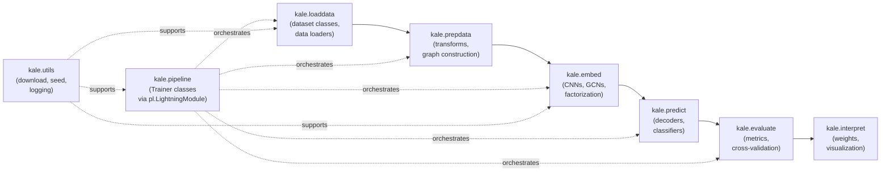
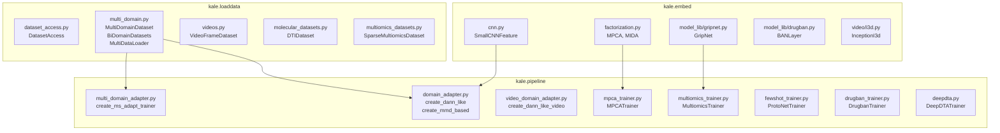

<!-- source: DeepWiki mcp.deepwiki.com · repo pykale/pykale · page 1 Overview · fetched 2026-10-21 -->

# Overview

<details>
<summary>Relevant source files</summary>

The following files were used as context for generating this wiki page:

- [.github/ISSUE_TEMPLATE/action-fail.md](.github/ISSUE_TEMPLATE/action-fail.md)
- [.github/workflows/test.yml](.github/workflows/test.yml)
- [README.md](README.md)
- [docs/source/index.rst](docs/source/index.rst)
- [docs/source/installation.md](docs/source/installation.md)
- [docs/source/kale.embed.rst](docs/source/kale.embed.rst)
- [docs/source/kale.evaluate.rst](docs/source/kale.evaluate.rst)
- [docs/source/kale.loaddata.rst](docs/source/kale.loaddata.rst)
- [docs/source/kale.pipeline.rst](docs/source/kale.pipeline.rst)
- [docs/source/kale.predict.rst](docs/source/kale.predict.rst)
- [docs/source/kale.prepdata.rst](docs/source/kale.prepdata.rst)
- [docs/source/kale.utils.rst](docs/source/kale.utils.rst)
- [examples/video_loading/README.md](examples/video_loading/README.md)
- [setup.py](setup.py)

</details>


This page introduces PyKale: its purpose, design principles, supported application domains, and repository structure. It is the entry point for this wiki. For installation steps, see [Installation and Setup](#1.1). For a detailed description of the seven-module pipeline API, see [Core Pipeline Architecture](#1.2).

---

## What Is PyKale

PyKale (`pykale` on PyPI) is a Python library in the PyTorch ecosystem for **multimodal learning** and **transfer learning** on graphs, images, and videos. It targets interdisciplinary research by providing a unified, pipeline-based API that reduces boilerplate and encourages reuse of components across problem domains.

The library is described in the `setup.py` metadata as:

> "Knowledge-aware machine learning from multiple sources in Python"

PyKale supports Python 3.10, 3.11, and 3.12, and depends on PyTorch, PyTorch Lightning, scikit-learn, and scipy as core runtime dependencies. See [setup.py:17-26]() for the full `install_requires` list.

Sources: [README.md:1-35](), [setup.py:113-152]()

---

## Design Philosophy

PyKale is guided by three "green ML" principles applied to software:

| Principle | Meaning in PyKale |
|-----------|-------------------|
| **Reduce** | Eliminate repetitive boilerplate across ML workflows |
| **Reuse** | Share modules across tasks and modalities via a common API |
| **Recycle** | Transfer learned models and components across application areas |

These principles are enforced structurally through the pipeline-based API: every application maps onto the same sequence of stages (`loaddata → prepdata → embed → predict → evaluate → interpret`), with `kale.pipeline` providing pre-built trainer classes that combine these stages using PyTorch Lightning.

Sources: [README.md:28-48]()

---

## Supported Application Domains

| Domain | Key Algorithms / Tasks |
|--------|------------------------|
| Domain Adaptation (images) | DANN, CDAN, WDGRL, DAN, JAN, M3SDA, MFSAN |
| Domain Adaptation (video) | DANN/MMD variants for RGB + optical flow |
| Few-Shot Learning | Prototypical Networks |
| Drug Discovery | DeepDTA, DrugBAN (bilinear attention), GripNet |
| Medical Imaging | Cardiac MRI classification via MPCA |
| Multi-omics | MOGONET (GCN + VCDN) |
| Graph Analysis | GripNet on polypharmacy side-effect graphs |
| Uncertainty Quantification | Landmark localization with Jaccard binning |
| Multimodal / AV | AVMNIST, multimodal VAE |

Sources: [docs/source/index.rst:39-51](), [README.md:28-48]()

---

## Repository Structure

The top-level repository is organized as follows:

```
pykale/
├── kale/              # Core library (the pip-installable package)
│   ├── loaddata/      # Data loading
│   ├── prepdata/      # Preprocessing / transforms
│   ├── embed/         # Feature extraction / encoders
│   ├── predict/       # Prediction heads / decoders
│   ├── evaluate/      # Metrics and cross-validation
│   ├── interpret/     # Visualization and weight analysis
│   ├── pipeline/      # End-to-end trainer classes
│   └── utils/         # Shared utilities (download, seed, logging)
├── examples/          # Runnable example scripts and notebooks
├── tests/             # pytest test suite
└── docs/              # Sphinx documentation source
```

The `kale/` package is what gets installed. `examples/` contains standalone applications that import from `kale/`. `tests/` mirrors the `kale/` structure with files named `test_<module>.py`.

Sources: [setup.py:127-128](), [docs/source/index.rst:1-70]()

---

## The Seven-Module Pipeline

**Module pipeline — ordered data flow with `kale.pipeline` as orchestrator**



Each module in `kale/` corresponds directly to one stage of an ML pipeline:

| Module | Directory | Primary Responsibility |
|--------|-----------|------------------------|
| `kale.loaddata` | `kale/loaddata/` | Load raw data from disk or remote sources |
| `kale.prepdata` | `kale/prepdata/` | Apply transforms to prepare data for models |
| `kale.embed` | `kale/embed/` | Extract or learn feature representations |
| `kale.predict` | `kale/predict/` | Map embeddings to predictions |
| `kale.evaluate` | `kale/evaluate/` | Compute performance metrics |
| `kale.interpret` | `kale/interpret/` | Visualize and explain model outputs |
| `kale.pipeline` | `kale/pipeline/` | Assemble stages into trainable workflows |
| `kale.utils` | `kale/utils/` | Cross-cutting utilities (no ML logic) |

Sources: [README.md:40-48](), [docs/source/index.rst:21-32]()

---

## Module–File Mapping

**Key source files per module**



Sources: [docs/source/kale.loaddata.rst:1-170](), [docs/source/kale.embed.rst:1-171](), [docs/source/kale.pipeline.rst:1-97]()

---

## Dependency Groups

PyKale uses optional dependency groups in `setup.py` to keep the base install lightweight:

| Install Option | Command | What It Adds |
|----------------|---------|--------------|
| core | `pip install pykale` | NumPy, pandas, PyTorch, scikit-learn, scipy, tensorly, pytorch-lightning |
| graph | `pip install pykale[graph]` | networkx, PyTDC |
| image | `pip install pykale[image]` | pydicom, scikit-image, pylibjpeg, python-gdcm |
| example | `pip install pykale[example]` | matplotlib, seaborn, yacs, nilearn, rdkit, captum, and others |
| full | `pip install pykale[full]` | graph + image + example |
| dev | `pip install pykale[dev]` | full + pytest, Sphinx, black, flake8, mypy, nbmake |

Two dependencies must be installed **manually before** installing PyKale:
- [PyTorch](https://pytorch.org/get-started/locally/) — to match your hardware (CPU/GPU/CUDA version)
- [PyTorch Geometric](https://github.com/pyg-team/pytorch_geometric) — required for any graph-based functionality

Sources: [setup.py:17-92](), [docs/source/installation.md:1-57]()

---

## Example Projects

The `examples/` directory contains self-contained applications. Each example follows a consistent pattern: a `main.py` entry point, a YAML configuration file loaded via `yacs`, and optional Jupyter notebook tutorials.

| Example Directory | Task | Key PyKale Modules |
|-------------------|------|--------------------|
| `examples/digits_dann/` | Image domain adaptation | `loaddata.multi_domain`, `pipeline.domain_adapter` |
| `examples/action_dann/` | Video domain adaptation | `loaddata.video_multi_domain`, `pipeline.video_domain_adapter` |
| `examples/cmri_mpca/` | Cardiac MRI classification | `loaddata.image_access`, `embed.factorization`, `pipeline.mpca_trainer` |
| `examples/multiomics_mogonet/` | Multi-omics classification | `loaddata.multiomics_datasets`, `pipeline.multiomics_trainer` |
| `examples/polypharmacy_gripnet/` | Drug side-effect prediction | `prepdata.supergraph_construct`, `embed.model_lib.gripnet` |
| `examples/bindingdb_deepdta/` | Drug-target interaction | `loaddata.tdc_datasets`, `pipeline.deepdta` |
| `examples/fewshot_protonet/` | Few-shot classification | `loaddata.few_shot`, `pipeline.fewshot_trainer` |
| `examples/office_multisource_adapt/` | Multi-source DA | `loaddata.multi_domain`, `pipeline.multi_domain_adapter` |

Sources: [docs/source/index.rst:39-51]()

---

## Related Wiki Pages

- **[Installation and Setup](#1.1)** — pip and source install instructions, optional dependency groups, PyTorch/PyG prerequisites.
- **[Core Pipeline Architecture](#1.2)** — detailed description of how the seven modules interact, including the `kale.pipeline` orchestration layer.
- **[Pipeline API Reference](#2)** — full API reference for all `kale` submodules.
- **[Domain Adaptation](#3)** — the most developed area; covers single-source, multi-source, and video DA.
- **[Examples and Tutorials](#5)** — walkthroughs of runnable examples including configuration patterns.
- **[Development Guide](#6)** — contributing, testing, CI/CD, and documentation build instructions.

---

