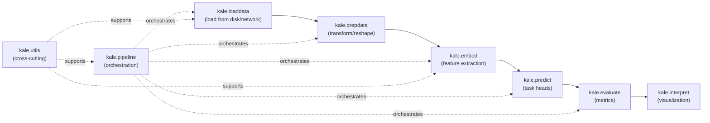
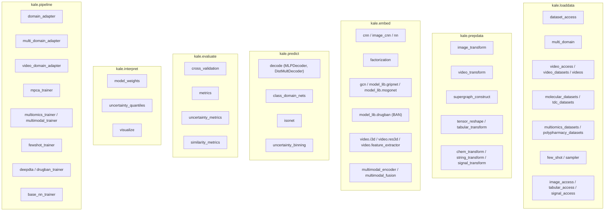
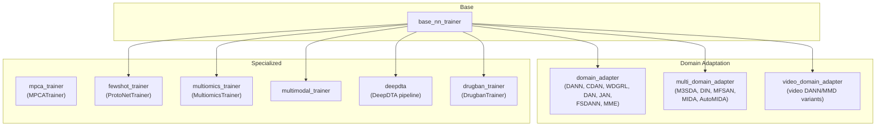
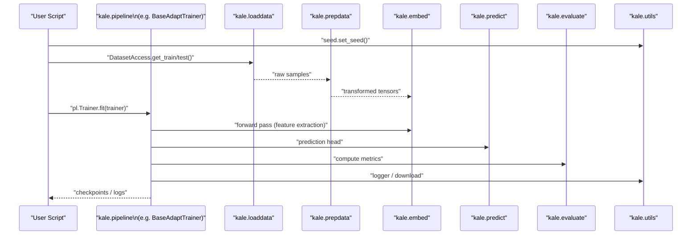
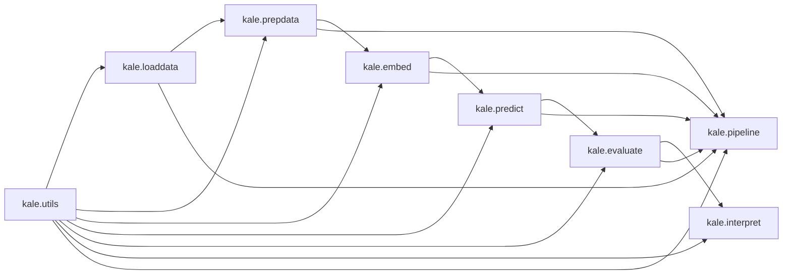

<!-- source: DeepWiki mcp.deepwiki.com · repo pykale/pykale · page 1.2 Core Pipeline Architecture · fetched 2026-10-21 -->

# Core Pipeline Architecture

Relevant source files

The following files were used as context for generating this wiki page:

- [.github/ISSUE_TEMPLATE/action-fail.md](.github/ISSUE_TEMPLATE/action-fail.md)
- [.github/workflows/test.yml](.github/workflows/test.yml)
- [README.md](README.md)
- [docs/source/index.rst](docs/source/index.rst)
- [docs/source/installation.md](docs/source/installation.md)
- [docs/source/kale.embed.rst](docs/source/kale.embed.rst)
- [docs/source/kale.evaluate.rst](docs/source/kale.evaluate.rst)
- [docs/source/kale.loaddata.rst](docs/source/kale.loaddata.rst)
- [docs/source/kale.pipeline.rst](docs/source/kale.pipeline.rst)
- [docs/source/kale.predict.rst](docs/source/kale.predict.rst)
- [docs/source/kale.prepdata.rst](docs/source/kale.prepdata.rst)
- [docs/source/kale.utils.rst](docs/source/kale.utils.rst)
- [examples/video_loading/README.md](examples/video_loading/README.md)
- [setup.py](setup.py)

This page describes the structural design of the `kale` library: the seven API modules that form the machine learning pipeline, the `kale.pipeline` module that orchestrates them, and `kale.utils` which provides shared infrastructure. It focuses on the *layout and relationships* of the modules, not the detailed API of any single module. For detailed API documentation on individual modules, see the Pipeline API Reference section (page [2](#2)).

---

## The Seven-Module Pipeline

PyKale is organized around a sequential pipeline that maps raw data to a final interpreted result. Each of the seven modules handles one stage of this process. The ordering is not arbitrary — data flows through the modules in the sequence shown below, and `kale.pipeline` composes subsets of these stages into end-to-end trainable workflows.

**Pipeline stage diagram — module names to `kale` package paths**

Sources: [README.md:42-48](), [docs/source/index.rst:23-33]()

---

## Module Responsibilities

The table below maps each module to its filesystem path and primary responsibilities.

| Module | Path | Responsibility |
|---|---|---|
| `kale.loaddata` | `kale/loaddata/` | Load data from disk or remote. Provides `DatasetAccess` base class and specialized dataset classes. |
| `kale.prepdata` | `kale/prepdata/` | Transform raw data into ML-ready tensors: image/video transforms, graph construction, tensor reshape. |
| `kale.embed` | `kale/embed/` | Feature extraction via CNNs, GCNs, factorization, attention networks, and video encoders. |
| `kale.predict` | `kale/predict/` | Task-specific prediction heads: classifiers, decoders, domain discriminators. |
| `kale.evaluate` | `kale/evaluate/` | Compute metrics, perform cross-validation, and measure uncertainty. |
| `kale.interpret` | `kale/interpret/` | Visualize model weights and prediction outputs. |
| `kale.pipeline` | `kale/pipeline/` | PyTorch Lightning `LightningModule` trainers that combine the stages above. |
| `kale.utils` | `kale/utils/` | Shared utilities: file download, random seeding, logging, model initialization. |

Sources: [docs/source/index.rst:23-33](), [README.md:42-48]()

---

## Module-to-Submodule Map

Each top-level module contains several submodules. The diagram below maps modules to their concrete submodule files.

**Submodule structure diagram**

Sources: [docs/source/kale.loaddata.rst](), [docs/source/kale.prepdata.rst](), [docs/source/kale.embed.rst](), [docs/source/kale.predict.rst](), [docs/source/kale.evaluate.rst](), [docs/source/kale.pipeline.rst](), [docs/source/kale.utils.rst]()

---

## kale.pipeline: The Orchestration Layer

`kale.pipeline` does not introduce new ML algorithms — it wires together components from `loaddata`, `prepdata`, `embed`, and `predict` into complete training workflows implemented as PyTorch Lightning `LightningModule` subclasses.

**Trainer class to domain diagram**

Sources: [docs/source/kale.pipeline.rst]()

Each trainer class implements the PyTorch Lightning lifecycle: `configure_optimizers`, `training_step`, `validation_step`, and `test_step`. The `BaseAdaptTrainer` found in `domain_adapter` adds domain adaptation specifics such as warmup scheduling and lambda annealing. For full details, see [Training Pipelines (kale.pipeline)](#2.5).

---

## kale.utils: Cross-Cutting Support

`kale.utils` does not belong to the main data flow pipeline. It provides shared infrastructure that any module may call.

| Submodule | Key responsibility |
|---|---|
| `kale.utils.download` | Fetch data files and model weights from remote URLs |
| `kale.utils.seed` | Set global random seeds for reproducibility |
| `kale.utils.logger` | Structured logging helpers used across trainers |
| `kale.utils.initialize_nn` | Neural network weight initialization utilities |
| `kale.utils.print` | Formatted console output for training summaries |
| `kale.utils.save_xlsx` | Export results to Excel files |
| `kale.utils.remap_model_parameters` | Map parameter names between model checkpoints |

Sources: [docs/source/kale.utils.rst]()

---

## Data Flow Through a Typical Training Run

The sequence below shows how control and data flow through the modules during a standard training run. The trainer (`kale.pipeline`) drives the process; the other modules are called as needed.

**Sequence diagram: a training run using a pipeline trainer**

Sources: [README.md:42-48](), [docs/source/kale.pipeline.rst]()

---

## Dependency Rules

The pipeline imposes a loose layering discipline: modules earlier in the pipeline may not import from modules later in the pipeline. `kale.utils` is the only module with no restriction — any other module may import from it.

Sources: [README.md:42-48](), [docs/source/index.rst:33]()

---

## Core Dependencies

The runtime dependencies in `setup.py` reflect the pipeline design: PyTorch and `pytorch-lightning` underpin the pipeline and embed layers, while `scikit-learn`, `scipy`, and `tensorly` support the factorization and evaluation layers.

| Dependency | Used primarily in |
|---|---|
| `torch` | `kale.embed`, `kale.predict`, `kale.pipeline` |
| `pytorch-lightning` | `kale.pipeline` |
| `torchvision` | `kale.loaddata`, `kale.prepdata`, `kale.embed` |
| `scikit-learn` | `kale.evaluate`, `kale.pipeline` (MPCATrainer, MIDATrainer) |
| `scipy` | `kale.evaluate`, `kale.embed.factorization` |
| `tensorly` | `kale.embed.factorization`, `kale.interpret.model_weights` |
| `numpy` | Throughout |
| `pandas` | `kale.loaddata`, `kale.evaluate` |

Sources: [setup.py:17-26]()

---

