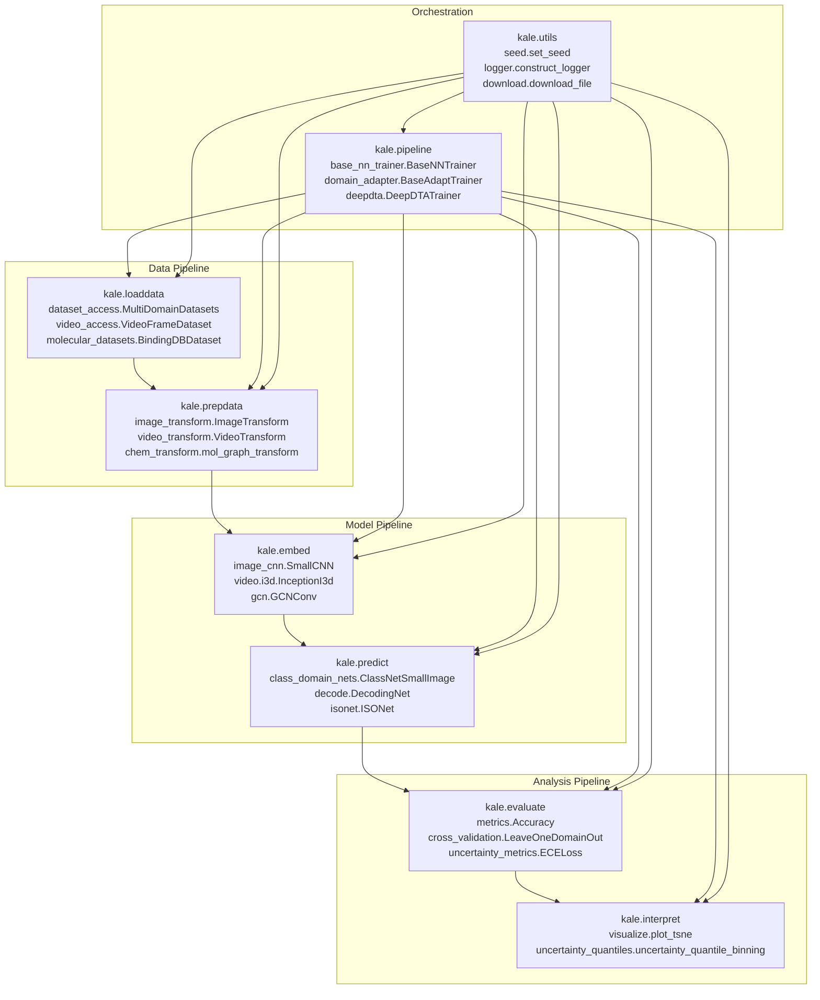
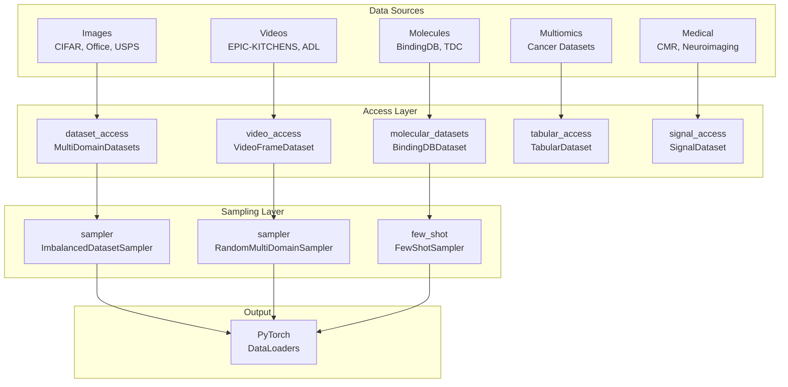
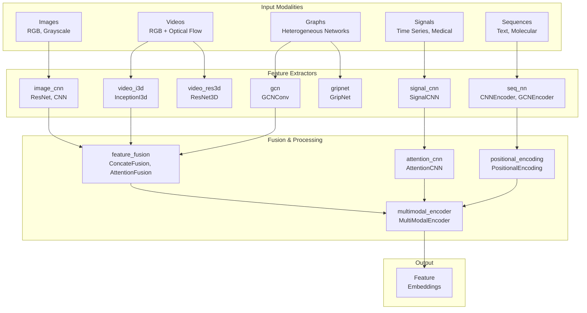
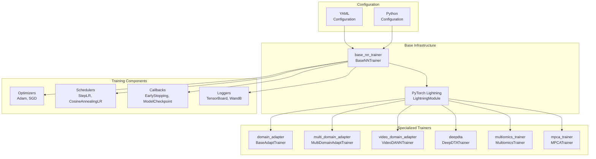
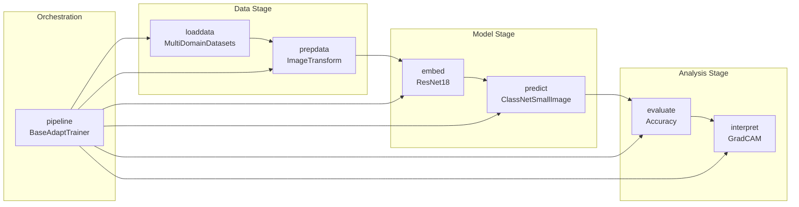

<!-- source: DeepWiki mcp.deepwiki.com · repo pykale/pykale · page 2 Pipeline API Reference · fetched 2026-10-21 -->

# Pipeline API Reference

Relevant source files

The following files were used as context for generating this wiki page:

- [docs/source/index.rst](docs/source/index.rst)
- [docs/source/kale.embed.rst](docs/source/kale.embed.rst)
- [docs/source/kale.evaluate.rst](docs/source/kale.evaluate.rst)
- [docs/source/kale.loaddata.rst](docs/source/kale.loaddata.rst)
- [docs/source/kale.pipeline.rst](docs/source/kale.pipeline.rst)
- [docs/source/kale.predict.rst](docs/source/kale.predict.rst)
- [docs/source/kale.prepdata.rst](docs/source/kale.prepdata.rst)
- [docs/source/kale.utils.rst](docs/source/kale.utils.rst)

This document provides comprehensive documentation of PyKale's core pipeline modules and their interfaces. The Pipeline API implements PyKale's knowledge-aware machine learning philosophy through a standardized, modular architecture that supports multimodal learning and transfer learning workflows.

For specific domain applications and examples, see [Examples and Tutorials](#5). For development guidelines and testing infrastructure, see [Development Guide](#6). For detailed implementation of domain adaptation techniques that utilize these pipeline components, see [Domain Adaptation](#3).

## Core Pipeline Architecture

PyKale's pipeline-based API follows a systematic approach to machine learning workflows, organizing functionality into six core modules that can be combined flexibly while maintaining standardization and reusability.

### Pipeline Flow Overview

**Sources:** [README.md:35-43](), [docs/source/index.rst:22-31]()

### Module Dependencies and Integration

```mermaid
graph TB
    subgraph "Core Dependencies"
        PYTORCH["torch<br/>PyTorch Framework"]
        LIGHTNING["pytorch_lightning<br/>Training Infrastructure"]
        NUMPY["numpy<br/>Numerical Computing"]
        SKLEARN["scikit_learn<br/>ML Utilities"]
    end
    
    subgraph "Optional Dependencies"
        PYGEOMETRIC["torch_geometric<br/>Graph Neural Networks"]
        TDC["PyTDC<br/>Drug Discovery"]
        RDKIT["rdkit<br/>Chemical Informatics"]
        DICOM["pydicom<br/>Medical Imaging"]
    end
    
    subgraph "kale.loaddata"
        DATASET_ACCESS["dataset_access"]
        VIDEO_ACCESS["video_access"]
        MOLECULAR_DATASETS["molecular_datasets"]
        MULTI_DOMAIN["multi_domain"]
        SAMPLER["sampler"]
    end
    
    subgraph "kale.embed"
        IMAGE_CNN["image_cnn"]
        VIDEO_I3D["video_i3d"]
        GCN["gcn"]
        GRIPNET["gripnet"]
        FEATURE_FUSION["feature_fusion"]
    end
    
    subgraph "kale.pipeline"
        BASE_TRAINER["base_nn_trainer"]
        DOMAIN_ADAPTER["domain_adapter"]
        MULTI_DOMAIN_ADAPTER["multi_domain_adapter"]
        VIDEO_DOMAIN_ADAPTER["video_domain_adapter"]
    end
    
    PYTORCH --> BASE_TRAINER
    LIGHTNING --> BASE_TRAINER
    PYGEOMETRIC --> GCN
    PYGEOMETRIC --> GRIPNET
    TDC --> MOLECULAR_DATASETS
    RDKIT --> MOLECULAR_DATASETS
    
    BASE_TRAINER --> DOMAIN_ADAPTER
    BASE_TRAINER --> MULTI_DOMAIN_ADAPTER
    BASE_TRAINER --> VIDEO_DOMAIN_ADAPTER
    
    DATASET_ACCESS --> MULTI_DOMAIN
    VIDEO_ACCESS --> VIDEO_I3D
    IMAGE_CNN --> FEATURE_FUSION
    GCN --> FEATURE_FUSION
```

**Sources:** [setup.py:16-26](), [setup.py:30-46]()

## Data Loading Module (kale.loaddata)

The `kale.loaddata` module provides unified interfaces for accessing diverse data sources including images, videos, molecular data, and multimodal datasets. It implements standardized dataset access patterns and sampling strategies.

### Key Components

| Component | Purpose | Key Classes |
|-----------|---------|-------------|
| `dataset_access` | Core dataset access interface | `DatasetAccess`, `MultiDomainDatasets` |
| `video_access` | Video dataset loading | `VideoFrameDataset`, `VideoDataset` |
| `molecular_datasets` | Drug discovery datasets | `BindingDBDataset`, `TDCDataset` |
| `multi_domain` | Multi-source domain datasets | `MultiDomainDatasets` |
| `sampler` | Sampling strategies | `ImbalancedDatasetSampler`, `RandomMultiDomainSampler` |

### Dataset Access Pattern

**Sources:** [docs/source/kale.loaddata.rst:1-169](), [examples/video_loading/README.md:9-25]()

## Feature Embedding Module (kale.embed)

The `kale.embed` module implements feature extraction and representation learning across multiple modalities. It provides CNN architectures, video models, graph neural networks, and multimodal fusion techniques.

### Architecture Components

| Component | Purpose | Key Classes |
|-----------|---------|-------------|
| `image_cnn` | CNN feature extraction | `SmallCNN`, `ResNet18`, `ResNet50` |
| `video_i3d` | Video feature extraction | `InceptionI3d`, `I3DBackbone` |
| `gcn` | Graph convolution | `GCNConv`, `GCNNet` |
| `gripnet` | Heterogeneous graphs | `GripNet`, `HeteroGCN` |
| `feature_fusion` | Multimodal fusion | `ConcateFusion`, `AttentionFusion` |

### Embedding Architecture

**Sources:** [docs/source/kale.embed.rst:1-172](), [tests/embed/test_seq_nn.py:1-49]()

## Training Pipeline Module (kale.pipeline)

The `kale.pipeline` module orchestrates training workflows through specialized trainers built on PyTorch Lightning. It provides domain adaptation, multimodal learning, and application-specific training pipelines.

### Trainer Architecture

| Component | Purpose | Key Classes |
|-----------|---------|-------------|
| `base_nn_trainer` | Base training infrastructure | `BaseNNTrainer`, `LightningModule` |
| `domain_adapter` | Domain adaptation training | `BaseAdaptTrainer`, `DANNTrainer` |
| `multi_domain_adapter` | Multi-source DA training | `MultiDomainAdaptTrainer` |
| `video_domain_adapter` | Video DA training | `VideoDANNTrainer` |
| `deepdta` | Drug-target interaction | `DeepDTATrainer` |
| `multiomics_trainer` | Multiomics analysis | `MultiomicsTrainer` |

### Training Pipeline Flow

**Sources:** [docs/source/kale.pipeline.rst:1-96](), [setup.py:20]()

## Data Preprocessing Module (kale.prepdata)

The `kale.prepdata` module provides data transformation and preprocessing functionality for different modalities including images, videos, signals, and molecular data.

### Preprocessing Components

| Component | Purpose | Key Classes |
|-----------|---------|-------------|
| `image_transform` | Image preprocessing | `ImageTransform`, `Resize`, `Normalize` |
| `video_transform` | Video preprocessing | `VideoTransform`, `ImglistToTensor` |
| `signal_transform` | Signal preprocessing | `SignalTransform`, `Standardize` |
| `chem_transform` | Chemical preprocessing | `ChemTransform`, `MoleculeTransform` |
| `tabular_transform` | Tabular preprocessing | `TabularTransform`, `StandardScaler` |

**Sources:** [docs/source/kale.prepdata.rst:1-87]()

## Prediction Module (kale.predict)

The `kale.predict` module implements prediction models and classification networks, including domain adaptation networks and uncertainty quantification.

### Prediction Components

| Component | Purpose | Key Classes |
|-----------|---------|-------------|
| `class_domain_nets` | Classification networks | `ClassNetSmallImage`, `DomainNetSmallImage` |
| `decode` | Decoding networks | `DecodingNet`, `FeatureDecoder` |
| `isonet` | Isometric networks | `ISONet`, `ISONetClassifier` |
| `uncertainty_binning` | Uncertainty quantification | `UncertaintyBinning`, `QuantileBinning` |

**Sources:** [docs/source/kale.predict.rst:1-48]()

## Evaluation Module (kale.evaluate)

The `kale.evaluate` module provides performance evaluation metrics, cross-validation strategies, and similarity measures for various machine learning tasks.

### Evaluation Components

| Component | Purpose | Key Classes |
|-----------|---------|-------------|
| `metrics` | Performance metrics | `Accuracy`, `F1Score`, `AUC` |
| `cross_validation` | CV strategies | `StratifiedKFold`, `GroupKFold` |
| `similarity_metrics` | Similarity measures | `MMD`, `HSIC`, `CKA` |
| `uncertainty_metrics` | Uncertainty evaluation | `CalibrationError`, `Reliability` |

**Sources:** [docs/source/kale.evaluate.rst:1-47]()

## Interpretation Module (kale.interpret)

The `kale.interpret` module provides model interpretation and visualization tools for understanding model behavior and predictions.

### Interpretation Components

| Component | Purpose | Key Classes |
|-----------|---------|-------------|
| `model_weights` | Weight analysis | `WeightAnalysis`, `ModelInspection` |
| `visualize` | Visualization tools | `PlotUtils`, `TensorboardUtils` |
| `uncertainty_quantiles` | Uncertainty analysis | `QuantileAnalysis`, `UncertaintyPlot` |
| `signal_image_attribution` | Attribution methods | `GradCAM`, `IntegratedGradients` |

**Sources:** [docs/source/kale.interpret.rst:1-49]()

## Utilities Module (kale.utils)

The `kale.utils` module provides supporting utilities for logging, initialization, data handling, and other common operations across the pipeline.

### Utility Components

| Component | Purpose | Key Classes |
|-----------|---------|-------------|
| `logger` | Logging utilities | `Logger`, `LoggerConfig` |
| `seed` | Reproducibility | `set_seed`, `seed_everything` |
| `download` | Data downloading | `download_file`, `extract_archive` |
| `initialize_nn` | Network initialization | `init_weights`, `init_modules` |

**Sources:** [docs/source/kale.utils.rst:1-72]()

## Pipeline Integration Patterns

### Standard Pipeline Workflow

**Sources:** [README.md:35-43](), [docs/source/index.rst:33]()

---

