<!-- source: DeepWiki mcp.deepwiki.com · repo pykale/pykale · page 2.1 Data Loading (kale.loaddata) · fetched 2026-10-21 -->

# Data Loading (kale.loaddata)

<details>
<summary>Relevant source files</summary>

The following files were used as context for generating this wiki page:

- [.gitignore](.gitignore)
- [examples/fewshot_protonet/README.md](examples/fewshot_protonet/README.md)
- [examples/fewshot_protonet/__init__.py](examples/fewshot_protonet/__init__.py)
- [examples/fewshot_protonet/config.py](examples/fewshot_protonet/config.py)
- [examples/fewshot_protonet/configs/demo.yaml](examples/fewshot_protonet/configs/demo.yaml)
- [examples/fewshot_protonet/configs/template.yaml](examples/fewshot_protonet/configs/template.yaml)
- [examples/fewshot_protonet/eval_unseen_classes.py](examples/fewshot_protonet/eval_unseen_classes.py)
- [examples/fewshot_protonet/main.py](examples/fewshot_protonet/main.py)
- [examples/multiomics_mogonet/main.py](examples/multiomics_mogonet/main.py)
- [examples/multiomics_mogonet/model.py](examples/multiomics_mogonet/model.py)
- [examples/video_loading/main.py](examples/video_loading/main.py)
- [kale/loaddata/dataset_access.py](kale/loaddata/dataset_access.py)
- [kale/loaddata/few_shot.py](kale/loaddata/few_shot.py)
- [kale/loaddata/mnistm.py](kale/loaddata/mnistm.py)
- [kale/loaddata/multi_domain.py](kale/loaddata/multi_domain.py)
- [kale/loaddata/multiomics_datasets.py](kale/loaddata/multiomics_datasets.py)
- [kale/loaddata/sampler.py](kale/loaddata/sampler.py)
- [kale/loaddata/usps.py](kale/loaddata/usps.py)
- [kale/loaddata/video_access.py](kale/loaddata/video_access.py)
- [kale/loaddata/video_datasets.py](kale/loaddata/video_datasets.py)
- [kale/loaddata/video_multi_domain.py](kale/loaddata/video_multi_domain.py)
- [kale/loaddata/videos.py](kale/loaddata/videos.py)
- [kale/pipeline/domain_adapter.py](kale/pipeline/domain_adapter.py)
- [kale/pipeline/fewshot_trainer.py](kale/pipeline/fewshot_trainer.py)
- [kale/pipeline/multiomics_trainer.py](kale/pipeline/multiomics_trainer.py)
- [kale/pipeline/video_domain_adapter.py](kale/pipeline/video_domain_adapter.py)
- [kale/predict/isonet.py](kale/predict/isonet.py)
- [kale/prepdata/video_transform.py](kale/prepdata/video_transform.py)
- [tests/loaddata/test_image_access.py](tests/loaddata/test_image_access.py)
- [tests/loaddata/test_sampler.py](tests/loaddata/test_sampler.py)
- [tests/loaddata/test_video_access.py](tests/loaddata/test_video_access.py)
- [tests/pipeline/test_domain_adapter.py](tests/pipeline/test_domain_adapter.py)
- [tests/pipeline/test_video_domain_adapter.py](tests/pipeline/test_video_domain_adapter.py)

</details>


## Purpose and Scope

The `kale.loaddata` module provides data loading interfaces and utilities as the first stage in PyKale's ML pipeline. It implements standardized patterns for loading datasets from multiple domains, supporting various data modalities including images, videos, graphs, tabular data, and molecular data. This module is specifically designed to facilitate domain adaptation research by providing consistent APIs for multi-domain scenarios.

For data preprocessing and transformations applied after loading, see [Data Preprocessing (kale.prepdata)](#2.2). For training pipelines that use these data loaders, see [Training Pipelines (kale.pipeline)](#2.5).

## Core Architecture

The `kale.loaddata` module is built around the **DatasetAccess Pattern**, which provides a unified interface for accessing training, validation, and test splits across different datasets. This abstraction enables seamless integration with domain adaptation pipelines.

### DatasetAccess Pattern

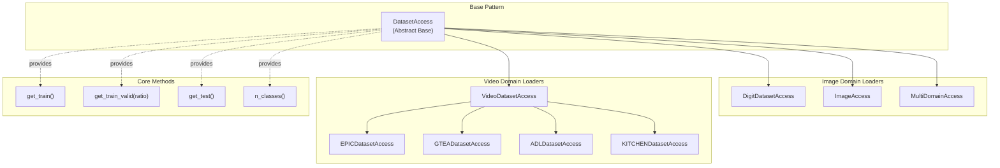

**Sources:** [kale/loaddata/dataset_access.py:9-48](), [kale/loaddata/video_access.py:200-237]()

The `DatasetAccess` class [kale/loaddata/dataset_access.py:9-23]() defines the core interface:

| Method | Return Type | Description |
|--------|-------------|-------------|
| `get_train()` | `torch.utils.data.Dataset` | Returns training dataset |
| `get_train_valid(valid_ratio)` | `tuple[Dataset, Dataset]` | Splits training data into train/validation |
| `get_test()` | `torch.utils.data.Dataset` | Returns test dataset |
| `n_classes()` | `int` | Returns number of classes |

**Sources:** [kale/loaddata/dataset_access.py:9-48]()

### Dataset Loading Flow

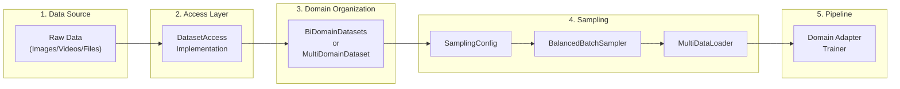

**Sources:** [kale/loaddata/dataset_access.py:9-48](), [kale/loaddata/multi_domain.py:102-241](), [kale/loaddata/sampler.py:23-83]()

## Multi-Domain Datasets

Multi-domain datasets are central to PyKale's domain adaptation capabilities. They organize data from multiple domains (e.g., different sensors, datasets, or conditions) while maintaining consistent batch sampling across domains.

### Architecture Overview

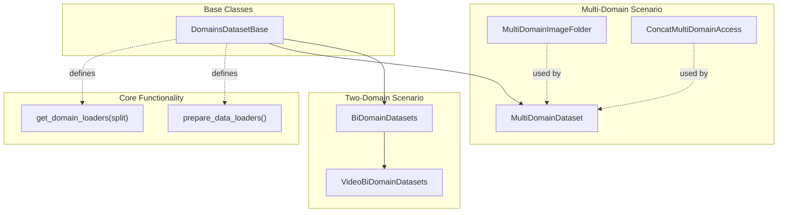

**Sources:** [kale/loaddata/multi_domain.py:80-100](), [kale/loaddata/multi_domain.py:102-250](), [kale/loaddata/multi_domain.py:553-730]()

### BiDomainDatasets

`BiDomainDatasets` [kale/loaddata/multi_domain.py:102-250]() manages source and target domain datasets for unsupervised or semi-supervised domain adaptation.

**Key Parameters:**

| Parameter | Type | Description |
|-----------|------|-------------|
| `source_access` | `DatasetAccess` | Accessor for source domain |
| `target_access` | `DatasetAccess` | Accessor for target domain |
| `config_weight_type` | `WeightingType` | Sampling weights: "natural", "balanced", "preset0" |
| `config_size_type` | `DatasetSizeType` | Epoch size: "max" or "source" |
| `valid_split_ratio` | `float` | Validation split ratio (default: 0.1) |
| `n_fewshot` | `int` | Number of labeled target samples for semi-supervised DA |
| `class_ids` | `list` | Subset of class IDs to use |

**Sources:** [kale/loaddata/multi_domain.py:103-176]()

**Usage Example:**
```python
# Create source and target accessors
source = DigitDatasetAccess(...)
target = DigitDatasetAccess(...)

# Create bi-domain dataset
dataset = BiDomainDatasets(
    source_access=source,
    target_access=target,
    config_weight_type="balanced",
    valid_split_ratio=0.1
)

# Prepare data loaders
dataset.prepare_data_loaders()

# Get domain-specific loaders
train_loader = dataset.get_domain_loaders(split="train", batch_size=32)
```

**Sources:** [tests/pipeline/test_domain_adapter.py:55-62]()

### MultiDomainDataset

`MultiDomainDataset` [kale/loaddata/multi_domain.py:553-730]() handles scenarios with multiple source domains and one target domain. Each batch contains samples from all domains with domain labels.

**Batch Structure:**
- Returns: `(X, y, domain_labels)` where `domain_labels` indicate which domain each sample belongs to
- Supports domain-stratified splitting via `_domain_stratified_split()` [kale/loaddata/multi_domain.py:252-278]()

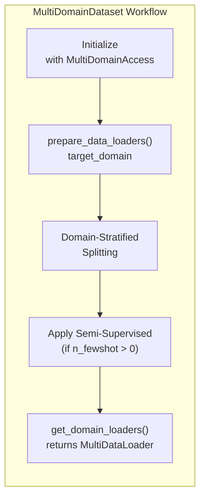

**Sources:** [kale/loaddata/multi_domain.py:553-730]()

### MultiDomainImageFolder

`MultiDomainImageFolder` [kale/loaddata/multi_domain.py:281-430]() extends PyTorch's `VisionDataset` for image datasets organized in domain/class folder structure:

```
root/
├── domain_a/
│   ├── class_1/
│   │   ├── xxx.jpg
│   │   └── yyy.jpg
│   └── class_2/
│       └── zzz.jpg
├── domain_b/
│   ├── class_1/
│   └── class_2/
```

**Key Features:**
- Domain label extraction: `domain_labels` attribute [kale/loaddata/multi_domain.py:366]()
- Optional train/test splitting: `split_train_test` parameter [kale/loaddata/multi_domain.py:331-374]()
- Domain and class filtering: `sub_domain_set`, `sub_class_set` [kale/loaddata/multi_domain.py:327-349]()

**Sources:** [kale/loaddata/multi_domain.py:281-430]()

## Sampling Strategies

Sampling strategies control how batches are constructed from datasets, particularly important for balanced class representation and domain adaptation.

### SamplingConfig

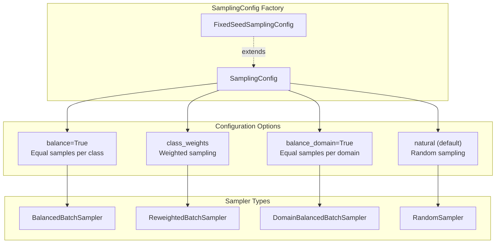

**Sources:** [kale/loaddata/sampler.py:23-113]()

### Key Sampler Classes

| Sampler | Purpose | Usage |
|---------|---------|-------|
| `BalancedBatchSampler` | Samples equal number of samples per class | Imbalanced datasets [kale/loaddata/sampler.py:154-193]() |
| `ReweightedBatchSampler` | Samples according to class weights | Custom class distributions [kale/loaddata/sampler.py:196-262]() |
| `DomainBalancedBatchSampler` | Samples equal number per domain | Multi-domain scenarios [kale/loaddata/sampler.py:364-400]() |
| `MultiDataLoader` | Iterates over multiple dataloaders in parallel | Domain adaptation [kale/loaddata/sampler.py:116-152]() |

**Sources:** [kale/loaddata/sampler.py:23-400]()

### MultiDataLoader

The `MultiDataLoader` [kale/loaddata/sampler.py:116-152]() is critical for domain adaptation. It synchronously iterates over multiple dataloaders, yielding batches from each domain simultaneously.

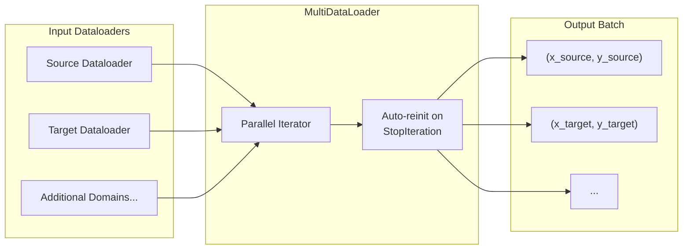

**Usage Pattern:**
```python
# From BiDomainDatasets.get_domain_loaders()
source_loader = source_sampling_config.create_loader(source_ds, batch_size)
target_loader = target_sampling_config.create_loader(target_ds, batch_size)

return MultiDataLoader(
    dataloaders=[source_loader, target_loader],
    n_batches=max(n_dataset // batch_size, 1)
)
```

**Sources:** [kale/loaddata/sampler.py:116-152](), [kale/loaddata/multi_domain.py:214-240]()

## Video Data Loading

Video data loading in PyKale supports sparse temporal sampling and multi-modality (RGB + optical flow) for action recognition and domain adaptation.

### Video Loading Architecture

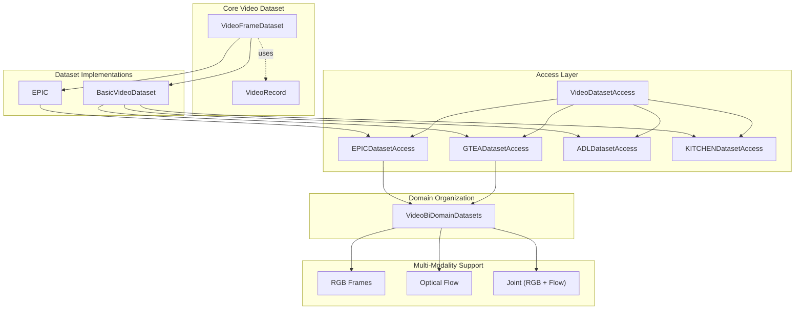

**Sources:** [kale/loaddata/videos.py:58-237](), [kale/loaddata/video_datasets.py:12-154](), [kale/loaddata/video_access.py:200-372](), [kale/loaddata/video_multi_domain.py:19-213]()

### VideoFrameDataset

`VideoFrameDataset` [kale/loaddata/videos.py:58-237]() implements sparse temporal sampling, dividing videos into segments and sampling frames from each segment.

**Key Parameters:**

| Parameter | Type | Description |
|-----------|------|-------------|
| `root_path` | `str` | Root directory containing video folders |
| `annotationfile_path` | `str` | Path to annotation file (one video per line) |
| `num_segments` | `int` | Number of segments to divide video into |
| `frames_per_segment` | `int` | Frames to sample from each segment |
| `image_modality` | `str` | "rgb" or "flow" |
| `imagefile_template` | `str` | Frame filename template (e.g., "img_{:05d}.jpg") |
| `random_shift` | `bool` | Random or center frame selection per segment |
| `test_mode` | `bool` | Deterministic sampling for testing |

**Sources:** [kale/loaddata/videos.py:98-148]()

**Sparse Temporal Sampling:**

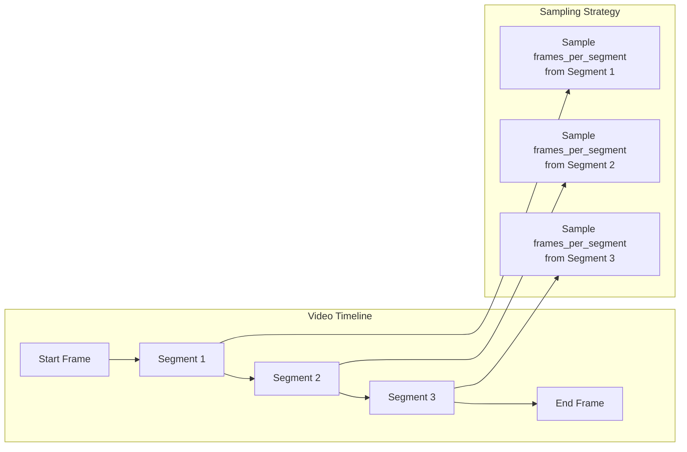

**Sources:** [kale/loaddata/videos.py:165-198](), [docs/source/index.rst:51]()

### VideoDataset and VideoDatasetAccess

`VideoDataset` [kale/loaddata/video_access.py:87-197]() is an enum providing factory methods for supported video datasets:

```python
class VideoDataset(Enum):
    EPIC = "EPIC"
    ADL = "ADL"
    GTEA = "GTEA"
    KITCHEN = "KITCHEN"
    
    @staticmethod
    def get_source_target(source, target, seed, params):
        # Returns (source_dict, target_dict, num_classes)
        # where dicts contain {'rgb': VideoDatasetAccess, 'flow': VideoDatasetAccess}
```

**Sources:** [kale/loaddata/video_access.py:87-197]()

### VideoBiDomainDatasets

`VideoBiDomainDatasets` [kale/loaddata/video_multi_domain.py:19-213]() extends `BiDomainDatasets` for video data with multi-modality support.

**Multi-Modality Handling:**

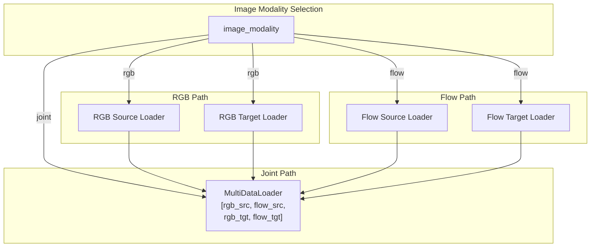

**Sources:** [kale/loaddata/video_multi_domain.py:90-189](), [kale/loaddata/video_access.py:22-32]()

**Batch Structure for Joint Modality:**
- Returns 4 tuples: `(x_s_rgb, y_s), (x_s_flow, y_s_flow), (x_tu_rgb, y_tu), (x_tu_flow, y_tu_flow)`
- Used by video domain adaptation trainers [kale/pipeline/video_domain_adapter.py:148-163]()

**Sources:** [kale/loaddata/video_multi_domain.py:158-189]()

## Domain-Specific Loaders

PyKale provides specialized loaders for various data modalities beyond images and videos.

### Image Datasets

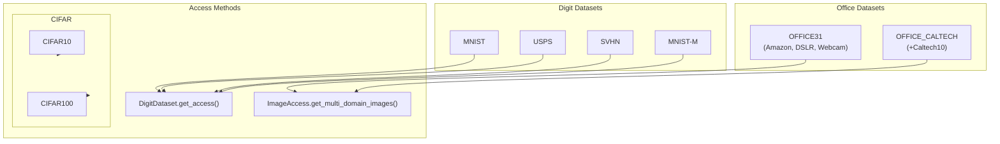

**Sources:** [kale/loaddata/image_access.py](), [docs/source/kale.loaddata.rst:25-31](), [tests/loaddata/test_image_access.py:12-46]()

### Video Datasets

| Dataset | Classes | Description |
|---------|---------|-------------|
| EPIC-Kitchens | 8 | Egocentric kitchen actions |
| GTEA | 6 | Georgia Tech Egocentric Activities |
| ADL | 7 | Activities of Daily Living |
| KITCHEN | 6 | Kitchen activities |

**Dataset Structure Requirements:**
```
root/
├── dataset_name/
│   ├── frames_rgb_flow/
│   │   ├── rgb/
│   │   │   └── video_folders/
│   │   └── flow/
│   │       └── video_folders/
│   └── annotations/
│       └── labels_train_test/
│           ├── train.pkl
│           └── test.pkl
```

**Sources:** [kale/loaddata/video_access.py:66-84](), [kale/loaddata/video_datasets.py:12-154]()

### Other Loaders

| Module | Data Type | Key Classes |
|--------|-----------|-------------|
| `molecular_datasets` | Drug-target data | `BindingDBDataset` |
| `tdc_datasets` | Therapeutics Data Commons | TDC integration |
| `polypharmacy_datasets` | Drug-drug interactions | `PolypharmacyDataset` |
| `multiomics_datasets` | Multi-omics data | Multi-omics loaders |
| `tabular_access` | CSV/tabular data | `load_csv_columns()` |
| `signal_access` | Time series signals | Signal loaders |
| `few_shot` | Few-shot learning | `NWayKShotDataset` |

**Sources:** [docs/source/kale.loaddata.rst:9-162]()

## Integration with Domain Adaptation

The data loading module integrates tightly with PyKale's domain adaptation pipeline through standardized interfaces.

### Usage in Domain Adapters

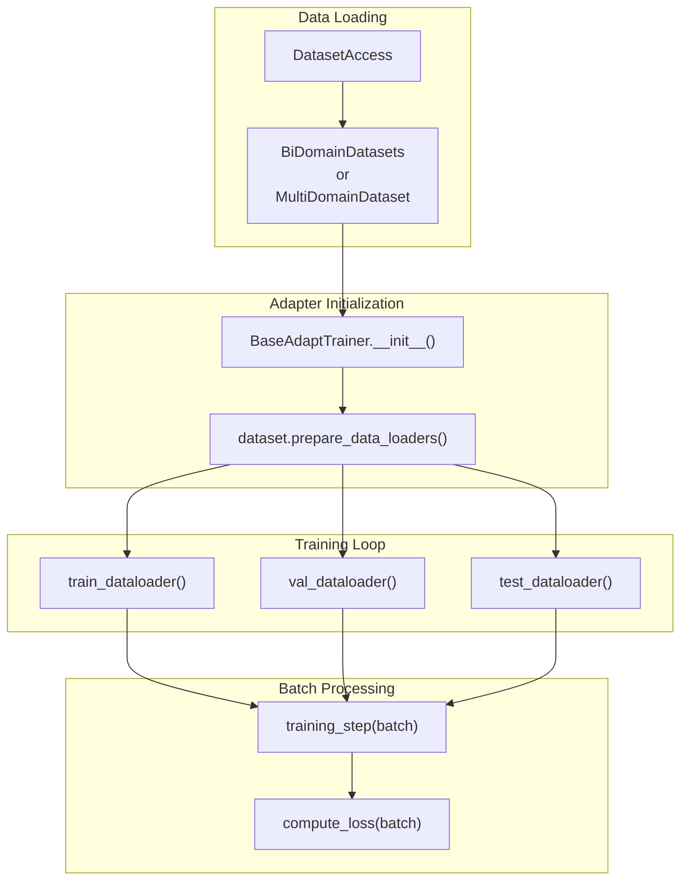

**Example from BaseAdaptTrainer:**
```python
# Initialization
def __init__(self, dataset, feature_extractor, task_classifier, ...):
    self._dataset = dataset
    self._dataset.prepare_data_loaders(target_domain=self.target_domain)

# Dataloader methods
def train_dataloader(self):
    return self._dataset.get_domain_loaders(
        split="train", batch_size=self._batch_size, num_workers=self._num_workers
    )
```

**Sources:** [kale/pipeline/domain_adapter.py:242-460](), [kale/loaddata/multi_domain.py:180-185]()

### Semi-Supervised Domain Adaptation

For few-shot or semi-supervised scenarios, `n_fewshot` parameter controls labeled target samples:

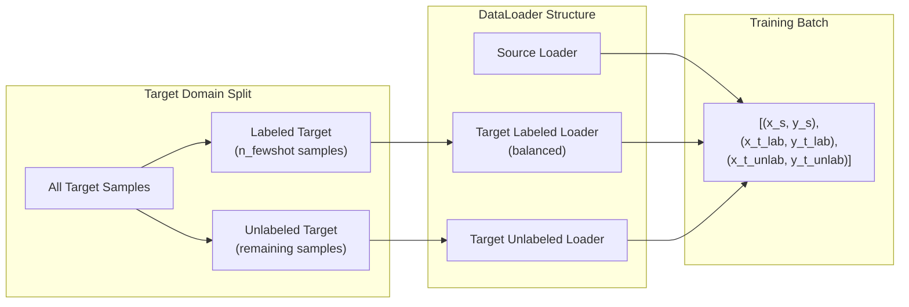

**Sources:** [kale/loaddata/multi_domain.py:228-240](), [kale/pipeline/domain_adapter.py:172-192]()

## Utility Functions

### Helper Functions

| Function | Location | Purpose |
|----------|----------|---------|
| `get_class_subset()` | [kale/loaddata/dataset_access.py:51-60]() | Filter dataset by class IDs |
| `split_by_ratios()` | [kale/loaddata/dataset_access.py:63-105]() | Split dataset by ratios |
| `get_labels()` | [kale/loaddata/sampler.py:308-329]() | Extract labels from various dataset types |
| `get_auto_num_workers()` | [kale/loaddata/sampler.py:15-20]() | Auto-determine optimal workers (75% cores) |
| `_domain_stratified_split()` | [kale/loaddata/multi_domain.py:252-278]() | Domain-stratified splitting |

**Sources:** [kale/loaddata/dataset_access.py:51-105](), [kale/loaddata/sampler.py:15-20](), [kale/loaddata/sampler.py:308-329](), [kale/loaddata/multi_domain.py:252-278]()

### Random State Management

PyKale provides consistent random state handling for reproducibility:

```python
# From multi_domain.py
def _seed_from_random_state(random_state):
    """Normalize different RNG providers to a torch-compatible seed."""
    if isinstance(random_state, (int, np.integer)):
        return int(random_state)
    if isinstance(random_state, np.random.RandomState):
        return int(random_state.randint(0, _MAX_TORCH_SEED))
    if isinstance(random_state, np.random.Generator):
        return int(random_state.integers(0, _MAX_TORCH_SEED))
```

**Sources:** [kale/loaddata/multi_domain.py:23-57]()

## Best Practices

1. **Use DatasetAccess Pattern**: Always implement custom datasets through `DatasetAccess` for consistency with PyKale's pipeline.

2. **Domain Label Consistency**: When using multi-domain datasets, ensure `return_domain_label=True` is set consistently across all dataset constructors.

3. **Balanced Sampling**: For imbalanced datasets, use `SamplingConfig(balance=True)` to ensure equal representation per class.

4. **Video Memory Management**: For video datasets, adjust `num_segments` and `frames_per_segment` to control memory usage while maintaining temporal coverage.

5. **Reproducibility**: Always set `random_state` parameter when splitting datasets to ensure reproducible experiments.

6. **Class Subsets**: Use `class_ids` parameter in `BiDomainDatasets` or `MultiDomainDataset` to restrict experiments to specific classes without modifying the underlying data.

**Sources:** [kale/loaddata/dataset_access.py:9-48](), [kale/loaddata/multi_domain.py:102-176](), [kale/loaddata/sampler.py:23-83](), [kale/loaddata/videos.py:98-148]()

---

