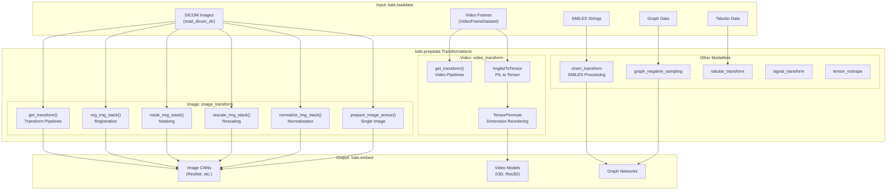
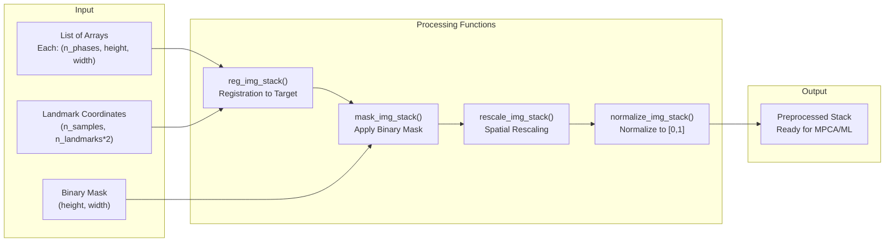
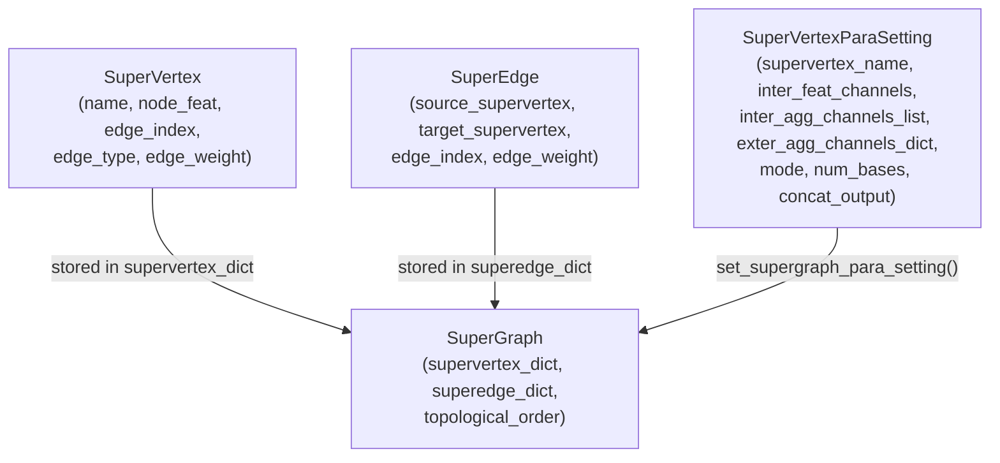
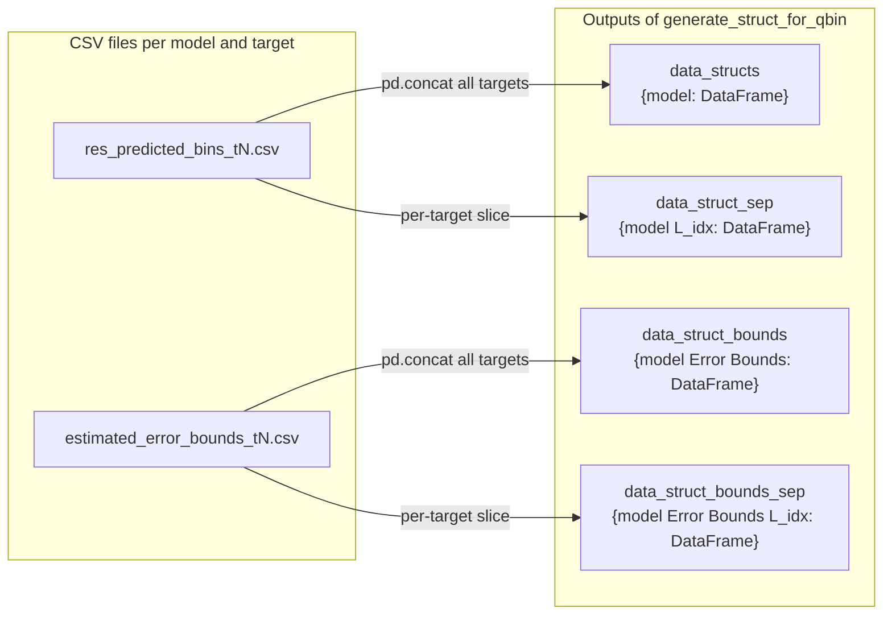
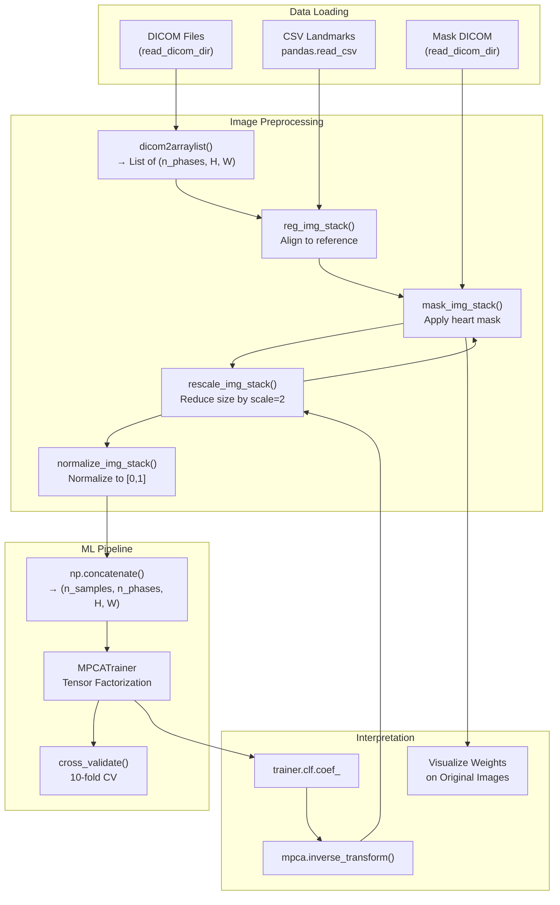

<!-- source: DeepWiki mcp.deepwiki.com · repo pykale/pykale · page 2.2 Data Preprocessing (kale.prepdata) · fetched 2026-10-21 -->

# Data Preprocessing (kale.prepdata)

<details>
<summary>Relevant source files</summary>

The following files were used as context for generating this wiki page:

- [examples/cmri_mpca/__init__.py](examples/cmri_mpca/__init__.py)
- [examples/cmri_mpca/config.py](examples/cmri_mpca/config.py)
- [examples/cmri_mpca/main.py](examples/cmri_mpca/main.py)
- [examples/cmri_mpca/tutorial.ipynb](examples/cmri_mpca/tutorial.ipynb)
- [examples/video_loading/main.py](examples/video_loading/main.py)
- [kale/evaluate/uncertainty_metrics.py](kale/evaluate/uncertainty_metrics.py)
- [kale/interpret/visualize.py](kale/interpret/visualize.py)
- [kale/loaddata/image_access.py](kale/loaddata/image_access.py)
- [kale/loaddata/video_access.py](kale/loaddata/video_access.py)
- [kale/loaddata/video_datasets.py](kale/loaddata/video_datasets.py)
- [kale/loaddata/videos.py](kale/loaddata/videos.py)
- [kale/prepdata/image_transform.py](kale/prepdata/image_transform.py)
- [kale/prepdata/supergraph_construct.py](kale/prepdata/supergraph_construct.py)
- [kale/prepdata/tabular_transform.py](kale/prepdata/tabular_transform.py)
- [kale/prepdata/video_transform.py](kale/prepdata/video_transform.py)
- [tests/conftest.py](tests/conftest.py)
- [tests/embed/test_gripnet.py](tests/embed/test_gripnet.py)
- [tests/evaluate/test_uncertainty_metrics.py](tests/evaluate/test_uncertainty_metrics.py)
- [tests/loaddata/test_tabular_access.py](tests/loaddata/test_tabular_access.py)
- [tests/prepdata/test_image_transform.py](tests/prepdata/test_image_transform.py)
- [tests/prepdata/test_tabular_transform.py](tests/prepdata/test_tabular_transform.py)

</details>


## Purpose and Scope

The `kale.prepdata` module provides preprocessing and transformation utilities that prepare raw data for feature extraction and model training. This module sits between data loading ([Data Loading](#2.1)) and feature embedding ([Feature Embedding](#2.3)) in PyKale's pipeline architecture. It supports multiple data modalities including images, videos, chemical structures, graphs, tabular data, and signals.

This page documents the core preprocessing transformations, with emphasis on image and video preprocessing which are the most extensively developed. For chemical preprocessing used in drug discovery applications, see [Drug Discovery Models](#4.2). For graph preprocessing used with GripNet, see [Graph Neural Networks](#4.5).

## Preprocessing Architecture

The preprocessing layer transforms loaded data into formats suitable for neural network training or traditional machine learning pipelines. The architecture follows a modular design where each data modality has dedicated transformation utilities.

**Architecture Overview**



**Sources:** [kale/prepdata/image_transform.py:1-263](), [kale/prepdata/video_transform.py:1-125](), [kale/prepdata/supergraph_construct.py:1-269](), [kale/prepdata/tabular_transform.py:1-174]()

## Image Preprocessing (kale.prepdata.image_transform)

The `image_transform` module provides comprehensive image preprocessing capabilities, particularly for medical imaging workflows. It supports both standard transform pipelines (for digits, CIFAR, Office datasets) and specialized operations for stacked image data (e.g., cardiac MRI time series).

### Transform Pipeline Factory

**Function: `get_transform(kind, augment=False)`**

Returns pre-configured transformation pipelines for commonly used datasets. The `kind` parameter specifies the dataset type, and `augment` enables data augmentation for training.

| Dataset Kind | Image Size | Channels | Normalization | Augmentation Options |
|--------------|------------|----------|---------------|---------------------|
| `"mnist32"` | 32×32 | 1 | mean=0.5, std=0.5 | Not implemented |
| `"mnist32rgb"` | 32×32 | 3 | mean=(0.5,0.5,0.5) | Not implemented |
| `"usps32"` | 32×32 | 1 | mean=0.5, std=0.5 | Not implemented |
| `"usps32rgb"` | 32×32 | 3 | mean=(0.5,0.5,0.5) | Not implemented |
| `"mnistm"` | 32×32 | 3 | mean=(0.5,0.5,0.5) | Not implemented |
| `"svhn"` | 32×32 | 3 | mean=(0.5,0.5,0.5) | Not implemented |
| `"cifar"` | 32×32 | 3 | ImageNet-style | RandomCrop, HorizontalFlip |
| `"office"` | 224×224 | 3 | ImageNet-style | RandomResizedCrop, HorizontalFlip |
| `"few-shot"` | 224×224 | 3 | ImageNet-style | None |

The transforms compose torchvision operations into standardized pipelines. For example, the Office dataset transform:

```python
# When augment=True
transforms.Compose([
    transforms.Resize(256),
    transforms.RandomResizedCrop(224),
    transforms.RandomHorizontalFlip(),
    transforms.ToTensor(),
    transforms.Normalize(mean=[0.485, 0.456, 0.406], 
                       std=[0.229, 0.224, 0.225])
])
```

**Sources:** [kale/prepdata/image_transform.py:19-103](), [kale/loaddata/image_access.py:42-54]()

### Stacked Image Operations

The module provides specialized functions for processing stacked images (3D arrays where the first dimension represents time or different instances). These are particularly important for medical imaging applications like cardiac MRI analysis.

**Stacked Image Processing Pipeline**



**Sources:** [examples/cmri_mpca/tutorial.ipynb:217-330](), [examples/cmri_mpca/main.py:101-129]()

#### Registration: `reg_img_stack(images, coords, target_coords)`

Performs similarity transformation (rotation, scaling, translation) to align images based on landmark coordinates. Returns registered images and maximum transformation distance for each sample.

**Input:**
- `images`: List where each element is `(n_phases, height, width)` array
- `coords`: Array of shape `(n_samples, n_landmarks*2)` with flattened (x,y) coordinates
- `target_coords`: Array of shape `(n_landmarks*2,)` for alignment target

**Algorithm:**
1. Reshape flattened coordinates to `(n_landmarks, 2)`
2. Estimate similarity transform using `skimage.transform.estimate_transform(ttype='similarity')`
3. Apply inverse transform with `skimage.transform.warp()` to each phase
4. Track maximum distance between transformed and target coordinates

**Output:**
- Modified `images` list (in-place)
- `max_dist`: Array of shape `(n_samples,)` with maximum alignment error

**Sources:** [kale/prepdata/image_transform.py:106-142](), [tests/prepdata/test_image_transform.py:51-78]()

#### Masking: `mask_img_stack(images, mask)`

Applies a binary mask to zero out background regions in all phases of all samples.

**Input:**
- `images`: List of arrays, each `(n_phases, height, width)`
- `mask`: Array of shape `(height, width)` with 0s and 1s

**Operation:** Element-wise multiplication: `images[i][j] = images[i][j] * mask`

**Sources:** [kale/prepdata/image_transform.py:172-187](), [tests/prepdata/test_image_transform.py:94-107]()

#### Rescaling: `rescale_img_stack(images, scale=0.5)`

Resizes images spatially by a scaling factor, typically used to reduce computational cost or match target dimensions.

**Input:**
- `images`: List of arrays, each `(n_phases, height, width)`
- `scale`: Float scaling factor (e.g., 0.5 for half size, 2.0 for double)

**Output:** New list with each array of shape `(n_phases, height*scale, width*scale)`

**Implementation:** Uses `skimage.transform.rescale()` with `preserve_range=True` to maintain original intensity values.

**Sources:** [kale/prepdata/image_transform.py:145-169](), [tests/prepdata/test_image_transform.py:81-91]()

#### Normalization: `normalize_img_stack(images)`

Normalizes pixel intensities to [0, 1] range using min-max scaling independently for each phase of each sample.

**Formula:** `normalized[i][j] = (img[i][j] - min) / (max - min)`

where min and max are computed per-phase.

**Sources:** [kale/prepdata/image_transform.py:190-206](), [tests/prepdata/test_image_transform.py:110-114]()

### Single Image Processing

#### Function: `prepare_image_tensor(image_path, resize_dim=(224,224), channels=1)`

Loads, preprocesses, and converts a single image file to a PyTorch tensor suitable for neural network input. This function handles various input formats and performs necessary conversions.

**Processing Steps:**
1. Load image using `skimage.io.imread()`
2. Convert colorspace:
   - If `channels=1`: Convert RGB to grayscale if needed
   - If `channels=3`: Convert grayscale to RGB by replication if needed
3. Resize to `resize_dim` using `skimage.transform.resize()`
4. Convert to uint8 range [0, 255]
5. Apply torchvision transforms: ToPILImage → ToTensor → Normalize
6. Return tensor of shape `(channels, height, width)`

**Normalization:**
- 1 channel: `mean=[0.5], std=[0.5]`
- 3 channels: `mean=[0.5, 0.5, 0.5], std=[0.5, 0.5, 0.5]`

**Sources:** [kale/prepdata/image_transform.py:209-262](), [tests/prepdata/test_image_transform.py:123-181]()

## Video Preprocessing (kale.prepdata.video_transform)

The `video_transform` module provides specialized transformations for video data, particularly for action recognition tasks. It integrates with PyKale's `VideoFrameDataset` ([kale/loaddata/videos.py:58-283]()) to convert lists of video frames into tensor formats suitable for 3D CNNs.

### Transform Pipeline Factory for Videos

**Function: `get_transform(kind, image_modality)`**

Returns dataset-specific and modality-specific transform pipelines for video data.

**Supported Datasets:**
- `"epic"`: EPIC-Kitchens
- `"gtea"`: Georgia Tech Egocentric Activities
- `"adl"`: Activities of Daily Living
- `"kitchen"`: Kitchen dataset

**Supported Modalities:**
- `"rgb"`: 3-channel RGB frames (normalization: mean/std = 0.5)
- `"flow"`: 2-channel optical flow (u, v components, normalization: mean/std = 0.5)

**RGB Transform Pipeline (Training):**


**Flow Transform Pipeline (Training):**


**Test/Validation Difference:** Uses `CenterCrop(224)` instead of `RandomCrop(224)` for deterministic evaluation.

**Sources:** [kale/prepdata/video_transform.py:5-84](), [kale/loaddata/video_access.py:22-32]()

### Tensor Conversion Classes

#### Class: `ImglistToTensor`

Converts a list of PIL images to a PyTorch tensor. Handles both RGB and optical flow (grayscale) images.

**RGB Mode:** Stacks images directly.
```
Input:  [PIL_RGB_1, PIL_RGB_2, ..., PIL_RGB_N]
Output: Tensor of shape (N, 3, H, W)
```

**Flow Mode:** Pairs consecutive grayscale images as (u, v) components.
```
Input:  [PIL_L_1_u, PIL_L_1_v, PIL_L_2_u, PIL_L_2_v, ..., PIL_L_N_u, PIL_L_N_v]
        (2N grayscale images)
Output: Tensor of shape (N, 2, H, W)
```

**Implementation Detail:** Uses `transforms.functional.to_tensor()` to convert each PIL image to tensor in [0, 1] range.

**Sources:** [kale/prepdata/video_transform.py:87-114](), [examples/video_loading/main.py:104]()

#### Class: `TensorPermute`

Reorders tensor dimensions from `(NUM_FRAMES, CHANNELS, HEIGHT, WIDTH)` to `(CHANNELS, NUM_FRAMES, HEIGHT, WIDTH)` to match the expected input format for 3D CNNs (e.g., I3D, 3D ResNet).

**Operation:** Applies `tensor.permute(1, 0, 2, 3).contiguous()`

**Rationale:** 3D convolutional networks expect the channel dimension first, then the temporal dimension.

**Sources:** [kale/prepdata/video_transform.py:117-124]()

### Integration with Video Loading

The video transforms are tightly integrated with `VideoDatasetAccess` classes in [kale/loaddata/video_access.py:200-372]():

```python
class VideoDatasetAccess(DatasetAccess):
    def __init__(self, ..., transform_kind, ...):
        # Get modality-specific transforms
        self._transform = video_transform.get_transform(
            transform_kind, 
            self._image_modality
        )
```

The complete pipeline for video action recognition:

1. `VideoDataset.get_source_target()` creates dataset access objects
2. Dataset loads sparse temporal samples as PIL image lists
3. `ImglistToTensor` converts to `(N, C, H, W)` tensor
4. Standard torchvision transforms (Resize, Crop, Normalize) applied
5. `TensorPermute` reorders to `(C, N, H, W)` for 3D CNN input

**Sources:** [kale/loaddata/video_access.py:214-236](), [examples/video_loading/main.py:97-120]()

## Other Preprocessing Modules

The `kale.prepdata` package includes additional preprocessing modules for specialized data types:

| Module | Purpose | Key Functions/Classes |
|--------|---------|----------------------|
| `chem_transform` | Chemical structure preprocessing | SMILES string processing for drug-target interaction models |
| `graph_negative_sampling` | Graph augmentation | Negative edge sampling for graph neural networks |
| `tabular_transform` | Tabular data preprocessing | `ToTensor`, `ToOneHotEncoding`, `apply_confidence_inversion`, `generate_struct_for_qbin` |
| `signal_transform` | Signal processing | Time-series and signal transformations |
| `supergraph_construct` | Heterogeneous graph construction | `SuperVertex`, `SuperEdge`, `SuperGraph`, `SuperVertexParaSetting` |
| `string_transform` | String processing | General string preprocessing utilities |
| `tensor_reshape` | Tensor manipulation | `normalize_tensor()`, dimension reshaping utilities |

### Supergraph Construction (kale.prepdata.supergraph_construct)

The `supergraph_construct` module defines the data structures used by GripNet for heterogeneous graph learning (see [Graph Neural Networks](#4.5)). A **supergraph** is a directed acyclic graph (DAG) where each node is a `SuperVertex` (a subgraph of semantically-related nodes) and each edge is a `SuperEdge` (a bipartite subgraph connecting two supervertices).

**Supergraph Class Relationships**



Sources: [kale/prepdata/supergraph_construct.py:1-269](), [tests/embed/test_gripnet.py:1-65]()

#### SuperVertex

Defined in [kale/prepdata/supergraph_construct.py:18-121](). Represents a subgraph of same-category nodes. Homogeneous (no `edge_type`) or heterogeneous (with `edge_type`).

| Parameter | Type | Description |
|-----------|------|-------------|
| `name` | `str` | Unique identifier for the supervertex |
| `node_feat` | `Tensor` | Node features, shape `(num_nodes, num_features)`. Accepts sparse tensors. |
| `edge_index` | `Tensor` | COO edge indices, shape `(2, num_edges)` |
| `edge_type` | `Tensor` (optional) | 0-indexed, continuous relation type per edge |
| `edge_weight` | `Tensor` (optional) | Scalar weight per edge |

When `edge_type` is provided:
- Edges are sorted by type; `range_list` is computed for type-wise access
- `edge_type` must be continuous and start from 0; a `ValueError` is raised otherwise

Key attributes set during `__init__`: `num_node`, `num_node_feat`, `num_edge`, `num_edge_type`, `in_supervertex_list`, `out_supervertex_list`, `start_supervertex`.

#### SuperEdge

Defined in [kale/prepdata/supergraph_construct.py:123-154](). Represents a bipartite subgraph connecting two supervertices.

| Parameter | Type | Description |
|-----------|------|-------------|
| `source_supervertex` | `str` | Name of the source `SuperVertex` |
| `target_supervertex` | `str` | Name of the target `SuperVertex` |
| `edge_index` | `Tensor` | COO cross-supervertex edges, shape `(2, num_edges)` |
| `edge_weight` | `Tensor` (optional) | Scalar weight per edge |

#### SuperVertexParaSetting

Defined in [kale/prepdata/supergraph_construct.py:157-194](). Configures the GripNet layer architecture for one supervertex. Passed to `SuperGraph.set_supergraph_para_setting()`.

| Parameter | Type | Default | Description |
|-----------|------|---------|-------------|
| `supervertex_name` | `str` | — | Name of the supervertex to configure |
| `inter_feat_channels` | `int` | — | Output dimension of internal feature layer |
| `inter_agg_channels_list` | `List[int]` | — | Output dims of internal aggregation layers (one entry per layer) |
| `exter_agg_channels_dict` | `Dict[str, int]` | `None` | Message vector dimension from each parent supervertex |
| `mode` | `str` | `None` | `"cat"` (concatenate) or `"add"` (sum) for external message aggregation |
| `num_bases` | `int` | `32` | Bases for basis decomposition in multi-relational supervertices |
| `concat_output` | `bool` | `True` | Whether to concatenate outputs across internal aggregation layers |

Raises `ValueError` if `mode` is not `None`, `"cat"`, or `"add"`.

#### SuperGraph

Defined in [kale/prepdata/supergraph_construct.py:197-268](). Top-level DAG container. Validates acyclicity and computes topological order via `networkx.topological_sort`.

| Parameter | Type | Description |
|-----------|------|-------------|
| `supervertex_list` | `List[SuperVertex]` | All supervertices in the graph |
| `superedge_list` | `List[SuperEdge]` | All superedges in the graph |
| `supervertex_setting_dict` | `Dict[str, SuperVertexParaSetting]` (optional) | Pre-assigned parameter settings |

**Key behaviors on construction:**
- Raises `TypeError` if the induced graph is not a DAG
- Populates `in_supervertex_list` and `out_supervertex_list` on each `SuperVertex`
- Sets `start_supervertex = False` on any vertex with at least one incoming superedge

**Key method:** `set_supergraph_para_setting(supervertex_setting_list)` — assigns parameter settings from a list of `SuperVertexParaSetting` objects, keyed by `supervertex_name`.

See [tests/embed/test_gripnet.py:11-34]() for the canonical construction pattern.

Sources: [kale/prepdata/supergraph_construct.py:197-268](), [tests/embed/test_gripnet.py:1-65]()

---

### Tabular Transforms (kale.prepdata.tabular_transform)

The `tabular_transform` module provides callable transform classes for structured data and utilities for the uncertainty quantification pipeline.

#### Transform Classes

**`ToTensor`** ([kale/prepdata/tabular_transform.py:18-45]())

Callable wrapper around `torch.tensor`. Constructed with optional `dtype` and `device`; calling it on any array-like returns a `torch.Tensor` with those settings.

---

**`ToOneHotEncoding`** ([kale/prepdata/tabular_transform.py:48-89]())

Callable wrapper around `torch.nn.functional.one_hot`. Converts class index arrays of shape `(*)` to one-hot tensors of shape `(*, num_classes)`.

| Parameter | Default | Description |
|-----------|---------|-------------|
| `num_classes` | `-1` | Number of classes; -1 infers from the max value in the input |
| `dtype` | `None` | Output tensor dtype |
| `device` | `None` | Output tensor device |

---

**`apply_confidence_inversion(data, uncertainty_measure)`** ([kale/prepdata/tabular_transform.py:92-110]())

Inverts values in a DataFrame column: `result = 1 / value + ε`. Values at or below zero are clamped to the minimum positive value before inversion. Used to convert confidence scores to uncertainty scores before binning.

#### generate_struct_for_qbin

**`generate_struct_for_qbin(models_to_compare, targets, saved_bins_path_pre, dataset)`** ([kale/prepdata/tabular_transform.py:113-173]())

Reads per-target, per-model CSV files from disk and organizes them into four dictionaries of DataFrames for use with the uncertainty quantification evaluation pipeline (see [Uncertainty Quantification](#4.7)).

**Data Flow**



| Argument | Type | Description |
|----------|------|-------------|
| `models_to_compare` | `List[str]` | Model name strings (used to construct file paths) |
| `targets` | `List[int]` | Target landmark indices to include |
| `saved_bins_path_pre` | `str` | Root path prefix for bin prediction CSV directories |
| `dataset` | `str` | Dataset name string (e.g., `"SA"`) used in path construction |

**Return values:**

| Dict | Key format | Contents |
|------|-----------|----------|
| `data_structs` | `"<model>"` | All targets concatenated; columns include UID, fold, errors, uncertainty bins, `Target Index` |
| `data_struct_sep` | `"<model> L<idx>"` | Single-target DataFrame for a given model |
| `data_struct_bounds` | `"<model> Error Bounds"` | Estimated error bounds, all targets concatenated |
| `data_struct_bounds_sep` | `"<model>Error Bounds L<idx>"` | Estimated error bounds, single target |

The path to each target's data is constructed as `saved_bins_path_pre/<model>/<dataset>/res_predicted_bins_t<idx>.csv`.

Sources: [kale/prepdata/tabular_transform.py:1-174](), [tests/prepdata/test_tabular_transform.py:1-112](), [tests/evaluate/test_uncertainty_metrics.py:37-42]()

---

### Chemical Transforms (kale.prepdata.chem_transform)

Used in drug discovery applications (see [Drug Discovery Models](#4.2)), particularly for DeepDTA and DrugBAN models. Processes SMILES strings into formats suitable for molecular encoders.

### Tensor Reshaping Utilities (kale.prepdata.tensor_reshape)

Provides general tensor manipulation utilities used across various PyKale components.

**Key Function:** `normalize_tensor()` — normalizes a tensor to the [0, 1] range. Used in `kale.interpret.visualize` for normalizing attention weights before molecular visualization ([kale/interpret/visualize.py:295]()).

Sources: [kale/interpret/visualize.py:20]()

## Complete Medical Imaging Example

The cardiac MRI preprocessing pipeline demonstrates the complete workflow from DICOM images to ML-ready tensors.

**CMR Preprocessing Pipeline**



**Code Example:**
```python
# Load data
images, patient_ids = dicom2arraylist(patient_dcm_list, return_patient_id=True)
landmarks = landmark_df.iloc[:, :-1].values
mask = dicom2arraylist(mask_dcm, return_patient_id=False)[0][0, ...]

# Preprocessing pipeline
img_reg, max_dist = reg_img_stack(images.copy(), landmarks, landmarks[0])
img_masked = mask_img_stack(img_reg.copy(), mask)
img_rescaled = rescale_img_stack(img_masked.copy(), scale=1/2)
img_norm = normalize_img_stack(img_rescaled.copy())

# Prepare for ML
x = np.concatenate([img_norm[i].reshape((1,) + img_norm[i].shape) 
                    for i in range(n_samples)], axis=0)

# Train MPCA classifier
trainer = MPCATrainer(classifier='linear_svc', n_features=200)
cv_results = cross_validate(trainer, x, y, cv=10, 
                            scoring=['accuracy', 'roc_auc'])
```

**Sources:** [examples/cmri_mpca/tutorial.ipynb:217-367](), [examples/cmri_mpca/main.py:101-154]()

## Usage Patterns

### Pattern 1: Standard Dataset Transforms

For standard datasets (MNIST, CIFAR, Office), use the transform factory:

```python
from kale.prepdata.image_transform import get_transform

# Get transform for specific dataset
transform = get_transform('cifar', augment=True)  # Training with augmentation
test_transform = get_transform('cifar', augment=False)  # Testing without augmentation

# Use with PyTorch Dataset
train_set = datasets.CIFAR10(root, train=True, transform=transform)
```

**Sources:** [kale/prepdata/image_transform.py:19-103](), [kale/loaddata/image_access.py:303-349]()

### Pattern 2: Medical Image Stack Processing

For medical imaging with temporal or multi-phase data:

```python
from kale.prepdata.image_transform import (
    reg_img_stack, mask_img_stack, rescale_img_stack, normalize_img_stack
)

# Sequential preprocessing
images = reg_img_stack(images, coords, target_coords)[0]
images = mask_img_stack(images, mask)
images = rescale_img_stack(images, scale=0.5)
images = normalize_img_stack(images)
```

**Sources:** [examples/cmri_mpca/main.py:102-129]()

### Pattern 3: Video Frame Transformation

For video action recognition:

```python
from kale.prepdata.video_transform import get_transform, ImglistToTensor, TensorPermute
from torchvision import transforms

# Get dataset-specific video transform
transform = get_transform('epic', 'rgb')  # or 'flow'

# Or build custom transform
custom_transform = transforms.Compose([
    ImglistToTensor(),
    transforms.Resize(256),
    transforms.CenterCrop(224),
    transforms.Normalize(mean=[0.5, 0.5, 0.5], std=[0.5, 0.5, 0.5]),
    TensorPermute()
])

# Use with VideoFrameDataset
dataset = VideoFrameDataset(
    root_path=video_root,
    annotationfile_path=annotation_file,
    transform=custom_transform
)
```

**Sources:** [kale/prepdata/video_transform.py:5-84](), [kale/loaddata/video_access.py:214-236](), [examples/video_loading/main.py:97-120]()

### Pattern 4: Single Image Loading

For loading individual images (e.g., from CSV file listing):

```python
from kale.prepdata.image_transform import prepare_image_tensor
import torch

# Load and preprocess single image
image_tensor = prepare_image_tensor(
    image_path='path/to/image.png',
    resize_dim=(224, 224),
    channels=3  # or 1 for grayscale
)

# Batch multiple images
images = [prepare_image_tensor(path, (224, 224), 3) for path in image_paths]
batch = torch.stack(images)  # Shape: (N, 3, 224, 224)
```

**Sources:** [kale/prepdata/image_transform.py:209-262](), [kale/loaddata/image_access.py:477-499]()

## Summary of Key Functions

| Function/Class | Module | Input | Output | Primary Use Case |
|----------------|--------|-------|--------|------------------|
| `get_transform()` | `image_transform` | `kind`, `augment` | torchvision.Compose | Standard dataset transforms |
| `reg_img_stack()` | `image_transform` | images, coords | Aligned images | Medical image registration |
| `mask_img_stack()` | `image_transform` | images, mask | Masked images | Background removal |
| `rescale_img_stack()` | `image_transform` | images, scale | Resized images | Dimensionality reduction |
| `normalize_img_stack()` | `image_transform` | images | Normalized images | Intensity normalization |
| `prepare_image_tensor()` | `image_transform` | image_path, resize_dim, channels | Tensor | Single image loading |
| `get_transform()` | `video_transform` | `kind`, `image_modality` | Dict of transforms | Video dataset transforms |
| `ImglistToTensor` | `video_transform` | List[PIL.Image] | Tensor (N,C,H,W) | Frame list to tensor |
| `TensorPermute` | `video_transform` | Tensor (N,C,H,W) | Tensor (C,N,H,W) | 3D CNN input format |

**Sources:** [kale/prepdata/image_transform.py:1-263](), [kale/prepdata/video_transform.py:1-125]()

---

