<!-- source: DeepWiki mcp.deepwiki.com · repo pykale/pykale · page 2.3 Feature Embedding (kale.embed) · fetched 2026-10-21 -->

# Feature Embedding (kale.embed)

<details>
<summary>Relevant source files</summary>

The following files were used as context for generating this wiki page:

- [docs/source/index.rst](docs/source/index.rst)
- [docs/source/kale.embed.rst](docs/source/kale.embed.rst)
- [docs/source/kale.evaluate.rst](docs/source/kale.evaluate.rst)
- [docs/source/kale.loaddata.rst](docs/source/kale.loaddata.rst)
- [docs/source/kale.pipeline.rst](docs/source/kale.pipeline.rst)
- [docs/source/kale.predict.rst](docs/source/kale.predict.rst)
- [docs/source/kale.prepdata.rst](docs/source/kale.prepdata.rst)
- [docs/source/kale.utils.rst](docs/source/kale.utils.rst)
- [examples/bindingdb_drugban/README.md](examples/bindingdb_drugban/README.md)
- [examples/bindingdb_drugban/configs.py](examples/bindingdb_drugban/configs.py)
- [examples/bindingdb_drugban/configs/DA_cross_domain.yaml](examples/bindingdb_drugban/configs/DA_cross_domain.yaml)
- [examples/bindingdb_drugban/configs/non_DA_cross_domain.yaml](examples/bindingdb_drugban/configs/non_DA_cross_domain.yaml)
- [examples/bindingdb_drugban/configs/non_DA_in_domain.yaml](examples/bindingdb_drugban/configs/non_DA_in_domain.yaml)
- [examples/bindingdb_drugban/main.py](examples/bindingdb_drugban/main.py)
- [examples/bindingdb_drugban/model.py](examples/bindingdb_drugban/model.py)
- [examples/bindingdb_drugban/test.py](examples/bindingdb_drugban/test.py)
- [kale/embed/factorization.py](kale/embed/factorization.py)
- [kale/embed/image_cnn.py](kale/embed/image_cnn.py)
- [kale/loaddata/molecular_datasets.py](kale/loaddata/molecular_datasets.py)
- [kale/pipeline/drugban_trainer.py](kale/pipeline/drugban_trainer.py)
- [kale/pipeline/multi_domain_adapter.py](kale/pipeline/multi_domain_adapter.py)
- [kale/predict/class_domain_nets.py](kale/predict/class_domain_nets.py)
- [kale/prepdata/supergraph_construct.py](kale/prepdata/supergraph_construct.py)
- [tests/embed/test_drugban.py](tests/embed/test_drugban.py)
- [tests/embed/test_factorization.py](tests/embed/test_factorization.py)
- [tests/embed/test_gripnet.py](tests/embed/test_gripnet.py)
- [tests/embed/test_multimodal_fusion.py](tests/embed/test_multimodal_fusion.py)
- [tests/loaddata/test_molecular_datasets.py](tests/loaddata/test_molecular_datasets.py)
- [tests/pipeline/test_drugban_trainer.py](tests/pipeline/test_drugban_trainer.py)
- [tests/pipeline/test_mida_trainer.py](tests/pipeline/test_mida_trainer.py)
- [tests/pipeline/test_multi_domain_adapter.py](tests/pipeline/test_multi_domain_adapter.py)

</details>


The `kale.embed` module provides neural network architectures and components for feature extraction and embedding across multiple data modalities including images, video, graphs, signals, and structured data. This module is the core feature extraction stage in PyKale's pipeline API, transforming raw input data into meaningful representations for downstream tasks.

For training pipelines and model orchestration using these embeddings, see [Training Pipelines (kale.pipeline)](2.5). For data loading that feeds into these embedding models, see [Data Loading (kale.loaddata)](2.1). For prediction heads that consume these embeddings, see [Prediction Heads (kale.predict)](2.4).

## Module Overview

The `kale.embed` package is organized into submodules by data modality and method family:

| Submodule | Key Classes / Functions | Primary Use Case |
|-----------|------------------------|-----------------|
| `kale.embed.image_cnn` | `SmallCNNFeature`, `ResNet*Feature`, `LeNet`, `ImageVAEEncoder`, `_Bottleneck` | Image feature extraction |
| `kale.embed.cnn` | CNN utilities | General CNN architectures |
| `kale.embed.signal_cnn` | Signal CNN encoders | 1D signal / EEG data |
| `kale.embed.factorization` | `MPCA`, `MIDA`, `BaseKernelDomainAdapter` | Tensor / matrix factorization |
| `kale.embed.gcn` | GCN layers | Graph node embedding |
| `kale.embed.model_lib.gripnet` | `GripNet` | Heterogeneous graph embedding |
| `kale.embed.model_lib.mogonet` | `MogonetGCN` | Multi-omics GCN |
| `kale.embed.model_lib.drugban` | `DrugBAN` | Drug-target interaction |
| `kale.embed.attention` | `BANLayer`, `PositionalEncoding` | Bilinear attention, transformers |
| `kale.embed.multimodal_encoder` | Encoder family | Multimodal VAE encoding |
| `kale.embed.multimodal_fusion` | `Concat`, `LowRankTensorFusion`, `BimodalInteractionFusion`, `ProductOfExperts` | Multimodal feature fusion |
| `kale.embed.nn` | `FCNet`, `RandomLayer` | MLP building blocks |
| `kale.embed.video.*` | `I3D`, `Res3D`, `SE_I3D`, `SE_Res3D` | Video feature extraction |
| `kale.embed.uncertainty_fitting` | Uncertainty fitting utilities | Landmark localization |

**Module-to-data-type mapping diagram:**

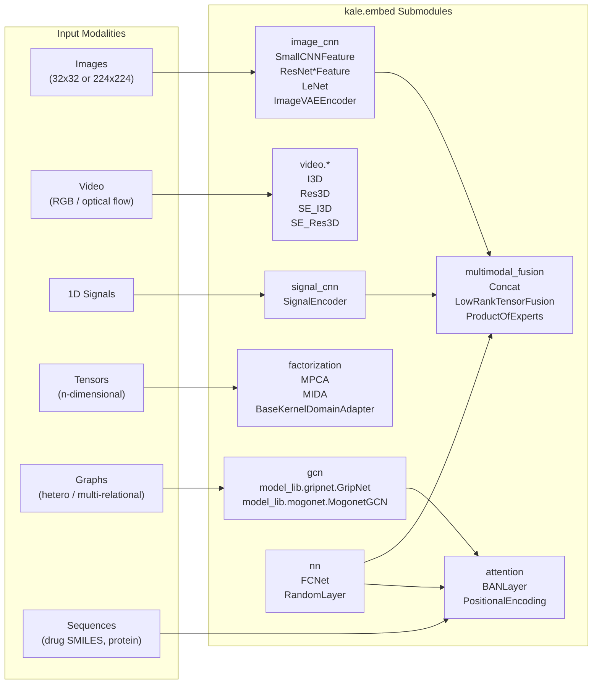

Sources: [docs/source/kale.embed.rst:1-171](), [kale/embed/image_cnn.py:1-10](), [kale/embed/factorization.py:1-10](), [kale/prepdata/supergraph_construct.py:1-10]()

## Image Feature Extractors

PyKale provides comprehensive CNN architectures for extracting features from images of various sizes and types. The image feature extractors are designed to handle both small images (32x32) and regular images (224x224).

### Small Image CNNs

For small images like CIFAR-10 and MNIST, PyKale offers specialized lightweight architectures:

| Class | Input Size | Output Features | Use Case |
|-------|------------|----------------|----------|
| `SmallCNNFeature` | 32x32 | 128 | CIFAR, MNIST feature extraction |
| `SimpleCNNBuilder` | Configurable | Configurable | Experimental CNN architectures |

The `SmallCNNFeature` class implements a 3-layer CNN with batch normalization and max pooling:

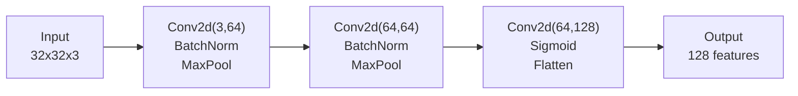

### ResNet Feature Extractors

For standard ImageNet-sized images, PyKale provides pre-trained ResNet-based feature extractors:

| Class | Architecture | Output Features | Weights |
|-------|-------------|----------------|---------|
| `ResNet18Feature` | ResNet-18 | 512 | ImageNet pre-trained |
| `ResNet34Feature` | ResNet-34 | 512 | ImageNet pre-trained |
| `ResNet50Feature` | ResNet-50 | 2048 | ImageNet pre-trained |
| `ResNet101Feature` | ResNet-101 | 2048 | ImageNet pre-trained |
| `ResNet152Feature` | ResNet-152 | 2048 | ImageNet pre-trained |

### Specialized Architectures

#### LeNet for Multi-Modal Learning
The `LeNet` class provides a customizable CNN based on the LeNet architecture, supporting additional layers and optional linear transformations:

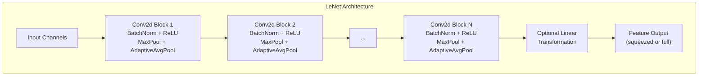

#### Variational Autoencoder Encoder
The `ImageVAEEncoder` provides latent space encoding for 224x224 images:

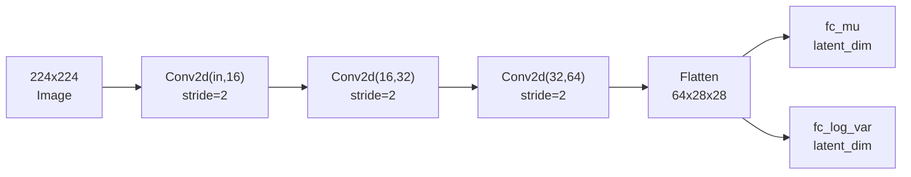

Sources: [kale/embed/image_cnn.py:50-88](), [kale/embed/image_cnn.py:191-303](), [kale/embed/image_cnn.py:306-389](), [kale/embed/image_cnn.py:391-449]()

## Factorization Methods

`kale.embed.factorization` implements scikit-learn-compatible dimensionality reduction and kernel-based domain adaptation via matrix / tensor factorization.

### MPCA

`MPCA` (Multilinear Principal Component Analysis) reduces the dimensionality of tensor-valued data (e.g., 3D image stacks) without first vectorizing them.

| Attribute / Parameter | Description |
|-----------------------|-------------|
| `var_ratio` | Fraction of variance to preserve (default `0.97`) |
| `max_iter` | Number of MPCA iterations (default `1`) |
| `vectorize` | Return flattened vector if `True` |
| `n_components` | Number of features to keep after vectorization |
| `proj_mats` | Learned projection matrices, one per tensor mode |
| `idx_order` | Feature ordering by explained variance |
| `shape_in` / `shape_out` | Input and output tensor shapes per sample |

`MPCA.fit(x)` performs SVD on each mode-unfolding of the training tensor and iteratively refines projection matrices. `MPCA.transform(x)` applies `multi_mode_dot` from `tensorly`. `MPCA.inverse_transform(x)` reconstructs approximate tensors from projected features.

**MPCA data flow:**

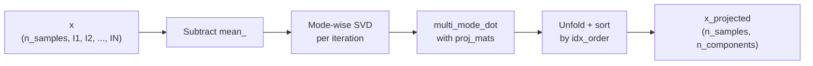

Sources: [kale/embed/factorization.py:308-507]()

### BaseKernelDomainAdapter and MIDA

`BaseKernelDomainAdapter` is the base class for kernel-based domain adaptation. `MIDA` (Maximum Independence Domain Adaptation) extends it to project features into a domain-invariant subspace by minimizing the Hilbert–Schmidt Independence Criterion (HSIC) between the projected data and domain labels.

| Parameter | Description |
|-----------|-------------|
| `num_components` | Output dimensionality (default: keep all) |
| `kernel` | Kernel function: `"linear"`, `"rbf"`, `"poly"`, etc. |
| `mu` | MIDA regularization weight for domain independence |
| `eta` | MIDA regularization weight for label preservation |
| `ignore_y` | Whether to ignore class labels during fitting |
| `augment` | Append / prepend domain factors to output (`"pre"`, `"post"`, or `None`) |
| `eigen_solver` | Eigendecomposition backend: `"auto"`, `"dense"`, `"arpack"`, `"randomized"` |
| `fit_inverse_transform` | Whether to enable `inverse_transform` |

`MIDA.fit(x, y, group_labels)` constructs the kernel matrix, applies centering, and performs eigendecomposition via `_eigendecompose`. `MIDA.transform(x, group_labels)` projects new data. When `kernel="linear"`, an `orig_coef_` attribute holds the explicit projection matrix in input feature space.

The `_eigendecompose` helper selects a backend (ARPACK, randomized, or dense `scipy.linalg.eigh`) based on data size and `num_components`.

Sources: [kale/embed/factorization.py:510-900](), [kale/embed/factorization.py:133-196]()

## Neural Network Components

The `kale.embed.nn` module provides fundamental neural network building blocks used throughout the embedding architectures.

### Fully Connected Networks

The `FCNet` class creates multi-layer fully connected networks with weight normalization:

```python
# Example usage from tests
dims = [64, 128, 64]  # input_dim, hidden_dim, output_dim
model = FCNet(dims, activation="ReLU", dropout=0.2)
```

### Random Layer for Domain Adaptation

The `RandomLayer` applies random matrix transformations for multi-source domain adaptation:

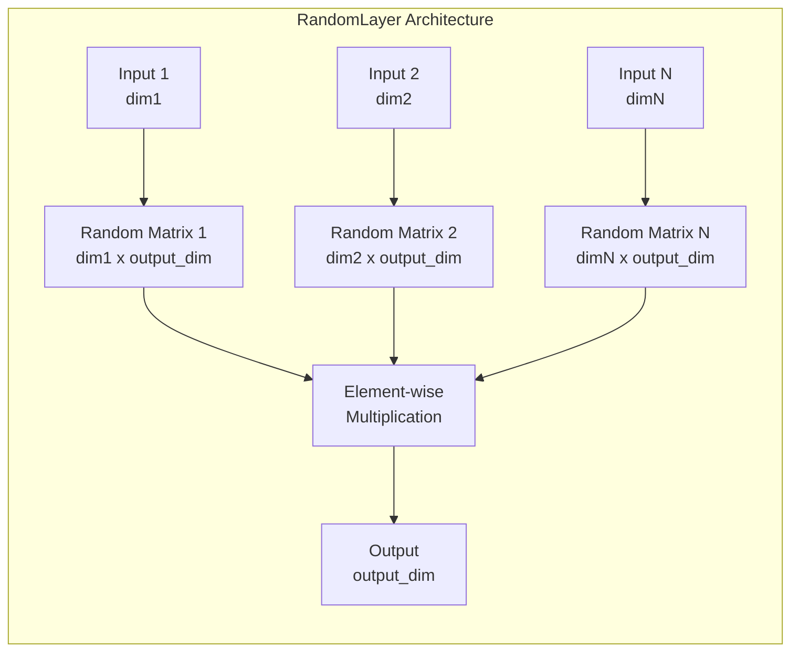

### Utility Layers

| Class | Purpose | Usage |
|-------|---------|-------|
| `Flatten` | Flatten tensors to 2D | Replace final FC layers |
| `Identity` | Pass-through layer | Replace unwanted layers |
| `_Bottleneck` | Domain-specific feature extraction | MFSAN multi-source DA |

Sources: [kale/embed/nn.py:8-36](), [kale/embed/nn.py:38-79](), [kale/embed/image_cnn.py:10-47](), [kale/embed/image_cnn.py:137-189]()

## Attention Mechanisms

PyKale implements attention mechanisms for sequential data and multimodal fusion.

### Transformer Positional Encoding

The `PositionalEncoding` class adds temporal position information to sequence embeddings:

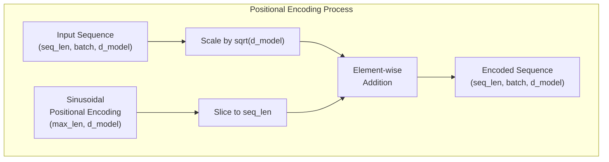

### Bilinear Attention Network (BAN)

The `BANLayer` implements bilinear attention for multimodal feature fusion, particularly useful for drug-protein interaction prediction:

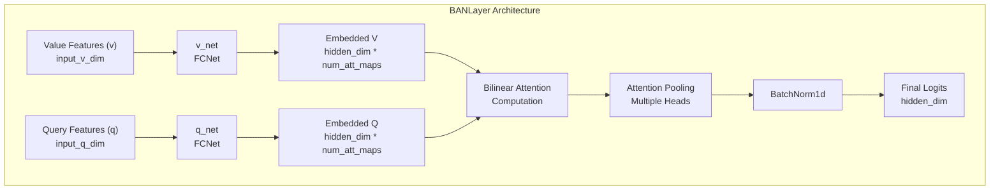

Sources: [kale/embed/attention.py:12-52](), [kale/embed/attention.py:54-130]()

## Graph Neural Networks

PyKale implements GripNet, a sophisticated graph neural network for heterogeneous graphs using a supergraph abstraction.

### Supergraph Construction

The supergraph framework provides a higher-level abstraction for heterogeneous graphs:

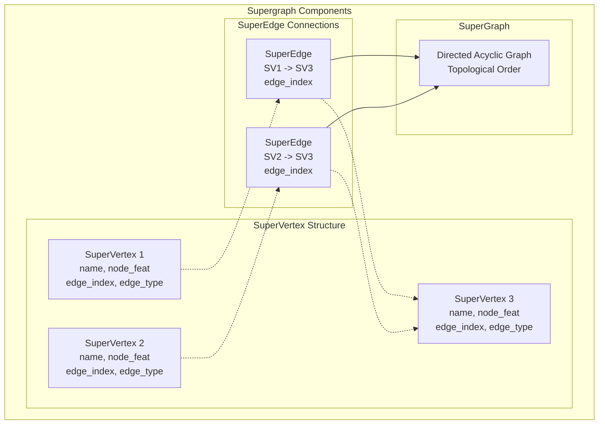

### GripNet Architecture

The `GripNet` model processes supergraphs using internal and external aggregation:

| Component | Purpose | Configuration |
|-----------|---------|--------------|
| `SuperVertex` | Subgraph with same node type | `node_feat`, `edge_index`, `edge_type` |
| `SuperEdge` | Bipartite connections | `source_supervertex`, `target_supervertex` |
| `SuperVertexParaSetting` | Layer parameters | `inter_feat_channels`, `inter_agg_channels_list` |
| `SuperGraph` | DAG of supervertices | Topological ordering, parameter settings |

Sources: [kale/prepdata/supergraph_construct.py:18-121](), [kale/prepdata/supergraph_construct.py:123-155](), [kale/prepdata/supergraph_construct.py:197-269](), [tests/embed/test_gripnet.py:9-44]()

### MogonetGCN

`MogonetGCN` (from `kale.embed.model_lib.mogonet`) implements a GCN encoder for unimodal omics data within the MOGONET multi-omics framework. Each omics modality gets its own `MogonetGCN` instance during the pre-training and joint-training phases in `MultiomicsTrainer`. See section [4.8](4.8) for the full multi-omics pipeline.

Sources: [docs/source/kale.embed.rst:67-74]()

## Code Entity Mapping

The following diagram maps high-level concepts to specific code entities in the `kale.embed` module:

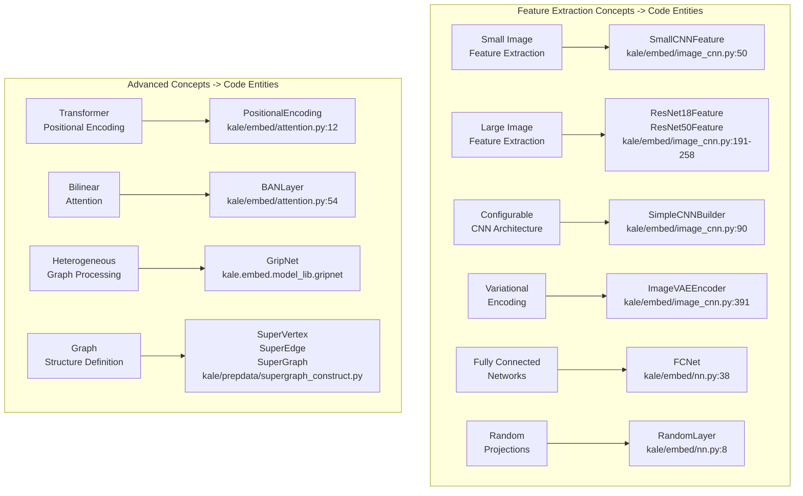

### Usage Pattern Mapping

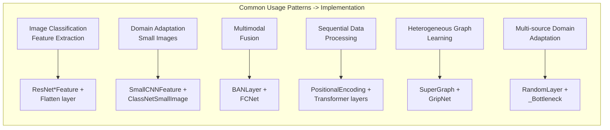

Sources: [kale/embed/image_cnn.py:1-449](), [kale/embed/nn.py:1-79](), [kale/embed/attention.py:1-130](), [kale/prepdata/supergraph_construct.py:1-269]()

---

