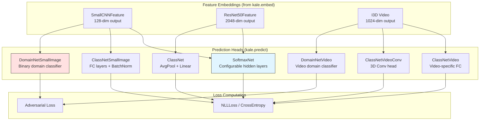
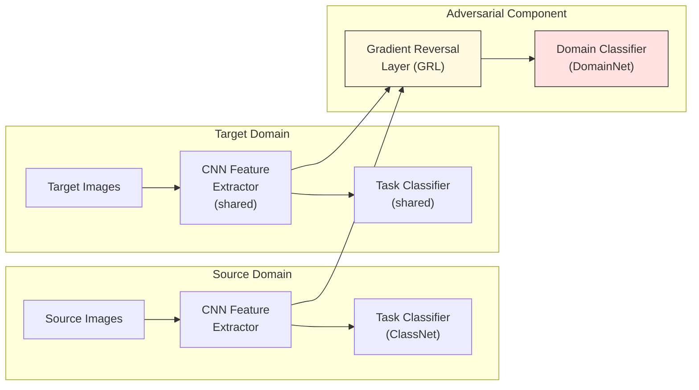
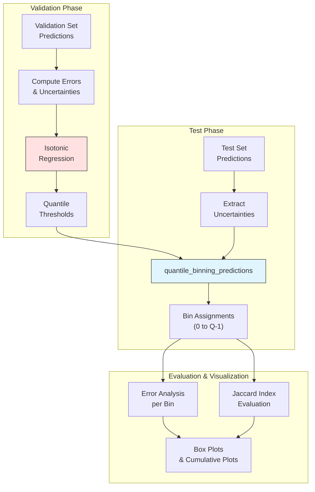
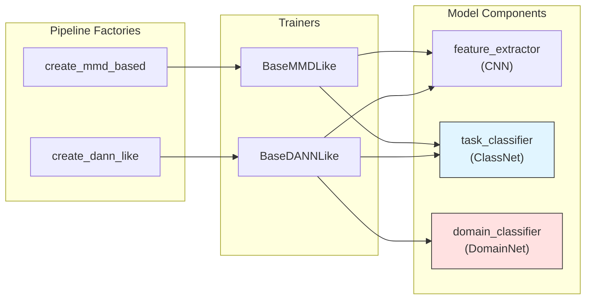

<!-- source: DeepWiki mcp.deepwiki.com · repo pykale/pykale · page 2.4 Prediction Heads (kale.predict) · fetched 2026-10-21 -->

# Prediction Heads (kale.predict)

<details>
<summary>Relevant source files</summary>

The following files were used as context for generating this wiki page:

- [.gitignore](.gitignore)
- [kale/embed/image_cnn.py](kale/embed/image_cnn.py)
- [kale/evaluate/metrics.py](kale/evaluate/metrics.py)
- [kale/loaddata/mnistm.py](kale/loaddata/mnistm.py)
- [kale/pipeline/multi_domain_adapter.py](kale/pipeline/multi_domain_adapter.py)
- [kale/predict/class_domain_nets.py](kale/predict/class_domain_nets.py)
- [kale/predict/decode.py](kale/predict/decode.py)
- [kale/predict/isonet.py](kale/predict/isonet.py)
- [kale/prepdata/graph_negative_sampling.py](kale/prepdata/graph_negative_sampling.py)
- [tests/pipeline/test_multi_domain_adapter.py](tests/pipeline/test_multi_domain_adapter.py)

</details>


The `kale.predict` module provides prediction head networks that transform learned feature embeddings into task-specific outputs. These heads include classification networks, domain discrimination networks for adversarial training, and uncertainty quantification utilities for medical imaging applications.

For information about feature extraction that precedes prediction heads, see [Feature Embedding (kale.embed)](#2.3). For information about training pipelines that use these prediction heads, see [Training Pipelines (kale.pipeline)](#2.5).

## Purpose and Scope

The prediction head layer sits between feature embeddings and loss computation in the PyKale pipeline. This module addresses three primary use cases:

1. **Task Classification**: Predicting class labels from learned features across image, video, and tabular modalities
2. **Domain Discrimination**: Adversarial domain classification for transfer learning methods (DANN, CDAN, WDGRL)
3. **Uncertainty Quantification**: Binning predictions by uncertainty estimates for medical imaging safety-critical applications

The module supports multi-scale architectures (small 32×32 images through 224×224 ImageNet-scale images), temporal data (video action recognition), and specialized medical imaging workflows.

**Sources**: [kale/predict/class_domain_nets.py:1-239](), [kale/predict/uncertainty_binning.py:1-69]()

## Prediction Head Architecture



**Diagram**: Prediction head architecture showing the flow from feature embeddings through task-specific prediction heads to loss computation.

**Sources**: [kale/predict/class_domain_nets.py:18-239](), [kale/embed/image_cnn.py:50-88]()

## Classification Prediction Heads

PyKale provides multiple classification head architectures optimized for different input characteristics and computational requirements.

### SoftmaxNet

`SoftmaxNet` is a flexible fully-connected classifier with configurable hidden layers and activation functions. It serves as the standard prediction head for tabular features and flattened CNN outputs.

**Architecture**:
- Input: Feature vector of dimension `input_dim`
- Hidden layers: Optional tuple of layer sizes (e.g., `(100, 50)`)
- Output: LogSoftmax over `n_classes`
- Loss: NLLLoss (negative log-likelihood)

**Key Parameters**:
- `input_dim` (int): Dimension of input feature vector
- `n_classes` (int): Number of output classes
- `hidden` (tuple): Hidden layer dimensions (empty tuple for linear classifier)
- `activation_fn` (nn.Module): Activation function (default: `nn.ReLU`)

```python
# Example from tests/predict/test_class_domain_nets.py:28-32
model = SoftmaxNet(input_dim=128, n_classes=8)
output = model(input_batch)  # Shape: (batch_size, 8)
```

**Sources**: [kale/predict/class_domain_nets.py:19-65](), [tests/predict/test_class_domain_nets.py:28-32]()

### ClassNet

`ClassNet` handles 4D convolutional feature maps (batch, channels, height, width) by applying average pooling followed by a linear layer. This is the standard head for connecting CNNs to classification outputs.

**Architecture**:
```
Input: (batch, 64, 8, 8)
  ↓ AvgPool2d(kernel_size=8)
(batch, 64, 1, 1)
  ↓ Flatten
(batch, 64)
  ↓ Linear(64, n_classes)
(batch, n_classes)
```

**Key Parameters**:
- `n_class` (int): Number of output classes (default: 10)
- `input_shape` (tuple): Expected input shape `(batch, channels, height, width)` (default: `(-1, 64, 8, 8)`)

**Sources**: [kale/predict/class_domain_nets.py:67-86](), [tests/predict/test_class_domain_nets.py:35-39]()

### ClassNetSmallImage

`ClassNetSmallImage` is optimized for small 32×32 images (MNIST, CIFAR) with dedicated batch normalization and dropout for improved regularization.

**Architecture**:
```
Input (128-dim)
  ↓ Linear(128 → 100) + BatchNorm + ReLU + Dropout
  ↓ Linear(100 → 100) + BatchNorm + ReLU
  ↓ Linear(100 → n_classes)
Output (n_classes)
```

This architecture provides strong regularization for small-scale image classification tasks where overfitting is a concern.

**Sources**: [kale/predict/class_domain_nets.py:88-116](), [tests/predict/test_class_domain_nets.py:42-47]()

### Video Classification Heads

PyKale provides two video classification heads for temporal action recognition:

#### ClassNetVideo

Standard video classifier using fully-connected layers with dropout:

- Input: 512-dim feature vector (default)
- Architecture: `Linear(512→100) → BatchNorm → ReLU → Dropout → Linear(100→n_classes)`
- Parameters: `input_size`, `n_channel`, `dropout_keep_prob`, `n_class`

#### ClassNetVideoConv

Convolutional video classifier compatible with I3D temporal outputs:

- Input: 5D tensor `(batch, 1024, 1, 1, 1)` from I3D average pooling
- Architecture: `Dropout → Unit3D(1024→n_classes, kernel=1×1×1)`
- No batch normalization or activation in final layer
- Uses `Unit3D` from [kale.embed.video.i3d](#2.3)

**Sources**: [kale/predict/class_domain_nets.py:160-216](), [tests/predict/test_class_domain_nets.py:50-54]()

## Domain Discrimination Heads

Domain discrimination networks are used in adversarial domain adaptation methods (DANN, CDAN, WDGRL) to distinguish between source and target domain features. The gradient reversal layer (implemented in training pipelines) ensures that the feature extractor learns domain-invariant representations.

### DomainNetSmallImage

Binary domain classifier for small image features with configurable depth:

**Shallow Configuration** (`bigger_discrim=False`):
```
Input (128-dim)
  ↓ Linear(128 → 100) + BatchNorm + ReLU
  ↓ Linear(100 → 2)
Output (2 classes: source/target)
```

**Deep Configuration** (`bigger_discrim=True`):
```
Input (128-dim)
  ↓ Linear(128 → 500) + BatchNorm + ReLU
  ↓ Linear(500 → 100) + BatchNorm + ReLU
  ↓ Linear(100 → 2)
Output (2 classes: source/target)
```

**Key Parameters**:
- `input_size` (int): Input feature dimension (default: 128)
- `hidden_size` (int): Hidden layer size for shallow network (default: 100)
- `deep_hidden_size` (int): First hidden layer size for deep network (default: 500)
- `num_classes` (int): Output dimension (default: 2 for binary domain classification)
- `bigger_discrim` (bool): Whether to use deep configuration (default: False)

**Sources**: [kale/predict/class_domain_nets.py:118-157](), [tests/predict/test_class_domain_nets.py:57-66]()

### DomainNetVideo

Video-specific domain classifier for temporal domain adaptation:

```
Input (128-dim video features)
  ↓ Linear(128 → 100) + BatchNorm + ReLU
  ↓ Linear(100 → 2)
Output (2 classes: source/target)
```

This architecture is used in video domain adaptation methods for action recognition across different video datasets (e.g., UCF101 → HMDB51).

**Sources**: [kale/predict/class_domain_nets.py:218-239]()

## Domain Adaptation Integration



**Diagram**: Domain adaptation architecture showing how `DomainNet` prediction heads enable adversarial training. The gradient reversal layer (GRL) is implemented in `kale.pipeline` trainers.

**Usage in DANN-like Methods**:
1. **Feature Extractor**: Shared CNN (e.g., `ResNet50Feature`) processes both domains
2. **Task Classifier**: `ClassNet` or `SoftmaxNet` predicts class labels
3. **Domain Classifier**: `DomainNet` predicts domain labels (source=0, target=1)
4. **Gradient Reversal**: During backpropagation, gradients from domain loss are reversed before updating feature extractor
5. **Result**: Feature extractor learns domain-invariant representations

**Sources**: [kale/predict/class_domain_nets.py:118-157](), [High-Level Architecture Diagrams]()

## Uncertainty Quantification for Medical Imaging

The `kale.predict.uncertainty_binning` module provides quantile-based uncertainty binning for landmark localization in medical imaging. This enables clinicians to assess prediction reliability and identify high-uncertainty cases requiring manual review.

### quantile_binning_predictions

Bins test predictions into quantile-based uncertainty groups using thresholds learned from validation data.

**Function Signature**:
```python
def quantile_binning_predictions(
    uncertainties_test: Dict[str, Union[int, float]],
    uncert_thresh: List[List[float]],
    save_pred_path: Optional[str] = None,
) -> Dict[str, int]
```

**Parameters**:
- `uncertainties_test`: Dictionary mapping prediction IDs (strings) to uncertainty values (floats)
- `uncert_thresh`: List of quantile thresholds `[[thresh1], [thresh2], ...]` from isotonic regression on validation set
- `save_pred_path`: Optional path to save predicted bin assignments

**Returns**:
- Dictionary mapping prediction IDs to bin indices (0 = most confident, higher = less confident)

**Binning Logic**:
```
Bin 0: uncertainty ≤ thresh[0]
Bin 1: thresh[0] < uncertainty ≤ thresh[1]
...
Bin Q-1: uncertainty > thresh[Q-2]
```

**Example Usage**:
```python
# From validation phase (using kale.interpret.uncertainty_quantiles)
uncert_boundaries, estimated_errors = quantile_binning_and_est_errors(
    errors=validation_errors,
    uncertainties=validation_uncertainties,
    num_bins=5
)

# Test phase prediction
test_bins = quantile_binning_predictions(
    uncertainties_test={'pred_001': 0.23, 'pred_002': 0.87, ...},
    uncert_thresh=uncert_boundaries
)
# Returns: {'pred_001': 0, 'pred_002': 3, ...}
```

**Sources**: [kale/predict/uncertainty_binning.py:14-68](), [kale/interpret/uncertainty_quantiles.py:47-115]()

## Uncertainty Binning Pipeline



**Diagram**: Uncertainty binning workflow from validation-phase threshold learning through test-phase prediction to evaluation. The `quantile_binning_predictions` function implements the test phase binning.

**Integration with Medical Imaging Pipeline**:
1. **Training**: Train landmark localization model with uncertainty estimation (e.g., using heatmap variance)
2. **Validation**: Compute uncertainty quantile thresholds using isotonic regression ([kale.interpret.uncertainty_quantiles:47-115]())
3. **Testing**: Bin test predictions using `quantile_binning_predictions` with learned thresholds
4. **Evaluation**: Analyze error distributions, Jaccard similarity, and calibration ([kale.evaluate.uncertainty_metrics](#2.6))
5. **Clinical Use**: Flag high-uncertainty predictions (high bin indices) for manual review

**Sources**: [kale/predict/uncertainty_binning.py:14-68](), [examples/landmark_uncertainty/main.py:1-256](), [kale/interpret/uncertainty_quantiles.py:47-115]()

## Prediction Head Selection Guide

| **Scenario** | **Recommended Head** | **Key Characteristics** |
|-------------|---------------------|------------------------|
| Small images (MNIST, CIFAR) | `ClassNetSmallImage` | BatchNorm + Dropout, 128→100→100→classes |
| Regular images (ImageNet) | `ClassNet` | AvgPool + Linear, minimal parameters |
| Video action recognition | `ClassNetVideo` or `ClassNetVideoConv` | Temporal features, I3D compatible |
| Transfer learning (general) | `SoftmaxNet` | Flexible hidden layers, any input dimension |
| Domain adaptation (image) | `DomainNetSmallImage` | Binary classification, configurable depth |
| Domain adaptation (video) | `DomainNetVideo` | Temporal domain discrimination |
| Medical imaging with uncertainty | `ClassNet` + `quantile_binning_predictions` | Post-processing for safety-critical applications |

**Sources**: [kale/predict/class_domain_nets.py:1-239](), [tests/predict/test_class_domain_nets.py:1-67]()

## Implementation Details

### Common Design Patterns

**1. Output Compatibility**:
- Classification heads output raw logits (no softmax in forward pass)
- `SoftmaxNet` applies `LogSoftmax` but pairs with `NLLLoss` (equivalent to CrossEntropyLoss on logits)
- Domain networks output logits for gradient reversal layer compatibility

**2. Batch Normalization Placement**:
- `ClassNetSmallImage`, `DomainNetSmallImage`: BatchNorm after each Linear layer
- `ClassNetVideo`: BatchNorm after first Linear layer only
- `ClassNet`, `SoftmaxNet`: No BatchNorm (relies on feature extractor normalization)

**3. Dimensionality Handling**:
```python
# ClassNet expects 4D input (batch, channels, height, width)
x = avgpool(x)  # → (batch, channels, 1, 1)
x = torch.flatten(x, 1)  # → (batch, channels)
x = linear(x)  # → (batch, n_classes)

# SoftmaxNet expects 2D input (batch, features)
x = feature_extractor(input)  # Already flattened
x = classifier(x)  # → (batch, n_classes)
```

**4. Activation Functions**:
- Hidden layers: ReLU (default), configurable in `SoftmaxNet`
- Output layers: No activation (raw logits for loss functions)
- `ClassNetVideoConv`: No activation in `Unit3D` final layer (`activation_fn=None`)

**Sources**: [kale/predict/class_domain_nets.py:18-239](), [tests/predict/test_class_domain_nets.py:1-67]()

### Connection to Training Pipelines

Prediction heads are instantiated and managed by training pipeline classes in `kale.pipeline`:



**Diagram**: Prediction heads are instantiated within training pipelines. Task classifiers (blue) predict class labels, while domain classifiers (red) enable adversarial training.

**Example from DANN Pipeline**:
```python
# From kale.pipeline.domain_adapter (conceptual)
feature_network = SmallCNNFeature(num_channels=3)  # kale.embed
classifier = ClassNetSmallImage(input_size=128, n_class=10)  # kale.predict
domain_classifier = DomainNetSmallImage(input_size=128, bigger_discrim=False)  # kale.predict

# Training loop uses gradient reversal layer with domain_classifier
```

For complete details on how prediction heads integrate with training workflows, see [Training Pipelines (kale.pipeline)](#2.5) and [Domain Adaptation](#3).

**Sources**: [kale/predict/class_domain_nets.py:1-239](), [High-Level Architecture Diagrams]()

## Testing and Validation

The module includes comprehensive tests validating shape transformations and numerical correctness:

**Shape Tests** ([tests/predict/test_class_domain_nets.py:28-66]()):
- `SoftmaxNet`: `(batch, 128)` → `(batch, 8)`
- `ClassNet`: `(batch, 64, 8, 8)` → `(batch, 10)`
- `ClassNetSmallImage`: `(batch, 128)` → `(batch, 8)`
- `ClassNetVideo`: `(batch, 128)` → `(batch, 8)`
- `ClassNetVideoConv`: `(batch, 1024, 1, 1, 1)` → `(batch, 8, 1, 1, 1)`
- `DomainNetSmallImage`: `(batch, 128)` → `(batch, 2)` (both shallow and deep)
- `DomainNetVideo`: `(batch, 128)` → `(batch, 2)`

**Uncertainty Binning Tests** ([tests/pipeline/test_uncertainty_qbin_pipeline.py:170-375]()):
- End-to-end validation of quantile binning workflow
- Tests isotonic regression threshold learning
- Validates bin assignment correctness
- Confirms generated visualization files

**Sources**: [tests/predict/test_class_domain_nets.py:1-67](), [tests/pipeline/test_uncertainty_qbin_pipeline.py:170-375]()

---

