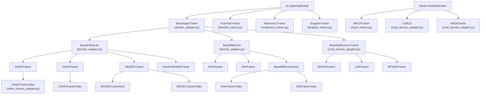
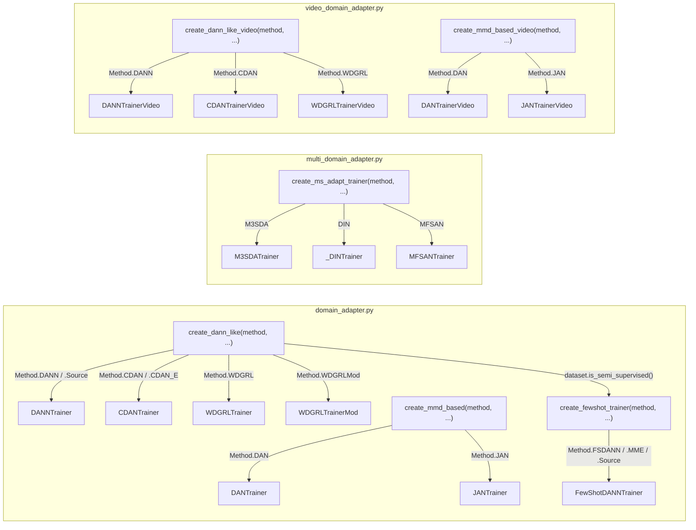
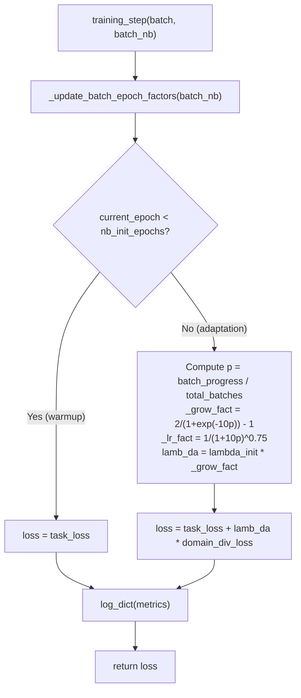
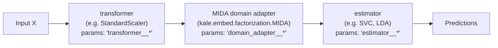
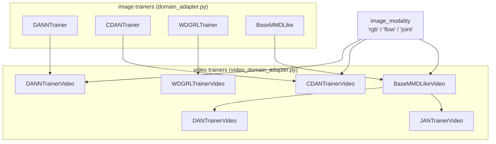
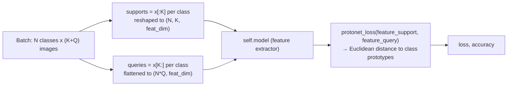
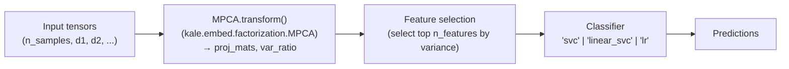
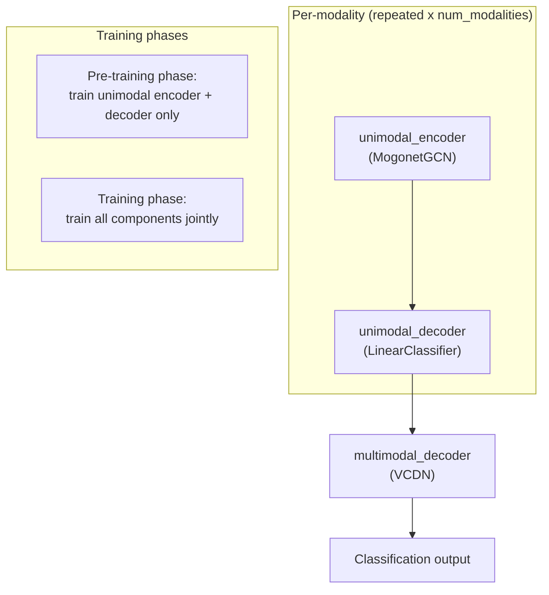
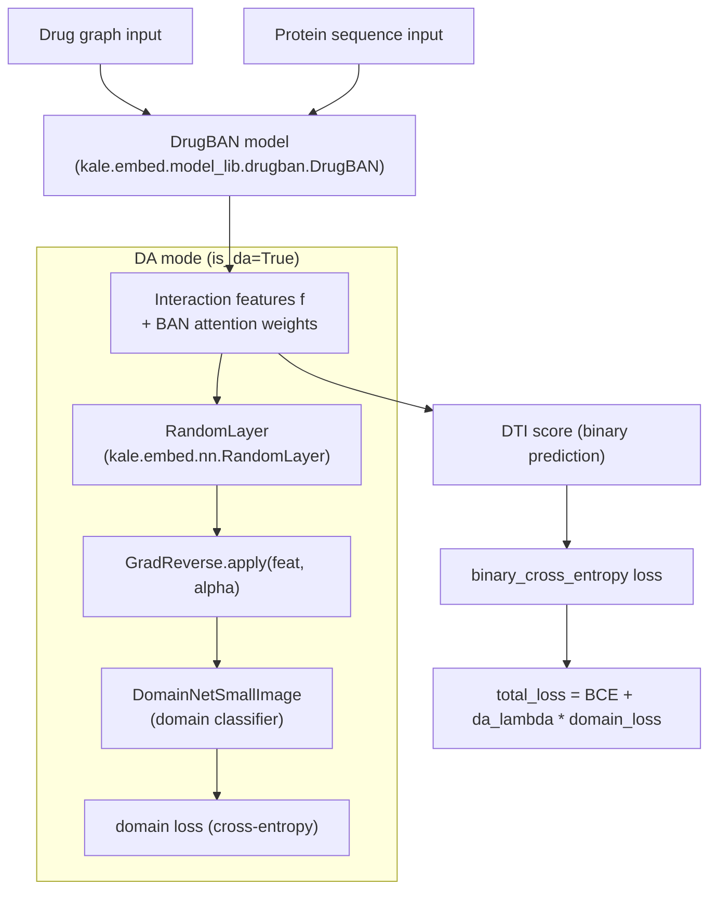

<!-- source: DeepWiki mcp.deepwiki.com · repo pykale/pykale · page 2.5 Training Pipelines (kale.pipeline) · fetched 2026-10-21 -->

# Training Pipelines (kale.pipeline)

<details>
<summary>Relevant source files</summary>

The following files were used as context for generating this wiki page:

- [examples/bindingdb_drugban/README.md](examples/bindingdb_drugban/README.md)
- [examples/bindingdb_drugban/configs.py](examples/bindingdb_drugban/configs.py)
- [examples/bindingdb_drugban/configs/DA_cross_domain.yaml](examples/bindingdb_drugban/configs/DA_cross_domain.yaml)
- [examples/bindingdb_drugban/configs/non_DA_cross_domain.yaml](examples/bindingdb_drugban/configs/non_DA_cross_domain.yaml)
- [examples/bindingdb_drugban/configs/non_DA_in_domain.yaml](examples/bindingdb_drugban/configs/non_DA_in_domain.yaml)
- [examples/bindingdb_drugban/main.py](examples/bindingdb_drugban/main.py)
- [examples/bindingdb_drugban/model.py](examples/bindingdb_drugban/model.py)
- [examples/bindingdb_drugban/test.py](examples/bindingdb_drugban/test.py)
- [examples/fewshot_protonet/README.md](examples/fewshot_protonet/README.md)
- [examples/fewshot_protonet/__init__.py](examples/fewshot_protonet/__init__.py)
- [examples/fewshot_protonet/config.py](examples/fewshot_protonet/config.py)
- [examples/fewshot_protonet/configs/demo.yaml](examples/fewshot_protonet/configs/demo.yaml)
- [examples/fewshot_protonet/configs/template.yaml](examples/fewshot_protonet/configs/template.yaml)
- [examples/fewshot_protonet/eval_unseen_classes.py](examples/fewshot_protonet/eval_unseen_classes.py)
- [examples/fewshot_protonet/main.py](examples/fewshot_protonet/main.py)
- [examples/multiomics_mogonet/main.py](examples/multiomics_mogonet/main.py)
- [examples/multiomics_mogonet/model.py](examples/multiomics_mogonet/model.py)
- [examples/video_loading/main.py](examples/video_loading/main.py)
- [kale/embed/image_cnn.py](kale/embed/image_cnn.py)
- [kale/interpret/model_weights.py](kale/interpret/model_weights.py)
- [kale/loaddata/dataset_access.py](kale/loaddata/dataset_access.py)
- [kale/loaddata/few_shot.py](kale/loaddata/few_shot.py)
- [kale/loaddata/molecular_datasets.py](kale/loaddata/molecular_datasets.py)
- [kale/loaddata/multi_domain.py](kale/loaddata/multi_domain.py)
- [kale/loaddata/multiomics_datasets.py](kale/loaddata/multiomics_datasets.py)
- [kale/loaddata/sampler.py](kale/loaddata/sampler.py)
- [kale/loaddata/video_access.py](kale/loaddata/video_access.py)
- [kale/loaddata/video_datasets.py](kale/loaddata/video_datasets.py)
- [kale/loaddata/video_multi_domain.py](kale/loaddata/video_multi_domain.py)
- [kale/loaddata/videos.py](kale/loaddata/videos.py)
- [kale/pipeline/domain_adapter.py](kale/pipeline/domain_adapter.py)
- [kale/pipeline/drugban_trainer.py](kale/pipeline/drugban_trainer.py)
- [kale/pipeline/fewshot_trainer.py](kale/pipeline/fewshot_trainer.py)
- [kale/pipeline/mpca_trainer.py](kale/pipeline/mpca_trainer.py)
- [kale/pipeline/multi_domain_adapter.py](kale/pipeline/multi_domain_adapter.py)
- [kale/pipeline/multiomics_trainer.py](kale/pipeline/multiomics_trainer.py)
- [kale/pipeline/video_domain_adapter.py](kale/pipeline/video_domain_adapter.py)
- [kale/predict/class_domain_nets.py](kale/predict/class_domain_nets.py)
- [kale/prepdata/video_transform.py](kale/prepdata/video_transform.py)
- [tests/embed/test_drugban.py](tests/embed/test_drugban.py)
- [tests/embed/test_multimodal_fusion.py](tests/embed/test_multimodal_fusion.py)
- [tests/interpret/test_model_weights.py](tests/interpret/test_model_weights.py)
- [tests/interpret/test_visualize.py](tests/interpret/test_visualize.py)
- [tests/loaddata/test_image_access.py](tests/loaddata/test_image_access.py)
- [tests/loaddata/test_molecular_datasets.py](tests/loaddata/test_molecular_datasets.py)
- [tests/loaddata/test_sampler.py](tests/loaddata/test_sampler.py)
- [tests/loaddata/test_video_access.py](tests/loaddata/test_video_access.py)
- [tests/pipeline/test_domain_adapter.py](tests/pipeline/test_domain_adapter.py)
- [tests/pipeline/test_drugban_trainer.py](tests/pipeline/test_drugban_trainer.py)
- [tests/pipeline/test_mpca_trainer.py](tests/pipeline/test_mpca_trainer.py)
- [tests/pipeline/test_multi_domain_adapter.py](tests/pipeline/test_multi_domain_adapter.py)
- [tests/pipeline/test_video_domain_adapter.py](tests/pipeline/test_video_domain_adapter.py)
- [tests/prepdata/test_tensor_reshape.py](tests/prepdata/test_tensor_reshape.py)

</details>


## Purpose and Scope

`kale.pipeline` contains trainer classes that assemble feature extractors, task classifiers, domain critics, and loss functions into complete, runnable training pipelines. Two families of trainers are provided:

- **PyTorch Lightning trainers** (`pl.LightningModule` subclasses) — implement `training_step`, `validation_step`, `test_step`, and `configure_optimizers` to drive deep learning training loops.
- **Scikit-learn compatible trainers** (`sklearn.base.BaseEstimator` subclasses) — wrap classical ML pipelines (MPCA, MIDA) with optional domain adaptation, usable with scikit-learn's cross-validation utilities.

This page documents the API of every trainer class. For how these trainers are assembled in practice, see Domain Adaptation ([3](#3)), Few-Shot Learning ([4.1](#4.1)), Medical Imaging ([4.3](#4.3)), or the Examples section ([5](#5)). For the embedding modules trainers operate on, see Feature Embedding ([2.3](#2.3)) and Prediction Heads ([2.4](#2.4)).

---

## Module File Map

| File | Primary Classes | Framework |
|------|----------------|-----------|
| `kale/pipeline/domain_adapter.py` | `BaseAdaptTrainer`, `DANNTrainer`, `CDANTrainer`, `WDGRLTrainer`, `WDGRLTrainerMod`, `DANTrainer`, `JANTrainer`, `FewShotDANNTrainer` | PyTorch Lightning |
| `kale/pipeline/multi_domain_adapter.py` | `BaseMultiSourceTrainer`, `M3SDATrainer`, `_DINTrainer`, `MFSANTrainer`, `CoIRLS`, `MIDATrainer`, `AutoMIDAClassificationTrainer` | PL + Scikit-learn |
| `kale/pipeline/video_domain_adapter.py` | `DANNTrainerVideo`, `CDANTrainerVideo`, `WDGRLTrainerVideo`, `DANTrainerVideo`, `JANTrainerVideo` | PyTorch Lightning |
| `kale/pipeline/fewshot_trainer.py` | `ProtoNetTrainer` | PyTorch Lightning |
| `kale/pipeline/mpca_trainer.py` | `MPCATrainer` | Scikit-learn |
| `kale/pipeline/multiomics_trainer.py` | `MultiomicsTrainer` | PyTorch Lightning |
| `kale/pipeline/drugban_trainer.py` | `DrugbanTrainer` | PyTorch Lightning |

---

## Trainer Class Hierarchy

**Diagram: Trainer Inheritance and Module Locations**



Sources: [kale/pipeline/domain_adapter.py:195-461](), [kale/pipeline/multi_domain_adapter.py:73-355](), [kale/pipeline/video_domain_adapter.py:101-400](), [kale/pipeline/fewshot_trainer.py:25-151](), [kale/pipeline/mpca_trainer.py:1-30](), [kale/pipeline/multiomics_trainer.py:1-30](), [kale/pipeline/drugban_trainer.py:27-100]()

---

## Factory Function → Trainer Mapping

For domain adaptation, trainer instances are created through factory functions rather than constructing classes directly.

**Diagram: Factory Functions and Trainer Construction**



Sources: [kale/pipeline/domain_adapter.py:87-193](), [kale/pipeline/multi_domain_adapter.py:46-65](), [kale/pipeline/video_domain_adapter.py:25-98]()

---

## The `Method` Enum

`Method` ([kale/pipeline/domain_adapter.py:54-84]()) is a string-valued enum that identifies which DA algorithm to run. It also exposes type-checking predicates used by factory functions and trainers.

| Enum Value | Algorithm | Group Predicate |
|---|---|---|
| `Method.Source` | Source-only (no adaptation) | `is_dann_method()`, `is_fewshot_method()` |
| `Method.DANN` | Domain-Adversarial NN | `is_dann_method()` |
| `Method.CDAN` | Conditional DA | `is_cdan_method()` |
| `Method.CDAN_E` | CDAN with entropy weighting | `is_cdan_method()` |
| `Method.FSDANN` | Few-Shot DANN | `is_fewshot_method()` |
| `Method.MME` | Minimax Entropy | `is_fewshot_method()` |
| `Method.WDGRL` | Wasserstein-guided RL | — |
| `Method.WDGRLMod` | Modified WDGRL | — |
| `Method.DAN` | Deep Adaptation Network | `is_mmd_method()` |
| `Method.JAN` | Joint Adaptation Network | `is_mmd_method()` |

---

## `BaseAdaptTrainer` — Core Domain Adaptation Trainer

`BaseAdaptTrainer` ([kale/pipeline/domain_adapter.py:195-461]()) is the `pl.LightningModule` base class for all deep DA trainers. Subclasses must implement `forward` and `compute_loss`.

### Constructor Parameters

| Parameter | Type | Default | Description |
|---|---|---|---|
| `dataset` | `BiDomainDatasets` or `MultiDomainDataset` | required | Multi-domain data container |
| `feature_extractor` | `nn.Module` | required | Backbone network (stored as `self.feat`) |
| `task_classifier` | `nn.Module` | required | Prediction head (stored as `self.classifier`) |
| `target_domain` | `str` | `None` | Name of the target domain |
| `nb_init_epochs` | `int` | `10` | Warmup epochs (task loss only) |
| `nb_adapt_epochs` | `int` | `50` | Total training epochs |
| `lambda_init` | `float` | `1.0` | Initial weight of adaptation loss |
| `adapt_lambda` | `bool` | `True` | Enable DANN λ schedule |
| `adapt_lr` | `bool` | `True` | Enable DANN LR schedule |
| `batch_size` | `int` | `32` | Batch size per domain loader |
| `init_lr` | `float` | `1e-3` | Initial learning rate |
| `optimizer` | `dict` | `None` | Dict with keys `"type"` and `"optim_params"` |

### Training Loop and Scheduling

**Diagram: BaseAdaptTrainer Training Step**



Sources: [kale/pipeline/domain_adapter.py:298-393]()

The `compute_loss` method must return a 3-tuple: `(task_loss, adaptation_loss, log_metrics_dict)`. The training step logs:
- `train_task_loss`, `train_domain_div_loss`, `train_total_loss` per step
- `alpha` and `lambda` per epoch (where applicable)

### Data Loading

`BaseAdaptTrainer` implements `train_dataloader`, `val_dataloader`, and `test_dataloader` by calling `self._dataset.get_domain_loaders(split=..., batch_size=..., num_workers=...)`. This returns a `MultiDataLoader` that yields synchronized batches from all domains.

The batch format is:
- **Unsupervised DA**: `(x, y, domain_labels)` — a merged tensor from source and target, with integer `domain_labels` identifying origin.
- **Semi-supervised DA**: three-tuple batches `(src_batch, labeled_tgt_batch, unlabeled_tgt_batch)`.

### Optimizer Configuration

`_configure_optimizer` ([kale/pipeline/domain_adapter.py:411-440]()) supports `"Adam"`, `"SGD"`, and `"AdamW"`. When `adapt_lr=True` and SGD is used, a `LambdaLR` scheduler wrapping `_lr_fact` is returned alongside the optimizer.

---

## Domain Adaptation Trainers (`domain_adapter.py`)

### Gradient Reversal Layer

`GradReverse` ([kale/pipeline/domain_adapter.py:23-43]()) is a `torch.autograd.Function` implementing the GRL from the DANN paper. Its `forward` pass is the identity; its `backward` pass negates the gradient and scales it by `alpha`. This is applied in `DANNTrainer.forward` as `GradReverse.apply(feature, self.alpha)`.

### DANN-Like Trainers

All DANN variants inherit from `BaseDANNLike` ([kale/pipeline/domain_adapter.py:463-567]()), which adds a `domain_classifier` attribute (the critic network) and implements the common `_uda_batch_forward` method.

| Class | Key Behavior | `compute_loss` inputs |
|---|---|---|
| `DANNTrainer` | GRL applied to features before critic | features + reversed features → critic |
| `CDANTrainer` | Critic receives outer-product of softmax × reversed features | Multilinear conditioning |
| `WDGRLTrainer` | Wasserstein loss; critic updated `k_critic` steps per training step | Critic cost = −W + γ·GP |
| `WDGRLTrainerMod` | WDGRL with `automatic_optimization=False`; manually steps critic and task optimizers | Same as WDGRL |
| `FewShotDANNTrainer` | Semi-supervised; uses labeled target data in classification loss | Requires `dataset.is_semi_supervised() == True` |

`WDGRLTrainer.configure_optimizers` ([kale/pipeline/domain_adapter.py:774-791]()) creates two separate optimizers: one for `feat + classifier` and one for `domain_classifier`. `WDGRLTrainerMod` uses `automatic_optimization=False` and steps them manually in `training_step`.

### MMD-Like Trainers

`DANTrainer` and `JANTrainer` inherit from `BaseMMDLike` (in `domain_adapter.py`). Instead of an adversarial critic, they minimize Maximum Mean Discrepancy between source and target feature distributions using Gaussian kernels.

- **DAN**: single-kernel MMD on feature layer outputs.
- **JAN**: joint kernel on features and softmax outputs simultaneously (two kernel sets with parameters `kernel_mul=[2.0, 2.0]`, `kernel_num=[5, 1]`).

---

## Multi-Source Domain Adaptation (`multi_domain_adapter.py`)

### `BaseMultiSourceTrainer`

`BaseMultiSourceTrainer` ([kale/pipeline/multi_domain_adapter.py:73-107]()) extends `BaseAdaptTrainer` and adds `n_classes` and `feature_dim` attributes. It expects a `MultiDomainDataset` with domain labels and uses the last domain as the target.

### Deep Trainers

| Class | Algorithm | Domain Loss |
|---|---|---|
| `M3SDATrainer` | Moment Matching for Multi-Source DA (ICCV 2019) | Sum of k-th order moments across domain pairs |
| `_DINTrainer` | Domain Independent Network | HSIC between features and one-hot domain labels |
| `MFSANTrainer` | Multiple Feature Spaces Adaptation Network (AAAI 2019) | MMD + classifier output discrepancy |

`M3SDATrainer` ([kale/pipeline/multi_domain_adapter.py:109-197]()) maintains a separate `nn.ModuleDict` of per-source classifiers. At inference on the target domain it averages their predictions via `_average_cls_output`.

`MFSANTrainer` ([kale/pipeline/multi_domain_adapter.py:255-355]()) adds per-source domain-specific bottleneck networks (`_Bottleneck` from `kale/embed/image_cnn.py`) in addition to per-source classifiers. The `cls_discrepancy` method penalizes disagreement among source classifiers on target data.

### `CoIRLS`

`CoIRLS` ([kale/pipeline/multi_domain_adapter.py:358-470]()) is a scikit-learn `BaseEstimator` implementing Covariate-Independence Regularized Least Squares. It solves a kernel regression problem with a regularization term penalizing covariate dependence (HSIC).

**Key API:**
- `fit(x, y, covariates)` — solves the linear system `(J·K + αI + λ·C·Kcov·C·K) · coef = y`
- `predict(x)` — computes `kernel(x, x_train) · coef`
- `decision_function(x)` — raw scores before thresholding

`CoIRLS` is used with `cross_validate` and `leave_one_group_out` for neuroimaging classification. See ([3.2](#3.2)).

### `MIDATrainer`

`MIDATrainer` ([kale/pipeline/multi_domain_adapter.py:509-750+]()) extends both `sklearn.model_selection._search.BaseSearchCV` and `TransformerMixin`. It constructs and searches a three-stage pipeline:

```
[transformer (optional)] → [MIDA] → [estimator]
```

**Diagram: MIDATrainer Pipeline and Parameter Namespacing**



Sources: [kale/pipeline/multi_domain_adapter.py:509-630]()

**Key Constructor Parameters:**

| Parameter | Description |
|---|---|
| `estimator` | Any sklearn-compatible classifier |
| `param_grid` | Dict with `transformer__`, `domain_adapter__`, `estimator__` prefixed keys |
| `use_mida` | If `False`, skips the MIDA step |
| `transformer` | Optional pre-processing step |
| `search_strategy` | `"grid"` or `"random"` |
| `num_iter` | Iterations for random search |
| `cv` | Cross-validation splitter |

After `fit`, the best configuration is stored in `best_transformer_` and `best_mida_`. The `adapt(x, group_labels)` method applies the fitted transformer and MIDA to new data.

Predefined hyperparameter grids are available as module-level constants:
- `CLASSIFIERS` — maps name strings to sklearn estimator instances
- `CLASSIFIER_PARAMS` — per-classifier parameter ranges
- `MIDA_PARAMS` — `mu`, `eta`, `ignore_y`, `augment` search ranges
- `INV_REG_COEF` — log-space regularization values

([kale/pipeline/multi_domain_adapter.py:483-506]())

---

## Video Domain Adaptation (`video_domain_adapter.py`)

Video trainers extend their image-domain counterparts and add an `image_modality` parameter (`"rgb"`, `"flow"`, or `"joint"`).

**Diagram: Video Trainer Inheritance and Modality Handling**



Sources: [kale/pipeline/video_domain_adapter.py:101-400]()

When `image_modality="joint"`, video trainers extract features from both `self.rgb_feat` and `self.flow_feat` (from `self.feat["rgb"]` and `self.feat["flow"]`) and concatenate them before classification. Batch structure in joint mode expects four sub-batches: `(x_s_rgb, y_s)`, `(x_s_flow, y_s_flow)`, `(x_tu_rgb, y_tu)`, `(x_tu_flow, y_tu_flow)`.

Factory functions:
- `create_dann_like_video(method, dataset, image_modality, feature_extractor, task_classifier, critic, **train_params)`
- `create_mmd_based_video(method, dataset, image_modality, feature_extractor, task_classifier, **train_params)`

([kale/pipeline/video_domain_adapter.py:25-98]())

---

## Few-Shot Learning: `ProtoNetTrainer`

`ProtoNetTrainer` ([kale/pipeline/fewshot_trainer.py:25-151]()) implements Prototypical Networks (Snell et al. 2017) as a `pl.LightningModule`.

**Diagram: ProtoNetTrainer Forward Pass**



Sources: [kale/pipeline/fewshot_trainer.py:89-116]()

**Constructor Parameters:**

| Parameter | Description |
|---|---|
| `net` | Feature extractor (outputs a 1-D feature vector) |
| `train_num_classes` | N for training episodes |
| `train_num_support_samples` | K for training |
| `train_num_query_samples` | Query samples per class in training |
| `val_num_classes` | N for validation/test |
| `val_num_support_samples` | K for validation/test |
| `optimizer` | String name from `torch.optim` (e.g. `"SGD"`) |
| `lr` | Learning rate |

The training and validation loss functions are separate `protonet_loss` instances initialized with their respective `num_classes` and `num_query_samples`. `test_step` reuses the validation-mode loss.

---

## MPCA Pipeline: `MPCATrainer`

`MPCATrainer` ([kale/pipeline/mpca_trainer.py]()) is a scikit-learn `BaseEstimator` implementing a three-stage pipeline: MPCA dimensionality reduction → feature selection → linear classifier.

**Diagram: MPCATrainer Inference Pipeline**



Sources: [kale/pipeline/mpca_trainer.py:1-50]()

Key parameters include `classifier` (string name), `classifier_params`, `mpca_params` (dict passed to `MPCA`), `n_features`, and `search_params` for hyperparameter search. Used in the cardiac MRI PAH diagnosis pipeline — see ([4.3](#4.3)).

---

## Multiomics Trainer: `MultiomicsTrainer`

`MultiomicsTrainer` ([kale/pipeline/multiomics_trainer.py]()) is a `pl.LightningModule` implementing the MOGONET framework for multi-omics cancer classification.

**Diagram: MultiomicsTrainer Architecture**



Sources: [kale/pipeline/multiomics_trainer.py:1-50](), [examples/multiomics_mogonet/model.py:1-50]()

The trainer manages a pre-training phase (unimodal GCN + classifier heads only) followed by joint training including the `VCDN` cross-modal fusion decoder. It operates on `SparseMultiomicsDataset` graph data objects from `kale.loaddata.multiomics_datasets`.

---

## DrugBAN Trainer: `DrugbanTrainer`

`DrugbanTrainer` ([kale/pipeline/drugban_trainer.py:27-300]()) is a `pl.LightningModule` for drug-target interaction (DTI) prediction using the DrugBAN bilinear attention network.

**Diagram: DrugbanTrainer Forward and DA Mode**



Sources: [kale/pipeline/drugban_trainer.py:27-200](), [examples/bindingdb_drugban/model.py:1-80]()

**Key Constructor Parameters:**

| Parameter | Description |
|---|---|
| `model` | `DrugBAN` network |
| `solver_lr` | Learning rate |
| `num_classes` | Number of output classes |
| `is_da` | Enable domain adaptation via CDAN-like GRL |
| `solver_da_lr` | Learning rate for domain classifier |
| `da_lambda` | Weight of domain adaptation loss |

Metrics tracked: `AUROC`, `F1Score`, `Accuracy`, `Recall`, `Specificity` (via `torchmetrics.MetricCollection`). The domain adaptation path uses `GradReverse` from `kale.pipeline.domain_adapter` and `DomainNetSmallImage` from `kale.predict.class_domain_nets`.

---

## Cross-Cutting Patterns

### Logging Convention

All PyTorch Lightning trainers in `kale.pipeline` use `self.log_dict(metrics, on_step=..., on_epoch=...)`. Domain adaptation trainers log metrics prefixed with the split name: `train_source_acc`, `valid_target_acc`, `test_domain_acc`, etc.

### Optimizer Configuration Dispatch

`BaseAdaptTrainer._configure_optimizer` ([kale/pipeline/domain_adapter.py:411-440]()) reads the `optimizer` dict argument:
- `None` → `Adam(lr=init_lr, betas=(0.8, 0.999), weight_decay=1e-5)`
- `{"type": "Adam", "optim_params": {...}}` → Adam with custom params
- `{"type": "SGD", "optim_params": {...}}` → SGD, optionally with `LambdaLR`

Invalid keys in `optim_params` are silently dropped via `validate_kwargs` from `kale.utils.validate`.

### Dataset Contract

All domain adaptation trainers expect their `dataset` argument to implement the `DomainsDatasetBase` interface from `kale/loaddata/multi_domain.py`:
- `prepare_data_loaders(target_domain=...)` — called in `BaseAdaptTrainer.__init__`
- `get_domain_loaders(split, batch_size, num_workers)` — returns a `MultiDataLoader`
- `is_semi_supervised()` — gates few-shot trainer creation in `create_dann_like`

Sources: [kale/loaddata/multi_domain.py:80-100](), [kale/pipeline/domain_adapter.py:242-292]()

---

