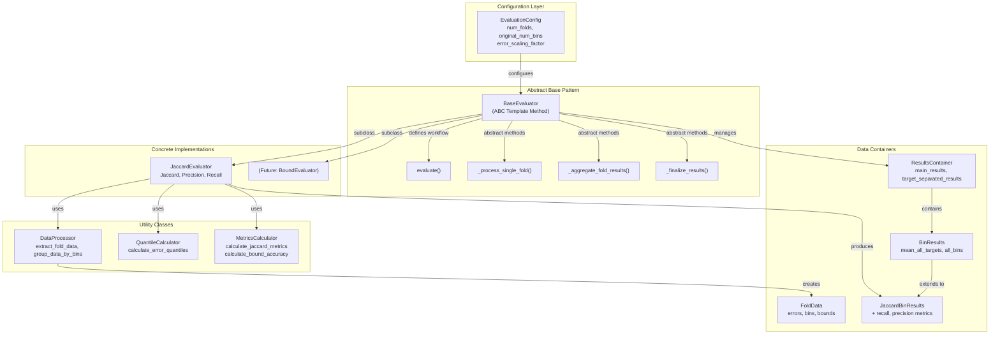
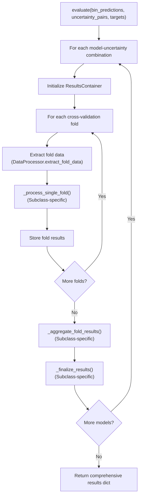
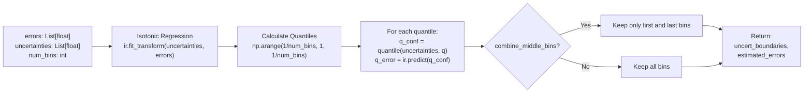
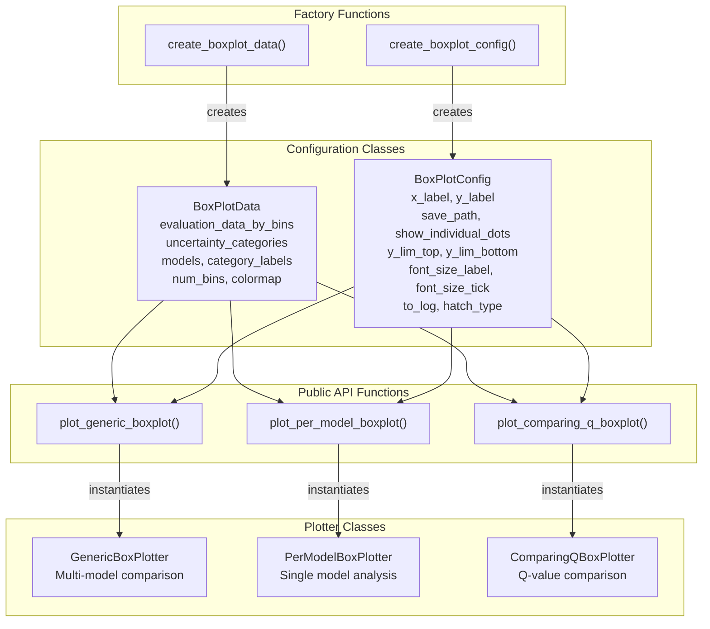
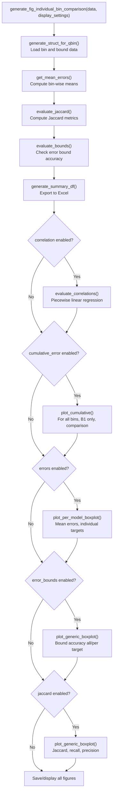
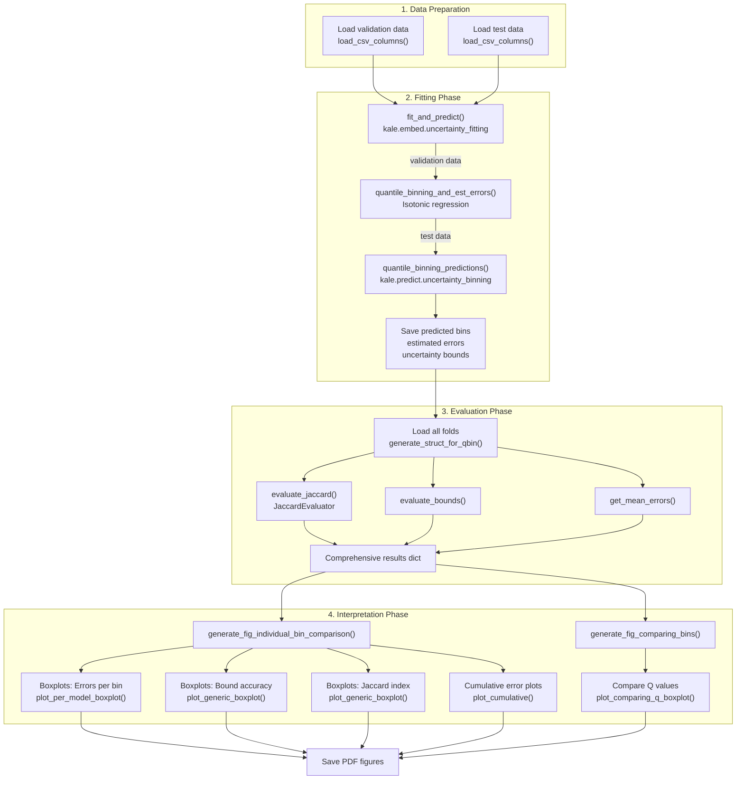
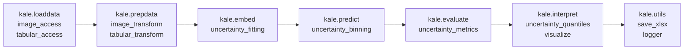

<!-- source: DeepWiki mcp.deepwiki.com · repo pykale/pykale · page 2.6 Evaluation and Interpretation (kale.evaluate, kale.interpret) · fetched 2026-10-21 -->

# Evaluation and Interpretation (kale.evaluate, kale.interpret)

<details>
<summary>Relevant source files</summary>

The following files were used as context for generating this wiki page:

- [examples/landmark_uncertainty/config.py](examples/landmark_uncertainty/config.py)
- [examples/landmark_uncertainty/main.py](examples/landmark_uncertainty/main.py)
- [examples/multisite_neuroimg_adapt/README.md](examples/multisite_neuroimg_adapt/README.md)
- [examples/multisite_neuroimg_adapt/config.py](examples/multisite_neuroimg_adapt/config.py)
- [examples/multisite_neuroimg_adapt/main.py](examples/multisite_neuroimg_adapt/main.py)
- [examples/multisite_neuroimg_adapt/tutorial.ipynb](examples/multisite_neuroimg_adapt/tutorial.ipynb)
- [kale/evaluate/cross_validation.py](kale/evaluate/cross_validation.py)
- [kale/evaluate/metrics.py](kale/evaluate/metrics.py)
- [kale/evaluate/uncertainty_metrics.py](kale/evaluate/uncertainty_metrics.py)
- [kale/interpret/box_plot.py](kale/interpret/box_plot.py)
- [kale/interpret/model_weights.py](kale/interpret/model_weights.py)
- [kale/interpret/uncertainty_quantiles.py](kale/interpret/uncertainty_quantiles.py)
- [kale/interpret/uncertainty_utils.py](kale/interpret/uncertainty_utils.py)
- [kale/pipeline/mpca_trainer.py](kale/pipeline/mpca_trainer.py)
- [kale/predict/decode.py](kale/predict/decode.py)
- [kale/predict/uncertainty_binning.py](kale/predict/uncertainty_binning.py)
- [kale/prepdata/graph_negative_sampling.py](kale/prepdata/graph_negative_sampling.py)
- [kale/prepdata/tabular_transform.py](kale/prepdata/tabular_transform.py)
- [tests/conftest.py](tests/conftest.py)
- [tests/evaluate/test_cross_validation.py](tests/evaluate/test_cross_validation.py)
- [tests/evaluate/test_uncertainty_metrics.py](tests/evaluate/test_uncertainty_metrics.py)
- [tests/interpret/test_box_plot.py](tests/interpret/test_box_plot.py)
- [tests/interpret/test_model_weights.py](tests/interpret/test_model_weights.py)
- [tests/interpret/test_uncertainty_quantiles.py](tests/interpret/test_uncertainty_quantiles.py)
- [tests/interpret/test_uncertainty_utils.py](tests/interpret/test_uncertainty_utils.py)
- [tests/interpret/test_visualize.py](tests/interpret/test_visualize.py)
- [tests/loaddata/test_tabular_access.py](tests/loaddata/test_tabular_access.py)
- [tests/pipeline/test_mpca_trainer.py](tests/pipeline/test_mpca_trainer.py)
- [tests/pipeline/test_uncertainty_qbin_pipeline.py](tests/pipeline/test_uncertainty_qbin_pipeline.py)
- [tests/predict/test_uncertainty_binning.py](tests/predict/test_uncertainty_binning.py)
- [tests/prepdata/test_tabular_transform.py](tests/prepdata/test_tabular_transform.py)
- [tests/prepdata/test_tensor_reshape.py](tests/prepdata/test_tensor_reshape.py)

</details>


## Purpose and Scope

This page documents PyKale's evaluation and interpretation modules (`kale.evaluate` and `kale.interpret`), which provide tools for assessing model performance and visualizing results. The primary focus is on **uncertainty quantification for medical imaging** applications, particularly landmark localization tasks, though the evaluation framework is extensible to other domains.

**Scope:**
- Uncertainty metrics evaluation (Jaccard similarity, error bounds, bin-wise analysis)
- Quantile binning methodology for uncertainty estimation
- Visualization tools for model weights, images, and uncertainty analysis
- Boxplot generation system for comparative analysis

For prediction head components that generate uncertainty values, see [Prediction Heads (kale.predict)](#2.4). For training pipelines that integrate evaluation, see [Training Pipelines (kale.pipeline)](#2.5). For complete medical imaging workflows, see [Medical Imaging Applications](#4.3).

Sources: [kale/evaluate/uncertainty_metrics.py:1-26](), [kale/interpret/uncertainty_quantiles.py:7-20]()

## Module Organization

The evaluation and interpretation functionality is organized into two main modules:

| Module | Purpose | Key Components |
|--------|---------|----------------|
| `kale.evaluate` | Metrics computation and evaluation | `BaseEvaluator`, `JaccardEvaluator`, `uncertainty_metrics`, `similarity_metrics` |
| `kale.interpret` | Results interpretation and visualization | `uncertainty_quantiles`, `visualize`, `box_plot`, `model_weights` |

**Supporting modules:**
- `kale.predict.uncertainty_binning` - Bin assignment for test predictions
- `kale.prepdata.tabular_transform` - Data structure generation for quantile binning
- `kale.utils.save_xlsx` - Results export to Excel format

Sources: [kale/evaluate/uncertainty_metrics.py:1-50](), [kale/interpret/uncertainty_quantiles.py:1-45]()

## Uncertainty Evaluation System (kale.evaluate)

### Architecture Overview



Sources: [kale/evaluate/uncertainty_metrics.py:82-625](), [kale/evaluate/uncertainty_metrics.py:659-695]()

### BaseEvaluator Template Method Pattern

The `BaseEvaluator` abstract base class implements the Template Method design pattern, providing a consistent evaluation workflow while allowing specialized implementations for different metrics.

**Workflow Steps:**



**Key methods in BaseEvaluator:**

| Method | Type | Purpose |
|--------|------|---------|
| `evaluate()` | Concrete | Main entry point, orchestrates evaluation workflow |
| `_process_single_fold()` | Abstract | Compute metrics for a single fold (subclass implements) |
| `_aggregate_fold_results()` | Abstract | Aggregate results across folds (subclass implements) |
| `_finalize_results()` | Abstract | Format final output dictionary (subclass implements) |

Sources: [kale/evaluate/uncertainty_metrics.py:659-750]()

### JaccardEvaluator Implementation

The `JaccardEvaluator` provides comprehensive uncertainty quantification assessment using Jaccard similarity, precision, and recall metrics.

**Core Evaluation Process:**

1. **Quantile Calculation**: For each fold, compute error quantiles to establish ground truth bins using `QuantileCalculator.calculate_error_quantiles()`
2. **Bin-wise Grouping**: Group predictions by uncertainty bins using `DataProcessor.group_data_by_bins()`
3. **Metrics Computation**: Calculate Jaccard, recall, and precision for each bin using `MetricsCalculator.calculate_jaccard_metrics()`
4. **Aggregation**: Average metrics across folds and organize by targets

**Key metrics:**

```python
# Jaccard Similarity (Intersection over Union)
jaccard = |predicted_bin ∩ ground_truth_bin| / |predicted_bin ∪ ground_truth_bin|

# Recall (Coverage of actual positives)
recall = |predicted_bin ∩ ground_truth_bin| / |ground_truth_bin|

# Precision (Accuracy of predictions)
precision = |predicted_bin ∩ ground_truth_bin| / |predicted_bin|
```

**Usage example:**

```python
from kale.evaluate.uncertainty_metrics import JaccardEvaluator, EvaluationConfig

# Configure evaluation
config = EvaluationConfig(
    num_folds=8,
    original_num_bins=10,
    combine_middle_bins=False,
    error_scaling_factor=1.0
)

# Create evaluator
evaluator = JaccardEvaluator(config)

# Evaluate
results = evaluator.evaluate(
    bin_predictions=bins_all_targets,
    uncertainty_pairs=[["epistemic", "epistemic Error", "epistemic Uncertainty"]],
    targets=[0, 1, 2]
)
```

Sources: [kale/evaluate/uncertainty_metrics.py:751-950](), [kale/evaluate/uncertainty_metrics.py:568-624]()

### Evaluation Metrics Functions

High-level convenience functions wrap the evaluator classes for common use cases:

**`evaluate_jaccard()`** - [kale/evaluate/uncertainty_metrics.py:952-1050]()
- Computes Jaccard similarity, recall, and precision across bins and targets
- Returns structured dictionary with keys: `"Jaccard All"`, `"Recall All"`, `"Precision All"`, `"Jaccard targets seperated"`, etc.
- Handles fold-wise and target-separated aggregation

**`evaluate_bounds()`** - [kale/evaluate/uncertainty_metrics.py:1053-1150]()
- Assesses whether predicted errors fall within expected bounds for each bin
- Uses `MetricsCalculator.calculate_bound_accuracy()` to check bin ranges
- Returns percentage of predictions within bounds for each bin

**`get_mean_errors()`** - [kale/evaluate/uncertainty_metrics.py:1153-1250]()
- Computes mean errors and concatenated error lists for each bin
- Supports error scaling via `error_scaling_factor` parameter
- Returns both bin-wise means and raw error lists for downstream analysis

Sources: [kale/evaluate/uncertainty_metrics.py:952-1250]()

## Interpretation and Visualization (kale.interpret)

### Quantile Binning Analysis

The quantile binning methodology enables uncertainty-aware error prediction by partitioning predictions into bins based on uncertainty thresholds.

**Core Function: `quantile_binning_and_est_errors()`**



**Key features:**
- Uses `sklearn.isotonic.IsotonicRegression` with `out_of_bounds="clip"` and `increasing=True`
- Supports two modes: `type="quantile"` (recommended) and `type="error-wise"` (not implemented)
- Optional `combine_middle_bins` reduces bins to 3 (low, medium, high uncertainty)

Sources: [kale/interpret/uncertainty_quantiles.py:47-115]()

### Boxplot System Architecture

PyKale provides a modern, configuration-based boxplot system for uncertainty quantification visualization.



**Boxplot Types:**

| Function | Use Case | Key Features |
|----------|----------|--------------|
| `plot_generic_boxplot()` | Compare multiple models across bins | Multi-model, color-coded, optional dots |
| `plot_per_model_boxplot()` | Analyze single model in detail | Log scale support, sample size display |
| `plot_comparing_q_boxplot()` | Compare different Q (bin count) values | Hatching patterns, Q-value labels |

**Configuration Example:**

```python
from kale.interpret.box_plot import create_boxplot_data, create_boxplot_config
from kale.interpret.uncertainty_quantiles import plot_generic_boxplot

# Create data container
data = create_boxplot_data(
    evaluation_data_by_bins=error_data_dict,
    uncertainty_categories=[['epistemic'], ['aleatoric']],
    models=['ResNet50', 'VGG16'],
    category_labels=['B5', 'B4', 'B3', 'B2', 'B1'],
    num_bins=5
)

# Create configuration
config = create_boxplot_config(
    colormap='Set1',
    x_label="Uncertainty Thresholded Bin",
    y_label="Localization Error (mm)",
    save_path="results/comparison.pdf",
    show_individual_dots=True,
    y_lim_top=20.0,
    to_log=True
)

# Generate plot
plot_generic_boxplot(data, config)
```

Sources: [kale/interpret/uncertainty_quantiles.py:118-272](), [kale/interpret/box_plot.py:1-50]() (inferred from imports)

### Visualization Functions

**Model Weight Visualization**

`plot_weights()` - [kale/interpret/visualize.py:31-67]()
- Displays model coefficients/weights overlaid on background images
- Supports separate colors for positive/negative weights
- Used for interpreting MPCA-based cardiac MRI classifiers

**Multi-Image Display**

`plot_multi_images()` - [kale/interpret/visualize.py:70-153]()
- Plots multiple images with optional markers (landmarks, keypoints)
- Configurable grid layout via `n_cols` and `n_rows`
- Color-coded markers using matplotlib colormaps
- Used in CMR preprocessing visualization

**Connectome Visualization**

`visualize_connectome()` - [kale/interpret/visualize.py:222-277]()
- Generates brain connectivity plots using `nilearn.plotting.plot_connectome`
- Selects top-p weighted ROI connections
- Supports custom colormaps and marker sizes
- Useful for fMRI and brain network analysis

**Distribution Plotting**

`distplot_1d()` - [kale/interpret/visualize.py:156-207]()
- Creates histogram distributions with seaborn
- Multi-dataset comparison support
- Customizable labels and colors

**Cumulative Error Plots**

`plot_cumulative()` - [kale/interpret/uncertainty_quantiles.py:274-382]()
- Generates cumulative distribution functions for localization errors
- Logarithmic x-axis scaling
- Supports bin filtering and comparison modes
- Multiple line styles for different models/uncertainty types

Sources: [kale/interpret/visualize.py:31-290](), [kale/interpret/uncertainty_quantiles.py:274-382]()

### High-Level Analysis Functions

**`generate_fig_individual_bin_comparison()`** - [kale/interpret/uncertainty_quantiles.py:385-870]()

Comprehensive analysis function that generates multiple figures comparing localization errors, error bounds accuracy, and Jaccard index across uncertainty bins.

**Inputs:**
- `data`: Tuple containing uncertainty pairs, models, dataset name, target indices, num_bins, colormap, paths, flags
- `display_settings`: Dict controlling which figures to generate (`correlation`, `cumulative_error`, `errors`, `error_bounds`, `jaccard`)

**Workflow:**



**`generate_fig_comparing_bins()`** - [kale/interpret/uncertainty_quantiles.py:873-1088]()

Generates comparison figures across different Q (bin count) values for a single model and uncertainty type.

**Purpose:** Optimize the number of quantile bins by comparing performance metrics across Q=5, Q=10, Q=15, etc.

Sources: [kale/interpret/uncertainty_quantiles.py:385-1088]()

## Complete Workflow Example

The following diagram shows how evaluation and interpretation components integrate in a typical uncertainty quantification pipeline:



**Complete code example from landmark uncertainty workflow:**

```python
# From examples/landmark_uncertainty/main.py
import numpy as np
from kale.embed.uncertainty_fitting import fit_and_predict
from kale.interpret.uncertainty_quantiles import (
    generate_fig_individual_bin_comparison,
    generate_fig_comparing_bins
)

# 1. Fit quantile binning on validation data
for model in models_to_compare:
    for landmark in landmarks:
        fit_and_predict(
            landmark,
            uncertainty_error_pairs,
            landmark_results_path_val,
            landmark_results_path_test,
            num_bins,
            cfg,
            groundtruth_test_errors=True,
            save_folder=output_dir
        )

# 2. Evaluate and generate individual bin comparison figures
generate_fig_individual_bin_comparison(
    data=[
        uncertainty_error_pairs,
        models_to_compare,
        dataset,
        landmarks,
        num_bins,
        colormap,
        save_folder,
        save_file_preamble,
        combine_middle_bins,
        save_figures_bool,
        confidence_invert,
        samples_as_dots_bool,
        show_sample_info_mode,
        box_plot_error_lim,
        show_individual_landmark_plots,
        interpret,
        num_folds,
        ind_landmarks_to_show,
        pixel_to_mm_scale,
    ],
    display_settings={
        "cumulative_error": True,
        "errors": True,
        "jaccard": True,
        "error_bounds": True,
        "correlation": True,
        "hatch": "o",
    }
)

# 3. Compare different Q values for optimization
generate_fig_comparing_bins(
    data=[
        uncertainty_pair,
        model,
        dataset,
        landmarks,
        num_quantile_bins,  # [5, 10, 15, 20]
        colormap,
        quantile_binning_dirs,
        save_folder_comparison,
        save_file_preamble,
        combine_middle_bins,
        save_figures_bool,
        samples_as_dots_bool,
        show_sample_info_mode,
        box_plot_error_lim,
        show_individual_landmark_plots,
        interpret,
        num_folds,
        ind_landmarks_to_show,
        pixel_to_mm_scale,
    ],
    display_settings={
        "errors": True,
        "jaccard": True,
        "error_bounds": True,
        "hatch": "///",
    }
)
```

Sources: [examples/landmark_uncertainty/main.py:44-252](), [tests/pipeline/test_uncertainty_qbin_pipeline.py:170-375]()

## Key Classes and Data Structures

### EvaluationConfig

Dataclass for evaluation parameters - [kale/evaluate/uncertainty_metrics.py:82-122]()

| Attribute | Type | Default | Description |
|-----------|------|---------|-------------|
| `num_folds` | int | 8 | Number of cross-validation folds |
| `original_num_bins` | int | 10 | Number of quantile bins |
| `error_scaling_factor` | float | 1.0 | Scaling factor for errors (e.g., pixel to mm) |
| `combine_middle_bins` | bool | False | Whether to merge middle bins |
| `combined_num_bins` | int | 3 | Bins when combined (low, medium, high) |

### FoldData

Container for single fold data - [kale/evaluate/uncertainty_metrics.py:124-152]()

| Attribute | Type | Description |
|-----------|------|-------------|
| `errors` | pd.DataFrame | Prediction errors for the fold |
| `bins` | pd.DataFrame | Uncertainty bin assignments |
| `bounds` | Optional[List] | Error bound information |

### BinResults and JaccardBinResults

Results containers - [kale/evaluate/uncertainty_metrics.py:154-221]()

`BinResults` stores base metrics:
- `mean_all_targets`: Mean metric across all targets
- `mean_all_bins`: Mean metric per bin
- `all_bins`: Raw metrics for each bin and target
- `all_bins_concat_targets_sep`: Target-separated metrics

`JaccardBinResults` extends with:
- `mean_all_targets_recall`, `mean_all_bins_recall`, `all_bins_recall`
- `mean_all_targets_precision`, `mean_all_bins_precision`, `all_bins_precision`

### ResultsContainer

Organizes nested evaluation results - [kale/evaluate/uncertainty_metrics.py:223-300]()

| Attribute | Description |
|-----------|-------------|
| `main_results` | Aggregated results across targets |
| `target_separated_results` | Results separated by individual targets |
| `target_sep_foldwise` | Target-separated results per fold |
| `target_sep_all` | Target-separated aggregated across folds |
| `recall_results`, `precision_results` | Jaccard-specific containers |

Sources: [kale/evaluate/uncertainty_metrics.py:82-300]()

## Integration with Other Modules

The evaluation and interpretation modules integrate closely with other PyKale components:

**Data Flow:**



**Module Dependencies:**

- **kale.loaddata.tabular_access**: `load_csv_columns()` loads prediction CSVs
- **kale.prepdata.tabular_transform**: `generate_struct_for_qbin()` prepares data structures
- **kale.predict.uncertainty_binning**: `quantile_binning_predictions()` assigns bins
- **kale.embed.uncertainty_fitting**: `fit_and_predict()` orchestrates fitting/prediction
- **kale.utils.save_xlsx**: `generate_summary_df()` exports results to Excel
- **kale.utils.logger**: `logging.construct_logger()` for pipeline logging

Sources: [kale/interpret/uncertainty_quantiles.py:32-44](), [kale/evaluate/uncertainty_metrics.py:32-36]()

## Configuration Examples

### CMR MPCA Tutorial Configuration

From cardiac MRI weight visualization - [examples/cmri_mpca/config.py:1-72]()

```python
_C.PLT_KWS.WEIGHT = CfgNode()
_C.PLT_KWS.WEIGHT.markersize = 6
_C.PLT_KWS.WEIGHT.alpha = 0.7

_C.PLT_KWS.MARKER = CfgNode()
_C.PLT_KWS.MARKER.marker = "+"
_C.PLT_KWS.MARKER.color = "r"
_C.PLT_KWS.MARKER.s = 100
```

### Landmark Uncertainty Configuration

From uncertainty quantification example - [examples/landmark_uncertainty/config.py:1-116]()

```python
_C.BOXPLOT = CfgNode()
_C.BOXPLOT.SAMPLES_AS_DOTS = True
_C.BOXPLOT.ERROR_LIM = 64
_C.BOXPLOT.SHOW_SAMPLE_INFO_MODE = "Average"  # "None", "All", "Average"

_C.IM_KWARGS = CfgNode()
_C.IM_KWARGS.colormap = "Set1"  # Options: 'Pastel1', 'Paired', 'Set1', 'tab10'

_C.PIPELINE.NUM_QUANTILE_BINS = [5, 10, 25]
_C.PIPELINE.COMBINE_MIDDLE_BINS = False
_C.PIPELINE.PIXEL_TO_MM_SCALE = 1.0
```

Sources: [examples/cmri_mpca/config.py:48-50](), [examples/landmark_uncertainty/config.py:82-100]()

---

