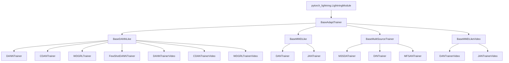
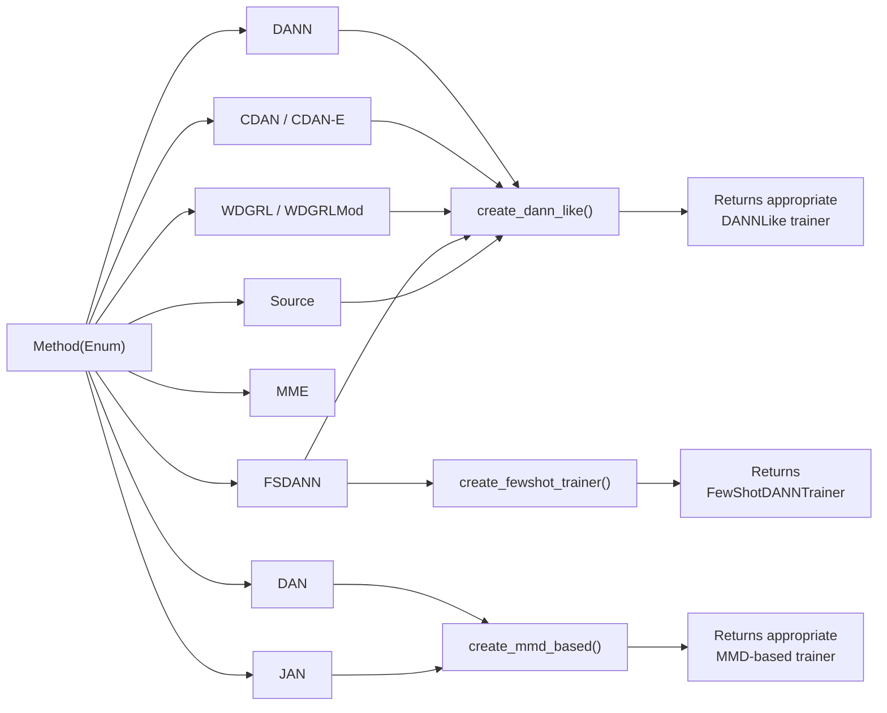
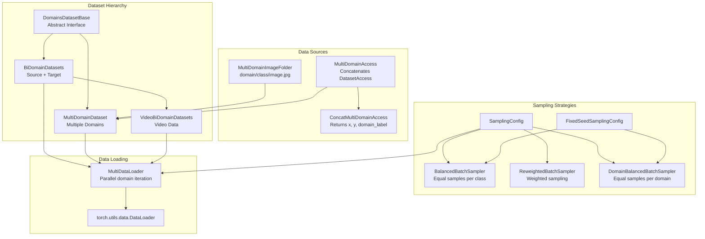
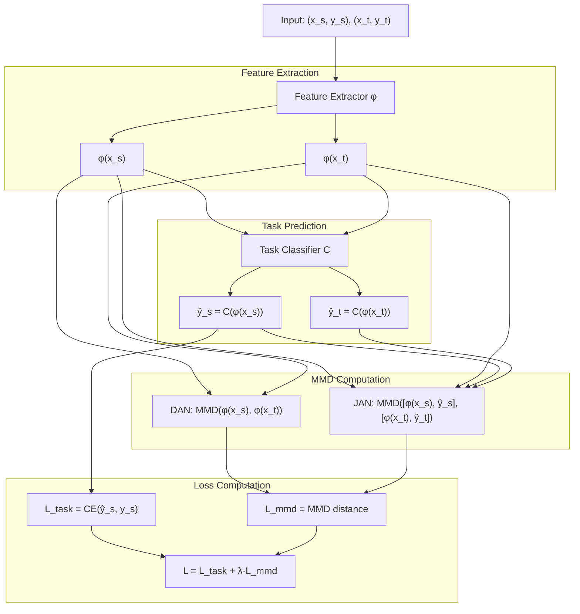
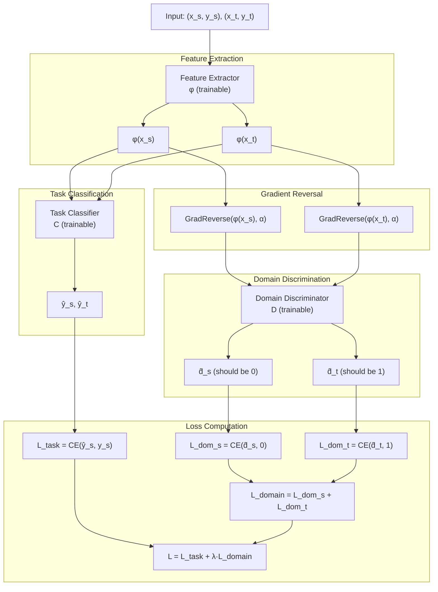
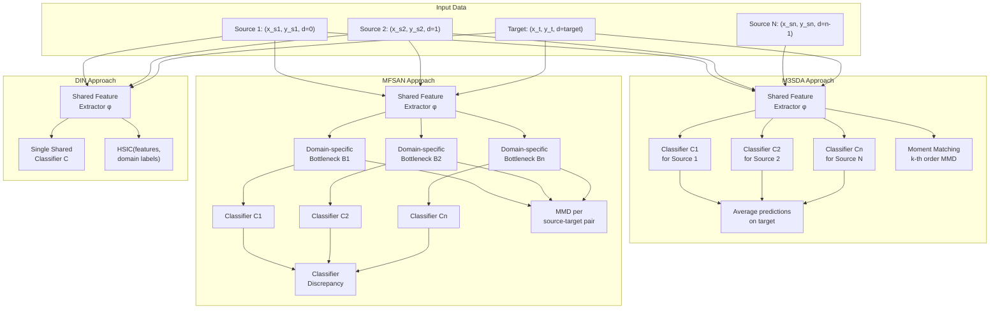
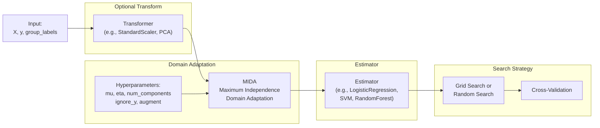
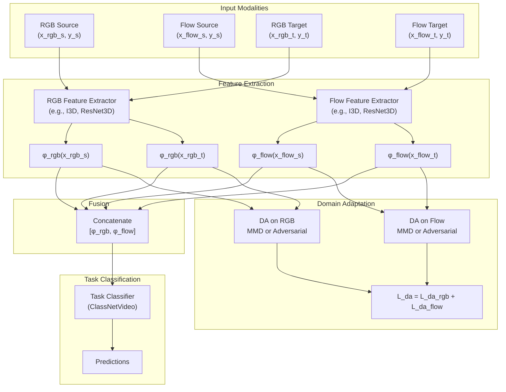
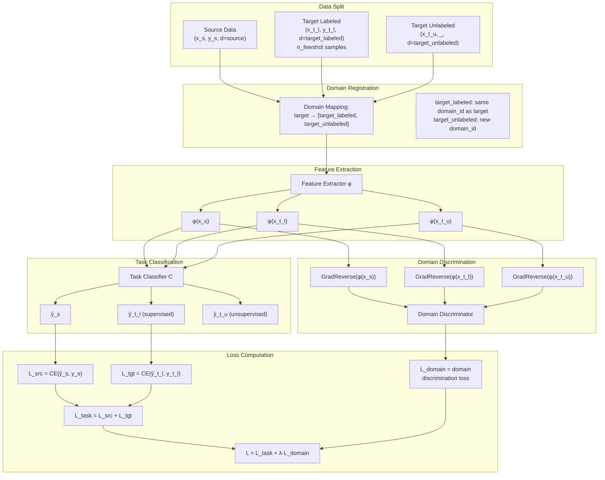

<!-- source: DeepWiki mcp.deepwiki.com · repo pykale/pykale · page 3 Domain Adaptation · fetched 2026-10-21 -->

# Domain Adaptation

<details>
<summary>Relevant source files</summary>

The following files were used as context for generating this wiki page:

- [kale/embed/image_cnn.py](kale/embed/image_cnn.py)
- [kale/loaddata/dataset_access.py](kale/loaddata/dataset_access.py)
- [kale/loaddata/multi_domain.py](kale/loaddata/multi_domain.py)
- [kale/loaddata/sampler.py](kale/loaddata/sampler.py)
- [kale/loaddata/video_multi_domain.py](kale/loaddata/video_multi_domain.py)
- [kale/pipeline/domain_adapter.py](kale/pipeline/domain_adapter.py)
- [kale/pipeline/multi_domain_adapter.py](kale/pipeline/multi_domain_adapter.py)
- [kale/pipeline/video_domain_adapter.py](kale/pipeline/video_domain_adapter.py)
- [kale/predict/class_domain_nets.py](kale/predict/class_domain_nets.py)
- [tests/loaddata/test_image_access.py](tests/loaddata/test_image_access.py)
- [tests/loaddata/test_sampler.py](tests/loaddata/test_sampler.py)
- [tests/loaddata/test_video_access.py](tests/loaddata/test_video_access.py)
- [tests/pipeline/test_domain_adapter.py](tests/pipeline/test_domain_adapter.py)
- [tests/pipeline/test_multi_domain_adapter.py](tests/pipeline/test_multi_domain_adapter.py)
- [tests/pipeline/test_video_domain_adapter.py](tests/pipeline/test_video_domain_adapter.py)

</details>


## Purpose and Scope

This document covers PyKale's domain adaptation (DA) capabilities, which represent the library's primary research focus and highest-importance components. Domain adaptation addresses the challenge of transferring knowledge learned from a source domain (where labeled training data is available) to a target domain (where little or no labeled data exists). 

This page covers:
- Single-source and multi-source domain adaptation methods
- Video-specific domain adaptation for action recognition
- Few-shot/semi-supervised domain adaptation
- Data loading and sampling strategies for multi-domain scenarios
- Factory functions and trainer implementations

For general pipeline architecture, see [Core Pipeline Architecture](#1.2). For data loading APIs, see [Data Loading (kale.loaddata)](#2.1). For few-shot learning with Prototypical Networks, see [Few-Shot Learning](#4.1).

Sources: [kale/pipeline/domain_adapter.py:1-10]()

---

## System Architecture Overview

The domain adaptation system in PyKale follows a modular, extensible architecture with three main layers: data management, training orchestration, and method implementations.

### High-Level Architecture

```mermaid
graph TB
    subgraph "Data Layer"
        MDD[MultiDomainDataset]
        BDD[BiDomainDatasets]
        VBDD[VideoBiDomainDatasets]
        MDIF[MultiDomainImageFolder]
        SAMP[SamplingConfig<br/>BalancedBatchSampler]
    end
    
    subgraph "Orchestration Layer"
        BASE[BaseAdaptTrainer<br/>PyTorch Lightning]
        FACTORY1["create_mmd_based()"]
        FACTORY2["create_dann_like()"]
        FACTORY3["create_ms_adapt_trainer()"]
        FACTORY4["create_mmd_based_video()"]
        METHOD[Method Enum<br/>DANN, CDAN, DAN, JAN, etc.]
    end
    
    subgraph "Single-Source Methods"
        DAN[DANTrainer<br/>Deep Adaptation Networks]
        JAN[JANTrainer<br/>Joint Adaptation Networks]
        DANN[DANNTrainer<br/>Domain-Adversarial NN]
        CDAN[CDANTrainer<br/>Conditional DA]
        WDGRL[WDGRLTrainer<br/>Wasserstein Distance]
        FSDANN[FewShotDANNTrainer<br/>Semi-supervised]
    end
    
    subgraph "Multi-Source Methods"
        M3SDA[M3SDATrainer<br/>Moment Matching]
        DIN[DINTrainer<br/>Domain Independent Net]
        MFSAN[MFSANTrainer<br/>Multi Feature Spaces]
        MIDA[MIDATrainer<br/>sklearn-compatible]
    end
    
    subgraph "Video Methods"
        DANV[DANNTrainerVideo]
        CDANV[CDANTrainerVideo]
        DANVID[DANTrainerVideo]
        JANVID[JANTrainerVideo]
    end
    
    subgraph "Network Components"
        FEAT[Feature Extractors<br/>ResNet18/34/50<br/>SmallCNNFeature<br/>I3D, Res3D]
        CLS[Task Classifiers<br/>SoftmaxNet<br/>ClassNetSmallImage<br/>ClassNetVideo]
        CRITIC[Domain Discriminators<br/>DomainNetSmallImage<br/>DomainNetVideo]
    end
    
    MDD --> BASE
    BDD --> BASE
    VBDD --> DANV
    
    BASE --> DAN
    BASE --> JAN
    BASE --> DANN
    BASE --> CDAN
    BASE --> WDGRL
    BASE --> FSDANN
    BASE --> M3SDA
    BASE --> DIN
    BASE --> MFSAN
    
    FACTORY1 --> DAN
    FACTORY1 --> JAN
    FACTORY2 --> DANN
    FACTORY2 --> CDAN
    FACTORY2 --> WDGRL
    FACTORY2 --> FSDANN
    FACTORY3 --> M3SDA
    FACTORY3 --> DIN
    FACTORY3 --> MFSAN
    FACTORY4 --> DANV
    FACTORY4 --> DANVID
    
    METHOD --> FACTORY1
    METHOD --> FACTORY2
    METHOD --> FACTORY3
    
    FEAT --> BASE
    CLS --> BASE
    CRITIC --> DANN
    CRITIC --> CDAN
```



**Domain Adaptation Architecture**

The architecture is organized into four layers:

1. **Data Layer**: Manages multi-domain datasets with sophisticated sampling strategies
2. **Orchestration Layer**: Factory functions and base trainers coordinate method selection
3. **Method Implementations**: Specific DA algorithms (MMD-based, adversarial, multi-source, video)
4. **Network Components**: Reusable feature extractors and classifiers

Sources: [kale/pipeline/domain_adapter.py:1-193](), [kale/pipeline/multi_domain_adapter.py:46-64](), [kale/pipeline/video_domain_adapter.py:25-99]()

---

## Core Components

### Base Trainer Architecture

All domain adaptation methods inherit from `BaseAdaptTrainer`, which provides a standardized PyTorch Lightning-based training framework with adaptive learning rates and domain adaptation loss weighting.



**Domain Adaptation Class Hierarchy**

#### Key Base Class Methods

The `BaseAdaptTrainer` class provides the following core functionality:

| Method | Purpose | Key Parameters |
|--------|---------|----------------|
| `__init__()` | Initialize trainer with dataset, networks, hyperparameters | `dataset`, `feature_extractor`, `task_classifier`, `target_domain`, `lambda_init`, `adapt_lambda`, `adapt_lr`, `nb_init_epochs`, `nb_adapt_epochs` |
| `training_step()` | Training loop with warmup and adaptation phases | Uses `lamb_da` for loss weighting |
| `_update_batch_epoch_factors()` | Updates λ and learning rate schedule | Implements DANN paper schedule: λ_p = 2/(1+exp(-10p)) - 1 |
| `compute_loss()` | Abstract method for loss computation | Returns `task_loss`, `domain_div_loss`, `log_metrics` |
| `configure_optimizers()` | Setup optimizers (Adam or SGD) | Supports adaptive learning rate schedules |

**Training Schedule**: The trainer uses a warmup phase (`nb_init_epochs`) where only task loss is optimized, followed by an adaptation phase where both task and domain adaptation losses are combined: **L = L_c + λL_a**

Sources: [kale/pipeline/domain_adapter.py:195-461]()

---

### Method Enumeration and Factory Functions

PyKale uses an enum-based method selection system with factory functions for creating trainers.



**Method Selection Flow**

#### Available Methods

The `Method` enum defines all supported domain adaptation approaches:

| Method | Type | Description | Reference |
|--------|------|-------------|-----------|
| `Source` | Baseline | Source-only training (no adaptation) | N/A |
| `DANN` | Adversarial | Domain-Adversarial Neural Networks | Ganin et al. (2016) |
| `CDAN` | Adversarial | Conditional Domain Adversarial Networks | Long et al. (2018) |
| `CDAN_E` | Adversarial | CDAN with entropy weighting | Long et al. (2018) |
| `FSDANN` | Semi-supervised | Few-shot DANN | N/A |
| `MME` | Semi-supervised | Minimax Entropy | Saito et al. (2019) |
| `WDGRL` | Adversarial | Wasserstein Distance Guided Representation Learning | Shen et al. (2018) |
| `WDGRLMod` | Adversarial | Modified WDGRL with staged optimization | Modified version |
| `DAN` | MMD-based | Deep Adaptation Networks | Long et al. (2015) |
| `JAN` | MMD-based | Joint Adaptation Networks | Long et al. (2017) |

#### Helper Methods

The `Method` enum provides utility methods for method categorization:

```python
# Example usage from code
method = Method("DANN")
if method.is_dann_method():  # Returns True for DANN, Source
    # Create DANN-like trainer
if method.is_cdan_method():  # Returns True for CDAN, CDAN-E
    # Create CDAN-like trainer
if method.is_mmd_method():   # Returns True for DAN, JAN
    # Create MMD-based trainer
```

Sources: [kale/pipeline/domain_adapter.py:54-108](), [kale/pipeline/domain_adapter.py:110-193]()

---

### Data Management

Domain adaptation requires specialized data loading that handles multiple domains simultaneously with balanced sampling.



**Data Management Components**

#### BiDomainDatasets

Manages source and target domain datasets for standard domain adaptation:

**Key Parameters**:
- `source_access`: DatasetAccess for source domain
- `target_access`: DatasetAccess for target domain
- `config_weight_type`: Weighting strategy (`"natural"`, `"balanced"`, `"preset0"`)
- `config_size_type`: Epoch size determination (`DatasetSizeType.Max` or `DatasetSizeType.Source`)
- `valid_split_ratio`: Validation split ratio (default: 0.1)
- `n_fewshot`: Number of labeled target samples for semi-supervised DA

**Data Flow**:
1. `prepare_data_loaders()`: Splits datasets into train/valid/test
2. `get_domain_loaders()`: Returns `MultiDataLoader` yielding `[(x_s, y_s), (x_t, y_t)]` batches

Sources: [kale/loaddata/multi_domain.py:102-250]()

#### MultiDomainDataset

Handles multiple source/target domains with domain labels:

**Key Features**:
- Returns batches as `(X, y, domain_label)` tuples
- Domain-stratified splitting with `_domain_stratified_split()`
- Semi-supervised support via `n_fewshot` parameter
- Automatic target domain registration for few-shot scenarios

**Example Structure**:
```python
# Domain labels assigned automatically
domain_to_idx = {
    "source1": 0,
    "source2": 1,
    "target": 2,
    "target_labeled": 2,      # Same label as target
    "target_unlabeled": 3     # New label for unlabeled target
}
```

Sources: [kale/loaddata/multi_domain.py:553-762]()

#### MultiDomainImageFolder

PyTorch-style ImageFolder for multi-domain datasets with folder structure:
```
root/
  domain_a/
    class_1/
      xxx.jpg
    class_2/
      yyy.jpg
  domain_b/
    class_1/
      zzz.jpg
```

**Key Attributes**:
- `domain_to_idx`: Mapping from domain names to indices
- `class_to_idx`: Mapping from class names to indices
- `domain_labels`: Tensor of domain labels for each sample
- `return_domain_label`: Whether to return domain labels in `__getitem__`

Sources: [kale/loaddata/multi_domain.py:281-430]()

#### Sampling Strategies

| Sampler | Purpose | Usage |
|---------|---------|-------|
| `BalancedBatchSampler` | Equal samples per class | Class-balanced training |
| `ReweightedBatchSampler` | Weighted class sampling | Custom class distributions |
| `DomainBalancedBatchSampler` | Equal samples per domain | Domain-balanced training |
| `FixedSeedSamplingConfig` | Deterministic sampling | Reproducible experiments |

**MultiDataLoader**: Iterates over multiple dataloaders in parallel, yielding batches from all domains simultaneously. Automatically reinitializes exhausted dataloaders to ensure continuous iteration.

Sources: [kale/loaddata/sampler.py:23-84](), [kale/loaddata/sampler.py:116-152](), [kale/loaddata/sampler.py:154-263](), [kale/loaddata/sampler.py:364-400]()

---

## Single-Source Domain Adaptation Methods

### MMD-Based Methods

Maximum Mean Discrepancy (MMD) methods minimize distribution distance in the feature space using kernel-based metrics.



**MMD-Based Method Architecture**

#### DANTrainer (Deep Adaptation Networks)

Minimizes MMD between source and target feature distributions using Gaussian kernels.

**Loss Computation**:
```python
# Feature-level MMD
kernels = gaussian_kernel(phi_s, phi_t, kernel_mul=2.0, kernel_num=5)
mmd_loss = compute_mmd_loss(kernels, batch_size)
total_loss = task_loss + lambda * mmd_loss
```

**Key Parameters**:
- `kernel_mul`: Multiplicative factor for kernel bandwidth (default: 2.0)
- `kernel_num`: Number of kernel bandwidths (default: 5)
- Computes MMD only on feature representations

Sources: [kale/pipeline/domain_adapter.py:87-108](), [kale/evaluate/metrics.py]() (referenced for `gaussian_kernel` and `compute_mmd_loss`)

#### JANTrainer (Joint Adaptation Networks)

Extends DAN by jointly matching distributions of features AND predictions.

**Loss Computation**:
```python
# Joint MMD over features and softmax outputs
source_list = [phi_s, softmax(y_hat_s)]
target_list = [phi_t, softmax(y_hat_t)]

# Compute joint kernels (product of feature and prediction kernels)
joint_kernels = feature_kernels * prediction_kernels
mmd_loss = compute_mmd_loss(joint_kernels, batch_size)
```

**Key Parameters**:
- `kernel_mul`: List of kernel multipliers for [features, predictions] (default: [2.0, 2.0])
- `kernel_num`: List of kernel numbers for [features, predictions] (default: [5, 1])
- Jointly aligns both feature and label distributions

Sources: [kale/pipeline/domain_adapter.py:87-108]()

#### Factory Function

```python
# Usage example
from kale.pipeline.domain_adapter import create_mmd_based, Method

model = create_mmd_based(
    method=Method.DAN,  # or Method.JAN
    dataset=dataset,
    feature_extractor=feature_network,
    task_classifier=classifier_network,
    target_domain="target",
    kernel_mul=2.0,
    kernel_num=5,
    **train_params
)
```

Sources: [kale/pipeline/domain_adapter.py:87-108]()

---

### Adversarial Methods

Adversarial domain adaptation uses a domain discriminator to encourage domain-invariant features via gradient reversal.



**Adversarial Domain Adaptation Architecture**

#### Gradient Reversal Layer

The `GradReverse` function is central to adversarial DA:

**Forward**: Identity transformation `f(x) = x`

**Backward**: Flips gradient sign `∂L/∂x → -α·∂L/∂x`

This creates an adversarial game where:
- Feature extractor φ tries to fool the discriminator (via gradient reversal)
- Discriminator D tries to distinguish domains
- Result: Domain-invariant features

Sources: [kale/pipeline/domain_adapter.py:23-44]()

#### DANNTrainer (Domain-Adversarial Neural Networks)

**Architecture**:
```python
# Forward pass
feature = feature_extractor(x)
reverse_feature = GradReverse.apply(feature, alpha)
class_output = task_classifier(feature)
domain_output = domain_classifier(reverse_feature)
```

**Key Parameters**:
- `alpha`: Gradient reversal strength (0.0 for source-only, 1.0 for full adaptation)
- `div_loss`: Loss type (default: `"adversarial"`)

**Training Schedule**: `alpha` and `lambda` adapt during training according to the DANN paper schedule.

Sources: [kale/pipeline/domain_adapter.py:570-604]()

#### CDANTrainer (Conditional Domain Adversarial Networks)

Conditions domain discriminator on both features AND task predictions using multilinear conditioning.

**Architecture**:
```python
# Multilinear conditioning
softmax_output = Softmax(class_output)
reverse_out = GradReverse.apply(softmax_output, alpha)
reverse_feature = GradReverse.apply(feature, alpha)

# Outer product: (batch, classes) ⊗ (batch, features)
conditioned = bmm(reverse_out.unsqueeze(2), reverse_feature.unsqueeze(1))
conditioned = conditioned.view(-1, classes * features)

# Optional random projection for dimensionality reduction
if use_random:
    conditioned = random_layer(conditioned)

domain_output = domain_classifier(conditioned)
```

**Key Parameters**:
- `use_entropy_weight`: Apply entropy-based weighting to discriminator loss
- `use_random`: Use random projection layer (projects to fixed dimension, e.g., 1024)
- `random_dim`: Dimensionality after random projection (default: 1024)

Sources: [kale/pipeline/domain_adapter.py:606-654]()

#### WDGRLTrainer (Wasserstein Distance Guided Representation Learning)

Uses Wasserstein distance instead of standard cross-entropy for domain discrimination.

**Training Procedure**:
1. **Critic Update Phase**: Train domain discriminator for `k_critic` steps with gradient penalty
2. **Feature Update Phase**: Update feature extractor and task classifier

**Loss Computation**:
```python
# Wasserstein distance (instead of binary cross-entropy)
critic_s = domain_classifier(h_s)
critic_t = domain_classifier(h_t)
wasserstein_distance = critic_s.mean() - (1 + beta_ratio) * critic_t.mean()

# Gradient penalty for Lipschitz constraint
gp = gradient_penalty(domain_classifier, h_s, h_t)
critic_cost = -wasserstein_distance + gamma * gp
```

**Key Parameters**:
- `k_critic`: Number of critic updates per feature update (default: 5)
- `gamma`: Gradient penalty coefficient (default: 10)
- `beta_ratio`: Asymmetric relaxation parameter (default: 0)

**WDGRLTrainerMod**: Modified version with staged optimization using `automatic_optimization=False` and manual optimizer stepping, compatible with PyTorch Lightning 2.0+.

Sources: [kale/pipeline/domain_adapter.py:656-792](), [kale/pipeline/domain_adapter.py:794-941]()

#### Factory Functions

```python
# Create adversarial DA trainer
from kale.pipeline.domain_adapter import create_dann_like, Method

# DANN
model = create_dann_like(
    method=Method.DANN,
    dataset=dataset,
    feature_extractor=feature_network,
    task_classifier=classifier_network,
    critic=domain_discriminator,
    target_domain="target",
    alpha=1.0,
    **train_params
)

# CDAN with random projection
model = create_dann_like(
    method=Method.CDAN,
    dataset=dataset,
    feature_extractor=feature_network,
    task_classifier=classifier_network,
    critic=domain_discriminator,
    target_domain="target",
    use_random=True,
    **train_params
)
```

Sources: [kale/pipeline/domain_adapter.py:110-170]()

---

## Multi-Source Domain Adaptation

Multi-source DA leverages multiple source domains to improve adaptation to a target domain. PyKale implements three neural network-based methods and one kernel-based method.



**Multi-Source Domain Adaptation Approaches**

### M3SDATrainer (Moment Matching for Multi-Source DA)

Minimizes k-th order moment divergence between all domains while maintaining source-specific classifiers.

**Architecture**:
- **Shared feature extractor** φ for all domains
- **Per-source classifiers** C_i for each source domain i
- **Moment matching** across all domain features
- **Prediction averaging** on target domain

**Loss Computation**:
```python
# k-th order moment matching (default k=3)
moment_loss = 0
for i in range(k_moment):
    moment_loss += moment_k(phi_x, domain_labels, k=i+1)

# Per-source classification losses
cls_loss = 0
for source_domain in source_domains:
    cls_loss += CE(C_i(phi_x[source_i]), y[source_i])
cls_loss /= num_sources

# Target prediction: average over all classifiers
y_t_hat = mean([C_1(phi_x_t), ..., C_n(phi_x_t)])

# Total loss
total_loss = cls_loss + lambda * moment_loss
```

**Key Parameters**:
- `k_moment`: Order of moment matching (default: 3)
- Each source domain has its own classifier in `nn.ModuleDict`

Sources: [kale/pipeline/multi_domain_adapter.py:109-198]()

### MFSANTrainer (Multiple Feature Spaces Adaptation Network)

Adapts multiple source domains using domain-specific feature spaces and enforces classifier consistency.

**Architecture**:
- **Shared feature extractor** φ
- **Domain-specific bottlenecks** B_i for each source (using `_Bottleneck` layers)
- **Domain-specific classifiers** C_i per source
- **MMD alignment** between each source-target pair in domain-specific spaces
- **Classifier discrepancy** minimization on target

**Loss Computation**:
```python
# Per-source MMD in domain-specific spaces
domain_dist = 0
for source_domain in source_domains:
    phi_src_i = B_i(phi_x[source_i])
    phi_tgt_i = B_i(phi_x[target])
    kernels = gaussian_kernel(phi_src_i, phi_tgt_i)
    domain_dist += compute_mmd_loss(kernels, batch_size)

# Classifier discrepancy on target
discrepancy = 0
for i, j in all_pairs(classifiers):
    soft_i = softmax(C_i(B_i(phi_x_t)))
    soft_j = softmax(C_j(B_j(phi_x_t)))
    discrepancy += mean(abs(soft_i - soft_j))
discrepancy *= 2 / (n_sources * (n_sources - 1))

domain_dist += discrepancy

# Per-source classification
cls_loss = 0
for source_domain in source_domains:
    cls_loss += CE(C_i(B_i(phi_x[source_i])), y[source_i])
cls_loss /= num_sources
```

**Key Parameters**:
- `domain_feat_dim`: Bottleneck feature dimension (default: 100)
- `kernel_mul`: MMD kernel multiplier (default: 2.0)
- `kernel_num`: Number of MMD kernels (default: 5)
- `input_dimension`: 1D or 2D input for bottleneck (default: 2)

Sources: [kale/pipeline/multi_domain_adapter.py:255-356](), [kale/embed/image_cnn.py:137-189]()

### DINTrainer (Domain Independent Network)

Learns domain-independent features by minimizing Hilbert-Schmidt Independence Criterion (HSIC) between features and domain labels.

**Architecture**:
- **Shared feature extractor** φ
- **Single shared classifier** C for all domains
- **HSIC regularization** to decorrelate features from domain labels

**Loss Computation**:
```python
# Feature-domain independence via HSIC
k_x = kernel(phi_x, phi_x)  # Feature kernel
k_d = one_hot(domain_labels) @ one_hot(domain_labels).T  # Domain kernel
hsic_loss = hsic(k_x, k_d)

# Standard classification on sources
cls_loss = CE(C(phi_x[sources]), y[sources])

total_loss = cls_loss + lambda * hsic_loss
```

**Key Parameters**:
- `kernel`: Kernel type (currently supports `"linear"`)
- Single classifier shared across all domains

Sources: [kale/pipeline/multi_domain_adapter.py:200-253]()

### Factory Function

```python
from kale.pipeline.multi_domain_adapter import create_ms_adapt_trainer

model = create_ms_adapt_trainer(
    method="M3SDA",  # or "MFSAN", "DIN"
    dataset=multi_domain_dataset,
    feature_extractor=feature_network,
    task_classifier=classifier_class,  # Class, not instance
    n_classes=10,
    target_domain="target",
    **train_params
)
```

Sources: [kale/pipeline/multi_domain_adapter.py:46-64]()

---

### MIDA and CoIRLS (sklearn-compatible Methods)

PyKale provides sklearn-compatible kernel-based DA methods for traditional ML pipelines.

#### MIDATrainer Pipeline

Integrates transformer → MIDA → estimator into a unified hyperparameter search pipeline.



**MIDATrainer Architecture**

**Pipeline Flow**:
1. **Optional Transformer**: Preprocessing (e.g., scaling, PCA)
2. **MIDA**: Kernel-based domain adaptation to domain-invariant subspace
3. **Estimator**: Standard classifier (LDA, LR, SVM, etc.)
4. **Hyperparameter Search**: Grid or random search with cross-validation

**Key Methods**:
| Method | Purpose | Parameters |
|--------|---------|------------|
| `fit(X, y, group_labels)` | Train pipeline with domain adaptation | `group_labels` for domain information |
| `adapt(X, group_labels)` | Transform data to adapted space | Returns adapted features |
| `predict(X, group_labels)` | Predict with domain adaptation | Applies full pipeline |
| `score(X, y, group_labels)` | Evaluate with domain adaptation | Standard scoring metrics |

**Hyperparameter Grid**:
```python
param_grid = {
    "transformer__with_mean": [True, False],
    "domain_adapter__mu": 1 / (2 * np.logspace(-15, 15, 11, base=2)),
    "domain_adapter__eta": 1 / (2 * np.logspace(-15, 15, 11, base=2)),
    "domain_adapter__num_components": [2, 5, 10],
    "domain_adapter__ignore_y": [True, False],
    "domain_adapter__augment": ["pre", "post", None],
    "estimator__C": np.logspace(-15, 15, 11, base=2)
}
```

**Usage Example**:
```python
from sklearn.preprocessing import StandardScaler
from sklearn.svm import SVC
from kale.pipeline.multi_domain_adapter import MIDATrainer

trainer = MIDATrainer(
    estimator=SVC(),
    param_grid=param_grid,
    transformer=StandardScaler(),
    use_mida=True,
    search_strategy="grid",  # or "random"
    cv=5,
    n_jobs=-1
)

trainer.fit(X, y, group_labels=domains)
predictions = trainer.predict(X_test, group_labels=domains_test)
```

Sources: [kale/pipeline/multi_domain_adapter.py:509-867]()

#### CoIRLS (Covariate-Independence Regularized Least Squares)

Kernel-based DA method that regularizes predictions to be independent of domain covariates.

**Objective**:
Minimize: `||Y - K_X α||² + α||α||² + λ·tr(α^T K_X C K_cov C K_X α)`

Where:
- **K_X**: Feature kernel matrix
- **K_cov**: Covariate (domain) kernel matrix
- **C**: Centering matrix
- **α, λ**: Regularization parameters

**Key Features**:
- Scikit-learn compatible (`fit`, `predict`, `decision_function`)
- Supports various kernels: `"linear"`, `"rbf"`, `"poly"`
- Multi-class via one-vs-rest with `LabelBinarizer`

**Usage Example**:
```python
from kale.pipeline.multi_domain_adapter import CoIRLS

clf = CoIRLS(
    kernel="linear",
    alpha=1.0,      # L2 regularization
    lambda_=1.0     # Covariate independence strength
)

clf.fit(X_train, y_train, covariates=domains_train)
y_pred = clf.predict(X_test)
scores = clf.decision_function(X_test)
```

Sources: [kale/pipeline/multi_domain_adapter.py:358-471]()

---

## Video Domain Adaptation

Video DA extends standard methods to handle temporal data and multiple modalities (RGB, optical flow).



**Video Domain Adaptation Architecture**

### Image Modality Support

Video DA supports three modes via `image_modality` parameter:

| Mode | Description | Features Used |
|------|-------------|---------------|
| `"rgb"` | RGB frames only | Appearance information |
| `"flow"` | Optical flow only | Motion information |
| `"joint"` | Both RGB and flow | Combined appearance + motion |

**Modality Determination**:
```python
def get_image_modality(image_modality):
    """Returns (use_rgb, use_flow) boolean flags"""
    if image_modality == "rgb":
        return True, False
    elif image_modality == "flow":
        return False, True
    elif image_modality == "joint":
        return True, True
```

Sources: [kale/loaddata/video_access.py]() (referenced)

### Video-Specific Trainers

#### DANNTrainerVideo

Adversarial DA for video with per-modality gradient reversal.

**Key Differences from Image DANN**:
- Separate feature extractors for RGB and flow: `feat["rgb"]`, `feat["flow"]`
- Per-modality domain discriminators
- Concatenated features for classification
- Batch structure: `[(x_s_rgb, y_s), (x_s_flow, y_s_flow), (x_tu_rgb, y_tu), (x_tu_flow, y_tu_flow)]` for joint mode

**Forward Pass**:
```python
def forward(self, x):
    # Extract features per modality
    if self.rgb:
        x_rgb = self.rgb_feat(x["rgb"])
        reverse_rgb = GradReverse.apply(x_rgb, self.alpha)
        adversarial_rgb = self.domain_classifier(reverse_rgb)
    
    if self.flow:
        x_flow = self.flow_feat(x["flow"])
        reverse_flow = GradReverse.apply(x_flow, self.alpha)
        adversarial_flow = self.domain_classifier(reverse_flow)
    
    # Concatenate for classification
    x = torch.cat((x_rgb, x_flow), dim=1) if joint else x_rgb or x_flow
    class_output = self.classifier(x)
    
    return [x_rgb, x_flow], class_output, [adversarial_rgb, adversarial_flow]
```

Sources: [kale/pipeline/video_domain_adapter.py:245-359]()

#### DANTrainerVideo & JANTrainerVideo

MMD-based methods extended for video with per-modality MMD computation.

**Loss Computation**:
```python
# For joint modality
[phi_s_rgb, phi_s_flow], y_hat = self.forward({"rgb": x_s_rgb, "flow": x_s_flow})
[phi_t_rgb, phi_t_flow], y_t_hat = self.forward({"rgb": x_tu_rgb, "flow": x_tu_flow})

mmd_rgb = compute_mmd(phi_s_rgb, phi_t_rgb, y_hat, y_t_hat)
mmd_flow = compute_mmd(phi_s_flow, phi_t_flow, y_hat, y_t_hat)
mmd = mmd_rgb + mmd_flow

total_loss = task_loss + lambda * mmd
```

Sources: [kale/pipeline/video_domain_adapter.py:101-243]()

#### CDANTrainerVideo & WDGRLTrainerVideo

Video versions of CDAN and WDGRL with multi-modality support, inheriting from their image counterparts.

Sources: [kale/pipeline/video_domain_adapter.py]()

### VideoBiDomainDatasets

Specialized dataset class for video DA with modality-aware data loading.

**Key Features**:
- Separate RGB and flow dataset accessors: `source_access_dict["rgb"]`, `source_access_dict["flow"]`
- Modality-aware splitting: `_rgb_source_by_split`, `_flow_source_by_split`
- Returns modality-specific batches via `MultiDataLoader`

**Data Loader Structure**:
- **RGB only**: `[(x_s_rgb, y_s), (x_t_rgb, y_t)]`
- **Flow only**: `[(x_s_flow, y_s), (x_t_flow, y_t)]`
- **Joint**: `[(x_s_rgb, y_s), (x_s_flow, y_s), (x_t_rgb, y_t), (x_t_flow, y_t)]`

Sources: [kale/loaddata/video_multi_domain.py:19-245]()

### Factory Functions

```python
from kale.pipeline.video_domain_adapter import create_dann_like_video, create_mmd_based_video
from kale.pipeline.domain_adapter import Method

# MMD-based video DA
model = create_mmd_based_video(
    method=Method.DAN,
    dataset=video_dataset,
    image_modality="joint",  # "rgb", "flow", or "joint"
    feature_extractor={"rgb": rgb_i3d, "flow": flow_i3d},
    task_classifier=classifier_network,
    **train_params
)

# Adversarial video DA
model = create_dann_like_video(
    method=Method.DANN,
    dataset=video_dataset,
    image_modality="joint",
    feature_extractor={"rgb": rgb_i3d, "flow": flow_i3d},
    task_classifier=classifier_network,
    critic=domain_discriminator,
    **train_params
)
```

Sources: [kale/pipeline/video_domain_adapter.py:25-99]()

---

## Few-Shot Domain Adaptation

Few-shot (semi-supervised) DA leverages a small number of labeled target samples to improve adaptation.



**Few-Shot Domain Adaptation Architecture**

### FewShotDANNTrainer

Extends DANN to semi-supervised setting with labeled target samples.

**Key Features**:
- Trains task classifier on both source AND labeled target data
- Uses balanced sampling for labeled target data (regardless of class distribution)
- Maintains domain adversarial training on all data

**Data Structure**:
```python
# Batch structure for few-shot DA
batch = [
    (x_source, y_source),           # Source data
    (x_target_labeled, y_target_labeled),  # Labeled target
    (x_target_unlabeled, _)         # Unlabeled target
]
```

**Loss Computation**:
```python
# Task loss on source + labeled target
loss_cls_src = CE(y_hat_src, y_src)
loss_cls_tgt = CE(y_hat_tgt_labeled, y_tgt_labeled)
task_loss = loss_cls_src + loss_cls_tgt

# Domain adversarial loss on all data
domain_loss = domain_discrimination_loss(all_samples)

total_loss = task_loss + lambda * domain_loss
```

**Supported Methods**:
- `Method.FSDANN`: Few-shot DANN
- `Method.MME`: Minimax Entropy (Saito et al., 2019)
- `Method.Source`: Source + labeled target only (no DA)

Sources: [kale/pipeline/domain_adapter.py:943-1036]()

### Few-Shot Dataset Configuration

Configured via `MultiDomainDataset` or `BiDomainDatasets` with `n_fewshot` parameter.

**Setting Up Few-Shot Learning**:

| Parameter | Type | Description |
|-----------|------|-------------|
| `n_fewshot` | int or float | If int: exact number of labeled target samples. If float: ratio of target samples (0 < n_fewshot < 1) |

**Few-Shot Data Selection**:
```python
def _get_few_shot_labeled_idx(labels, domain_labels, target_domain_label, n_fewshot, random_state):
    """Select n_fewshot labeled samples from target domain"""
    target_idx = torch.where(domain_labels == target_domain_label)[0]
    target_labels = labels[target_idx]
    
    # Select balanced samples across classes
    labeled_idx = []
    for class_label in unique_classes:
        class_idx = torch.where(target_labels == class_label)[0]
        n_samples = min(n_fewshot_per_class, len(class_idx))
        selected = random_state.choice(class_idx, n_samples, replace=False)
        labeled_idx.append(selected)
    
    return concatenate(labeled_idx)
```

**Domain Label Registration**:
When `n_fewshot > 0`, the system automatically:
1. Splits target domain into labeled and unlabeled subsets
2. Registers new domain labels:
   - `"target_labeled"`: Same domain_id as original target
   - `"target_unlabeled"`: New domain_id

Sources: [kale/loaddata/multi_domain.py:594-762]()

### Usage Example

```python
from kale.loaddata.multi_domain import MultiDomainDataset
from kale.pipeline.domain_adapter import create_dann_like, Method

# Setup dataset with 20 labeled target samples
dataset = MultiDomainDataset(
    data_access=multi_domain_access,
    n_fewshot=20  # or 0.1 for 10% of target samples
)

# Create few-shot DANN trainer
model = create_dann_like(
    method=Method.FSDANN,
    dataset=dataset,
    feature_extractor=feature_network,
    task_classifier=classifier_network,
    critic=domain_discriminator,
    target_domain="target",
    **train_params
)
```

Sources: [kale/pipeline/domain_adapter.py:172-193]()

---

## Network Components

Domain adaptation methods require three types of networks: feature extractors, task classifiers, and domain discriminators.

### Feature Extractors

#### For Small Images (32×32)

| Class | Output Size | Architecture | Use Case |
|-------|-------------|--------------|----------|
| `SmallCNNFeature` | 128 | 3 Conv layers + BN + MaxPool | MNIST, USPS, SVHN |
| `SimpleCNNBuilder` | Variable | Configurable Conv layers | Custom architectures |

**SmallCNNFeature**:
```python
from kale.embed.image_cnn import SmallCNNFeature

feature_network = SmallCNNFeature(num_channels=3, kernel_size=5)
# Output: 128-dimensional feature vector
```

Sources: [kale/embed/image_cnn.py:50-88]()

#### For Regular Images (224×224)

| Class | Output Size | Pretrained | Use Case |
|-------|-------------|------------|----------|
| `ResNet18Feature` | 512 | Yes (ImageNet) | Office-31, Office-Caltech |
| `ResNet34Feature` | 512 | Yes | Medium-scale datasets |
| `ResNet50Feature` | 2048 | Yes | Large-scale datasets |
| `ResNet101Feature` | 2048 | Yes | High-capacity needs |
| `ResNet152Feature` | 2048 | Yes | Maximum capacity |

**ResNet Feature Extractors**:
```python
from kale.embed.image_cnn import ResNet18Feature
from torchvision.models import ResNet18_Weights

# With default pretrained weights
feature_network = ResNet18Feature(weights=ResNet18_Weights.DEFAULT)

# Without pretraining
feature_network = ResNet18Feature(weights=None)
```

Sources: [kale/embed/image_cnn.py:191-304]()

#### For Video Data

| Class | Output Size | Input | Use Case |
|-------|-------------|-------|----------|
| `I3D` | 1024 | 3D tensor (C, T, H, W) | EPIC-Kitchens, GTEA |
| `Res3D` | Variable | 3D tensor | Action recognition |

Sources: [kale/embed/video/i3d.py](), [kale/embed/video/res3d.py]() (referenced)

#### For MFSAN (Domain-Specific Bottleneck)

```python
from kale.embed.image_cnn import _Bottleneck

# Used internally by MFSANTrainer
bottleneck = _Bottleneck(
    inplanes=2048,    # Input feature dimension
    planes=100,       # Output feature dimension
    input_dimension=2 # 2D (images) or 1D (vectors)
)
```

Sources: [kale/embed/image_cnn.py:137-189]()

### Task Classifiers

#### For Small Images

**ClassNetSmallImage**: Simple MLP classifier for digit recognition tasks.

```python
from kale.predict.class_domain_nets import ClassNetSmallImage

classifier = ClassNetSmallImage(input_size=128, n_class=10)
# Architecture: FC(128→100) → BN → ReLU → Dropout → FC(100→100) → BN → ReLU → FC(100→10)
```

Sources: [kale/predict/class_domain_nets.py:88-116]()

#### For Regular Images

**ClassNet**: CNN prediction head with average pooling.

```python
from kale.predict.class_domain_nets import ClassNet

classifier = ClassNet(
    n_class=31,
    input_shape=(-1, 512, 7, 7)  # (batch, channels, height, width)
)
# Architecture: AvgPool → Flatten → Linear
```

Sources: [kale/predict/class_domain_nets.py:67-86]()

#### For Video

**ClassNetVideo**: Video classifier with dropout.

```python
from kale.predict.class_domain_nets import ClassNetVideo

classifier = ClassNetVideo(
    input_size=1024,          # For single modality
    # input_size=2048,        # For joint RGB+Flow
    n_channel=100,
    dropout_keep_prob=0.5,
    n_class=8
)
```

**ClassNetVideoConv**: Convolutional classifier using I3D's Unit3D.

Sources: [kale/predict/class_domain_nets.py:160-216]()

#### Generic Classifier

**SoftmaxNet**: Flexible MLP classifier with configurable hidden layers.

```python
from kale.predict.class_domain_nets import SoftmaxNet

classifier = SoftmaxNet(
    input_dim=512,
    n_classes=10,
    hidden=(256, 128),         # Optional hidden layers
    activation_fn=nn.ReLU
)
```

Sources: [kale/predict/class_domain_nets.py:19-65]()

### Domain Discriminators

#### For Small Images

**DomainNetSmallImage**: Domain classifier with optional deeper architecture.

```python
from kale.predict.class_domain_nets import DomainNetSmallImage

# Standard discriminator
critic = DomainNetSmallImage(
    input_size=128,
    hidden_size=100,
    num_classes=2,        # Binary: source vs target
    bigger_discrim=False
)

# Deeper discriminator (for CDAN)
critic = DomainNetSmallImage(
    input_size=128,
    deep_hidden_size=500,
    hidden_size=100,
    bigger_discrim=True   # Adds extra hidden layer
)
```

Sources: [kale/predict/class_domain_nets.py:118-157]()

#### For Video

**DomainNetVideo**: Video domain discriminator.

```python
from kale.predict.class_domain_nets import DomainNetVideo

critic = DomainNetVideo(
    input_size=1024,     # For single modality
    # input_size=512,    # Per-modality for joint
    n_channel=100
)
```

Sources: [kale/predict/class_domain_nets.py:219-239]()

---

## Usage Patterns

### Basic Single-Source Domain Adaptation

```python
import pytorch_lightning as pl
from kale.loaddata.image_access import DigitDataset
from kale.loaddata.multi_domain import BiDomainDatasets
from kale.embed.image_cnn import SmallCNNFeature
from kale.predict.class_domain_nets import ClassNetSmallImage, DomainNetSmallImage
from kale.pipeline.domain_adapter import create_dann_like, Method

# 1. Load datasets
source, target, num_channels = DigitDataset.get_source_target(
    DigitDataset("MNIST"), DigitDataset("USPS"), data_path="./data"
)

# 2. Create multi-domain dataset
dataset = BiDomainDatasets(
    source_access=source,
    target_access=target,
    config_weight_type="natural",
    valid_split_ratio=0.1
)

# 3. Setup networks
feature_network = SmallCNNFeature(num_channels=num_channels)
feature_dim = feature_network.output_size()
classifier_network = ClassNetSmallImage(input_size=feature_dim, n_class=10)
critic_network = DomainNetSmallImage(input_size=feature_dim)

# 4. Create trainer
model = create_dann_like(
    method=Method.DANN,
    dataset=dataset,
    feature_extractor=feature_network,
    task_classifier=classifier_network,
    critic=critic_network,
    target_domain=None,  # Auto-detected for BiDomainDatasets
    # Training parameters
    adapt_lambda=True,
    adapt_lr=True,
    lambda_init=1.0,
    nb_init_epochs=10,
    nb_adapt_epochs=50,
    batch_size=32,
    init_lr=1e-3,
    optimizer={"type": "SGD", "optim_params": {"momentum": 0.9, "weight_decay": 5e-4}}
)

# 5. Train with PyTorch Lightning
trainer = pl.Trainer(max_epochs=50, gpus=1)
trainer.fit(model)

# 6. Test
trainer.test(model)
```

Sources: [tests/pipeline/test_domain_adapter.py:45-104]()

### Multi-Source Domain Adaptation

```python
from kale.loaddata.image_access import ImageAccess
from kale.loaddata.multi_domain import MultiDomainDataset
from kale.embed.image_cnn import ResNet18Feature
from kale.predict.class_domain_nets import ClassNetSmallImage
from kale.pipeline.multi_domain_adapter import create_ms_adapt_trainer

# 1. Load multi-domain dataset (e.g., Office-Caltech with 4 domains)
office_caltech = ImageAccess.get_multi_domain_images(
    "OFFICE_CALTECH", 
    data_path="./data",
    download=True,
    return_domain_label=True
)

# 2. Create multi-domain dataset
dataset = MultiDomainDataset(
    data_access=office_caltech,
    valid_split_ratio=0.1,
    test_split_ratio=0.2
)

# 3. Setup networks
feature_network = ResNet18Feature()
classifier_network = ClassNetSmallImage  # Pass class, not instance

# 4. Create multi-source trainer
model = create_ms_adapt_trainer(
    method="M3SDA",  # or "MFSAN", "DIN"
    dataset=dataset,
    feature_extractor=feature_network,
    task_classifier=classifier_network,
    n_classes=10,
    target_domain="amazon",  # Specify target
    # Method-specific parameters
    k_moment=3,  # For M3SDA
    # Training parameters
    **train_params
)

# 5. Train
trainer = pl.Trainer(max_epochs=50)
trainer.fit(model)
```

Sources: [tests/pipeline/test_multi_domain_adapter.py:41-69]()

### Video Domain Adaptation with Multi-Modality

```python
from yacs.config import CfgNode
from kale.loaddata.video_access import VideoDataset
from kale.loaddata.video_multi_domain import VideoBiDomainDatasets
from kale.embed.video.i3d import I3D
from kale.predict.class_domain_nets import ClassNetVideo, DomainNetVideo
from kale.pipeline.video_domain_adapter import create_dann_like_video
from kale.pipeline.domain_adapter import Method

# 1. Configure dataset paths
cfg = CfgNode()
cfg.DATASET = CfgNode()
cfg.DATASET.ROOT = "./data/video_test_data"
cfg.DATASET.SOURCE = "EPIC"
cfg.DATASET.TARGET = "GTEA"
cfg.DATASET.SRC_TRAINLIST = "epic_D1_train.pkl"
cfg.DATASET.SRC_TESTLIST = "epic_D1_test.pkl"
cfg.DATASET.TGT_TRAINLIST = "gtea_train.pkl"
cfg.DATASET.TGT_TESTLIST = "gtea_test.pkl"
cfg.DATASET.IMAGE_MODALITY = "joint"  # "rgb", "flow", or "joint"
cfg.DATASET.FRAMES_PER_SEGMENT = 16

# 2. Load video datasets
source, target, num_classes = VideoDataset.get_source_target(
    VideoDataset(cfg.DATASET.SOURCE),
    VideoDataset(cfg.DATASET.TARGET),
    seed=42,
    cfg=cfg
)

# 3. Create video dataset
dataset = VideoBiDomainDatasets(
    source_access_dict=source,
    target_access_dict=target,
    image_modality=cfg.DATASET.IMAGE_MODALITY,
    seed=42,
    config_weight_type="natural"
)

# 4. Setup networks
# Feature extractors for each modality
rgb_i3d = I3D(num_classes=400, modality="rgb")
flow_i3d = I3D(num_classes=400, modality="flow")
feature_network = {"rgb": rgb_i3d, "flow": flow_i3d}

# Classifier (input size = 2048 for joint, 1024 for single modality)
classifier = ClassNetVideo(input_size=2048, n_class=num_classes)

# Domain discriminator (per-modality size)
critic = DomainNetVideo(input_size=1024)

# 5. Create video DA trainer
model = create_dann_like_video(
    method=Method.DANN,
    dataset=dataset,
    image_modality=cfg.DATASET.IMAGE_MODALITY,
    feature_extractor=feature_network,
    task_classifier=classifier,
    critic=critic,
    **train_params
)

# 6. Train
trainer = pl.Trainer(max_epochs=50)
trainer.fit(model)
```

Sources: [tests/pipeline/test_video_domain_adapter.py:60-149]()

### Few-Shot Domain Adaptation

```python
from kale.loaddata.multi_domain import MultiDomainDataset, MultiDomainAccess
from kale.pipeline.domain_adapter import create_dann_like, Method

# 1. Setup dataset with few-shot configuration
data_access = MultiDomainAccess(
    data_access={"source": source_access, "target": target_access},
    n_classes=10,
    return_domain_label=True
)

dataset = MultiDomainDataset(
    data_access=data_access,
    n_fewshot=20,  # Use 20 labeled target samples
    valid_split_ratio=0.1
)

# 2. Create few-shot trainer (automatically detected via dataset.is_semi_supervised())
model = create_dann_like(
    method=Method.FSDANN,  # or Method.MME
    dataset=dataset,
    feature_extractor=feature_network,
    task_classifier=classifier_network,
    critic=critic_network,
    target_domain="target",
    **train_params
)

# 3. Train (warmup phase uses source only, adaptation phase uses few-shot)
trainer = pl.Trainer(max_epochs=50)
trainer.fit(model)
```

Sources: [kale/pipeline/domain_adapter.py:172-193](), [tests/pipeline/test_domain_adapter.py:45-104]()

### sklearn-Compatible MIDA Pipeline

```python
from sklearn.preprocessing import StandardScaler
from sklearn.svm import SVC
from sklearn.model_selection import GridSearchCV
from kale.pipeline.multi_domain_adapter import MIDATrainer
import numpy as np

# 1. Setup hyperparameter grid
param_grid = {
    "transformer__with_mean": [True, False],
    "domain_adapter__mu": 1 / (2 * np.logspace(-5, 5, 5, base=2)),
    "domain_adapter__eta": 1 / (2 * np.logspace(-5, 5, 5, base=2)),
    "domain_adapter__num_components": [5, 10],
    "domain_adapter__ignore_y": [True, False],
    "estimator__C": np.logspace(-3, 3, 5, base=2)
}

# 2. Create MIDA trainer
trainer = MIDATrainer(
    estimator=SVC(kernel='rbf'),
    param_grid=param_grid,
    transformer=StandardScaler(),
    use_mida=True,
    search_strategy="grid",  # or "random" with num_iter
    cv=5,
    n_jobs=-1,
    verbose=1
)

# 3. Fit with domain labels (one-hot encoded)
trainer.fit(X_train, y_train, group_labels=domain_labels_train)

# 4. Predict and evaluate
y_pred = trainer.predict(X_test, group_labels=domain_labels_test)
score = trainer.score(X_test, y_test, group_labels=domain_labels_test)

# 5. Access best parameters
print(f"Best params: {trainer.best_params_}")
print(f"Best score: {trainer.best_score_}")
```

Sources: [kale/pipeline/multi_domain_adapter.py:509-867](), [tests/pipeline/test_multi_domain_adapter.py:71-122]()

---

## Extension Points

### Adding a New Domain Adaptation Method

To implement a new DA method, inherit from the appropriate base class:

#### 1. For MMD-Based Methods

```python
from kale.pipeline.domain_adapter import BaseMMDLike

class MyMMDTrainer(BaseMMDLike):
    def __init__(self, dataset, feature_extractor, task_classifier, **base_params):
        super().__init__(dataset, feature_extractor, task_classifier, **base_params)
        # Add method-specific initialization
    
    def _compute_mmd(self, phi_s, phi_t, y_hat, y_t_hat):
        # Implement your MMD computation
        # Return: mmd_loss (scalar tensor)
        pass
```

#### 2. For Adversarial Methods

```python
from kale.pipeline.domain_adapter import BaseDANNLike

class MyAdversarialTrainer(BaseDANNLike):
    def __init__(self, dataset, feature_extractor, task_classifier, critic, **base_params):
        super().__init__(dataset, feature_extractor, task_classifier, critic, **base_params)
    
    def forward(self, x):
        # Implement feature extraction and domain discrimination
        feature = self._extract_features(x)
        class_output = self.classifier(feature)
        domain_output = self.domain_classifier(...)  # Your logic here
        return feature, class_output, domain_output
    
    def compute_loss(self, batch, split_name="valid"):
        # Implement loss computation
        # Return: task_loss, domain_div_loss, log_metrics
        pass
```

#### 3. For Multi-Source Methods

```python
from kale.pipeline.multi_domain_adapter import BaseMultiSourceTrainer

class MyMultiSourceTrainer(BaseMultiSourceTrainer):
    def __init__(self, dataset, feature_extractor, task_classifier, n_classes, target_domain, **base_params):
        super().__init__(dataset, feature_extractor, task_classifier, n_classes, target_domain, **base_params)
        # Setup source-specific components
    
    def forward(self, x):
        # Extract features
        phi_x = self.feat(x)
        return phi_x
    
    def compute_loss(self, batch, split_name="valid"):
        x, y, domain_labels = batch
        phi_x = self.forward(x)
        
        # Implement your multi-source DA logic
        # Return: task_loss, domain_loss, log_metrics
        pass
```

Sources: [kale/pipeline/domain_adapter.py:195-241](), [kale/pipeline/domain_adapter.py:463-568](), [kale/pipeline/multi_domain_adapter.py:73-107]()

### Adding to Factory Functions

Update the factory function or create a new one:

```python
# In domain_adapter.py or your custom module
from kale.pipeline.domain_adapter import Method

# 1. Add to Method enum
class Method(Enum):
    # ... existing methods
    MY_METHOD = "MyMethod"
    
    def is_my_method_type(self):
        return self in (Method.MY_METHOD, Method.RELATED_METHOD)

# 2. Update or create factory function
def create_my_method(method, dataset, feature_extractor, task_classifier, **train_params):
    if method is Method.MY_METHOD:
        return MyMMDTrainer(
            dataset=dataset,
            feature_extractor=feature_extractor,
            task_classifier=task_classifier,
            **train_params
        )
    # ... handle other cases
```

### Custom Sampling Strategy

Implement custom sampling by subclassing `SamplingConfig`:

```python
from kale.loaddata.sampler import SamplingConfig
from torch.utils.data.sampler import BatchSampler, Sampler

class MySampler(Sampler):
    def __init__(self, dataset, batch_size):
        # Your sampling logic
        pass
    
    def __iter__(self):
        # Yield batch indices
        pass
    
    def __len__(self):
        return self.num_batches

class MySamplingConfig(SamplingConfig):
    def __init__(self, **kwargs):
        super().__init__()
        self.custom_params = kwargs
    
    def create_sampler(self, dataset, batch_size):
        return MySampler(dataset, batch_size, **self.custom_params)
```

Sources: [kale/loaddata/sampler.py:23-84]()

---

## Summary

PyKale's domain adaptation system provides:

**Core Capabilities**:
- **Single-source DA**: MMD-based (DAN, JAN) and adversarial (DANN, CDAN, WDGRL) methods
- **Multi-source DA**: M3SDA, MFSAN, DIN for leveraging multiple source domains
- **Video DA**: Multi-modality support (RGB, optical flow, joint) with video-specific trainers
- **Few-shot DA**: Semi-supervised adaptation with labeled target samples
- **Traditional ML**: sklearn-compatible MIDA and CoIRLS for kernel-based DA

**Key Components**:
- `BaseAdaptTrainer`: PyTorch Lightning-based base class with adaptive λ and learning rate scheduling
- Factory functions: `create_dann_like()`, `create_mmd_based()`, `create_ms_adapt_trainer()`
- Multi-domain data loading: `MultiDomainDataset`, `BiDomainDatasets`, `VideoBiDomainDatasets`
- Sophisticated sampling: Domain-balanced, class-balanced, weighted sampling strategies
- Modular networks: Feature extractors, task classifiers, domain discriminators

**Design Principles**:
- **Modularity**: Mix-and-match feature extractors, classifiers, and DA methods
- **Extensibility**: Clear base classes and factory patterns for adding new methods
- **Reproducibility**: Deterministic sampling with fixed seeds
- **Integration**: PyTorch Lightning for training, sklearn-compatible for traditional ML

For specific method implementations, see pages [3.1](#3.1), [3.2](#3.2), [3.3](#3.3), and [3.4](#3.4). For data loading details, see [Data Loading (kale.loaddata)](#2.1).

Sources: [kale/pipeline/domain_adapter.py](), [kale/pipeline/multi_domain_adapter.py](), [kale/pipeline/video_domain_adapter.py](), [kale/loaddata/multi_domain.py](), [kale/loaddata/video_multi_domain.py]()

---

