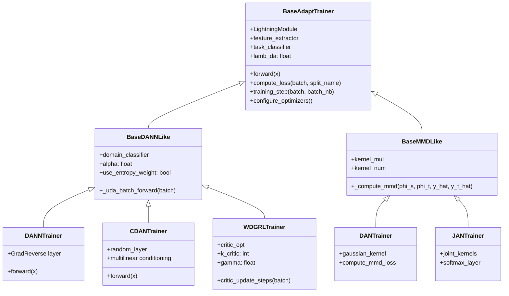
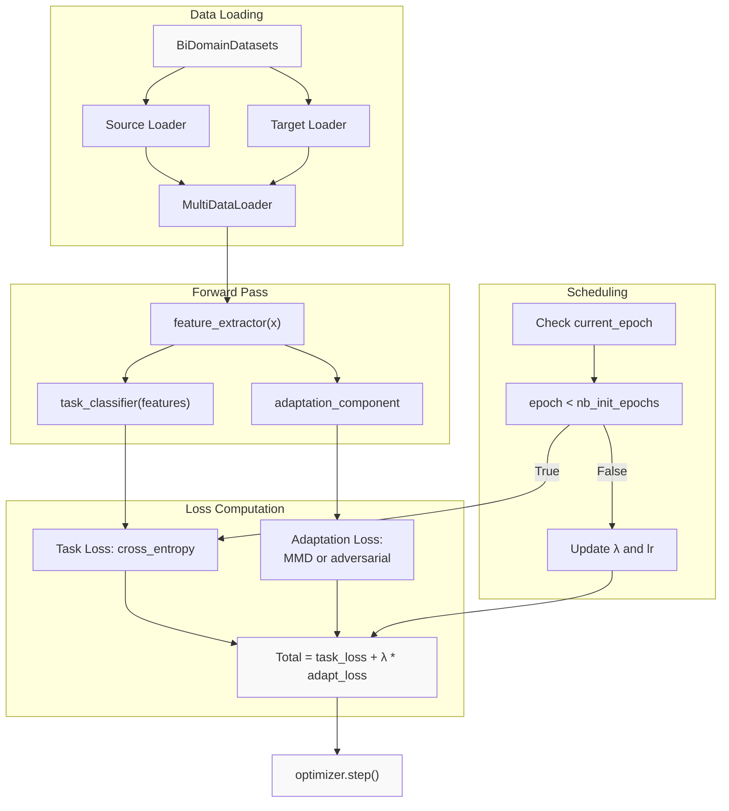
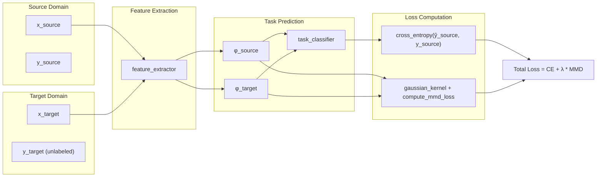
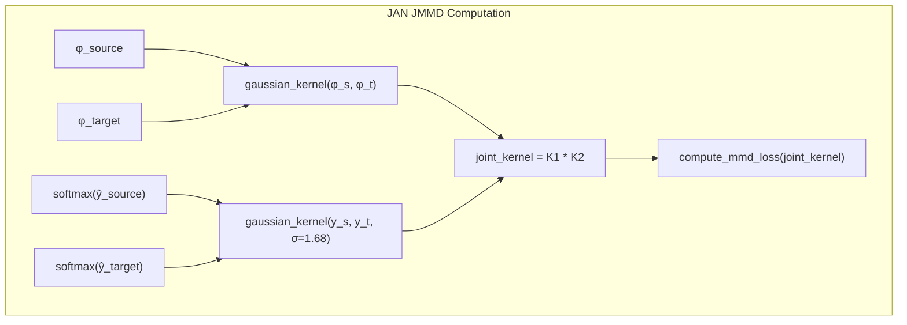
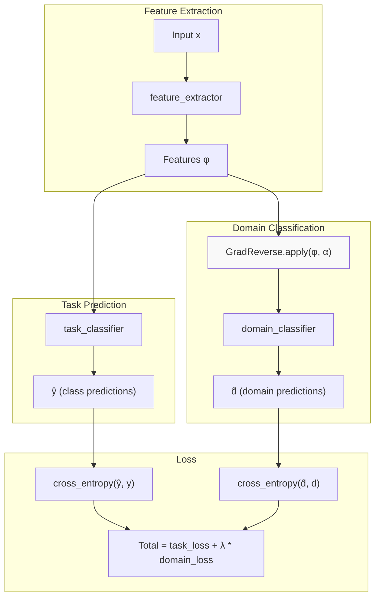
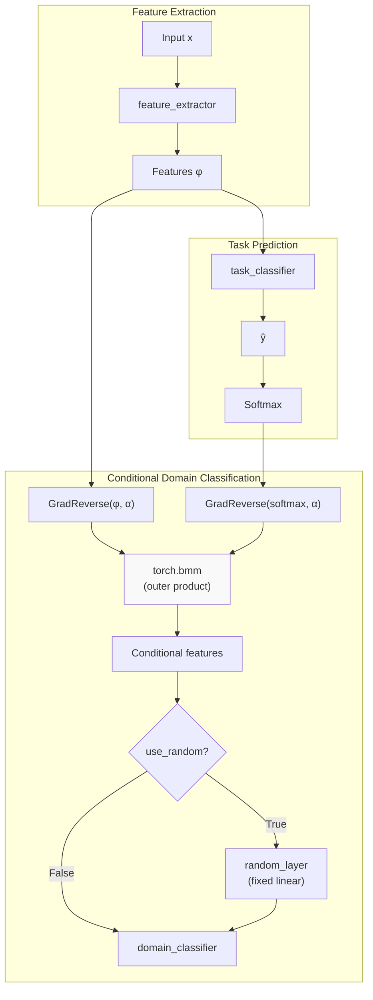
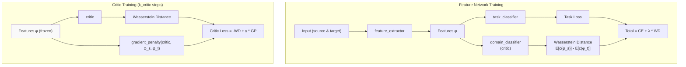
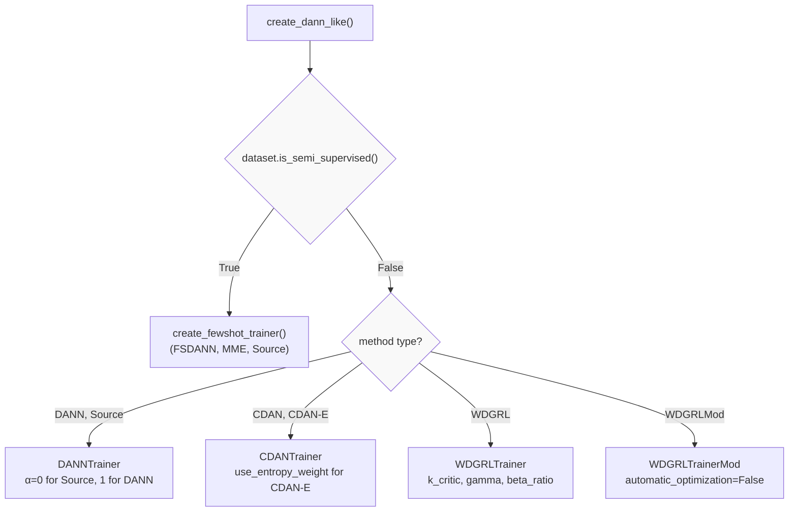
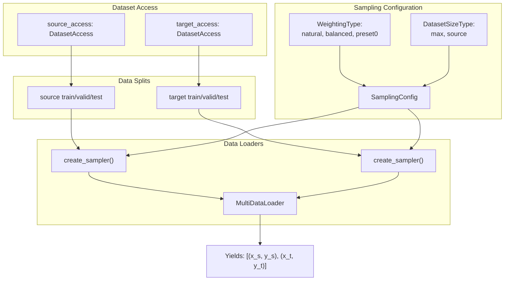
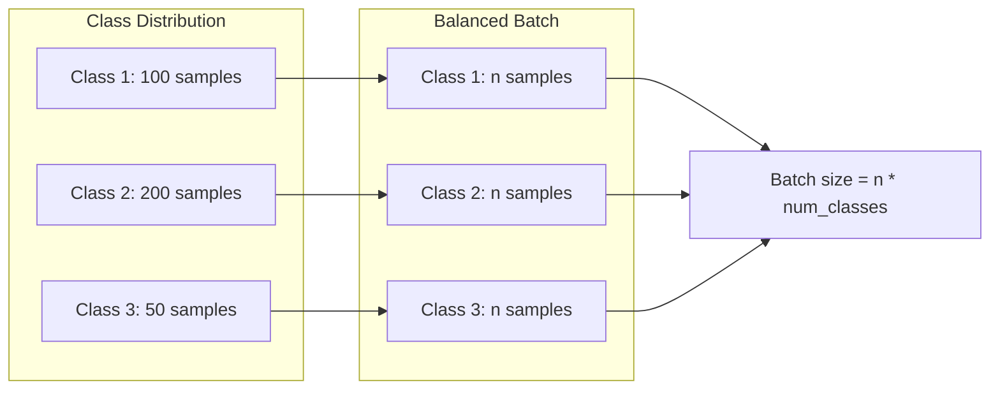

<!-- source: DeepWiki mcp.deepwiki.com · repo pykale/pykale · page 3.1 Single-Source Domain Adaptation · fetched 2026-10-21 -->

# Single-Source Domain Adaptation

<details>
<summary>Relevant source files</summary>

The following files were used as context for generating this wiki page:

- [examples/action_dann/main.py](examples/action_dann/main.py)
- [examples/action_dann/test.py](examples/action_dann/test.py)
- [examples/bindingdb_deepdta/tutorial.ipynb](examples/bindingdb_deepdta/tutorial.ipynb)
- [examples/digits_dann/configs/MN2UP-CDAN.yaml](examples/digits_dann/configs/MN2UP-CDAN.yaml)
- [examples/digits_dann/configs/MN2UP-DAN.yaml](examples/digits_dann/configs/MN2UP-DAN.yaml)
- [examples/digits_dann/configs/MN2UP-DANN.yaml](examples/digits_dann/configs/MN2UP-DANN.yaml)
- [examples/digits_dann/main.py](examples/digits_dann/main.py)
- [examples/digits_dann/tutorial.ipynb](examples/digits_dann/tutorial.ipynb)
- [examples/toy_domain_adaptation/main.py](examples/toy_domain_adaptation/main.py)
- [examples/toy_domain_adaptation/tutorial.ipynb](examples/toy_domain_adaptation/tutorial.ipynb)
- [kale/loaddata/dataset_access.py](kale/loaddata/dataset_access.py)
- [kale/loaddata/multi_domain.py](kale/loaddata/multi_domain.py)
- [kale/loaddata/sampler.py](kale/loaddata/sampler.py)
- [kale/loaddata/usps.py](kale/loaddata/usps.py)
- [kale/loaddata/video_multi_domain.py](kale/loaddata/video_multi_domain.py)
- [kale/pipeline/domain_adapter.py](kale/pipeline/domain_adapter.py)
- [kale/pipeline/video_domain_adapter.py](kale/pipeline/video_domain_adapter.py)
- [tests/loaddata/test_image_access.py](tests/loaddata/test_image_access.py)
- [tests/loaddata/test_sampler.py](tests/loaddata/test_sampler.py)
- [tests/loaddata/test_video_access.py](tests/loaddata/test_video_access.py)
- [tests/pipeline/test_domain_adapter.py](tests/pipeline/test_domain_adapter.py)
- [tests/pipeline/test_video_domain_adapter.py](tests/pipeline/test_video_domain_adapter.py)

</details>


## Purpose and Scope

This page documents PyKale's single-source domain adaptation methods, where a model learns to transfer knowledge from one labeled source domain to one unlabeled target domain. This includes MMD-based approaches (DAN, JAN), adversarial methods (DANN, CDAN, WDGRL), the `BaseAdaptTrainer` architecture, and factory functions for creating trainers.

For multi-source domain adaptation (multiple source domains), see [Multi-Source Domain Adaptation](#3.2). For video-specific domain adaptation with temporal features, see [Video Domain Adaptation](#3.3). For semi-supervised settings with few labeled target samples, see [Few-Shot Domain Adaptation](#3.4).

## Overview

Single-source domain adaptation addresses the domain shift problem where a model trained on a source domain performs poorly on a target domain due to distribution differences. PyKale implements two main categories of methods:

1. **MMD-based methods**: Minimize Maximum Mean Discrepancy between source and target feature distributions
   - `DAN` (Deep Adaptation Networks)
   - `JAN` (Joint Adaptation Networks)

2. **Adversarial methods**: Use domain discriminators to learn domain-invariant features
   - `DANN` (Domain-Adversarial Neural Networks)
   - `CDAN` (Conditional Domain Adversarial Network)
   - `WDGRL` (Wasserstein Distance Guided Representation Learning)

All methods inherit from `BaseAdaptTrainer`, which provides a unified PyTorch Lightning-based training interface with adaptive learning rate and lambda scheduling.

**Sources:** [kale/pipeline/domain_adapter.py:1-193]()

## Architecture Overview

### Class Hierarchy



**Diagram: Single-Source Domain Adaptation Class Hierarchy**

This diagram shows the inheritance structure of domain adaptation trainers. `BaseAdaptTrainer` provides core functionality, with specialized base classes for adversarial (`BaseDANNLike`) and MMD-based (`BaseMMDLike`) methods.

**Sources:** [kale/pipeline/domain_adapter.py:195-461](), [kale/pipeline/domain_adapter.py:463-568](), [kale/pipeline/domain_adapter.py:570-941]()

### BaseAdaptTrainer Architecture

The `BaseAdaptTrainer` class implements the fundamental building blocks for all domain adaptation methods:

| Component | Description | Line Reference |
|-----------|-------------|----------------|
| Feature Extractor | Maps inputs to latent space | [kale/pipeline/domain_adapter.py:219-220]() |
| Task Classifier | Predicts labels from features | [kale/pipeline/domain_adapter.py:221-222]() |
| Lambda Scheduling | DANN-style adaptive weighting | [kale/pipeline/domain_adapter.py:206-214]() |
| Learning Rate Scheduling | DANN-style LR decay | [kale/pipeline/domain_adapter.py:306-308]() |
| Warmup Phase | Source-only training | [kale/pipeline/domain_adapter.py:231-232]() |

**Key features:**

- **Loss formulation**: $\mathcal{L} = \mathcal{L}_c + \lambda \mathcal{L}_a$, where $\mathcal{L}_c$ is task loss and $\mathcal{L}_a$ is adaptation loss
- **Lambda schedule**: $\lambda_p = \frac{2}{1 + \exp(-\gamma \cdot p)} - 1$ where $p \in [0,1]$ is training progress
- **Learning rate schedule**: $lr = \frac{lr_0}{(1 + 10p)^{0.75}}$
- **Warmup**: First `nb_init_epochs` epochs use only task loss ($\lambda=0$)

**Sources:** [kale/pipeline/domain_adapter.py:195-461]()

### Training Flow



**Diagram: Training Flow in Single-Source Domain Adaptation**

This diagram illustrates the complete training pipeline from data loading through loss computation and optimization.

**Sources:** [kale/pipeline/domain_adapter.py:359-393](), [kale/loaddata/multi_domain.py:214-240]()

## MMD-Based Methods

MMD (Maximum Mean Discrepancy) methods minimize the distance between source and target feature distributions using kernel-based distance measures.

### DAN (Deep Adaptation Networks)

DAN minimizes MMD between source and target features in the feature space using a Gaussian kernel.



**Diagram: DAN Architecture**

**Key implementation details:**

- **Kernel**: Multi-kernel Gaussian with configurable `kernel_mul` and `kernel_num` parameters
- **MMD computation**: Uses `gaussian_kernel()` to compute kernel matrix, then `compute_mmd_loss()` for final MMD value
- **Feature matching**: Matches distribution of features $\phi_s$ and $\phi_t$ only

**Sources:** [kale/pipeline/domain_adapter.py:1285-1319]()

**Usage:**

```python
from kale.pipeline.domain_adapter import create_mmd_based, Method

model = create_mmd_based(
    method=Method.DAN,
    dataset=dataset,
    feature_extractor=feature_network,
    task_classifier=classifier_network,
    target_domain="target",
    nb_init_epochs=10,
    nb_adapt_epochs=50,
    batch_size=32,
    init_lr=1e-3
)
```

**Sources:** [kale/pipeline/domain_adapter.py:87-108]()

### JAN (Joint Adaptation Networks)

JAN extends DAN by jointly matching both feature distributions and classifier predictions using JMMD (Joint MMD).

**Key differences from DAN:**

| Aspect | DAN | JAN |
|--------|-----|-----|
| Matching | Features only | Features + softmax predictions |
| Kernel | Single multi-scale Gaussian | Product of two multi-scale Gaussians |
| Parameters | `kernel_mul`, `kernel_num` | `kernel_mul=[2.0, 2.0]`, `kernel_num=[5, 1]` |

**Implementation:**



**Diagram: JAN JMMD Computation**

The joint kernel is computed as the element-wise product of feature kernel and prediction kernel, enforcing alignment in both spaces simultaneously.

**Sources:** [kale/pipeline/domain_adapter.py:1322-1363]()

## Adversarial Methods

Adversarial domain adaptation methods learn domain-invariant features by training a domain discriminator to distinguish source from target, while the feature extractor is trained to fool the discriminator.

### DANN (Domain-Adversarial Neural Networks)

DANN uses a Gradient Reversal Layer (GRL) to enable adversarial training without explicit minimax optimization.



**Diagram: DANN Architecture with Gradient Reversal Layer**

**Key components:**

- **GradReverse layer**: Identity in forward pass, negates and scales gradient by $\alpha$ in backward pass
- **Domain labels**: Source=0, Target=1
- **Alpha parameter**: Controls strength of adversarial learning, typically set to 1.0

**Sources:** [kale/pipeline/domain_adapter.py:23-43](), [kale/pipeline/domain_adapter.py:570-604]()

**Gradient Reversal Layer implementation:**

The GRL is a custom autograd function that implements:
- Forward: $\text{GRL}(x) = x$
- Backward: $\frac{\partial L}{\partial x} = -\alpha \frac{\partial L}{\partial \text{GRL}(x)}$

**Sources:** [kale/pipeline/domain_adapter.py:23-43]()

### CDAN (Conditional Domain Adversarial Network)

CDAN improves upon DANN by conditioning the domain discriminator on task predictions, capturing multimodal structures.



**Diagram: CDAN Conditional Domain Classification**

**Key features:**

- **Multilinear conditioning**: Outer product of features and predictions: $h \otimes g$ where $h$ are features and $g$ are softmax predictions
- **Random layer**: Optional fixed random projection to reduce dimensionality (from $d_h \times n_c$ to 1024)
- **Entropy weighting** (CDAN-E): Weights samples by entropy to focus on uncertain predictions

**Sources:** [kale/pipeline/domain_adapter.py:606-654]()

**CDAN-E variant:**

```python
# CDAN with entropy weighting (CDAN-E)
model = create_dann_like(
    method=Method.CDAN_E,  # Automatically sets use_entropy_weight=True
    dataset=dataset,
    feature_extractor=feature_network,
    task_classifier=classifier_network,
    critic=domain_network,
    target_domain="target"
)
```

The entropy weight $w = 1 + \exp(-H)$ where $H$ is prediction entropy, downweighting confident predictions.

**Sources:** [kale/pipeline/domain_adapter.py:500-504](), [kale/pipeline/domain_adapter.py:137-147]()

### WDGRL (Wasserstein Distance Guided Representation Learning)

WDGRL uses Wasserstein distance instead of adversarial loss, providing a more stable distance metric between distributions.

**Architecture differences from DANN:**

| Component | DANN | WDGRL |
|-----------|------|-------|
| Domain loss | Cross-entropy | Wasserstein distance |
| Gradient reversal | Yes (GRL) | No |
| Critic training | Jointly with features | Separate critic steps |
| Gradient penalty | No | Yes (enforces 1-Lipschitz) |



**Diagram: WDGRL Training Flow**

**Key implementation details:**

- **Critic steps**: Critic is updated `k_critic` times per feature update
- **Gradient penalty**: Enforces 1-Lipschitz constraint: $\gamma \cdot ||\nabla_{\hat{\phi}} c(\hat{\phi})||_2$
- **Asymmetric variant**: Optional $\beta$ parameter for asymmetric relaxation: $E[c(\phi_s)] - (1+\beta)E[c(\phi_t)]$

**Sources:** [kale/pipeline/domain_adapter.py:656-792]()

**Critic update implementation:**

```python
# From WDGRLTrainer.critic_update_steps
for _ in range(self._k_critic):
    gp = gradient_penalty(self.domain_classifier, h_s, h_t)
    critic_s = self.domain_classifier(h_s)
    critic_t = self.domain_classifier(h_t)
    wasserstein_distance = critic_s.mean() - (1 + self._beta_ratio) * critic_t.mean()
    critic_cost = -wasserstein_distance + self._gamma * gp
    # Update critic
```

**Sources:** [kale/pipeline/domain_adapter.py:717-746]()

## Factory Functions

PyKale provides two main factory functions for creating domain adaptation trainers, which handle method-specific initialization and parameter validation.

### create_mmd_based()

Creates MMD-based domain adaptation trainers (DAN, JAN).

**Signature:**
```python
def create_mmd_based(
    method: Method,
    dataset,
    feature_extractor,
    task_classifier,
    target_domain,
    **train_params
) -> BaseMMDLike
```

**Parameters:**

| Parameter | Type | Description |
|-----------|------|-------------|
| `method` | `Method` | `Method.DAN` or `Method.JAN` |
| `dataset` | `MultiDomainDataset` or `BiDomainDatasets` | Multi-domain dataset |
| `feature_extractor` | `torch.nn.Module` | Feature extraction network |
| `task_classifier` | `torch.nn.Module` | Task classification network |
| `target_domain` | `str` | Name of target domain |
| `**train_params` | `dict` | Training parameters (lr, epochs, etc.) |

**Returns:** `DANTrainer` or `JANTrainer`

**Sources:** [kale/pipeline/domain_adapter.py:87-108]()

### create_dann_like()

Creates adversarial domain adaptation trainers (DANN, CDAN, CDAN-E, WDGRL).

**Signature:**
```python
def create_dann_like(
    method: Method,
    dataset,
    feature_extractor,
    task_classifier,
    critic,
    target_domain,
    **train_params
) -> BaseDANNLike
```

**Additional parameter:**

| Parameter | Type | Description |
|-----------|------|-------------|
| `critic` | `torch.nn.Module` | Domain discriminator/critic network |

**Method-specific handling:**



**Diagram: Factory Function Decision Flow for create_dann_like()**

**Sources:** [kale/pipeline/domain_adapter.py:110-193]()

### Method Enumeration

The `Method` enum provides type-safe method selection with helper functions:

```python
class Method(Enum):
    Source = "Source"      # Source-only baseline
    DANN = "DANN"
    CDAN = "CDAN"
    CDAN_E = "CDAN-E"
    WDGRL = "WDGRL"
    WDGRLMod = "WDGRLMod"
    DAN = "DAN"
    JAN = "JAN"
    
    # Helper methods
    def is_mmd_method(self):
        return self in (Method.DAN, Method.JAN)
    
    def is_dann_method(self):
        return self in (Method.DANN, Method.Source)
    
    def is_cdan_method(self):
        return self in (Method.CDAN, Method.CDAN_E)
```

**Sources:** [kale/pipeline/domain_adapter.py:54-85]()

## Data Loading Infrastructure

### BiDomainDatasets

`BiDomainDatasets` manages iteration over source and target domains with sophisticated sampling strategies.



**Diagram: BiDomainDatasets Data Flow**

**Key features:**

| Feature | Description | Line Reference |
|---------|-------------|----------------|
| Weighted sampling | `natural`, `balanced`, or custom class weights | [kale/loaddata/multi_domain.py:139-154]() |
| Dataset size control | Use max or source dataset size for epoch length | [kale/loaddata/multi_domain.py:66-77]() |
| Class subset filtering | Filter to specific class IDs | [kale/loaddata/multi_domain.py:209-212]() |
| Validation split | Automatic train/valid splitting | [kale/loaddata/multi_domain.py:109]() |

**Sources:** [kale/loaddata/multi_domain.py:102-250]()

### MultiDataLoader

`MultiDataLoader` synchronizes iteration over multiple domain loaders, yielding batches from all domains simultaneously.

**Batch structure:**

- **Unsupervised**: `[(x_source, y_source), (x_target, y_target)]`
- **Semi-supervised**: `[(x_source, y_source), (x_target_labeled, y_target_labeled), (x_target_unlabeled, y_target_unlabeled)]`

**Implementation details:**

```python
class MultiDataLoader:
    def __init__(self, dataloaders, n_batches):
        self._dataloaders = dataloaders
        self._n_batches = n_batches
    
    def __iter__(self):
        for _ in range(self._n_batches):
            # Get next batch from each loader
            # Reinitialize if any loader exhausted
            yield [next(dl) for dl in self._iterators]
```

**Sources:** [kale/loaddata/sampler.py:116-151]()

### Sampling Strategies

PyKale provides three main sampling strategies through `SamplingConfig`:

| Strategy | Description | Use Case |
|----------|-------------|----------|
| `BalancedBatchSampler` | Equal samples per class | Imbalanced datasets |
| `ReweightedBatchSampler` | Custom class weights | Specific class importance |
| `DomainBalancedBatchSampler` | Equal samples per domain | Multi-domain datasets |

**BalancedBatchSampler example:**



**Diagram: Balanced Sampling Strategy**

Each batch contains equal representation from all classes, regardless of natural class distribution.

**Sources:** [kale/loaddata/sampler.py:154-193]()

## Usage Examples

### Basic DANN Example

```python
from kale.pipeline.domain_adapter import create_dann_like, Method
from kale.loaddata.image_access import DigitDataset
from kale.loaddata.multi_domain import BiDomainDatasets
from kale.embed.image_cnn import SmallCNNFeature
from kale.predict.class_domain_nets import ClassNetSmallImage, DomainNetSmallImage

# Load datasets
source = DigitDataset.get_access(DigitDataset("MNIST"), download_path)[0]
target = DigitDataset.get_access(DigitDataset("USPS"), download_path)[0]
dataset = BiDomainDatasets(source, target, config_weight_type="natural")

# Create networks
feature_network = SmallCNNFeature(num_channels=1)
classifier_network = ClassNetSmallImage(feature_dim=128, num_classes=10)
domain_network = DomainNetSmallImage(input_size=128)

# Create DANN trainer
model = create_dann_like(
    method=Method.DANN,
    dataset=dataset,
    feature_extractor=feature_network,
    task_classifier=classifier_network,
    critic=domain_network,
    target_domain="target",
    alpha=1.0,
    nb_init_epochs=10,
    nb_adapt_epochs=50,
    batch_size=32,
    init_lr=0.001,
    optimizer={"type": "SGD", "optim_params": {"momentum": 0.9}}
)

# Train with PyTorch Lightning
import pytorch_lightning as pl
trainer = pl.Trainer(max_epochs=60)
trainer.fit(model)
```

**Sources:** [tests/pipeline/test_domain_adapter.py:47-104]()

### DAN with Custom Parameters

```python
# DAN with custom kernel parameters
model = create_mmd_based(
    method=Method.DAN,
    dataset=dataset,
    feature_extractor=feature_network,
    task_classifier=classifier_network,
    target_domain="target",
    nb_init_epochs=5,
    nb_adapt_epochs=30,
    batch_size=64,
    init_lr=0.01,
    lambda_init=0.5,  # Initial lambda value
    adapt_lambda=True,  # Use adaptive lambda scheduling
    adapt_lr=True  # Use adaptive learning rate
)
```

**Sources:** [kale/pipeline/domain_adapter.py:87-108]()

### CDAN-E with Entropy Weighting

```python
# CDAN with entropy weighting and random layer
critic_network = DomainNetSmallImage(input_size=1024)

model = create_dann_like(
    method=Method.CDAN_E,  # Enables entropy weighting
    dataset=dataset,
    feature_extractor=feature_network,
    task_classifier=classifier_network,
    critic=critic_network,
    target_domain="target",
    use_random=True,  # Use random layer for dimensionality reduction
    random_dim=1024,
    batch_size=32
)
```

The random layer projects the multilinear features (feature_dim × num_classes) to a fixed 1024 dimensions using a frozen random linear layer.

**Sources:** [kale/pipeline/domain_adapter.py:137-147](), [kale/pipeline/domain_adapter.py:619-633]()

### WDGRL with Gradient Penalty

```python
# WDGRL with critic training configuration
model = create_dann_like(
    method=Method.WDGRL,
    dataset=dataset,
    feature_extractor=feature_network,
    task_classifier=classifier_network,
    critic=critic_network,
    target_domain="target",
    k_critic=5,  # Number of critic updates per feature update
    gamma=10,  # Gradient penalty coefficient
    beta_ratio=0,  # Asymmetric relaxation (0 for symmetric)
    batch_size=32
)
```

**Sources:** [kale/pipeline/domain_adapter.py:148-167]()

### MultiDomainDataset with Domain Labels

```python
from kale.loaddata.multi_domain import MultiDomainAccess, MultiDomainDataset

# Create multi-domain access with domain labels
data_access = MultiDomainAccess(
    {"MNIST": mnist_access, "USPS": usps_access},
    n_classes=10,
    return_domain_label=True
)

# Create dataset with explicit target domain
dataset = MultiDomainDataset(
    data_access,
    valid_split_ratio=0.1,
    test_split_ratio=0.2,
    random_state=42
)

# Prepare loaders with target domain specification
dataset.prepare_data_loaders(target_domain="USPS")

# Batches now include domain labels: (x, y, domain_label)
dataloader = dataset.get_domain_loaders(split="train", batch_size=32)
x, y, domain_labels = next(iter(dataloader))
```

**Sources:** [kale/loaddata/multi_domain.py:553-622]()

### Custom Optimizer Configuration

```python
# Using custom optimizer with domain adaptation
model = create_dann_like(
    method=Method.DANN,
    dataset=dataset,
    feature_extractor=feature_network,
    task_classifier=classifier_network,
    critic=domain_network,
    target_domain="target",
    optimizer={
        "type": "Adam",  # or "SGD", "AdamW"
        "optim_params": {
            "betas": (0.9, 0.999),
            "weight_decay": 1e-5
        }
    },
    init_lr=0.001
)
```

The optimizer configuration is validated against PyTorch optimizer signatures, ensuring only valid parameters are passed.

**Sources:** [kale/pipeline/domain_adapter.py:411-440]()

## Training Configuration

### Common Training Parameters

All domain adaptation trainers accept these core parameters:

| Parameter | Type | Default | Description |
|-----------|------|---------|-------------|
| `nb_init_epochs` | `int` | 10 | Warmup epochs with source-only training |
| `nb_adapt_epochs` | `int` | 50 | Total training epochs (including warmup) |
| `batch_size` | `int` | 32 | Batch size for training |
| `num_workers` | `int` | 0 | Number of data loading workers |
| `init_lr` | `float` | 1e-3 | Initial learning rate |
| `lambda_init` | `float` | 1.0 | Initial adaptation loss weight |
| `adapt_lambda` | `bool` | True | Use adaptive lambda scheduling |
| `adapt_lr` | `bool` | True | Use adaptive learning rate scheduling |

**Sources:** [kale/pipeline/domain_adapter.py:226-258]()

### Method-Specific Parameters

**CDAN/CDAN-E:**
- `use_entropy_weight`: Enable entropy weighting (True for CDAN-E)
- `use_random`: Use random projection layer
- `random_dim`: Dimension of random projection (default: 1024)

**WDGRL:**
- `k_critic`: Critic update steps per feature update (default: 5)
- `gamma`: Gradient penalty coefficient (default: 10)
- `beta_ratio`: Asymmetric relaxation parameter (default: 0)

**JAN:**
- `kernel_mul`: Kernel bandwidth multipliers (default: [2.0, 2.0])
- `kernel_num`: Number of kernels (default: [5, 1])

**Sources:** [kale/pipeline/domain_adapter.py:606-692](), [kale/pipeline/domain_adapter.py:1322-1363]()

### PyTorch Lightning Integration

All trainers are PyTorch Lightning modules, providing:

- Automatic training loop management
- Built-in validation and testing
- Logging to TensorBoard/other loggers
- Multi-GPU support
- Mixed precision training
- Checkpointing

```python
import pytorch_lightning as pl
from pytorch_lightning.callbacks import ModelCheckpoint
from pytorch_lightning.loggers import TensorBoardLogger

# Configure callbacks and loggers
checkpoint_callback = ModelCheckpoint(
    monitor='valid_target_acc',
    mode='max',
    save_top_k=3
)

logger = TensorBoardLogger('logs/', name='dann_experiment')

# Train
trainer = pl.Trainer(
    max_epochs=60,
    callbacks=[checkpoint_callback],
    logger=logger,
    accelerator='gpu',
    devices=1
)
trainer.fit(model)

# Test
trainer.test(model)
```

**Sources:** [kale/pipeline/domain_adapter.py:195-241]()

## Metrics and Logging

### Logged Metrics

All domain adaptation methods log standard metrics during training:

| Metric | Description | Logged Phase |
|--------|-------------|--------------|
| `{split}_source_acc` | Source domain accuracy | train/valid/test |
| `{split}_target_acc` | Target domain accuracy | train/valid/test |
| `{split}_task_loss` | Task classification loss | train/valid/test |
| `{split}_domain_div_loss` | Domain divergence/adaptation loss | train/valid/test |
| `{split}_total_loss` | Combined loss | train/valid/test |
| `alpha` | GRL strength (adversarial methods) | per epoch |
| `lambda` | Adaptation loss weight | per epoch |

**Adversarial-specific metrics:**
- `{split}_domain_acc`: Domain classifier accuracy
- `{split}_source_domain_acc`: Domain classification on source
- `{split}_target_domain_acc`: Domain classification on target

**WDGRL-specific metrics:**
- `{split}_wasserstein_dist`: Estimated Wasserstein distance

**Sources:** [kale/pipeline/domain_adapter.py:383-401](), [kale/pipeline/domain_adapter.py:548-558]()

### Accessing Metrics

```python
# After training
results = trainer.test(model)
print(f"Target accuracy: {results[0]['test_target_acc']:.4f}")

# During training (from Lightning callbacks)
class MetricCallback(pl.Callback):
    def on_validation_epoch_end(self, trainer, pl_module):
        metrics = trainer.callback_metrics
        print(f"Valid target acc: {metrics['valid_target_acc']:.4f}")
```

**Sources:** [kale/pipeline/domain_adapter.py:395-409]()

---

**Page Sources:** [kale/pipeline/domain_adapter.py:1-1486](), [kale/loaddata/multi_domain.py:1-841](), [kale/loaddata/sampler.py:1-400](), [tests/pipeline/test_domain_adapter.py:1-105]()

---

