<!-- source: DeepWiki mcp.deepwiki.com · repo pykale/pykale · page 3.2 Multi-Source Domain Adaptation · fetched 2026-10-21 -->

# Multi-Source Domain Adaptation

<details>
<summary>Relevant source files</summary>

The following files were used as context for generating this wiki page:

- [examples/multisite_neuroimg_adapt/README.md](examples/multisite_neuroimg_adapt/README.md)
- [examples/multisite_neuroimg_adapt/config.py](examples/multisite_neuroimg_adapt/config.py)
- [examples/multisite_neuroimg_adapt/main.py](examples/multisite_neuroimg_adapt/main.py)
- [examples/multisite_neuroimg_adapt/tutorial.ipynb](examples/multisite_neuroimg_adapt/tutorial.ipynb)
- [kale/embed/image_cnn.py](kale/embed/image_cnn.py)
- [kale/evaluate/cross_validation.py](kale/evaluate/cross_validation.py)
- [kale/pipeline/multi_domain_adapter.py](kale/pipeline/multi_domain_adapter.py)
- [kale/predict/class_domain_nets.py](kale/predict/class_domain_nets.py)
- [tests/evaluate/test_cross_validation.py](tests/evaluate/test_cross_validation.py)
- [tests/pipeline/test_multi_domain_adapter.py](tests/pipeline/test_multi_domain_adapter.py)

</details>


## Purpose and Scope

This page documents PyKale's multi-source domain adaptation capabilities, which enable training models when data comes from multiple source domains and must generalize to a target domain. Multi-source domain adaptation extends single-source methods by leveraging complementary information from multiple sources simultaneously.

For single-source domain adaptation methods (DANN, DAN, JAN, CDAN), see [Single-Source Domain Adaptation](#3.1). For video-specific adaptations, see [Video Domain Adaptation](#3.3). For core data loading infrastructure, see [Data Loading](#2.1).

**Key Components Covered:**
- Neural network-based trainers: M3SDA, DIN, MFSAN
- Kernel-based adaptation: MIDA (Maximum Independence Domain Adaptation)
- Automated pipeline: MIDATrainer and AutoMIDAClassificationTrainer
- CoIRLS (Covariate-Independence Regularized Least Squares)

## Architecture Overview

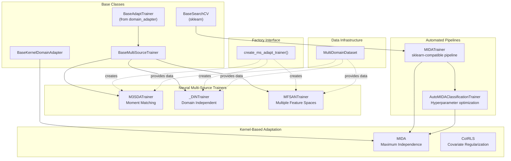

**Diagram: Multi-Source Domain Adaptation System Architecture**

Sources: [kale/pipeline/multi_domain_adapter.py:1-1500]()

## Neural Network-Based Trainers

### BaseMultiSourceTrainer

`BaseMultiSourceTrainer` provides the foundation for all neural multi-source domain adaptation methods, extending `BaseAdaptTrainer` with multi-source specific functionality.

**Key Attributes:**
- `n_classes`: Number of target classes
- `feature_dim`: Dimension of feature vectors
- `target_label`: Integer label for target domain
- `domain_to_idx`: Mapping from domain names to indices

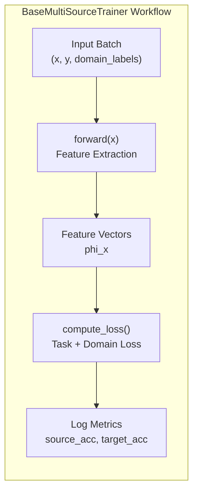

**Diagram: BaseMultiSourceTrainer Processing Flow**

Sources: [kale/pipeline/multi_domain_adapter.py:73-107]()

### M3SDATrainer

**Moment Matching for Multi-Source Domain Adaptation (M3SDA)** aligns distributions across domains by matching their k-th order statistical moments.

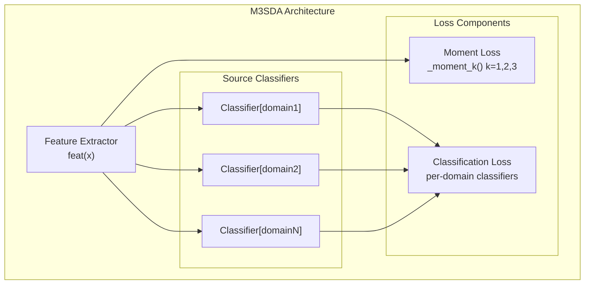

**Diagram: M3SDA Component Architecture**

**Key Parameters:**
- `k_moment` (int): Number of moments to match (default: 3)

**Implementation Details:**
- Maintains separate `nn.ModuleDict` of classifiers for each source domain
- Target domain predictions: average outputs from all source classifiers
- Moment divergence computed via `losses._moment_k()` for orders 1 through k

**Loss Function:**
```
Total Loss = Classification Loss + λ × Moment Loss
where Moment Loss = Σ(k=1 to k_moment) moment_k(features, domain_labels)
```

Sources: [kale/pipeline/multi_domain_adapter.py:109-198]()

### _DINTrainer

**Domain Independent Network (DIN)** learns domain-invariant features by minimizing the Hilbert-Schmidt Independence Criterion (HSIC) between features and domain labels.

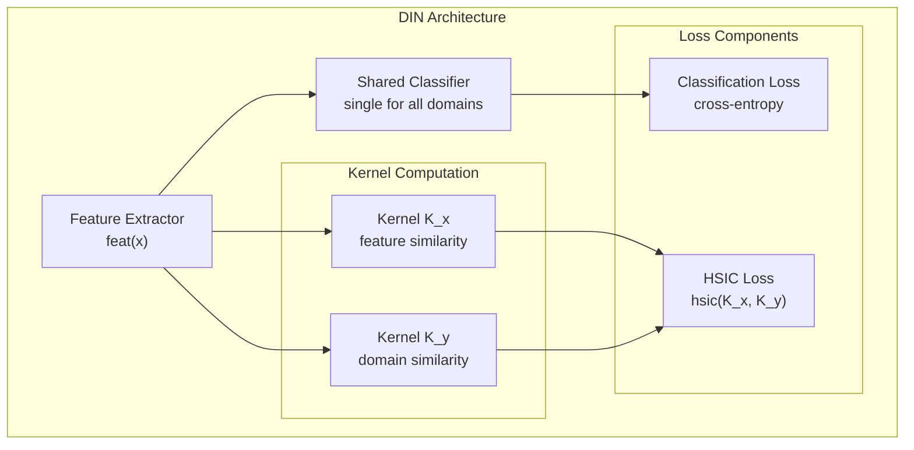

**Diagram: DIN Processing Pipeline**

**Key Parameters:**
- `kernel` (str): Kernel type for HSIC computation (default: "linear")
- `kernel_mul` (float): Kernel multiplier (default: 2.0)
- `kernel_num` (int): Number of kernels (default: 5)

**HSIC Computation:**
- Linear kernel: `K_x = x @ x.T`
- Domain kernel: `K_y = one_hot(domain_labels) @ one_hot(domain_labels).T`
- Independence measure: `losses.hsic(K_x, K_y)`

Sources: [kale/pipeline/multi_domain_adapter.py:200-253]()

### MFSANTrainer

**Multiple Feature Spaces Adaptation Network (MFSAN)** learns domain-specific feature transformations while maintaining classifier consistency.

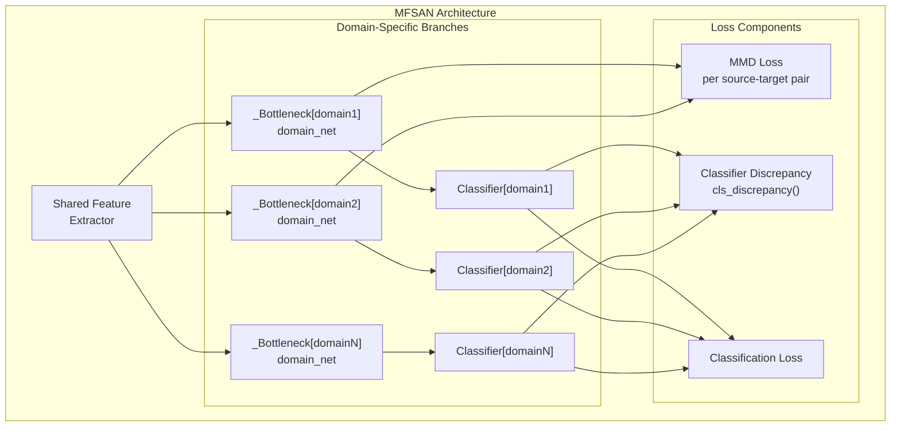

**Diagram: MFSAN Multi-Branch Architecture**

**Key Parameters:**
- `domain_feat_dim` (int): Dimension of domain-specific features (default: 100)
- `kernel_mul` (float): MMD kernel multiplier (default: 2.0)
- `kernel_num` (int): Number of kernels for MMD (default: 5)
- `input_dimension` (int): 1D or 2D input for bottleneck (default: 2)

**Domain-Specific Components:**
- Each source domain has dedicated `_Bottleneck` ([kale/embed/image_cnn.py:137-189]()) for feature transformation
- Domain-specific classifiers operate on transformed features
- Target predictions: average of all classifier outputs via `_get_avg_cls_output()`

**Loss Components:**
| Component | Purpose | Computation |
|-----------|---------|-------------|
| MMD Loss | Source-target alignment | `losses.compute_mmd_loss()` per domain pair |
| Classification Loss | Source classification | Cross-entropy on source domains |
| Classifier Discrepancy | Output consistency | Pairwise L1 distance between classifier outputs |

Sources: [kale/pipeline/multi_domain_adapter.py:255-356](), [kale/embed/image_cnn.py:137-189]()

### Factory Function

The `create_ms_adapt_trainer()` function provides a unified interface for instantiating multi-source trainers.

```python
# Usage example (not actual code)
trainer = create_ms_adapt_trainer(
    method="M3SDA",  # or "DIN", "MFSAN"
    dataset=multi_domain_dataset,
    feature_extractor=resnet_feature,
    task_classifier=classifier_class,
    **train_params
)
```

**Supported Methods:**
| Method | Trainer Class | Key Characteristic |
|--------|--------------|-------------------|
| `"M3SDA"` | M3SDATrainer | Moment matching alignment |
| `"DIN"` | _DINTrainer | HSIC-based independence |
| `"MFSAN"` | MFSANTrainer | Domain-specific feature spaces |

Sources: [kale/pipeline/multi_domain_adapter.py:46-64]()

## Kernel-Based Domain Adaptation

### MIDA (Maximum Independence Domain Adaptation)

MIDA is a kernel-based method that removes the effect of domain/grouping factors by learning a feature space that maximizes Hilbert-Schmidt Independence Criterion (HSIC) between features and factors while preserving class discriminability.

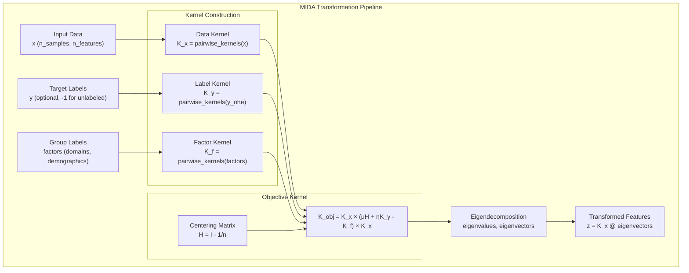

**Diagram: MIDA Kernel-Based Transformation**

**Key Parameters:**
- `num_components` (int, optional): Number of components to keep
- `mu` (float): L2 kernel regularization coefficient (default: 1.0)
- `eta` (float): Class-dependency regularization coefficient (default: 1.0)
- `ignore_y` (bool): Whether to ignore labels during fitting (default: False)
- `augment` (str): Data augmentation strategy - `"pre"` (prepend factors), `"post"` (append factors), or `None`
- `kernel` (str): Kernel type - `"linear"`, `"rbf"`, `"poly"`, `"sigmoid"` (default: `"linear"`)
- `fit_inverse_transform` (bool): Fit inverse mapping for reconstruction (default: False)

**Objective Function:**

The MIDA objective kernel balances three terms:

```
K_objective = K_x × (μ × H + η × K_y - K_f) × K_x

where:
  μ: controls kernel regularization (smoothness)
  η: controls class dependency preservation
  H: centering matrix for zero-mean constraint
  K_y: label kernel (class structure)
  K_f: factor kernel (domain/covariate structure to remove)
```

**Semi-Supervised Support:**

MIDA supports semi-supervised scenarios by setting target labels to `-1`:

```python
# Example usage pattern
y[target_indices] = -1  # Mask unknown labels
mida.fit(x, y, group_labels=domains)
```

When `-1` labels are present, the `OneHotEncoder` uses `drop=(-1,)` to exclude the unknown class from the label kernel.

Sources: [kale/embed/factorization.py:866-992]()

### MIDA Implementation Details

```mermaid
graph LR
    subgraph "MIDA Class Hierarchy"
        BaseKernel["BaseKernelDomainAdapter<br/>sklearn-compatible base"]
        MIDA["MIDA<br/>_make_objective_kernel()"]
    end
    
    subgraph "Core Methods"
        Fit["fit(x, y, group_labels)"]
        Transform["transform(x, group_labels)"]
        InvTransform["inverse_transform(z)"]
        FitTransform["fit_transform(x, y, group_labels)"]
    end
    
    subgraph "Properties"
        Components["eigenvalues_<br/>eigenvectors_"]
        NFeatOut["_n_features_out"]
        OrigCoef["orig_coef_<br/>(linear kernel only)"]
    end
    
    BaseKernel --> MIDA
    MIDA --> Fit
    MIDA --> Transform
    MIDA --> InvTransform
    MIDA --> FitTransform
    
    Fit --> Components
    Components --> NFeatOut
    Components --> OrigCoef
```

**Diagram: MIDA Method Structure**

**Augmentation Strategies:**

| Strategy | Description | Transform Shape |
|----------|-------------|-----------------|
| `None` | No augmentation | `(n_samples, num_components)` |
| `"pre"` | Prepend factors to input before kernelization | `(n_samples, num_components)` |
| `"post"` | Append factors to transformed output | `(n_samples, num_components + num_factors)` |

**Eigendecomposition Configuration:**

MIDA supports multiple eigensolvers for different scenarios:

| Solver | Use Case | Parameters |
|--------|----------|-----------|
| `"dense"` | Small datasets | Full eigendecomposition |
| `"arpack"` | Large sparse matrices | `max_iter`, `tol` |
| `"randomized"` | Very large matrices | `iterated_power` |
| `"auto"` | Automatic selection | Chooses based on data size |

**Inverse Transform:**

When `fit_inverse_transform=True`, MIDA learns a mapping from the transformed space back to the original space using kernel ridge regression:

```
x_reconstructed = K(z, z_fit) @ dual_coef_
where dual_coef_ = (K(z_fit, z_fit) + α × I)^(-1) @ x_fit
```

Sources: [kale/embed/factorization.py:510-864]()

## MIDATrainer Pipeline

`MIDATrainer` integrates MIDA with scikit-learn estimators in an automated hyperparameter search pipeline.

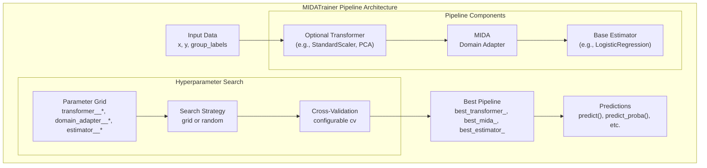

**Diagram: MIDATrainer Workflow**

**Key Features:**

1. **Three-Stage Pipeline:** `[Transformer] → [MIDA] → [Estimator]`
2. **Hyperparameter Search:** Grid or randomized search over all components
3. **sklearn-Compatible:** Inherits from `BaseSearchCV`, supports all sklearn estimators
4. **Domain-Aware CV:** Passes `group_labels` through cross-validation splits

**Constructor Parameters:**

| Parameter | Type | Description |
|-----------|------|-------------|
| `estimator` | BaseEstimator | Classifier/regressor to optimize |
| `param_grid` | dict/list | Hyperparameters to search |
| `use_mida` | bool | Whether to include MIDA (default: True) |
| `transformer` | BaseEstimator | Optional preprocessing step |
| `search_strategy` | str | `"grid"` or `"random"` |
| `num_iter` | int | Iterations for random search |
| `scoring` | str/callable/dict | Evaluation metric(s) |
| `cv` | int/CV object | Cross-validation strategy |

**Parameter Naming Convention:**

Parameters for different pipeline stages use prefixes:
- `transformer__param_name`: For preprocessing transformer
- `domain_adapter__param_name`: For MIDA
- `estimator__param_name` or `param_name`: For final estimator

```python
# Example parameter grid (not actual code)
param_grid = {
    "transformer__with_mean": [True, False],
    "domain_adapter__mu": [0.01, 0.1, 1.0],
    "domain_adapter__num_components": [5, 10, 20],
    "estimator__C": [0.1, 1.0, 10.0],
}
```

**Methods:**

| Method | Description |
|--------|-------------|
| `fit(x, y, group_labels)` | Train pipeline with hyperparameter search |
| `adapt(x, group_labels)` | Apply transformer + MIDA (exclude estimator) |
| `predict(x, group_labels)` | Predict using best pipeline |
| `predict_proba(x, group_labels)` | Class probabilities |
| `predict_log_proba(x, group_labels)` | Log probabilities |
| `decision_function(x, group_labels)` | Decision scores |
| `transform(x, group_labels)` | Full pipeline transformation |
| `inverse_transform(z)` | Reconstruct from transformed space |
| `score(x, y, group_labels)` | Evaluate on test data |

**Attributes After Fitting:**

| Attribute | Description |
|-----------|-------------|
| `best_params_` | Optimal hyperparameters |
| `best_score_` | Best CV score |
| `best_index_` | Index of best configuration |
| `best_estimator_` | Trained estimator with best params |
| `best_mida_` | Trained MIDA with best params (if `use_mida=True`) |
| `best_transformer_` | Trained transformer with best params (if provided) |
| `cv_results_` | Detailed results for all configurations |
| `n_features_in_` | Number of input features |
| `groups_` | Unique group labels from training |

Sources: [kale/pipeline/multi_domain_adapter.py:509-1062]()

### MIDATrainer Advanced Usage

**Multi-Metric Evaluation:**

```python
# Multi-metric scoring (not actual code)
trainer = MIDATrainer(
    estimator=LogisticRegression(),
    param_grid=param_grid,
    scoring=["accuracy", "f1", "roc_auc"],
    refit="roc_auc",  # Refit on best roc_auc
)
```

**Custom Cross-Validation:**

```python
# Leave-one-group-out CV (not actual code)
from sklearn.model_selection import LeaveOneGroupOut

trainer = MIDATrainer(
    estimator=estimator,
    param_grid=param_grid,
    cv=LeaveOneGroupOut(),  # Train on n-1 domains, test on 1
)
trainer.fit(x, y, group_labels=domains, groups=domains)
```

**Disabling MIDA:**

```python
# Use as standard sklearn pipeline (not actual code)
trainer = MIDATrainer(
    estimator=estimator,
    param_grid=param_grid,
    use_mida=False,  # Only transformer + estimator
)
```

Sources: [kale/pipeline/multi_domain_adapter.py:509-1062](), [tests/pipeline/test_mida_trainer.py:1-546]()

## AutoMIDAClassificationTrainer

`AutoMIDAClassificationTrainer` provides a high-level interface for automated multi-source domain adaptation with minimal configuration.

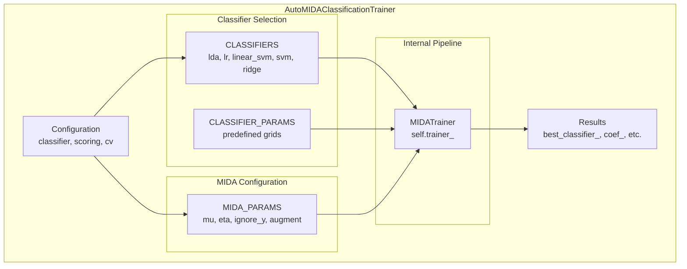

**Diagram: AutoMIDAClassificationTrainer Architecture**

**Key Features:**

1. **Automatic Classifier Selection:** Choose from predefined classifiers or search all (`"auto"`)
2. **Predefined Hyperparameter Grids:** Sensible defaults for each classifier
3. **Delegation Pattern:** Wraps `MIDATrainer` for core functionality
4. **Simplified Interface:** Fewer parameters for common use cases

**Constructor Parameters:**

| Parameter | Type | Default | Description |
|-----------|------|---------|-------------|
| `classifier` | str | `"lr"` | Classifier type or `"auto"` to search all |
| `transformer` | BaseEstimator | None | Optional preprocessing |
| `use_mida` | bool | True | Enable MIDA adaptation |
| `nonlinear` | bool | False | Use nonlinear kernels in MIDA |
| `search_strategy` | str | `"grid"` | `"grid"` or `"random"` |
| `num_search_iter` | int | 10 | Iterations for random search |
| `num_solver_iter` | int | 1000 | Max iterations for estimator solver |
| `param_grid` | dict | None | Custom hyperparameters (overrides defaults) |
| `scoring` | str/callable/dict | None | Evaluation metric(s) |
| `cv` | int/CV | None | Cross-validation strategy |
| `verbose` | int | 0 | Verbosity level |
| `random_state` | int | None | Random seed |

**Predefined Classifiers:**

| Classifier | Class | Default Parameters |
|------------|-------|-------------------|
| `"lda"` | LinearDiscriminantAnalysis | `tol`: [1e-5, 1e-4, 1e-3] |
| `"lr"` | LogisticRegression | `C`: 2^[-15..15] |
| `"linear_svm"` | LinearSVC | `C`: 2^[-15..15] |
| `"svm"` | SVC | `C`: 2^[-15..15] |
| `"ridge"` | RidgeClassifier | `alpha`: 1/(2×2^[-15..15]) |

**Predefined MIDA Parameters:**

```python
MIDA_PARAMS = {
    "mu": 1 / (2 * INV_REG_COEF),       # [2^-16, ..., 2^14]
    "eta": 1 / (2 * INV_REG_COEF),      # [2^-16, ..., 2^14]
    "ignore_y": [True, False],
    "augment": ["pre", "post", None],
}
```

Sources: [kale/pipeline/multi_domain_adapter.py:483-507](), [kale/pipeline/multi_domain_adapter.py:1063-1500]()

### AutoMIDAClassificationTrainer Usage Patterns

**Basic Usage:**

```python
# Simplest configuration (not actual code)
trainer = AutoMIDAClassificationTrainer(
    classifier="lr",
    scoring="accuracy",
)
trainer.fit(x, y, group_labels=domains)
y_pred = trainer.predict(x, group_labels=domains)
```

**Auto Classifier Selection:**

```python
# Search over all classifiers (not actual code)
trainer = AutoMIDAClassificationTrainer(
    classifier="auto",  # Try lda, lr, linear_svm, svm, ridge
    search_strategy="random",
    num_search_iter=20,
    scoring="roc_auc",
)
```

**Custom Hyperparameters:**

```python
# Override default parameter grid (not actual code)
custom_params = {
    "C": [0.1, 1.0, 10.0],
    "domain_adapter__mu": [0.01, 0.1, 1.0],
    "domain_adapter__num_components": [5, 10],
}
trainer = AutoMIDAClassificationTrainer(
    classifier="lr",
    param_grid=custom_params,
)
```

**Nonlinear MIDA:**

```python
# Enable nonlinear kernels (not actual code)
trainer = AutoMIDAClassificationTrainer(
    classifier="svm",
    nonlinear=True,  # Adds rbf, poly kernels to search
)
```

**Important Methods and Properties:**

| Method/Property | Description |
|-----------------|-------------|
| `fit(x, y, group_labels)` | Train with hyperparameter search |
| `best_classifier_` | Trained classifier with optimal params |
| `best_mida_` | Trained MIDA (if `use_mida=True`) |
| `best_transformer_` | Trained transformer (if provided) |
| `coef_` | Coefficient matrix in original feature space |
| `adapt(x, group_labels)` | Apply transformer + MIDA only |
| `groups_` | Unique group labels from training |
| `classes_` | Class labels |

**Coefficient Interpretation:**

When `classifier` is linear and `use_mida=True` with `kernel="linear"`:
- `coef_` provides interpretable coefficients in the original feature space
- Shape: `(n_classes, n_features)` or `(n_classes, n_features + n_factors)` if `augment` is used
- Raises `ValueError` if `nonlinear=True` or non-linear kernel used

Sources: [kale/pipeline/multi_domain_adapter.py:1063-1500](), [tests/pipeline/test_mida_trainer.py:247-543]()

## CoIRLS

**Covariate-Independence Regularized Least Squares (CoIRLS)** is a kernel-based semi-supervised method that learns predictors robust to covariate shift.

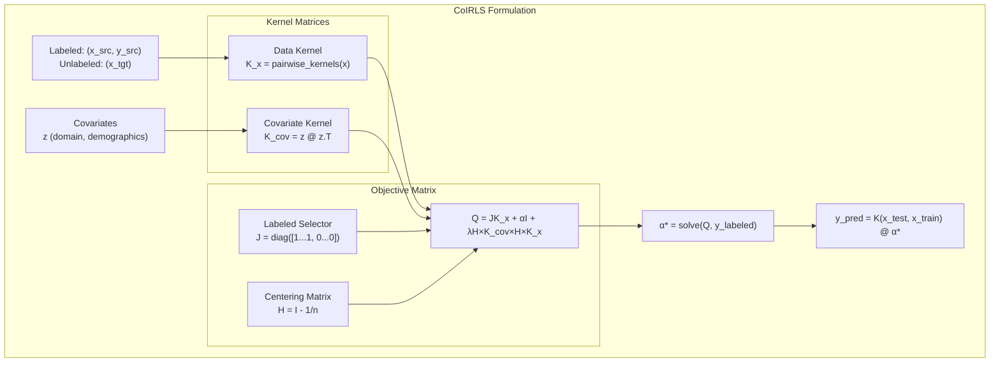

**Diagram: CoIRLS Mathematical Formulation**

**Key Parameters:**

| Parameter | Type | Default | Description |
|-----------|------|---------|-------------|
| `kernel` | str | `"linear"` | Kernel type: `"linear"`, `"rbf"`, `"poly"` |
| `kernel_kwargs` | dict | None | Additional kernel parameters |
| `alpha` | float | 1.0 | L2 regularization strength |
| `lambda_` | float | 1.0 | Covariate dependence penalty |

**Objective Function:**

CoIRLS minimizes:

```
min ||Y_labeled - K_x[labeled] @ α||² 
    + α × ||α||²
    + λ × trace(α.T @ K_x @ H @ K_cov @ H @ K_x @ α)

where:
  α: coefficients in kernel space
  λ: controls covariate independence
  H: centering matrix
  K_cov: covariate similarity kernel
```

**Matrix Solution:**

The closed-form solution is:

```
α = Q^(-1) @ y_labeled

where Q = J @ K_x + α × I + λ × H @ K_cov @ H @ K_x
  J: selector matrix (1 for labeled, 0 for unlabeled)
```

**Methods:**

| Method | Description |
|--------|-------------|
| `fit(x, y, covariates)` | Train on labeled data with covariates |
| `predict(x)` | Predict labels for new samples |
| `decision_function(x)` | Compute decision scores |

**Usage Pattern:**

```python
# Training with source and target data (not actual code)
x_train = np.concatenate([x_source, x_target])
y_train = y_source  # Only source labels
covariates = np.concatenate([z_source, z_target])  # Domain indicators

clf = CoIRLS(kernel="linear", alpha=1.0, lambda_=1.0)
clf.fit(x_train, y_train, covariates)
y_pred = clf.predict(x_target)
```

**Key Characteristics:**

1. **Semi-Supervised:** Can include unlabeled target samples in training
2. **Covariate-Aware:** Explicitly models and removes covariate effects
3. **Kernel-Based:** Supports nonlinear transformations
4. **Closed-Form Solution:** No iterative optimization required
5. **sklearn-Compatible:** Follows `ClassifierMixin` interface

Sources: [kale/pipeline/multi_domain_adapter.py:358-471]()

## Integration with Data Infrastructure

Multi-source trainers require `MultiDomainDataset` for data management.

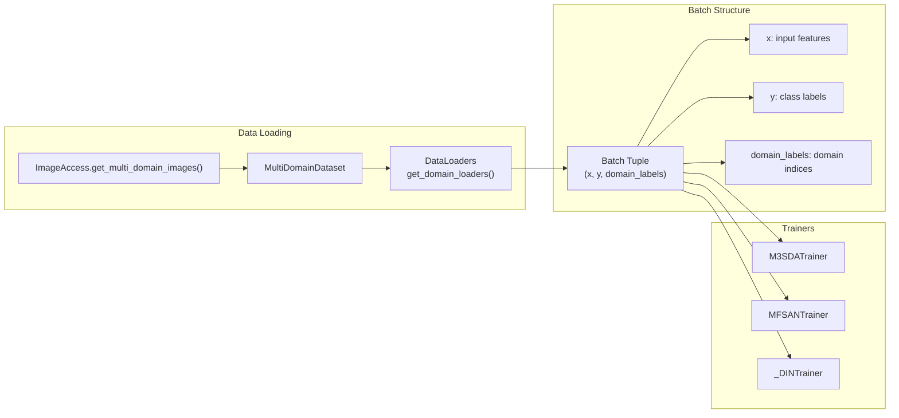

**Diagram: Data Flow to Multi-Source Trainers**

**MultiDomainDataset Configuration:**

| Attribute | Description |
|-----------|-------------|
| `domain_to_idx` | Mapping from domain names to integer indices |
| `datasets` | Dictionary of domain-specific datasets |
| `target_domain` | Name of target domain |
| `BalancedBatchSampler` | Ensures balanced sampling across domains |

**Example Data Access:**

```python
# Loading multi-domain data (not actual code)
dataset = ImageAccess.get_multi_domain_images(
    "OFFICE_CALTECH",
    download_path,
    return_domain_label=True  # Essential for multi-source
)

multi_domain = MultiDomainDataset(dataset)
multi_domain.prepare_data_loaders(
    batch_size=32,
    target_domain="amazon"
)

# Batch structure
for x, y, domain_labels in multi_domain.get_domain_loaders("train"):
    # x: image tensors
    # y: class labels
    # domain_labels: 0=target, 1=source1, 2=source2, etc.
    pass
```

Sources: [kale/loaddata/multi_domain.py:1-500](), [tests/pipeline/test_multi_domain_adapter.py:33-69]()

## Testing and Validation

**Test Coverage:**

| Test File | Components Tested | Key Tests |
|-----------|------------------|-----------|
| `test_multi_domain_adapter.py` | M3SDA, MFSAN, DIN, CoIRLS | Method variants, kernel types |
| `test_mida_trainer.py` | MIDATrainer, AutoMIDAClassificationTrainer | Pipeline integration, CV strategies |
| `test_factorization.py` | MIDA | Kernels, augmentation, eigensolvers |

**Common Test Parameters:**

```python
# Typical test configuration (not actual code)
config_params = {
    "train_params": {
        "adapt_lambda": True,
        "nb_adapt_epochs": 2,
        "nb_init_epochs": 1,
        "init_lr": 0.001,
        "batch_size": 60,
    }
}
```

**Validation Metrics:**

Multi-source trainers log three key metrics during training:
1. `source_acc`: Average accuracy on source domains
2. `target_acc`: Accuracy on target domain
3. `domain_acc`: Domain alignment loss (moment/MMD/HSIC)

Sources: [tests/pipeline/test_multi_domain_adapter.py:1-122](), [tests/pipeline/test_mida_trainer.py:1-543](), [tests/embed/test_factorization.py:104-246]()

## Comparison Table

**Choosing a Multi-Source Method:**

| Method | Type | Strengths | Limitations | Best For |
|--------|------|-----------|-------------|----------|
| **M3SDA** | Neural | Simple, interpretable moment matching | Requires separate classifiers per source | Small number of sources, clear distribution differences |
| **DIN** | Neural | Single classifier, HSIC-based | Currently supports linear kernel only | Efficiency with many sources |
| **MFSAN** | Neural | Domain-specific features, classifier consistency | Higher memory usage | Complex domain-specific patterns |
| **MIDA** | Kernel | Flexible kernels, semi-supervised, sklearn-compatible | Kernel matrix memory for large datasets | Small-medium datasets, interpretability needed |
| **CoIRLS** | Kernel | Closed-form solution, covariate-aware | Less flexible than MIDA | Quick prototyping, demographic factors |

**Computational Complexity:**

| Method | Training Complexity | Memory | Inference |
|--------|-------------------|--------|-----------|
| M3SDA | O(n_sources × batch_size) | n_sources classifiers | Linear |
| DIN | O(batch_size²) kernel | Single classifier | Linear |
| MFSAN | O(n_sources × batch_size) | n_sources (bottlenecks + classifiers) | Linear |
| MIDA | O(n³) eigendecomposition | O(n²) kernel matrix | O(n × d) |
| CoIRLS | O(n³) solve | O(n²) kernel matrix | O(n × d) |

Sources: [kale/pipeline/multi_domain_adapter.py:1-1500]()

---

