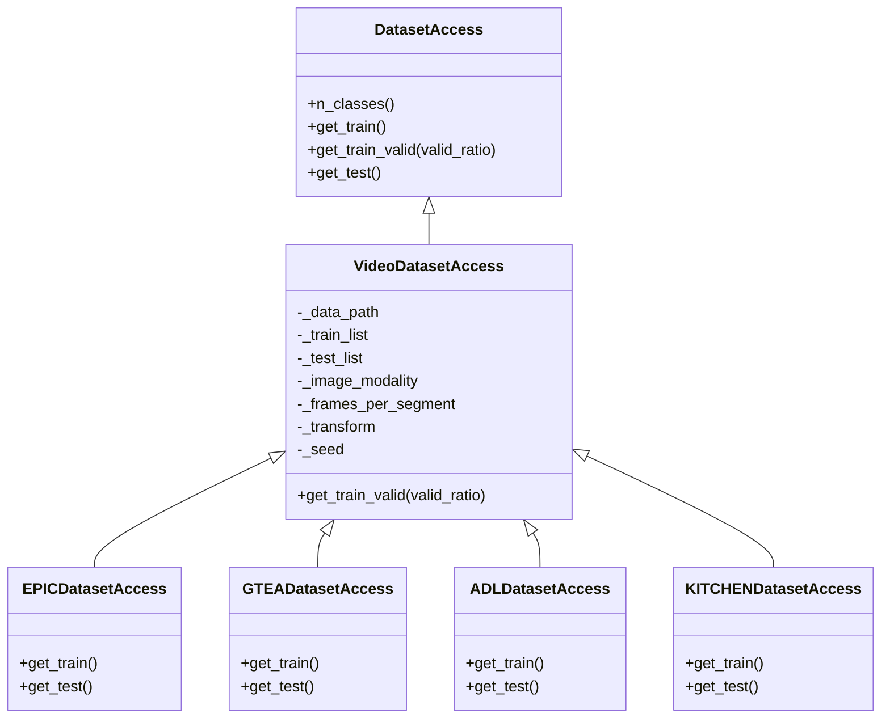
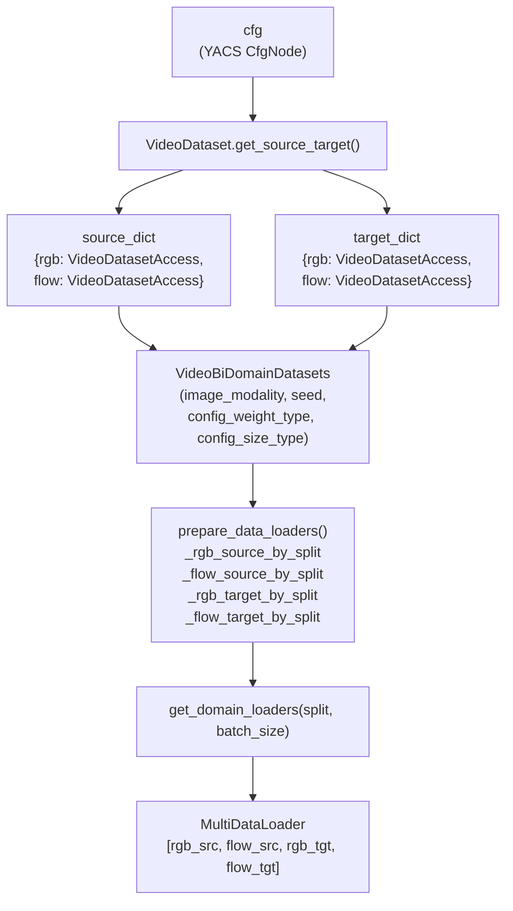
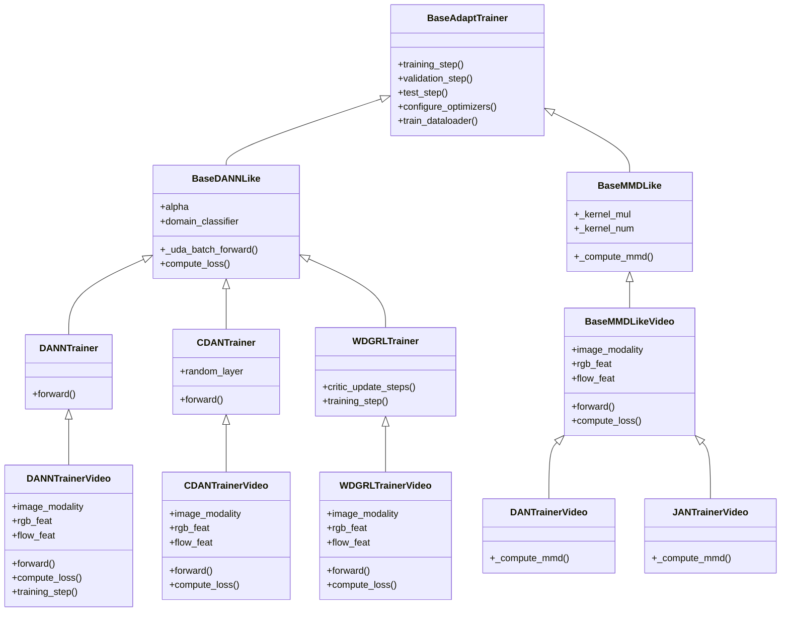
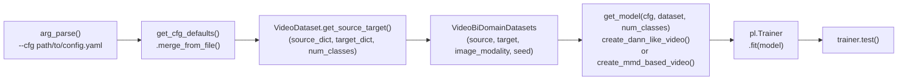

<!-- source: DeepWiki mcp.deepwiki.com · repo pykale/pykale · page 3.3 Video Domain Adaptation · fetched 2026-10-21 -->

# Video Domain Adaptation

<details>
<summary>Relevant source files</summary>

The following files were used as context for generating this wiki page:

- [examples/action_dann/main.py](examples/action_dann/main.py)
- [examples/action_dann/test.py](examples/action_dann/test.py)
- [examples/digits_dann/configs/MN2UP-CDAN.yaml](examples/digits_dann/configs/MN2UP-CDAN.yaml)
- [examples/digits_dann/configs/MN2UP-DAN.yaml](examples/digits_dann/configs/MN2UP-DAN.yaml)
- [examples/digits_dann/configs/MN2UP-DANN.yaml](examples/digits_dann/configs/MN2UP-DANN.yaml)
- [examples/digits_dann/main.py](examples/digits_dann/main.py)
- [examples/digits_dann/tutorial.ipynb](examples/digits_dann/tutorial.ipynb)
- [examples/video_loading/main.py](examples/video_loading/main.py)
- [kale/loaddata/dataset_access.py](kale/loaddata/dataset_access.py)
- [kale/loaddata/multi_domain.py](kale/loaddata/multi_domain.py)
- [kale/loaddata/sampler.py](kale/loaddata/sampler.py)
- [kale/loaddata/video_access.py](kale/loaddata/video_access.py)
- [kale/loaddata/video_datasets.py](kale/loaddata/video_datasets.py)
- [kale/loaddata/video_multi_domain.py](kale/loaddata/video_multi_domain.py)
- [kale/loaddata/videos.py](kale/loaddata/videos.py)
- [kale/pipeline/domain_adapter.py](kale/pipeline/domain_adapter.py)
- [kale/pipeline/video_domain_adapter.py](kale/pipeline/video_domain_adapter.py)
- [kale/prepdata/video_transform.py](kale/prepdata/video_transform.py)
- [tests/loaddata/test_image_access.py](tests/loaddata/test_image_access.py)
- [tests/loaddata/test_sampler.py](tests/loaddata/test_sampler.py)
- [tests/loaddata/test_video_access.py](tests/loaddata/test_video_access.py)
- [tests/pipeline/test_domain_adapter.py](tests/pipeline/test_domain_adapter.py)
- [tests/pipeline/test_video_domain_adapter.py](tests/pipeline/test_video_domain_adapter.py)

</details>


## Purpose and Scope

This page covers the video-specific domain adaptation (DA) pipeline in PyKale, targeted at action recognition tasks. It describes the `VideoDataset` enum and `VideoDatasetAccess` hierarchy for loading action video data, the `image_modality` system (`rgb`, `flow`, `joint`), `VideoBiDomainDatasets`, and the video-specific trainer classes in `kale/pipeline/video_domain_adapter.py`.

For single-source DA on image data (DANN, CDAN, DAN, etc.) and the `BaseAdaptTrainer` lifecycle, see [Single-Source Domain Adaptation](#3.1). For multi-source DA, see [Multi-Source Domain Adaptation](#3.2). For video data loading infrastructure independent of DA (e.g., `VideoFrameDataset`), see [Video Processing](#4.4).

---

## Supported Datasets

The `VideoDataset` enum in [kale/loaddata/video_access.py:87-92]() identifies four action recognition datasets:

| Enum Value | Dataset Name | Action Classes | Access Class |
|---|---|---|---|
| `VideoDataset.EPIC` | EPIC-Kitchen | 8 | `EPICDatasetAccess` |
| `VideoDataset.ADL` | ADL | 7 | `ADLDatasetAccess` |
| `VideoDataset.GTEA` | GTEA | 6 | `GTEADatasetAccess` |
| `VideoDataset.KITCHEN` | KITCHEN | 6 | `KITCHENDatasetAccess` |

When source and target datasets have different class counts, `num_classes = min(source_classes, target_classes)`. For example, EPIC → GTEA yields `num_classes = 6`.

Sources: [kale/loaddata/video_access.py:87-197]()

---

## Image Modality

The `image_modality` string is the central control parameter for video DA. The helper `get_image_modality(image_modality)` converts it to a `(rgb: bool, flow: bool)` tuple used throughout data loading and trainer forward passes.

| `image_modality` | `rgb` | `flow` | Batch elements per iteration |
|---|---|---|---|
| `"rgb"` | `True` | `False` | `(x_s_rgb, y_s), (x_tu_rgb, y_tu)` |
| `"flow"` | `False` | `True` | `(x_s_flow, y_s), (x_tu_flow, y_tu)` |
| `"joint"` | `True` | `True` | `(x_s_rgb, y_s), (x_s_flow, _), (x_tu_rgb, y_tu), (x_tu_flow, _)` |

Sources: [kale/loaddata/video_access.py:22-32]()

---

## Data Loading Architecture

### VideoDatasetAccess Hierarchy

Each dataset access class wraps a `VideoFrameDataset` (or `EPIC`) instance and provides `get_train()` and `get_test()`. The `VideoDatasetAccess.get_train_valid()` override uses a fixed `_seed` to ensure RGB and flow splits are identically partitioned when both are active.

**VideoDatasetAccess class hierarchy**



Sources: [kale/loaddata/video_access.py:200-373]()

### VideoDataset.get_source_target

The static method `VideoDataset.get_source_target(source, target, seed, params)` is the primary data setup entry point:

1. Reads paths from `cfg` via `get_videodata_config(cfg)` and `generate_list()`.
2. Converts `image_modality` to `(rgb, flow)` booleans.
3. Instantiates the appropriate `VideoDatasetAccess` subclass per modality using the `factories` dict.
4. Returns `(source_dict, target_dict, num_classes)` where each dict has `"rgb"` and `"flow"` keys.

```python
source, target, num_classes = VideoDataset.get_source_target(
    VideoDataset(cfg.DATASET.SOURCE.upper()),
    VideoDataset(cfg.DATASET.TARGET.upper()),
    seed,
    cfg,
)
```

Sources: [kale/loaddata/video_access.py:93-197]()

### Expected Directory Layout

The `generate_list()` function in [kale/loaddata/video_access.py:54-84]() constructs expected paths:

| Dataset | Frame root | Annotation root |
|---|---|---|
| EPIC | `<ROOT>/EPIC/EPIC_KITCHENS_2018/frames_rgb_flow` | `<ROOT>/EPIC/EPIC_KITCHENS_2018/annotations/labels_train_test/` |
| ADL | `<ROOT>/ADL/frames_rgb_flow` | `<ROOT>/ADL/annotations/labels_train_test/` |
| GTEA | `<ROOT>/GTEA/frames_rgb_flow` | `<ROOT>/GTEA/annotations/labels_train_test/` |
| KITCHEN | `<ROOT>/KITCHEN/frames_rgb_flow` | `<ROOT>/KITCHEN/annotations/labels_train_test/` |

Annotation files are pickle files (`.pkl`) referenced by `cfg.DATASET.SRC_TRAINLIST`, `cfg.DATASET.SRC_TESTLIST`, etc.

### VideoBiDomainDatasets

`VideoBiDomainDatasets` in [kale/loaddata/video_multi_domain.py:19-232]() extends `BiDomainDatasets` to track separate RGB and flow splits:

- `_rgb_source_by_split`, `_flow_source_by_split`
- `_rgb_target_by_split`, `_flow_target_by_split`

Its `prepare_data_loaders()` calls `get_train_valid()` and `get_test()` per modality. Its `get_domain_loaders()` assembles a `MultiDataLoader` from whichever modality sub-loaders are non-null, filtering out `None` entries before construction.

**Video data loading flow**



Sources: [kale/loaddata/video_multi_domain.py:19-232]()

---

## Video Transforms

`get_transform(kind, image_modality)` in [kale/prepdata/video_transform.py:5-84]() returns a dict with `"train"`, `"valid"`, and `"test"` keys. Accepted `kind` values: `"epic"`, `"gtea"`, `"adl"`, `"kitchen"` (all currently share the same transform pipeline).

| Stage | RGB pipeline | Flow pipeline |
|---|---|---|
| Train | `ImglistToTensor → Resize(256) → RandomCrop(224) → Normalize([0.5,0.5,0.5]) → TensorPermute` | `ImglistToTensor → Resize(256) → RandomCrop(224) → Normalize([0.5,0.5]) → TensorPermute` |
| Val / Test | Same but `CenterCrop(224)` instead of `RandomCrop` | Same but `CenterCrop(224)` |

Two custom transform classes handle video-specific shape requirements:

- **`ImglistToTensor`**: converts a list of PIL images to a `(FRAMES × CHANNELS × H × W)` tensor. For flow input (grayscale mode `"L"`), consecutive pairs of images are merged into 2-channel frames.
- **`TensorPermute`**: reorders axes from `(FRAMES × CHANNELS × H × W)` to `(CHANNELS × FRAMES × H × W)`, the input format expected by 3D video CNNs such as I3D and Res3D.

Sources: [kale/prepdata/video_transform.py]()

---

## Video DA Trainers

### Factory Functions

Two factory functions in [kale/pipeline/video_domain_adapter.py:25-98]() instantiate trainers:

- **`create_dann_like_video(method, dataset, image_modality, feature_extractor, task_classifier, critic, **train_params)`**
- **`create_mmd_based_video(method, dataset, image_modality, feature_extractor, task_classifier, **train_params)`**

| `Method` value | Factory function | Trainer class | Notes |
|---|---|---|---|
| `DANN` | `create_dann_like_video` | `DANNTrainerVideo` | GRL-based adversarial |
| `Source` | `create_dann_like_video` | `DANNTrainerVideo` | `alpha=0.0`, no adaptation |
| `CDAN` | `create_dann_like_video` | `CDANTrainerVideo` | Conditional adversarial |
| `CDAN_E` | `create_dann_like_video` | `CDANTrainerVideo` | With entropy weighting |
| `WDGRL` | `create_dann_like_video` | `WDGRLTrainerVideo` | Wasserstein distance |
| `DAN` | `create_mmd_based_video` | `DANTrainerVideo` | Gaussian kernel MMD |
| `JAN` | `create_mmd_based_video` | `JANTrainerVideo` | Joint kernel MMD |

> `Method.WDGRLMod` and few-shot methods (`FSDANN`, `MME`) are **not** supported for video. The few-shot path is marked as future work in [kale/pipeline/video_domain_adapter.py:56-63]().

### Trainer Class Hierarchy

**Video DA trainer class hierarchy (with parent image DA classes)**



Sources: [kale/pipeline/video_domain_adapter.py](), [kale/pipeline/domain_adapter.py:463-604]()

### Feature Extractor Convention

All video trainers require `feature_extractor` to be a `dict` with `"rgb"` and `"flow"` keys. In `__init__`, each trainer does:

```python
self.rgb_feat = self.feat["rgb"]
self.flow_feat = self.feat["flow"]
```

A `None` value means that modality is inactive. The combined feature dimension depends on modality:

| Modality | `feature_network` shape | `class_feature_dim` |
|---|---|---|
| `"rgb"` | `{"rgb": RGBNet, "flow": None}` | 1024 |
| `"flow"` | `{"rgb": None, "flow": FlowNet}` | 1024 |
| `"joint"` | `{"rgb": RGBNet, "flow": FlowNet}` | 2048 (concatenated) |

For joint modality, `domain_feature_dim = class_feature_dim // 2 = 1024` is used for the critic input.

Sources: [tests/pipeline/test_video_domain_adapter.py:96-107]()

### Forward Pass: Modality Branching

Each video trainer overrides `forward(x)` where `x = {"rgb": tensor_or_none, "flow": tensor_or_none}`:

**DANNTrainerVideo** ([kale/pipeline/video_domain_adapter.py:266-291]()):
- Both `rgb` and `flow` branches run if `self.rgb` and `self.flow` are `True`.
- GRL is applied separately to each branch's features.
- A single shared `domain_classifier` processes each modality's reversed features independently.
- Task features are concatenated for joint, or used directly for single-modality.

**CDANTrainerVideo** ([kale/pipeline/video_domain_adapter.py:408-450]()):
- Outer product of softmax output and reversed features is computed per modality.
- If `use_entropy_weight=True` (CDAN-E), entropy-based sample weights are applied symmetrically to both modalities.

**WDGRLTrainerVideo** ([kale/pipeline/video_domain_adapter.py:555-579]()):
- `domain_classifier` is applied directly to features (no GRL) per modality.

### Loss Computation for Joint Modality

For joint modality (`DANNTrainerVideo` and `CDANTrainerVideo`), domain losses sum across both modalities:

```
adv_loss = loss_dmn_src_rgb + loss_dmn_src_flow + loss_dmn_tgt_rgb + loss_dmn_tgt_flow
```

Source domain classification accuracy (`dok_src`) and target accuracy (`dok_tgt`) are concatenated across modalities before averaging.

Sources: [kale/pipeline/video_domain_adapter.py:293-354](), [kale/pipeline/video_domain_adapter.py:452-529]()

### MMD Trainers

`BaseMMDLikeVideo.compute_loss()` handles joint batches with 4 elements and single-modality batches with 2 elements. For joint input, MMD is computed per modality and summed:

```
mmd = mmd_rgb + mmd_flow
```

`DANTrainerVideo` uses a standard Gaussian kernel. `JANTrainerVideo` uses a joint kernel—the element-wise product of kernels from both the feature layer and the softmax classifier output—matching the original JAN paper.

Sources: [kale/pipeline/video_domain_adapter.py:101-242]()

---

## Configuration Parameters

The video DA pipeline reads from a YACS `CfgNode`. Key parameters used by `get_videodata_config()` and the trainer:

| Config key | Description |
|---|---|
| `cfg.DATASET.ROOT` | Root directory for all video datasets |
| `cfg.DATASET.SOURCE` | Source dataset name (e.g., `"EPIC"`) |
| `cfg.DATASET.TARGET` | Target dataset name (e.g., `"GTEA"`) |
| `cfg.DATASET.SRC_TRAINLIST` | Source train annotation `.pkl` filename |
| `cfg.DATASET.SRC_TESTLIST` | Source test annotation `.pkl` filename |
| `cfg.DATASET.TGT_TRAINLIST` | Target train annotation `.pkl` filename |
| `cfg.DATASET.TGT_TESTLIST` | Target test annotation `.pkl` filename |
| `cfg.DATASET.IMAGE_MODALITY` | `"rgb"`, `"flow"`, or `"joint"` |
| `cfg.DATASET.FRAMES_PER_SEGMENT` | Frames sampled per video segment (e.g., 16) |
| `cfg.DATASET.WEIGHT_TYPE` | Sampling strategy: `"natural"`, `"balanced"`, `"preset0"` |
| `cfg.DATASET.SIZE_TYPE` | Epoch length reference: `"max"` or `"source"` |

Sources: [kale/loaddata/video_access.py:35-51](), [examples/action_dann/main.py]()

---

## action_dann Example

The `examples/action_dann/` directory provides a complete video DA training and evaluation workflow.

**Entry points:**
- `examples/action_dann/main.py` — training + test loop
- `examples/action_dann/test.py` — checkpoint loading and test-only evaluation

**Training flow**



The `get_model` function (in `examples/action_dann/model.py`) selects the factory function based on `cfg.DAN.METHOD`, constructs a `feature_network` dict with I3D/Res3D encoders, and creates `ClassNetVideo` and `DomainNetVideo` for the task and critic heads respectively.

Sources: [examples/action_dann/main.py]()

### Test-Only Evaluation

`examples/action_dann/test.py` loads a saved `.ckpt` checkpoint using `weights_update(model, checkpoint)` which filters the state dict by key overlap. It then calls `trainer.test(model=model_test)` directly without `trainer.fit()`.

Sources: [examples/action_dann/test.py]()

---

## Relationship to Image DA Trainers

Video DA trainers extend image DA trainers from [kale/pipeline/domain_adapter.py]() with three systematic changes:

| Aspect | Image DA | Video DA |
|---|---|---|
| `feature_extractor` type | `nn.Module` | `dict` (`{"rgb": ..., "flow": ...}`) |
| `forward(x)` input | image tensor | `{"rgb": tensor_or_None, "flow": tensor_or_None}` |
| `compute_loss` batch | `(x, y, domain_labels)` | 2-element or 4-element tuple depending on modality |
| `training_step` return | `loss` scalar | `{"loss": loss}` dict (DANNTrainerVideo) |

The `Method` enum, warmup epoch logic, λ scheduling, LR scheduling, and `configure_optimizers` are all inherited unchanged from `BaseAdaptTrainer`.

Sources: [kale/pipeline/video_domain_adapter.py:14-22](), [kale/pipeline/domain_adapter.py:195-460]()

---

