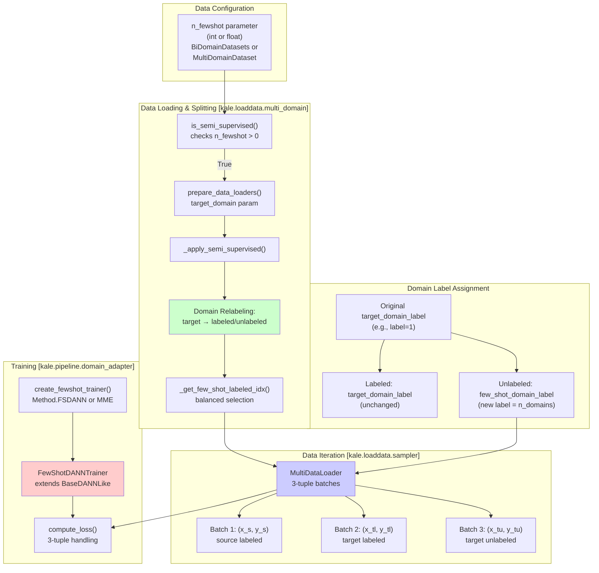
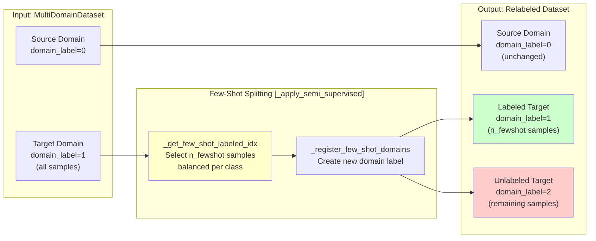
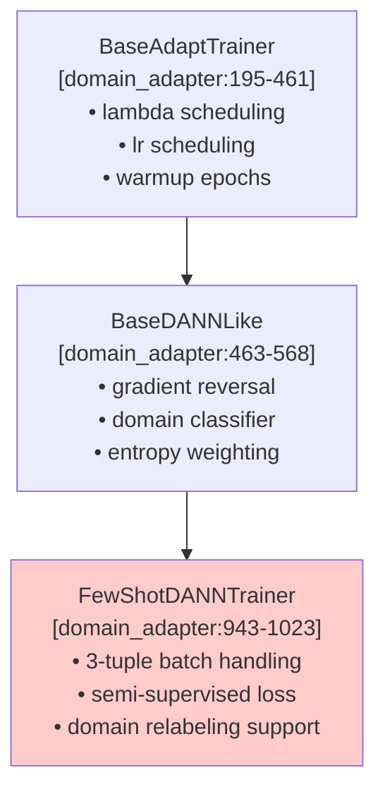
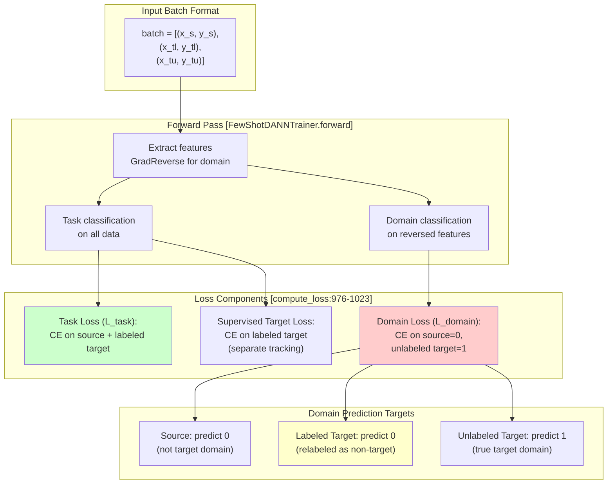
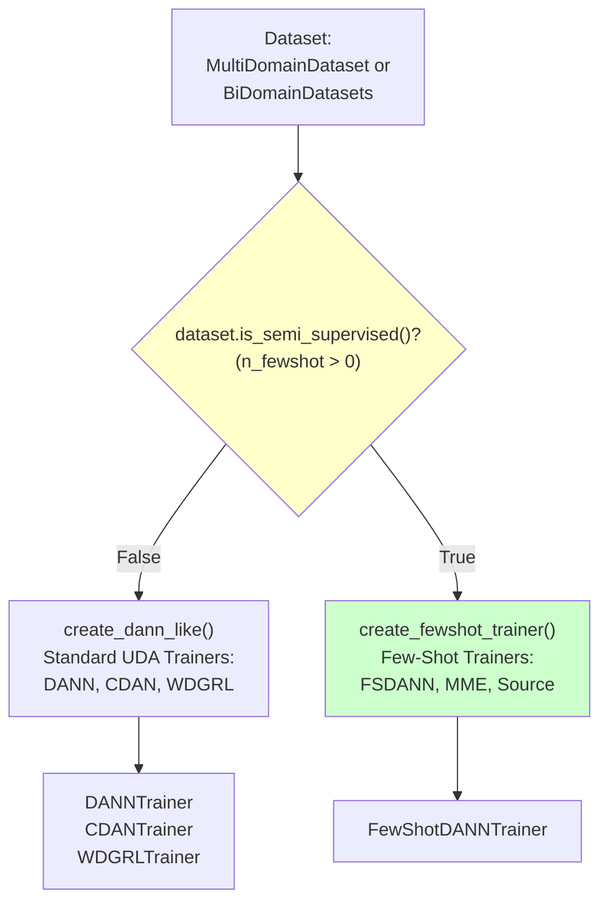

<!-- source: DeepWiki mcp.deepwiki.com · repo pykale/pykale · page 3.4 Few-Shot Domain Adaptation · fetched 2026-10-21 -->

# Few-Shot Domain Adaptation

<details>
<summary>Relevant source files</summary>

The following files were used as context for generating this wiki page:

- [examples/fewshot_protonet/README.md](examples/fewshot_protonet/README.md)
- [examples/fewshot_protonet/__init__.py](examples/fewshot_protonet/__init__.py)
- [examples/fewshot_protonet/config.py](examples/fewshot_protonet/config.py)
- [examples/fewshot_protonet/configs/demo.yaml](examples/fewshot_protonet/configs/demo.yaml)
- [examples/fewshot_protonet/configs/template.yaml](examples/fewshot_protonet/configs/template.yaml)
- [examples/fewshot_protonet/eval_unseen_classes.py](examples/fewshot_protonet/eval_unseen_classes.py)
- [examples/fewshot_protonet/main.py](examples/fewshot_protonet/main.py)
- [kale/loaddata/dataset_access.py](kale/loaddata/dataset_access.py)
- [kale/loaddata/few_shot.py](kale/loaddata/few_shot.py)
- [kale/loaddata/multi_domain.py](kale/loaddata/multi_domain.py)
- [kale/loaddata/sampler.py](kale/loaddata/sampler.py)
- [kale/loaddata/video_multi_domain.py](kale/loaddata/video_multi_domain.py)
- [kale/pipeline/domain_adapter.py](kale/pipeline/domain_adapter.py)
- [kale/pipeline/fewshot_trainer.py](kale/pipeline/fewshot_trainer.py)
- [kale/pipeline/video_domain_adapter.py](kale/pipeline/video_domain_adapter.py)
- [tests/loaddata/test_image_access.py](tests/loaddata/test_image_access.py)
- [tests/loaddata/test_sampler.py](tests/loaddata/test_sampler.py)
- [tests/loaddata/test_video_access.py](tests/loaddata/test_video_access.py)
- [tests/pipeline/test_domain_adapter.py](tests/pipeline/test_domain_adapter.py)
- [tests/pipeline/test_video_domain_adapter.py](tests/pipeline/test_video_domain_adapter.py)

</details>


## Purpose and Scope

This page documents PyKale's few-shot domain adaptation (FSDA) system, which extends standard unsupervised domain adaptation to semi-supervised scenarios where a small number of labeled samples are available in the target domain. This approach enables more effective adaptation when limited target supervision is feasible.

For standard unsupervised domain adaptation methods (DANN, CDAN, DAN, JAN), see [Single-Source Domain Adaptation](#3.1). For multi-source domain adaptation, see [Multi-Source Domain Adaptation](#3.2). For prototypical network-based few-shot learning without domain shift, see [Few-Shot Learning](#4.1).

---

## Key Concepts

Few-shot domain adaptation addresses the **semi-supervised domain adaptation** problem where:
- Abundant labeled source data is available
- A small number of labeled target samples (`n_fewshot`) can be obtained
- The remaining target data is unlabeled

This is more realistic than pure unsupervised DA, as practitioners can often afford to label a small subset of target data. The system splits target data into:
- **Labeled target**: `n_fewshot` samples with known labels
- **Unlabeled target**: Remaining target samples (labels ignored during training)

**Sources:** [kale/pipeline/domain_adapter.py:943-1023](), [kale/loaddata/multi_domain.py:177-178]()

---

## System Architecture

### Few-Shot DA Pipeline Flow



**Diagram: Few-Shot Domain Adaptation Pipeline**

This diagram shows the complete flow from configuration through data preparation to training. The key innovation is **domain relabeling**, where the target domain is split into two "domains" with different labels, enabling the training system to distinguish labeled from unlabeled target samples.

**Sources:** [kale/pipeline/domain_adapter.py:172-193](), [kale/loaddata/multi_domain.py:594-654](), [kale/loaddata/sampler.py:116-151]()

---

## Data Preparation for Few-Shot DA

### Domain Relabeling Mechanism

The core of few-shot DA in PyKale is **domain relabeling**, which creates distinct domain labels for labeled and unlabeled target samples:

| Original Dataset | Few-Shot Split | Domain Label | Purpose |
|------------------|----------------|--------------|---------|
| Source | Source | `source_label` (e.g., 0) | Supervised learning |
| Target | Labeled Target | `target_domain_label` (unchanged) | Supervised on target |
| Target | Unlabeled Target | `few_shot_domain_label` (new) | Domain adaptation objective |



**Diagram: Domain Relabeling Process**

**Sources:** [kale/loaddata/multi_domain.py:623-654](), [kale/loaddata/multi_domain.py:655-660]()

### Few-Shot Sample Selection

The `_get_few_shot_labeled_idx` function implements **balanced few-shot sampling**:

```python
# Pseudo-code representation from kale/loaddata/multi_domain.py:728-769
def _get_few_shot_labeled_idx(labels, domain_labels, target_label, n_fewshot, random_state):
    # 1. Find all target domain samples
    target_idx = where(domain_labels == target_label)
    target_labels = labels[target_idx]
    
    # 2. Calculate samples per class
    if n_fewshot is int:
        n_per_class = n_fewshot // n_classes  # e.g., 20 samples → 2 per class (10 classes)
    elif n_fewshot is float:
        n_per_class = int(n_fewshot * len(target_idx) / n_classes)  # percentage
    
    # 3. Balanced sampling across classes
    for each class:
        class_samples = target_idx[target_labels == class_id]
        selected = random_state.choice(class_samples, n_per_class)
        labeled_idx.extend(selected)
    
    return labeled_idx
```

**Key behaviors:**
- **Balanced selection**: Equal samples per class (or as equal as possible)
- **Integer mode**: `n_fewshot=20` with 10 classes → 2 labeled samples per class
- **Float mode**: `n_fewshot=0.1` → 10% of target samples, balanced across classes
- **Deterministic**: Uses `random_state` for reproducible splits

**Sources:** [kale/loaddata/multi_domain.py:728-769]()

### Data Loader Configuration

Few-shot DA uses `MultiDataLoader` to iterate over **three data sources simultaneously**:

| Loader Type | Dataset | Batch Size | Sampling Strategy |
|-------------|---------|------------|-------------------|
| Source Loader | Source domain | `batch_size` | Random or balanced (config) |
| Labeled Target Loader | Labeled target | `min(n_fewshot, batch_size)` | **Always balanced** |
| Unlabeled Target Loader | Unlabeled target | `batch_size` | Random or balanced (config) |

The labeled target loader **always uses balanced sampling** to ensure all classes appear in training, regardless of the global sampling configuration.

**Sources:** [kale/loaddata/multi_domain.py:228-240](), [kale/loaddata/sampler.py:116-151]()

---

## FewShotDANNTrainer Implementation

### Class Hierarchy



**Diagram: FewShotDANNTrainer Class Hierarchy**

**Sources:** [kale/pipeline/domain_adapter.py:195-461](), [kale/pipeline/domain_adapter.py:463-568](), [kale/pipeline/domain_adapter.py:943-1023]()

### Supported Methods

The `Method` enum defines few-shot DA methods:

```python
# From kale/pipeline/domain_adapter.py:54-85
class Method(Enum):
    FSDANN = "FSDANN"    # Few-shot DANN (naive approach)
    MME = "MME"          # Minimax Entropy (Saito et al. 2019)
    Source = "Source"    # Source-only baseline
    
    def is_fewshot_method(self):
        return self in (Method.FSDANN, Method.MME, Method.Source)
    
    def allow_supervised(self):
        return self.is_fewshot_method()
```

**FSDANN** (naive approach):
- Task classifier trained on **source + labeled target**
- Domain classifier distinguishes **source vs. unlabeled target**
- Labeled target samples treated like source samples

**MME** (Minimax Entropy):
- More sophisticated approach from [Saito et al. ICCV 2019]
- Encourages low entropy (confident predictions) on target
- Not yet fully implemented in PyKale

**Sources:** [kale/pipeline/domain_adapter.py:54-85](), [kale/pipeline/domain_adapter.py:943-964]()

### Loss Computation

The `compute_loss` method handles **3-tuple batches** from `MultiDataLoader`:



**Diagram: Few-Shot DANN Loss Computation**

Key implementation details from [kale/pipeline/domain_adapter.py:976-1023]():

```python
def compute_loss(self, batch, split_name="valid"):
    # Unpack 3-tuple batch
    (x_s, y_s), (x_tl, y_tl), (x_tu, y_tu) = batch
    
    # Forward pass on all data
    _, y_hat_s, d_hat_s = self.forward(x_s)
    _, y_hat_tl, d_hat_tl = self.forward(x_tl)
    _, y_hat_tu, d_hat_tu = self.forward(x_tu)
    
    # 1. Task loss: source + labeled target (supervised)
    loss_task_src, ok_src = cross_entropy_logits(y_hat_s, y_s)
    loss_task_tl, ok_tl = cross_entropy_logits(y_hat_tl, y_tl)
    loss_task = loss_task_src + loss_task_tl
    
    # 2. Domain loss: source=0, labeled_target=0, unlabeled_target=1
    domain_labels_src = torch.zeros(len(y_s))
    domain_labels_tl = torch.zeros(len(y_tl))  # Relabeled as "non-target"
    domain_labels_tu = torch.ones(len(y_tu))   # True target domain
    
    loss_dmn_src, dok_src = cross_entropy_logits(d_hat_s, domain_labels_src)
    loss_dmn_tl, dok_tl = cross_entropy_logits(d_hat_tl, domain_labels_tl)
    loss_dmn_tu, dok_tu = cross_entropy_logits(d_hat_tu, domain_labels_tu)
    
    loss_domain = loss_dmn_src + loss_dmn_tl + loss_dmn_tu
    
    # 3. Total loss (combined in training_step with lambda weighting)
    return loss_task, loss_domain, log_metrics
```

**Critical design decision**: Labeled target samples are assigned **domain label 0** (like source) in the domain classifier objective. This means:
- Domain classifier learns to distinguish: {source + labeled target} vs. {unlabeled target}
- Encourages feature alignment between source and labeled target
- Unlabeled target samples drive domain adaptation

**Sources:** [kale/pipeline/domain_adapter.py:976-1023]()

---

## Creating a Few-Shot DA Trainer

### Factory Function

The `create_fewshot_trainer` function instantiates few-shot trainers:

```python
# From kale/pipeline/domain_adapter.py:172-193
def create_fewshot_trainer(
    method: Method,
    dataset,
    feature_extractor,
    task_classifier,
    target_domain,
    critic,
    **train_params
):
    if not dataset.is_semi_supervised():
        raise ValueError("Dataset must be semi-supervised for few-shot methods.")
    
    if method.is_fewshot_method():
        alpha = 0 if method is Method.Source else 1
        return FewShotDANNTrainer(
            alpha=alpha,
            dataset=dataset,
            feature_extractor=feature_extractor,
            task_classifier=task_classifier,
            critic=critic,
            target_domain=target_domain,
            method=method,
            **train_params,
        )
    else:
        raise ValueError(f"Unsupported semi-supervised method: {method}")
```

This function is called automatically by `create_dann_like` when the dataset has `is_semi_supervised() == True`.

**Sources:** [kale/pipeline/domain_adapter.py:172-193](), [kale/pipeline/domain_adapter.py:110-124]()

### Integration with Standard DA



**Diagram: Automatic Trainer Selection Based on Dataset Configuration**

The system automatically selects the appropriate trainer type based on whether `n_fewshot > 0`.

**Sources:** [kale/pipeline/domain_adapter.py:110-124]()

---

## Usage Example

### Complete Few-Shot DA Setup

```python
# 1. Configure dataset with n_fewshot parameter
from kale.loaddata.multi_domain import MultiDomainDataset, MultiDomainAccess
from kale.loaddata.image_access import DigitDataset

# Get source and target data access
source = DigitDataset.get_access(DigitDataset("MNIST"), download_path)[0]
target = DigitDataset.get_access(DigitDataset("USPS"), download_path)[0]

# Create multi-domain access
data_access = MultiDomainAccess(
    {"SOURCE": source, "TARGET": target},
    n_classes=10,
    return_domain_label=True
)

# Create dataset with few-shot configuration
dataset = MultiDomainDataset(
    data_access,
    n_fewshot=20,  # Use 20 labeled target samples (2 per class for 10 classes)
    random_state=42
)

# 2. Setup networks
from kale.embed.image_cnn import SmallCNNFeature
from kale.predict.class_domain_nets import ClassNetSmallImage, DomainNetSmallImage

feature_extractor = SmallCNNFeature(num_channels=1)
task_classifier = ClassNetSmallImage(feature_extractor.output_size(), 10)
domain_classifier = DomainNetSmallImage(feature_extractor.output_size())

# 3. Create few-shot trainer (automatically selected)
from kale.pipeline.domain_adapter import create_dann_like, Method

model = create_dann_like(
    method=Method.FSDANN,
    dataset=dataset,
    feature_extractor=feature_extractor,
    task_classifier=task_classifier,
    critic=domain_classifier,
    target_domain="TARGET",
    # Training hyperparameters
    nb_init_epochs=10,
    nb_adapt_epochs=100,
    batch_size=32,
    init_lr=0.001,
    adapt_lambda=True,
    adapt_lr=True
)

# 4. Train with PyTorch Lightning
import pytorch_lightning as pl

trainer = pl.Trainer(max_epochs=100, accelerator="gpu")
trainer.fit(model)
```

**Key configuration points:**

| Parameter | Type | Description | Example Values |
|-----------|------|-------------|----------------|
| `n_fewshot` | `int` or `float` | Number or ratio of labeled target samples | `20`, `0.1` (10%) |
| `random_state` | `int` or Generator | Seed for deterministic splitting | `42` |
| `target_domain` | `str` | Name of target domain (for MultiDomainDataset) | `"TARGET"` |
| `method` | `Method` enum | Few-shot algorithm | `Method.FSDANN`, `Method.MME` |
| `nb_init_epochs` | `int` | Warmup epochs (source-only) | `10` |
| `nb_adapt_epochs` | `int` | Total training epochs | `100` |

**Sources:** [tests/pipeline/test_domain_adapter.py:45-104]()

### Percentage-Based Few-Shot

```python
# Use 10% of target data as labeled samples
dataset = MultiDomainDataset(
    data_access,
    n_fewshot=0.1,  # Float: 10% of target samples, balanced per class
    random_state=42
)
```

When `n_fewshot` is a float between 0 and 1, it specifies the **percentage** of target samples to use as labeled data, distributed evenly across classes.

**Sources:** [kale/loaddata/multi_domain.py:586-589]()

---

## Video Domain Few-Shot DA

While the core few-shot DA infrastructure supports video data through `VideoBiDomainDatasets`, the specialized video trainers (e.g., `DANNTrainerVideo`) do not yet have few-shot variants implemented. The comment in [kale/pipeline/video_domain_adapter.py:56-62]() indicates this is planned for future work:

```python
# Uncomment for later work.
# Set up a new create_fewshot_trainer for video data based on original one in `domain_adapter.py`

# if dataset.is_semi_supervised():
#     return create_fewshot_trainer_video(
#         method, dataset, feature_extractor, task_classifier, critic, **train_params
#     )
```

**Sources:** [kale/pipeline/video_domain_adapter.py:56-62]()

---

## Testing and Validation

The few-shot DA system is tested across multiple configurations:

```python
# From tests/pipeline/test_domain_adapter.py:20
FEW_SHOT = [0, 20]  # Test both unsupervised (0) and few-shot (20) settings

@pytest.mark.parametrize("da_method", DA_METHODS)
@pytest.mark.parametrize("n_fewshot", FEW_SHOT)
def test_domain_adaptor(da_method, n_fewshot, download_path, testing_cfg):
    # Skip combinations:
    # - n_fewshot=0 with FSDANN/MME (requires labeled target)
    # - n_fewshot>0 with standard methods (not designed for few-shot)
    if n_fewshot == 0:
        if da_method in ["FSDANN", "MME", "Source"]:
            return
    else:
        if da_method in ["DANN", "CDAN", "CDAN-E", "WDGRL", "WDGRLMod", "DAN", "JAN"]:
            return
    
    # Create dataset with n_fewshot parameter
    dataset = MultiDomainDataset(data_access, n_fewshot=n_fewshot)
    # ... create model and test ...
```

This ensures:
- Few-shot methods work only with `n_fewshot > 0`
- Standard UDA methods work only with `n_fewshot = 0`
- Both configurations are tested for consistency

**Sources:** [tests/pipeline/test_domain_adapter.py:45-104]()

---

## Design Principles and Trade-offs

### Domain Relabeling Rationale

The domain relabeling approach (splitting target into two "domains") enables:

**Advantages:**
- **Minimal code changes**: Reuses `BaseDANNLike` infrastructure
- **Flexible data iteration**: `MultiDataLoader` naturally handles 3-tuple batches
- **Clear semantics**: Domain labels explicitly encode supervised/unsupervised split

**Trade-offs:**
- Requires understanding of domain label manipulation
- Domain classifiers see labeled target samples as "non-target" during training

### Balanced Few-Shot Sampling

The system **always balances** few-shot samples across classes:

**Rationale:**
- Prevents class imbalance in limited supervision setting
- Ensures all classes appear in labeled target set
- More realistic evaluation (practitioners would balance if possible)

**Implementation:** Even if global sampling is unbalanced, the labeled target loader uses `FixedSeedSamplingConfig(balance=True)` [kale/loaddata/multi_domain.py:232-234]().

**Sources:** [kale/loaddata/multi_domain.py:232-234](), [kale/loaddata/multi_domain.py:728-769]()

---

## Related Systems

- **Standard Domain Adaptation** [Single-Source Domain Adaptation](#3.1): Unsupervised DA methods (DANN, CDAN, DAN, JAN) that assume no target labels
- **Few-Shot Learning** [Few-Shot Learning](#4.1): Prototypical networks for N-way-K-shot classification without domain shift
- **Multi-Source DA** [Multi-Source Domain Adaptation](#3.2): Adaptation from multiple source domains (compatible with few-shot via `MultiDomainDataset`)

The few-shot DA system bridges the gap between fully unsupervised DA and fully supervised learning, providing a practical middle ground for real-world deployment scenarios.

---

