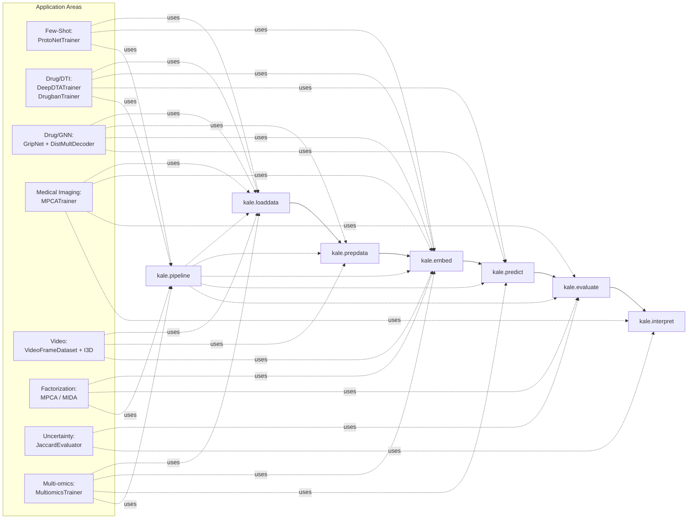

<!-- source: DeepWiki mcp.deepwiki.com · repo pykale/pykale · page 4 Specialized Models and Tasks · fetched 2026-10-21 -->

# Specialized Models and Tasks

Relevant source files

The following files were used as context for generating this wiki page:

- [docs/source/index.rst](docs/source/index.rst)
- [docs/source/kale.embed.rst](docs/source/kale.embed.rst)
- [docs/source/kale.evaluate.rst](docs/source/kale.evaluate.rst)
- [docs/source/kale.loaddata.rst](docs/source/kale.loaddata.rst)
- [docs/source/kale.pipeline.rst](docs/source/kale.pipeline.rst)
- [docs/source/kale.predict.rst](docs/source/kale.predict.rst)
- [docs/source/kale.prepdata.rst](docs/source/kale.prepdata.rst)
- [docs/source/kale.utils.rst](docs/source/kale.utils.rst)

This section groups PyKale's task-specific model families that go beyond the core domain adaptation infrastructure. Each subsection covers a distinct application area, including its data loading conventions, embedding and prediction modules, and the trainer class that orchestrates end-to-end training.

> **Domain adaptation** is covered separately in [Domain Adaptation](#3). This section focuses on models for few-shot learning, drug discovery, medical imaging, video processing, graph neural networks, dimensionality reduction, uncertainty quantification, and multi-omics integration.

---

## Overview of Application Areas

PyKale organizes specialized tasks across all layers of the pipeline API. The table below maps each application area to its primary modules.

| Application Area | Data Loading | Embedding | Prediction | Pipeline/Trainer |
|---|---|---|---|---|
| Few-Shot Learning | `kale.loaddata.few_shot` | `kale.embed.image_cnn` | — | `kale.pipeline.fewshot_trainer` |
| Drug Discovery (DTI) | `kale.loaddata.molecular_datasets`, `kale.loaddata.tdc_datasets` | `kale.embed.model_lib.drugban`, `kale.embed.nn` | `kale.predict.decode` | `kale.pipeline.deepdta`, `kale.pipeline.drugban_trainer` |
| Drug Discovery (GripNet) | `kale.loaddata.polypharmacy_datasets` | `kale.embed.model_lib.gripnet` | `kale.predict.decode` | standard `pl.Trainer` |
| Medical Imaging | `kale.loaddata.tabular_access` | `kale.embed.factorization` | `kale.predict.class_domain_nets` | `kale.pipeline.mpca_trainer` |
| Video Processing | `kale.loaddata.videos`, `kale.loaddata.video_datasets` | `kale.embed.video` | — | `kale.pipeline.video_domain_adapter` |
| Graph Neural Networks | `kale.loaddata.polypharmacy_datasets` | `kale.embed.model_lib.gripnet` | `kale.predict.decode` | standard `pl.Trainer` |
| Factorization Methods | `kale.loaddata.tabular_access` | `kale.embed.factorization` | — | `kale.pipeline.mpca_trainer` |
| Uncertainty Quantification | `kale.loaddata.tabular_access` | `kale.embed.uncertainty_fitting` | `kale.predict.uncertainty_binning` | `kale.evaluate.uncertainty_metrics` |
| Multi-omics / Multimodal | `kale.loaddata.multiomics_datasets`, `kale.loaddata.avmnist_datasets` | `kale.embed.model_lib.mogonet`, `kale.embed.multimodal_encoder` | `kale.predict.decode` | `kale.pipeline.multiomics_trainer`, `kale.pipeline.multimodal_trainer` |

Sources: [docs/source/kale.embed.rst](), [docs/source/kale.loaddata.rst](), [docs/source/kale.pipeline.rst](), [docs/source/kale.predict.rst](), [docs/source/index.rst]()

---

## Module Dependency Map

**Diagram: Specialized Task Areas and Their Primary Code Modules**

```mermaid
flowchart TD
    subgraph FewShot["Few-Shot Learning (4.1)"]
        FS_DATA["kale.loaddata.few_shot\nNWayKShotDataset"]
        FS_PIPE["kale.pipeline.fewshot_trainer\nProtoNetTrainer"]
        FS_DATA --> FS_PIPE
    end

    subgraph Drug["Drug Discovery (4.2)"]
        DR_DATA["kale.loaddata.molecular_datasets\nDTIDataset"]
        DR_TDC["kale.loaddata.tdc_datasets\nBindingDBDataset"]
        DR_POLY["kale.loaddata.polypharmacy_datasets\nPolypharmacyDataset"]
        DR_EMB1["kale.embed.model_lib.drugban\nBANLayer"]
        DR_EMB2["kale.embed.model_lib.gripnet\nGripNet"]
        DR_PIPE1["kale.pipeline.deepdta\nDeepDTATrainer"]
        DR_PIPE2["kale.pipeline.drugban_trainer\nDrugbanTrainer"]
        DR_DATA --> DR_PIPE1
        DR_TDC --> DR_PIPE1
        DR_DATA --> DR_PIPE2
        DR_EMB1 --> DR_PIPE2
        DR_POLY --> DR_EMB2
    end

    subgraph MedImg["Medical Imaging (4.3)"]
        MI_DATA["kale.loaddata.tabular_access\nread_dicom_dir"]
        MI_EMB["kale.embed.factorization\nMPCA"]
        MI_PIPE["kale.pipeline.mpca_trainer\nMPCATrainer"]
        MI_DATA --> MI_EMB --> MI_PIPE
    end

    subgraph Video["Video Processing (4.4)"]
        VD_DATA["kale.loaddata.videos\nVideoFrameDataset"]
        VD_ACCESS["kale.loaddata.video_access\nVideoDatasetAccess"]
        VD_EMB["kale.embed.video\nI3D / Res3D"]
        VD_DATA --> VD_ACCESS --> VD_EMB
    end

    subgraph GNN["Graph Neural Networks (4.5)"]
        GN_PRE["kale.prepdata.supergraph_construct\nSuperGraph / SuperVertex / SuperEdge"]
        GN_EMB["kale.embed.model_lib.gripnet\nGripNet"]
        GN_DEC["kale.predict.decode\nDistMultDecoder"]
        GN_PRE --> GN_EMB --> GN_DEC
    end

    subgraph Factorization["Factorization Methods (4.6)"]
        FA_EMB["kale.embed.factorization\nMPCA / MIDA"]
        FA_PIPE["kale.pipeline.mpca_trainer\nMPCATrainer / MIDATrainer"]
        FA_EMB --> FA_PIPE
    end

    subgraph UQ["Uncertainty Quantification (4.7)"]
        UQ_EMB["kale.embed.uncertainty_fitting"]
        UQ_PRED["kale.predict.uncertainty_binning"]
        UQ_EVAL["kale.evaluate.uncertainty_metrics\nJaccardEvaluator\nQuantileBinningAnalyzer"]
        UQ_EMB --> UQ_PRED --> UQ_EVAL
    end

    subgraph Omics["Multi-omics / Multimodal (4.8)"]
        OM_DATA["kale.loaddata.multiomics_datasets\nSparseMultiomicsDataset"]
        OM_AV["kale.loaddata.avmnist_datasets"]
        OM_EMB1["kale.embed.model_lib.mogonet\nMogonetGCN"]
        OM_EMB2["kale.embed.multimodal_encoder"]
        OM_PIPE1["kale.pipeline.multiomics_trainer\nMultiomicsTrainer"]
        OM_PIPE2["kale.pipeline.multimodal_trainer"]
        OM_DATA --> OM_EMB1 --> OM_PIPE1
        OM_AV --> OM_EMB2 --> OM_PIPE2
    end
```

Sources: [docs/source/kale.embed.rst](), [docs/source/kale.loaddata.rst](), [docs/source/kale.pipeline.rst](), [docs/source/kale.prepdata.rst]()

---

## Placement in the PyKale Pipeline

All specialized models reuse the same seven-module pipeline API. The diagram below shows which pipeline stages each application area uses.

**Diagram: Specialized Tasks Mapped to Pipeline Stages**

Sources: [docs/source/index.rst](), [docs/source/kale.pipeline.rst]()

---

## Subsection Guide

The child pages of this section each cover one application area in full detail.

| Page | Title | Primary Trainer / Entry Point |
|---|---|---|
| [4.1](#4.1) | Few-Shot Learning | `ProtoNetTrainer` in `kale.pipeline.fewshot_trainer` |
| [4.2](#4.2) | Drug Discovery Models | `DrugbanTrainer`, `DeepDTATrainer`, `GripNet` |
| [4.3](#4.3) | Medical Imaging | `MPCATrainer` in `kale.pipeline.mpca_trainer` |
| [4.4](#4.4) | Video Processing | `VideoFrameDataset` in `kale.loaddata.videos` |
| [4.5](#4.5) | Graph Neural Networks | `GripNet` + `SuperGraph` in `kale.embed.model_lib.gripnet` |
| [4.6](#4.6) | Factorization Methods | `MPCA`, `MIDA` in `kale.embed.factorization` |
| [4.7](#4.7) | Uncertainty Quantification | `QuantileBinningAnalyzer`, `JaccardEvaluator` |
| [4.8](#4.8) | Multimodal and Multi-omics Learning | `MultiomicsTrainer`, `MogonetGCN`, `VCDN` |

Each page describes: the dataset/data loader classes, the embedding and prediction components, the trainer or evaluation class, and at least one runnable example from the `examples/` directory. For a guide to those examples, see [Examples and Tutorials](#5).

Sources: [docs/source/index.rst](), [docs/source/kale.pipeline.rst](), [docs/source/kale.embed.rst](), [docs/source/kale.loaddata.rst]()

---

