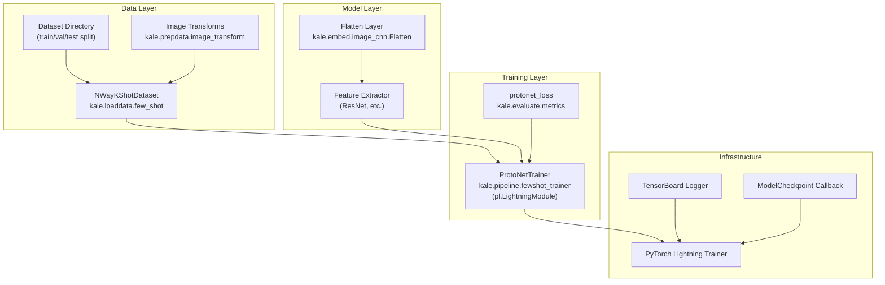
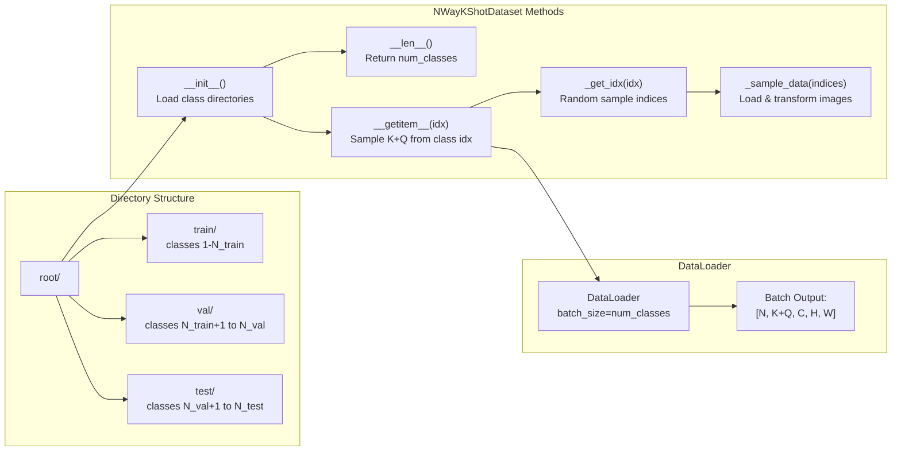
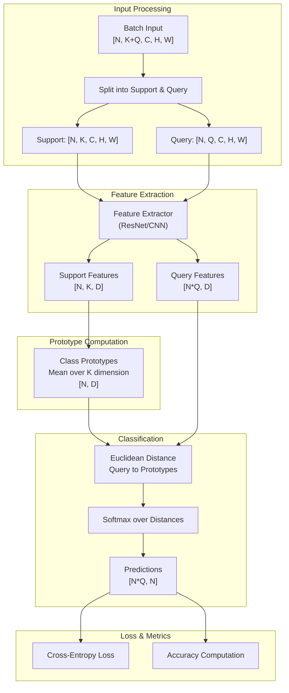
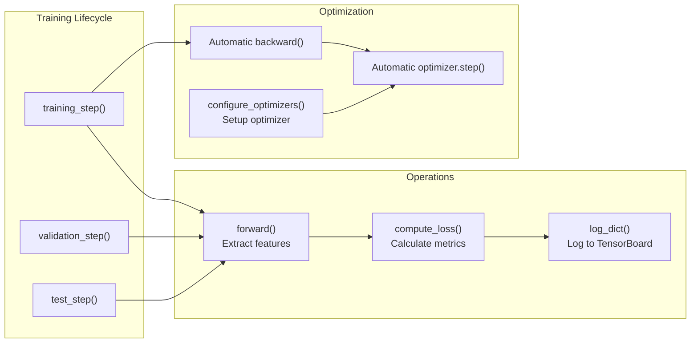
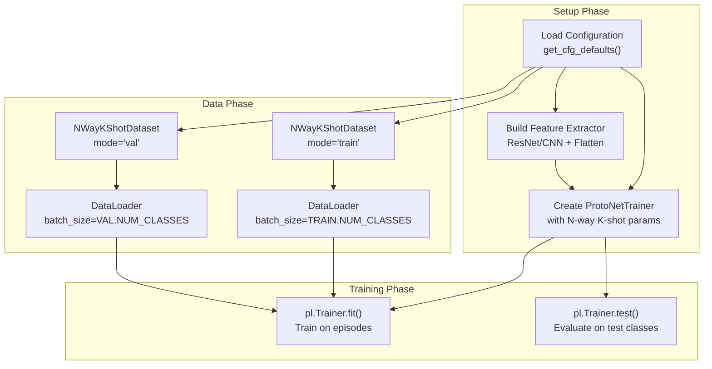

<!-- source: DeepWiki mcp.deepwiki.com · repo pykale/pykale · page 4.1 Few-Shot Learning · fetched 2026-10-21 -->

# Few-Shot Learning

<details>
<summary>Relevant source files</summary>

The following files were used as context for generating this wiki page:

- [examples/cifar_cnntransformer/main.py](examples/cifar_cnntransformer/main.py)
- [examples/fewshot_protonet/README.md](examples/fewshot_protonet/README.md)
- [examples/fewshot_protonet/__init__.py](examples/fewshot_protonet/__init__.py)
- [examples/fewshot_protonet/config.py](examples/fewshot_protonet/config.py)
- [examples/fewshot_protonet/configs/demo.yaml](examples/fewshot_protonet/configs/demo.yaml)
- [examples/fewshot_protonet/configs/template.yaml](examples/fewshot_protonet/configs/template.yaml)
- [examples/fewshot_protonet/eval_unseen_classes.py](examples/fewshot_protonet/eval_unseen_classes.py)
- [examples/fewshot_protonet/main.py](examples/fewshot_protonet/main.py)
- [kale/loaddata/few_shot.py](kale/loaddata/few_shot.py)
- [kale/pipeline/fewshot_trainer.py](kale/pipeline/fewshot_trainer.py)

</details>


## Purpose and Scope

This document describes PyKale's few-shot learning capabilities, specifically the implementation of Prototypical Networks (ProtoNet) for N-way K-shot learning scenarios. Few-shot learning enables models to classify new classes with only a few labeled examples per class.

For domain adaptation with few labeled target samples, see [Few-Shot Domain Adaptation](#3.4). For general image classification examples, see [Getting Started Tutorials](#5.1). For few-shot learning examples and tutorials, see [Few-Shot Learning Examples](#5.5).

## Overview

PyKale implements few-shot learning through three primary components:

1. **Dataset Management**: [kale/loaddata/few_shot.py]() provides `NWayKShotDataset` for episodic data loading
2. **Model Training**: [kale/pipeline/fewshot_trainer.py]() provides `ProtoNetTrainer` with PyTorch Lightning integration
3. **Loss Computation**: `kale.evaluate.metrics.protonet_loss` handles metric learning for prototypes

The implementation follows the Prototypical Networks approach, where models learn an embedding space where samples from the same class cluster around class prototypes (mean embeddings of support samples).

**Sources**: [kale/loaddata/few_shot.py:1-131](), [kale/pipeline/fewshot_trainer.py:1-151](), [examples/fewshot_protonet/README.md:1-110]()

## System Architecture



**Diagram: Few-Shot Learning System Architecture**

This architecture shows how PyKale's few-shot learning components integrate with PyTorch Lightning for standardized training workflows. The system separates data management, model architecture, and training orchestration into distinct, reusable components.

**Sources**: [kale/pipeline/fewshot_trainer.py:19-30](), [examples/fewshot_protonet/main.py:48-63]()

## N-Way K-Shot Learning Paradigm

Few-shot learning in PyKale follows the N-way K-shot episodic training paradigm with support and query sets:

| Concept | Symbol | Description | Example |
|---------|--------|-------------|---------|
| **N-way** | N | Number of classes per episode | 5-way = 5 classes |
| **K-shot** | K | Support samples per class | 5-shot = 5 support samples/class |
| **Support Set** | - | Labeled samples for prototype computation | N × K samples total |
| **Query Set** | - | Test samples for classification | N × Q samples (Q = query samples/class) |

### Episodic Training Structure

In each training episode:
1. Sample N classes randomly from the training set
2. For each class, sample K support samples and Q query samples
3. Compute class prototypes from support samples
4. Classify query samples based on distance to prototypes
5. Update model parameters based on classification loss

Training uses more classes (typically 20-30 way) while validation/testing uses fewer (typically 5-way) to evaluate generalization to unseen class distributions.

**Sources**: [kale/loaddata/few_shot.py:16-27](), [kale/pipeline/fewshot_trainer.py:32-38](), [examples/fewshot_protonet/README.md:7-16]()

## Dataset Management: NWayKShotDataset



**Diagram: NWayKShotDataset Data Flow**

### Class Structure

The `NWayKShotDataset` class [kale/loaddata/few_shot.py:16-131]() implements episodic data loading:

**Key Parameters**:
- `path`: Root directory containing train/val/test splits
- `mode`: One of "train", "val", or "test"
- `num_support_samples`: K in K-shot (default: 5)
- `num_query_samples`: Number of query samples per class (default: 15)
- `transform`: Image preprocessing transformations

**Implementation Details**:

The dataset organizes images by class and samples episodically:

```python
# From kale/loaddata/few_shot.py:92-103
def __len__(self):
    # Returns number of classes, not number of images
    return len(self.classes)

def __getitem__(self, idx):
    # idx represents a class index
    # Returns K+Q samples from class idx
    image_idx = self._get_idx(idx)
    images = self._sample_data(image_idx)
    images = torch.stack(images)
    return images, idx
```

**Critical Design Decision**: The `__len__()` method returns the number of classes, not total images. When using with `DataLoader`, set `batch_size=num_classes` to sample from N classes simultaneously.

**Sources**: [kale/loaddata/few_shot.py:16-131](), [examples/fewshot_protonet/main.py:68-93]()

### Directory Structure Requirements

The dataset must follow this structure [kale/loaddata/few_shot.py:31-63]():

```
root/
├── train/
│   ├── class_1/
│   │   ├── image_001.png
│   │   ├── image_002.png
│   │   └── ...
│   ├── class_2/
│   └── ...
├── val/
│   ├── class_m/
│   └── ...
└── test/
    ├── class_n/
    └── ...
```

Train, validation, and test splits must contain **disjoint classes** to properly evaluate few-shot generalization. This ensures the model is tested on truly unseen classes.

**Sources**: [kale/loaddata/few_shot.py:31-63](), [examples/fewshot_protonet/README.md:24-58]()

## Prototypical Networks Implementation



**Diagram: ProtoNet Forward Pass and Loss Computation**

### ProtoNetTrainer Class

The `ProtoNetTrainer` [kale/pipeline/fewshot_trainer.py:25-151]() extends `pl.LightningModule` to provide a standardized training interface:

**Initialization Parameters**:

| Parameter | Type | Description | Default |
|-----------|------|-------------|---------|
| `net` | `torch.nn.Module` | Feature extractor (no task head) | Required |
| `train_num_classes` | `int` | N for training episodes | 30 |
| `train_num_support_samples` | `int` | K for training | 5 |
| `train_num_query_samples` | `int` | Q for training | 15 |
| `val_num_classes` | `int` | N for validation/testing | 5 |
| `val_num_support_samples` | `int` | K for validation/testing | 5 |
| `val_num_query_samples` | `int` | Q for validation/testing | 15 |
| `devices` | `str` | Device placement | "cuda" |
| `optimizer` | `str` | Optimizer name | "SGD" |
| `lr` | `float` | Learning rate | 0.001 |

**Sources**: [kale/pipeline/fewshot_trainer.py:53-88]()

### Forward Pass Implementation

The `forward()` method [kale/pipeline/fewshot_trainer.py:89-98]() processes episodic batches:

```python
def forward(self, x, num_support_samples, num_classes):
    # x shape: [num_classes, K+Q, C, H, W]
    # Split into support and query
    supports = x[0][0:num_support_samples]
    queries = x[0][num_support_samples:]
    
    # Concatenate across classes
    for image in x[1:]:
        supports = torch.cat((supports, image[0:num_support_samples]), dim=0)
        queries = torch.cat((queries, image[num_support_samples:]), dim=0)
    
    # Extract features
    feature_support = self.model(supports).reshape(num_classes, num_support_samples, -1)
    feature_query = self.model(queries)
    
    return feature_support, feature_query
```

The method:
1. Separates support and query samples from each class
2. Concatenates across all N classes
3. Extracts features using the backbone network
4. Reshapes support features to [N, K, D] for prototype computation

**Sources**: [kale/pipeline/fewshot_trainer.py:89-98]()

### Loss and Accuracy Computation

The `compute_loss()` method [kale/pipeline/fewshot_trainer.py:100-116]() uses `protonet_loss` from `kale.evaluate.metrics`:

```python
def compute_loss(self, feature_support, feature_query, mode="train"):
    loss, acc = eval(f"self.loss_{mode}")(feature_support, feature_query)
    return_dict = {"{}_loss".format(mode): loss.item(), 
                   "{}_acc".format(mode): acc}
    return loss, return_dict
```

The loss function:
1. Computes class prototypes as mean of support features: `prototypes = feature_support.mean(dim=1)`
2. Calculates Euclidean distances from queries to prototypes
3. Applies negative distances as logits (closer = higher probability)
4. Computes cross-entropy loss against true class labels

Separate loss instances are created for training and validation to handle different N/Q values [kale/pipeline/fewshot_trainer.py:82-87]().

**Sources**: [kale/pipeline/fewshot_trainer.py:82-116]()

## Training Pipeline

### PyTorch Lightning Integration

The trainer implements standard Lightning methods for training orchestration:



**Diagram: Training Lifecycle with PyTorch Lightning**

**Training Step** [kale/pipeline/fewshot_trainer.py:118-129]():
- Extracts features using `forward()`
- Computes loss and accuracy
- Logs metrics at both step and epoch level
- Returns loss for automatic backpropagation

**Validation/Test Steps** [kale/pipeline/fewshot_trainer.py:131-143]():
- Similar to training but without gradient updates
- Logs only at epoch level
- Uses validation N-way K-shot configuration

**Optimizer Configuration** [kale/pipeline/fewshot_trainer.py:145-150]():
- Dynamically creates optimizer from string name (e.g., "SGD", "Adam")
- Applies learning rate from initialization

**Sources**: [kale/pipeline/fewshot_trainer.py:118-150]()

## Configuration Management

PyKale examples use YACS for configuration management [examples/fewshot_protonet/config.py:1-55]():

### Configuration Structure

```yaml
# Dataset configuration
DATASET:
  ROOT: "data/omniglot"
  IMG_SIZE: 84

# Model architecture
MODEL:
  BACKBONE: "ResNet18Feature"
  PRETRAIN_WEIGHTS: None

# Training configuration
TRAIN:
  EPOCHS: 100
  OPTIMIZER: "SGD"
  LEARNING_RATE: 0.001
  NUM_CLASSES: 30          # N for training
  NUM_SUPPORT_SAMPLES: 5   # K
  NUM_QUERY_SAMPLES: 15    # Q

# Validation/Testing configuration
VAL:
  NUM_CLASSES: 5           # N for validation
  NUM_SUPPORT_SAMPLES: 5   # K
  NUM_QUERY_SAMPLES: 15    # Q

# Output configuration
OUTPUT:
  OUT_DIR: "outputs"
  SAVE_TOP_K: 1
  SAVE_LAST: True
```

Configuration files support two levels:
- **demo.yaml**: Minimal configuration requiring only dataset paths [examples/fewshot_protonet/configs/demo.yaml:1-10]()
- **template.yaml**: Full configuration with all tunable hyperparameters [examples/fewshot_protonet/configs/template.yaml:1-29]()

**Sources**: [examples/fewshot_protonet/config.py:1-55](), [examples/fewshot_protonet/configs/template.yaml:1-29]()

## Usage Examples

### Basic Training Example



**Diagram: End-to-End Training Workflow**

### Complete Training Script

The main training script [examples/fewshot_protonet/main.py:37-130]() follows this workflow:

**1. Configuration Setup**:
```python
cfg = get_cfg_defaults()
cfg.merge_from_file(args.cfg)
cfg.freeze()
```

**2. Model Initialization**:
```python
net = eval(f"{cfg.MODEL.BACKBONE}(weights={cfg.MODEL.PRETRAIN_WEIGHTS})")
if cfg.MODEL.BACKBONE.startswith("resnet"):
    net.fc = Flatten()  # Replace final FC with flatten

model = ProtoNetTrainer(
    net=net,
    train_num_classes=cfg.TRAIN.NUM_CLASSES,
    train_num_support_samples=cfg.TRAIN.NUM_SUPPORT_SAMPLES,
    train_num_query_samples=cfg.TRAIN.NUM_QUERY_SAMPLES,
    val_num_classes=cfg.VAL.NUM_CLASSES,
    val_num_support_samples=cfg.VAL.NUM_SUPPORT_SAMPLES,
    val_num_query_samples=cfg.VAL.NUM_QUERY_SAMPLES,
    devices="cuda" if cfg.GPUS > 0 else "cpu",
    optimizer=cfg.TRAIN.OPTIMIZER,
    lr=cfg.TRAIN.LEARNING_RATE,
)
```

**3. Dataset and DataLoader Creation**:
```python
transform = get_transform(kind="few-shot", augment=False)

train_set = NWayKShotDataset(
    path=cfg.DATASET.ROOT,
    mode="train",
    num_support_samples=cfg.TRAIN.NUM_SUPPORT_SAMPLES,
    num_query_samples=cfg.TRAIN.NUM_QUERY_SAMPLES,
    transform=transform,
)
train_dataloader = DataLoader(
    train_set, 
    batch_size=cfg.TRAIN.NUM_CLASSES,  # Critical: batch_size = num_classes
    shuffle=True, 
    drop_last=True
)
```

**4. PyTorch Lightning Training**:
```python
logger = pl.loggers.TensorBoardLogger(cfg.OUTPUT.OUT_DIR)
model_checkpoint = pl.callbacks.ModelCheckpoint(
    dirpath=os.path.join(cfg.OUTPUT.OUT_DIR, experiment_time, cfg.OUTPUT.WEIGHT_DIR),
    filename="{epoch}-{val_acc:.2f}",
    monitor="val_acc",
    mode="max",
    save_top_k=cfg.OUTPUT.SAVE_TOP_K,
)

trainer = pl.Trainer(
    devices=cfg.GPUS,
    max_epochs=cfg.TRAIN.EPOCHS,
    logger=logger,
    callbacks=[model_checkpoint],
    accelerator="gpu" if cfg.GPUS > 0 else "cpu",
)

trainer.fit(model=model, train_dataloaders=train_dataloader, val_dataloaders=val_dataloader)
trainer.test(model=model, dataloaders=test_dataloader, ckpt_path="best")
```

**Sources**: [examples/fewshot_protonet/main.py:37-130]()

### Evaluating on Unseen Classes

The evaluation script [examples/fewshot_protonet/eval_unseen_classes.py:1-78]() demonstrates testing pretrained models on novel classes:

```python
# Load pretrained model
model = ProtoNetTrainer(net=net, devices="cuda" if cfg.GPUS > 0 else "cpu")

# Create test dataset with unseen classes
test_set = NWayKShotDataset(
    path=cfg.DATASET.ROOT,
    mode="test",  # Test split contains unseen classes
    num_support_samples=cfg.VAL.NUM_SUPPORT_SAMPLES,
    num_query_samples=cfg.VAL.NUM_QUERY_SAMPLES,
    transform=transform,
)
test_dataloader = DataLoader(test_set, batch_size=cfg.VAL.NUM_CLASSES, drop_last=True)

# Test with checkpoint
trainer.test(model=model, dataloaders=test_dataloader, ckpt_path=args.ckpt)
```

**Key Point**: The test set must contain classes completely disjoint from training and validation to properly evaluate few-shot generalization capabilities.

**Sources**: [examples/fewshot_protonet/eval_unseen_classes.py:30-73]()

## Supported Backbones

PyKale's few-shot learning supports any feature extractor that outputs a 1D feature vector [kale/pipeline/fewshot_trainer.py:41]():

**Available Backbones**:
- ResNet variants from `torchvision.models` (ResNet18, ResNet34, ResNet50, etc.)
- Custom ResNet implementations from `kale.embed.image_cnn` (e.g., `ResNet18Feature`)
- Any custom CNN architecture with appropriate output shape

**Configuration**:
```yaml
MODEL:
  BACKBONE: "ResNet18Feature"  # or "resnet18", "resnet50", etc.
  PRETRAIN_WEIGHTS: None       # or "IMAGENET1K_V1" for pretrained weights
```

When using ResNet models, replace the final fully-connected layer with `Flatten()` [examples/fewshot_protonet/main.py:49-50]():
```python
net = resnet18(weights=None)
net.fc = Flatten()  # Remove classification head, keep feature extractor
```

**Sources**: [examples/fewshot_protonet/main.py:48-50](), [examples/fewshot_protonet/README.md:74]()

## Supported Datasets

The implementation works with standard few-shot learning benchmarks that follow the required directory structure [examples/fewshot_protonet/README.md:22-58]():

| Dataset | Description | Classes | Download |
|---------|-------------|---------|----------|
| **Omniglot** | Handwritten characters from 50 alphabets | 1,623 | [Official repo](https://github.com/brendenlake/omniglot) |
| **mini-ImageNet** | Subset of ImageNet with 100 classes | 100 | [Image list](https://drive.google.com/file/d/1iBu_Iqt49opXHSUNcTRU2WQas1WICLwQ/view) |
| **tiered-ImageNet** | Hierarchical subset of ImageNet | 608 | [Dataset tool](https://github.com/yaoyao-liu/tiered-imagenet-tools) |

All datasets must be organized with train/val/test splits containing disjoint classes.

**Sources**: [examples/fewshot_protonet/README.md:22-58]()

## Integration with PyKale Pipeline

Few-shot learning integrates with PyKale's broader ecosystem:

**Data Loading**: Uses `kale.loaddata.few_shot.NWayKShotDataset` and `kale.prepdata.image_transform.get_transform`

**Feature Extraction**: Compatible with `kale.embed.image_cnn` ResNet implementations

**Training**: Extends `kale.pipeline` patterns with PyTorch Lightning integration

**Evaluation**: Uses `kale.evaluate.metrics.protonet_loss` for loss computation

**Configuration**: Follows PyKale's YACS configuration standard used across examples

The modular design allows mixing few-shot learning components with other PyKale capabilities, such as using domain adaptation backbones or uncertainty quantification methods.

**Sources**: [kale/pipeline/fewshot_trainer.py:1-23](), [examples/fewshot_protonet/main.py:23-26]()

---

