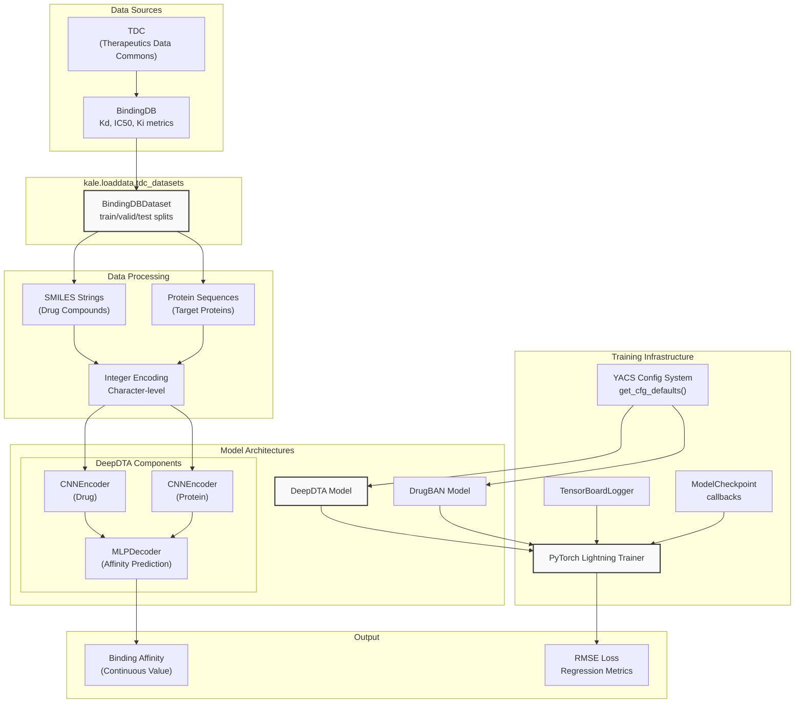
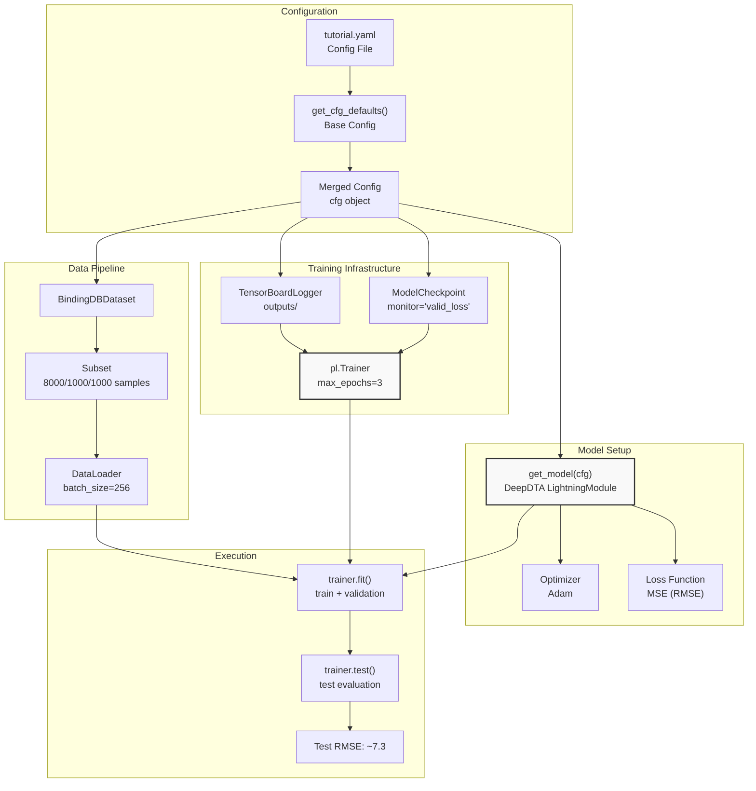

<!-- source: DeepWiki mcp.deepwiki.com · repo pykale/pykale · page 4.2 Drug Discovery Models · fetched 2026-10-21 -->

# Drug Discovery Models

<details>
<summary>Relevant source files</summary>

The following files were used as context for generating this wiki page:

- [examples/bindingdb_deepdta/tutorial.ipynb](examples/bindingdb_deepdta/tutorial.ipynb)
- [examples/bindingdb_drugban/README.md](examples/bindingdb_drugban/README.md)
- [examples/bindingdb_drugban/configs.py](examples/bindingdb_drugban/configs.py)
- [examples/bindingdb_drugban/configs/DA_cross_domain.yaml](examples/bindingdb_drugban/configs/DA_cross_domain.yaml)
- [examples/bindingdb_drugban/configs/non_DA_cross_domain.yaml](examples/bindingdb_drugban/configs/non_DA_cross_domain.yaml)
- [examples/bindingdb_drugban/configs/non_DA_in_domain.yaml](examples/bindingdb_drugban/configs/non_DA_in_domain.yaml)
- [examples/bindingdb_drugban/main.py](examples/bindingdb_drugban/main.py)
- [examples/bindingdb_drugban/model.py](examples/bindingdb_drugban/model.py)
- [examples/bindingdb_drugban/test.py](examples/bindingdb_drugban/test.py)
- [examples/polypharmacy_gripnet/README.md](examples/polypharmacy_gripnet/README.md)
- [examples/polypharmacy_gripnet/__init__.py](examples/polypharmacy_gripnet/__init__.py)
- [examples/polypharmacy_gripnet/config.py](examples/polypharmacy_gripnet/config.py)
- [examples/polypharmacy_gripnet/configs/PoSE_MINI-GripNet.yaml](examples/polypharmacy_gripnet/configs/PoSE_MINI-GripNet.yaml)
- [examples/polypharmacy_gripnet/main.py](examples/polypharmacy_gripnet/main.py)
- [examples/polypharmacy_gripnet/model.py](examples/polypharmacy_gripnet/model.py)
- [examples/toy_domain_adaptation/main.py](examples/toy_domain_adaptation/main.py)
- [examples/toy_domain_adaptation/tutorial.ipynb](examples/toy_domain_adaptation/tutorial.ipynb)
- [kale/loaddata/molecular_datasets.py](kale/loaddata/molecular_datasets.py)
- [kale/loaddata/polypharmacy_datasets.py](kale/loaddata/polypharmacy_datasets.py)
- [kale/pipeline/drugban_trainer.py](kale/pipeline/drugban_trainer.py)
- [tests/embed/test_drugban.py](tests/embed/test_drugban.py)
- [tests/embed/test_multimodal_fusion.py](tests/embed/test_multimodal_fusion.py)
- [tests/loaddata/test_molecular_datasets.py](tests/loaddata/test_molecular_datasets.py)
- [tests/pipeline/test_drugban_trainer.py](tests/pipeline/test_drugban_trainer.py)

</details>


This document covers PyKale's drug discovery capabilities, focusing on drug-target interaction (DTI) prediction models and their integration with the Therapeutics Data Commons (TDC). Drug-target interaction prediction involves estimating the binding affinity between chemical compounds and protein targets, a critical task in computational drug discovery.

For general pipeline orchestration and training, see [Training Pipelines](#2.5). For molecular data loading and preprocessing, see [Data Loading](#2.1) and [Data Preprocessing](#2.2). For graph-based drug discovery approaches using heterogeneous networks, see [Graph Neural Networks](#4.5).

## Overview

PyKale provides specialized support for drug-target interaction prediction through:
- Integration with TDC (Therapeutics Data Commons) for standardized benchmark datasets
- Implementation of DeepDTA (Deep Drug-Target Affinity) architecture
- Support for DrugBAN (Drug-Bilinear Attention Network) model
- PyTorch Lightning-based training pipelines for DTI prediction
- Configuration management via YACS for reproducible experiments

The drug discovery system processes SMILES strings (drug representations) and protein sequences to predict continuous binding affinity values.

**Sources:** [examples/bindingdb_deepdta/tutorial.ipynb:20-41]()

## System Architecture



**Sources:** [examples/bindingdb_deepdta/tutorial.ipynb:1-350]()

## BindingDB Dataset Integration

### Dataset Loading

The `BindingDBDataset` class provides access to drug-target interaction data from TDC's BindingDB benchmark. The dataset loader handles three affinity measurement metrics:

| Metric | Drugs | Targets | Pairs | Description |
|--------|-------|---------|-------|-------------|
| Kd | 10,655 | 1,413 | 52,284 | Dissociation constant |
| IC50 | 549,205 | 5,078 | 991,486 | Half-maximal inhibitory concentration |
| Ki | 174,662 | 3,070 | 375,032 | Inhibition constant |

The dataset interface follows PyTorch's `Dataset` API and integrates with standard `DataLoader` for batching:

```python
from kale.loaddata.tdc_datasets import BindingDBDataset
from torch.utils.data import DataLoader

# Load dataset splits
train_dataset = BindingDBDataset(name="BindingDB_Kd", split="train", path="./data")
valid_dataset = BindingDBDataset(name="BindingDB_Kd", split="valid", path="./data")
test_dataset = BindingDBDataset(name="BindingDB_Kd", split="test", path="./data")

# Create dataloaders
train_loader = DataLoader(dataset=train_dataset, shuffle=True, batch_size=256)
```

Each data sample contains:
- Drug SMILES string (character-encoded)
- Protein sequence (character-encoded)
- Binding affinity value (continuous target in log space)

The affinity values are transformed to log space, with a typical range of [-13, 20] for normalized predictions.

**Sources:** [examples/bindingdb_deepdta/tutorial.ipynb:28-40](), [examples/bindingdb_deepdta/tutorial.ipynb:163-201]()

### TDC Integration

PyKale integrates with the Therapeutics Data Commons (TDC), a machine learning platform for drug discovery that provides:
- Standardized benchmark datasets across therapeutic domains
- Unified data loaders with consistent APIs
- Pre-defined train/validation/test splits for reproducibility
- Multiple affinity metrics (Kd, IC50, Ki) for comprehensive evaluation

The integration abstracts away dataset downloading, caching, and preprocessing, allowing researchers to focus on model development.

**Sources:** [examples/bindingdb_deepdta/tutorial.ipynb:30-31]()

## DeepDTA Architecture

### Model Overview

DeepDTA (Deep Drug-Target Affinity) models protein sequences and compound 1D representations using convolutional neural networks. The architecture consists of:
1. **Drug Encoder**: CNN processing SMILES character sequences
2. **Protein Encoder**: CNN processing protein amino acid sequences  
3. **MLP Decoder**: Fully connected layers predicting binding affinity

```mermaid
graph LR
    subgraph "Input Processing"
        DRUG_IN["Drug SMILES<br/>Max Length: 85"]
        PROTEIN_IN["Protein Sequence<br/>Max Length: 1200"]
        DRUG_EMB["Embedding Layer<br/>vocab_size=65<br/>embed_dim=128"]
        PROTEIN_EMB["Embedding Layer<br/>vocab_size=26<br/>embed_dim=128"]
    end
    
    subgraph "CNNEncoder (Drug)"
        DRUG_CONV1["Conv1d<br/>in:128 out:32 kernel:4"]
        DRUG_CONV2["Conv1d<br/>in:32 out:64 kernel:8"]
        DRUG_CONV3["Conv1d<br/>in:64 out:96 kernel:8"]
        DRUG_POOL["AdaptiveMaxPool1d<br/>output:96"]
    end
    
    subgraph "CNNEncoder (Protein)"
        PROT_CONV1["Conv1d<br/>in:128 out:32 kernel:4"]
        PROT_CONV2["Conv1d<br/>in:32 out:64 kernel:8"]
        PROT_CONV3["Conv1d<br/>in:64 out:96 kernel:8"]
        PROT_POOL["AdaptiveMaxPool1d<br/>output:96"]
    end
    
    subgraph "MLPDecoder"
        CONCAT["Concatenate<br/>96 + 96 = 192"]
        FC1["Linear 192->1024<br/>Dropout 0.1"]
        FC2["Linear 1024->1024<br/>Dropout 0.1"]
        FC3["Linear 1024->512"]
        FC4["Linear 512->1<br/>Affinity Output"]
    end
    
    DRUG_IN --> DRUG_EMB
    PROTEIN_IN --> PROTEIN_EMB
    
    DRUG_EMB --> DRUG_CONV1
    DRUG_CONV1 --> DRUG_CONV2
    DRUG_CONV2 --> DRUG_CONV3
    DRUG_CONV3 --> DRUG_POOL
    
    PROTEIN_EMB --> PROT_CONV1
    PROT_CONV1 --> PROT_CONV2
    PROT_CONV2 --> PROT_CONV3
    PROT_CONV3 --> PROT_POOL
    
    DRUG_POOL --> CONCAT
    PROT_POOL --> CONCAT
    CONCAT --> FC1
    FC1 --> FC2
    FC2 --> FC3
    FC3 --> FC4
```



**Sources:** [examples/bindingdb_deepdta/tutorial.ipynb:23-26](), [examples/bindingdb_deepdta/tutorial.ipynb:310-346]()

### Component Details

#### CNNEncoder

The `CNNEncoder` component processes sequential input through:
- **Embedding Layer**: Converts character/amino acid indices to dense vectors (128-dimensional)
- **Convolutional Layers**: Three 1D convolutions with increasing filter sizes (kernel sizes 4, 8, 8) and channels (32, 64, 96)
- **Activation**: ReLU activations between layers
- **Pooling**: Adaptive max pooling to fixed output size (96 features)

The drug encoder vocabulary size is 65 characters (SMILES notation), while the protein encoder uses 26 amino acids.

#### MLPDecoder

The `MLPDecoder` component combines encoded representations:
- **Input**: Concatenated drug and protein features (192 dimensions)
- **Architecture**: Four fully connected layers (192→1024→1024→512→1)
- **Regularization**: Dropout (0.1) after first two layers
- **Output**: Single continuous value representing predicted binding affinity

Total model parameters: **2,244,609** trainable parameters.

**Sources:** [examples/bindingdb_deepdta/tutorial.ipynb:313-346]()

### Model Instantiation

Models are instantiated through a factory function that reads configuration:

```python
from config import get_cfg_defaults

cfg = get_cfg_defaults()
cfg.merge_from_file("./configs/tutorial.yaml")
cfg.freeze()

model = get_model(cfg)
```

The configuration system (YACS-based) allows specifying:
- Embedding dimensions
- CNN filter numbers and kernel sizes
- MLP hidden layer dimensions
- Dropout rates
- Learning rate and optimizer settings

**Sources:** [examples/bindingdb_deepdta/tutorial.ipynb:96-107](), [examples/bindingdb_deepdta/tutorial.ipynb:214-216]()

## DrugBAN Model

DrugBAN (Drug-Bilinear Attention Network) is an alternative architecture mentioned in the high-level system diagrams. While not covered in detail in the provided tutorial, it represents another approach to drug-target interaction prediction available in PyKale.

DrugBAN typically features:
- Bilinear attention mechanisms for drug-target interaction modeling
- Graph-based representations for molecular structures
- Enhanced interpretability through attention visualization

**Sources:** High-level system architecture diagrams (Diagram 3)

## Training Pipeline

### PyTorch Lightning Integration



**Sources:** [examples/bindingdb_deepdta/tutorial.ipynb:115-296]()

### Training Workflow

The training process follows PyTorch Lightning's standardized workflow:

1. **Configuration Loading**: YACS-based configuration system merges defaults with custom settings
   ```python
   cfg = get_cfg_defaults()
   cfg.merge_from_file("./configs/tutorial.yaml")
   cfg.freeze()
   ```

2. **Dataset Preparation**: Load and split BindingDB data
   ```python
   train_dataset = BindingDBDataset(name=cfg.DATASET.NAME, split="train", path=cfg.DATASET.PATH)
   train_loader = DataLoader(dataset=train_dataset, shuffle=True, batch_size=cfg.SOLVER.TRAIN_BATCH_SIZE)
   ```

3. **Model Initialization**: Create DeepDTA model from configuration
   ```python
   model = get_model(cfg)
   ```

4. **Logger Setup**: Configure TensorBoard for experiment tracking
   ```python
   tb_logger = TensorBoardLogger("outputs", name=cfg.DATASET.NAME)
   ```

5. **Trainer Configuration**: Set up PyTorch Lightning trainer with callbacks
   ```python
   checkpoint_callback = ModelCheckpoint(filename="{epoch}-{step}-{valid_loss:.4f}", 
                                          monitor="valid_loss", mode="min")
   trainer = pl.Trainer(min_epochs=cfg.SOLVER.MIN_EPOCHS, 
                        max_epochs=cfg.SOLVER.MAX_EPOCHS,
                        accelerator="gpu",
                        logger=tb_logger,
                        callbacks=[checkpoint_callback])
   ```

6. **Training Execution**: Fit model with training and validation data
   ```python
   trainer.fit(model, train_dataloaders=train_loader, val_dataloaders=valid_loader)
   ```

7. **Evaluation**: Test on held-out test set
   ```python
   trainer.test(dataloaders=test_loader)
   ```

**Sources:** [examples/bindingdb_deepdta/tutorial.ipynb:126-293]()

### Training Configuration

Key configuration parameters via YACS:

| Parameter Category | Key Parameters | Typical Values |
|-------------------|----------------|----------------|
| Dataset | `DATASET.NAME`, `DATASET.PATH` | "BindingDB_Kd", "./data" |
| Solver | `SOLVER.SEED`, `SOLVER.TRAIN_BATCH_SIZE`, `SOLVER.TEST_BATCH_SIZE` | 2020, 256, 256 |
| Training | `SOLVER.MIN_EPOCHS`, `SOLVER.MAX_EPOCHS` | 1, 3 (tutorial), 100 (full training) |
| Model | Drug/protein vocab sizes, embedding dims, CNN filters | 65/26, 128, [32,64,96] |

**Sources:** [examples/bindingdb_deepdta/tutorial.ipynb:115-138]()

## Evaluation Metrics

### Regression Metrics

Drug-target interaction prediction is formulated as a regression problem with binding affinity as the continuous target variable. The primary evaluation metric is **Root Mean Square Error (RMSE)**:

- **Target Value Range**: [-13, 20] in log space (transformed affinity values)
- **Tutorial Performance**: RMSE ~7.3 with 3 epochs on subset (8000/1000/1000 samples)
- **Full Training Performance**: RMSE <1.0 with 100 epochs on complete dataset

The RMSE metric directly measures prediction accuracy for binding affinity values, which are critical for ranking potential drug candidates.

**Sources:** [examples/bindingdb_deepdta/tutorial.ipynb:300-304]()

### Model Checkpointing

The training pipeline uses `ModelCheckpoint` callback to save best-performing models:
- **Monitor Metric**: `valid_loss` (validation loss)
- **Mode**: `min` (lower is better)
- **Filename Pattern**: `{epoch}-{step}-{valid_loss:.4f}`

This enables model recovery and selection based on validation performance.

**Sources:** [examples/bindingdb_deepdta/tutorial.ipynb:251-252]()

## Configuration System

### YACS Integration

The drug discovery examples use YACS (Yet Another Configuration System) for hierarchical configuration management:

```python
from config import get_cfg_defaults

cfg = get_cfg_defaults()           # Load base defaults
cfg.merge_from_file(cfg_path)      # Override with custom YAML
cfg.freeze()                        # Make immutable
```

Configuration hierarchy:
1. **Base Defaults**: Defined in `config.py` via `get_cfg_defaults()`
2. **Custom YAML**: Project-specific overrides in `./configs/tutorial.yaml`
3. **Frozen Config**: Immutable configuration object used throughout training

### Configuration Structure

Typical configuration nodes:

```
cfg.DATASET
├── NAME: "BindingDB_Kd"
├── PATH: "./data"

cfg.SOLVER
├── SEED: 2020
├── TRAIN_BATCH_SIZE: 256
├── TEST_BATCH_SIZE: 256
├── MIN_EPOCHS: 1
└── MAX_EPOCHS: 3

cfg.MODEL
├── DRUG_ENCODER
│   ├── VOCAB_SIZE: 65
│   ├── EMBED_DIM: 128
│   └── CNN_FILTERS: [32, 64, 96]
└── PROTEIN_ENCODER
    ├── VOCAB_SIZE: 26
    └── EMBED_DIM: 128
```

This configuration pattern enables reproducible experiments and easy hyperparameter tuning without code changes.

**Sources:** [examples/bindingdb_deepdta/tutorial.ipynb:115-135]()

## Usage Example

Complete end-to-end workflow for drug-target interaction prediction:

```python
import pytorch_lightning as pl
import torch
from config import get_cfg_defaults
from model import get_model
from pytorch_lightning.callbacks import ModelCheckpoint
from pytorch_lightning.loggers import TensorBoardLogger
from torch.utils.data import DataLoader

from kale.loaddata.tdc_datasets import BindingDBDataset
from kale.utils.seed import set_seed

# 1. Configuration
cfg = get_cfg_defaults()
cfg.merge_from_file("./configs/tutorial.yaml")
cfg.freeze()
set_seed(cfg.SOLVER.SEED)

# 2. Dataset Loading
train_dataset = BindingDBDataset(name="BindingDB_Kd", split="train", path="./data")
valid_dataset = BindingDBDataset(name="BindingDB_Kd", split="valid", path="./data")
test_dataset = BindingDBDataset(name="BindingDB_Kd", split="test", path="./data")

train_loader = DataLoader(train_dataset, shuffle=True, batch_size=256)
valid_loader = DataLoader(valid_dataset, shuffle=True, batch_size=256)
test_loader = DataLoader(test_dataset, shuffle=True, batch_size=256)

# 3. Model Setup
model = get_model(cfg)

# 4. Training Infrastructure
logger = TensorBoardLogger("outputs", name="BindingDB_Kd")
checkpoint = ModelCheckpoint(filename="{epoch}-{step}-{valid_loss:.4f}", 
                             monitor="valid_loss", mode="min")

trainer = pl.Trainer(
    min_epochs=1,
    max_epochs=100,
    accelerator="gpu" if torch.cuda.is_available() else "cpu",
    logger=logger,
    callbacks=[checkpoint]
)

# 5. Training and Evaluation
trainer.fit(model, train_dataloaders=train_loader, val_dataloaders=valid_loader)
trainer.test(dataloaders=test_loader)
```

Expected output: Test RMSE <1.0 for full training (100 epochs).

**Sources:** [examples/bindingdb_deepdta/tutorial.ipynb:96-293]()

## Implementation Notes

### Data Preprocessing

Drug and protein sequences are preprocessed as follows:
- **SMILES Encoding**: Character-level encoding with vocabulary size 65 (standard SMILES notation)
- **Protein Encoding**: Amino acid sequence encoding with vocabulary size 26 (20 standard amino acids + special tokens)
- **Max Lengths**: Drugs padded/truncated to 85 characters, proteins to 1200 characters
- **Affinity Transformation**: Log-space transformation for normalized target values

### Hardware Considerations

The tutorial supports both CPU and GPU execution:
- GPU acceleration recommended for full dataset training (100 epochs)
- CPU execution viable for tutorial subset (8000/1000/1000 samples, 3 epochs)
- Device selection handled automatically via `torch.cuda.is_available()`

### Memory Management

For large-scale training:
- Batch size can be adjusted via `cfg.SOLVER.TRAIN_BATCH_SIZE`
- Gradient accumulation available through PyTorch Lightning's `accumulate_grad_batches`
- Mixed precision training supported via `trainer.precision` parameter

**Sources:** [examples/bindingdb_deepdta/tutorial.ipynb:150-158](), [examples/bindingdb_deepdta/tutorial.ipynb:313-346]()

---

