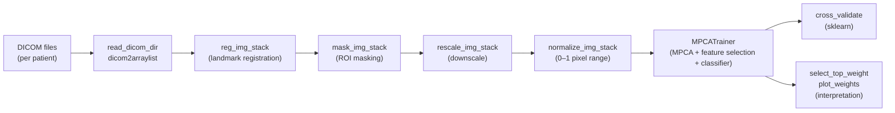
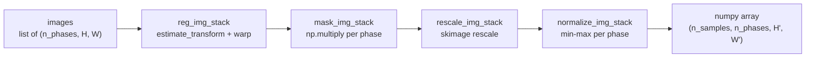
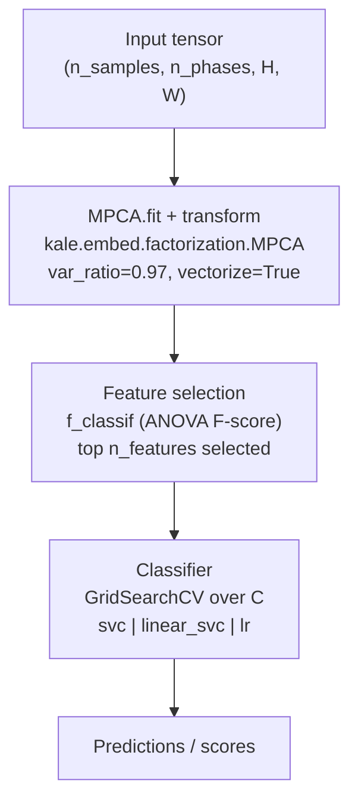
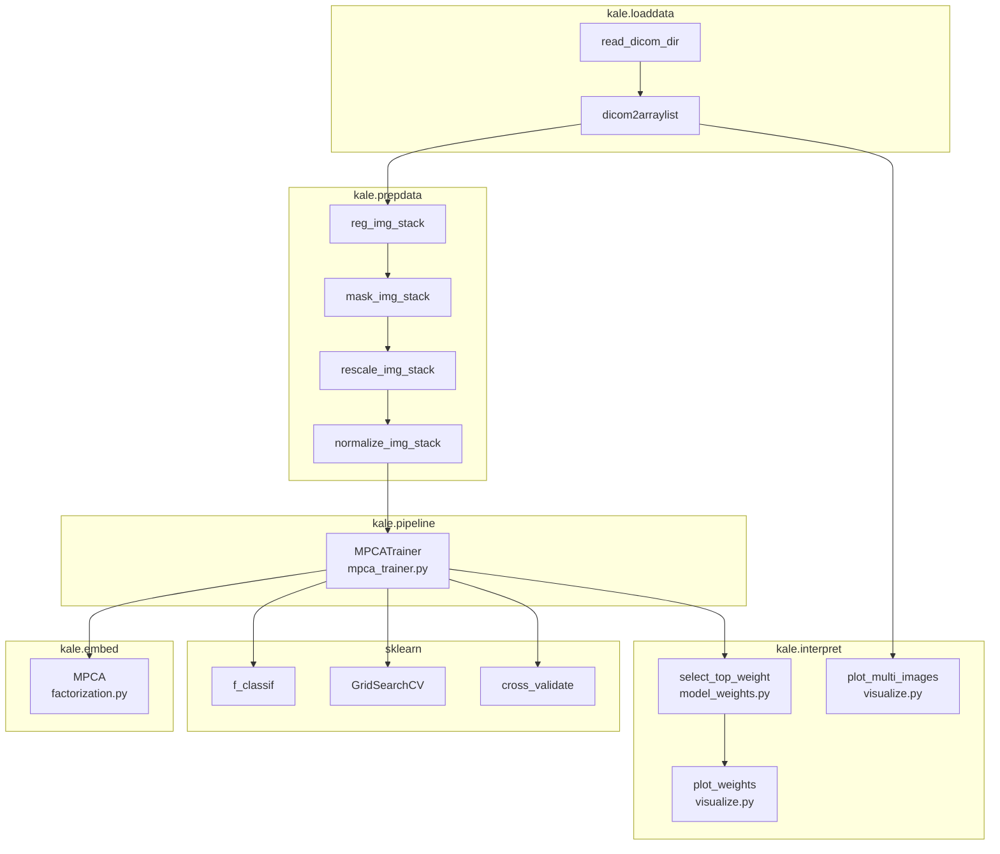

<!-- source: DeepWiki mcp.deepwiki.com · repo pykale/pykale · page 4.3 Medical Imaging · fetched 2026-10-21 -->

# Medical Imaging

<details>
<summary>Relevant source files</summary>

The following files were used as context for generating this wiki page:

- [examples/cmri_mpca/__init__.py](examples/cmri_mpca/__init__.py)
- [examples/cmri_mpca/config.py](examples/cmri_mpca/config.py)
- [examples/cmri_mpca/main.py](examples/cmri_mpca/main.py)
- [examples/cmri_mpca/tutorial.ipynb](examples/cmri_mpca/tutorial.ipynb)
- [kale/embed/factorization.py](kale/embed/factorization.py)
- [kale/interpret/model_weights.py](kale/interpret/model_weights.py)
- [kale/interpret/visualize.py](kale/interpret/visualize.py)
- [kale/loaddata/image_access.py](kale/loaddata/image_access.py)
- [kale/pipeline/mpca_trainer.py](kale/pipeline/mpca_trainer.py)
- [kale/prepdata/image_transform.py](kale/prepdata/image_transform.py)
- [tests/embed/test_factorization.py](tests/embed/test_factorization.py)
- [tests/interpret/test_model_weights.py](tests/interpret/test_model_weights.py)
- [tests/interpret/test_visualize.py](tests/interpret/test_visualize.py)
- [tests/pipeline/test_mida_trainer.py](tests/pipeline/test_mida_trainer.py)
- [tests/pipeline/test_mpca_trainer.py](tests/pipeline/test_mpca_trainer.py)
- [tests/prepdata/test_image_transform.py](tests/prepdata/test_image_transform.py)
- [tests/prepdata/test_tensor_reshape.py](tests/prepdata/test_tensor_reshape.py)

</details>


This page documents PyKale's medical imaging support, which centers on a pipeline for classifying cardiac MRI (CMR) images to diagnose Pulmonary Arterial Hypertension (PAH). It covers DICOM data loading, image preprocessing, the `MPCATrainer` classification pipeline, and weight-based model interpretation.

For the runnable example walkthrough (configuration, entry points, and output figures), see [5.4](#5.4). For the underlying MPCA and MIDA factorization algorithms in depth, see [4.6](#4.6).

---

## Overview

The medical imaging pipeline implements the approach described in:

> Swift et al. (2021). *A machine learning cardiac magnetic resonance approach to extract disease features and automate pulmonary arterial hypertension diagnosis.* European Heart Journal–Cardiovascular Imaging.

The pipeline transforms raw DICOM files into a classification result and an interpretable weight map in five stages:

**Pipeline diagram: cmri_mpca end-to-end**



Sources: [examples/cmri_mpca/main.py:1-158](), [examples/cmri_mpca/tutorial.ipynb:1-403]()

---

## DICOM Data Loading

**Module:** `kale.loaddata.image_access`

### Functions

| Function | Signature | Purpose |
|---|---|---|
| `read_dicom_dir` | `(dicom_path, sort_instance, sort_patient, check_series_uid)` | Reads all `.dcm` files under a root directory, organized by patient sub-directory. Returns a list-of-lists of pydicom dataset objects. |
| `read_dicom_phases` | `(dicom_path, sort_instance)` | Reads all phases (instances) for a single patient directory. |
| `check_dicom_series_uid` | `(dcm_phases, sort_instance)` | Splits a phase list by `SeriesInstanceUID` if multiple series exist in one directory. |
| `dicom2arraylist` | `(dicom_patient_list, return_patient_id)` | Converts the nested list of pydicom objects into a Python list of NumPy arrays, shape `(n_phases, H, W)` per patient. |

### Expected Directory Structure

`read_dicom_dir` expects DICOM files arranged as:

```
<dicom_path>/
    <patient_a>/
        phase_1.dcm
        phase_2.dcm
        ...
    <patient_b>/
        phase_1.dcm
        ...
```

[kale/loaddata/image_access.py:404-474]()

### Sorting and Series Handling

- `sort_instance=True`: sorts phases by `InstanceNumber` (cardiac phase order).
- `sort_patient=True`: sorts patients by `PatientID`.
- `check_series_uid=True`: splits a patient's phases into separate entries if they belong to different `SeriesInstanceUID` values — useful for datasets that mix series within a directory.

After calling `dicom2arraylist`, each entry in the returned list is a NumPy array of shape `(n_phases, H, W)`. Patient IDs can be co-retrieved by passing `return_patient_id=True`.

**Typical usage from `main.py`:**

```python
patient_dcm_list = read_dicom_dir(img_path, sort_instance=True, sort_patient=True)
images, patient_ids = dicom2arraylist(patient_dcm_list, return_patient_id=True)
```

[examples/cmri_mpca/main.py:59-66]()

Sources: [kale/loaddata/image_access.py:352-474](), [tests/prepdata/test_image_transform.py:24-34]()

---

## Image Preprocessing

**Module:** `kale.prepdata.image_transform`

All four preprocessing functions operate on a Python list of NumPy arrays (i.e., the output of `dicom2arraylist`). Each array has shape `(n_phases, H, W)`. The functions mutate the list in-place using `.copy()` calls at the call site to avoid aliasing.

### Function Reference

| Function | Key Parameters | Effect |
|---|---|---|
| `reg_img_stack` | `images`, `coords`, `target_coords` | Similarity-transform registration to a target landmark configuration. Uses `skimage.transform.estimate_transform` and `warp`. |
| `mask_img_stack` | `images`, `mask` | Element-wise multiplication of each phase by a binary mask of shape `(H, W)`. Zeros out pixels outside the ROI. |
| `rescale_img_stack` | `images`, `scale` | Scales spatial dimensions by `scale` using `skimage.transform.rescale`. Phase count is unchanged. |
| `normalize_img_stack` | `images` | Maps each phase independently to `[0, 1]` by min-max normalization. |

[kale/prepdata/image_transform.py:106-206]()

### Registration (`reg_img_stack`)

- Requires landmark coordinates of shape `(n_samples, n_landmarks * 2)`.
- For each sample, estimates a similarity transform (rotation, scale, translation) from source landmarks to `target_coords` (typically the first patient's landmarks).
- Applies the inverse transform to all phases of that patient using `warp`.
- Returns `(registered_images, max_dist)` where `max_dist` is an array of the maximum landmark alignment error per patient.

```python
img_reg, max_dist = reg_img_stack(images.copy(), landmarks, landmarks[0])
```

[kale/prepdata/image_transform.py:106-142]()

### Preprocessing Sequence

The four steps must be applied in order. Rescaling is applied *after* masking, so the mask dimensions match the original image dimensions:



Sources: [kale/prepdata/image_transform.py:106-206](), [examples/cmri_mpca/main.py:101-129](), [tests/prepdata/test_image_transform.py:51-115]()

---

## Classification: MPCATrainer

**Module:** `kale.pipeline.mpca_trainer`  
**Class:** `MPCATrainer`

`MPCATrainer` implements the three-stage pipeline — MPCA dimensionality reduction, discriminative feature selection, and linear classification — as a single scikit-learn–compatible estimator (`BaseEstimator`, `ClassifierMixin`).

### Pipeline stages

**Diagram: MPCATrainer internal pipeline**



[kale/pipeline/mpca_trainer.py:43-199]()

### Constructor Parameters

| Parameter | Default | Description |
|---|---|---|
| `classifier` | `"svc"` | One of `"svc"`, `"linear_svc"`, `"lr"`. |
| `classifier_params` | `"auto"` | `"auto"` triggers `GridSearchCV` over `C`. Alternatively, pass a `dict` of fixed parameters. |
| `classifier_param_grid` | `None` | Custom `C` grid for `GridSearchCV`. Defaults to `logspace(-4, 2, 7)`. |
| `mpca_params` | `None` | Dict passed to `MPCA(...)`. Defaults to `{"var_ratio": 0.97, "vectorize": True}`. |
| `n_features` | `None` | Number of top features retained after MPCA. If `None`, all MPCA features are used. |
| `search_params` | `None` | Passed to `GridSearchCV`. Defaults to `{"cv": 5}`. |

[kale/pipeline/mpca_trainer.py:67-115]()

### fit / predict

`fit(x, y)` executes the full three-stage sequence:
1. Calls `MPCA.fit(x)` then `MPCA.transform(x)` with `vectorize=True`.
2. If `n_features` is set, runs `f_classif` to rank features by discriminability.
3. Fits the classifier (via `GridSearchCV` if `classifier_params == "auto"`).

`predict(x)`, `predict_proba(x)`, `decision_function(x)` all call `_extract_feature(x)` which applies the fitted MPCA transform and feature selection mask before passing to the classifier.

> **Note:** `predict_proba` raises `ValueError` if `classifier == "linear_svc"` since `LinearSVC` does not support probability estimation.

[kale/pipeline/mpca_trainer.py:116-199]()

### Cross-Validation

Because `MPCATrainer` implements the scikit-learn estimator interface, it integrates directly with `sklearn.model_selection.cross_validate`:

```python
trainer = MPCATrainer(classifier="linear_svc", n_features=200)
cv_results = cross_validate(trainer, x, y, cv=10, scoring=["accuracy", "roc_auc"], n_jobs=1)
```

[examples/cmri_mpca/main.py:131-138]()

Sources: [kale/pipeline/mpca_trainer.py:1-200](), [tests/pipeline/test_mpca_trainer.py:1-63](), [kale/embed/factorization.py:308-507]()

---

## Model Interpretation

After fitting, the classifier's linear coefficients can be projected back to image space via `MPCA.inverse_transform` to produce a spatial weight map showing which cardiac regions the model relies on most.

### Weight Reconstruction

```python
# Project classifier weights back to image space
weights = trainer.mpca.inverse_transform(trainer.clf.coef_) - trainer.mpca.mean_
# Rescale to original image dimensions
weights = rescale_img_stack(weights, cfg.PROC.SCALE)
# Apply ROI mask
weights = mask_img_stack(weights, mask)
```

[examples/cmri_mpca/main.py:144-146]()

### select_top_weight

**Function:** `kale.interpret.model_weights.select_top_weight`

Zeros all weights except the top `select_ratio` fraction by absolute magnitude. Works on vectors or higher-order tensors.

```python
top_weights = model_weights.select_top_weight(weights, select_ratio=0.02)
```

- Accepts any array shape; flattens internally via `tensorly.base.unfold`.
- Returns an array of the same shape as input.

[kale/interpret/model_weights.py:21-44]()

### plot_weights

**Function:** `kale.interpret.visualize.plot_weights`

Overlays the non-zero weight locations on a background CMR image:

- Positive weights → red squares (`"rs"` by default).
- Negative weights → green squares (`"gs"` by default).
- Accepts a 2D `weight_img` and optional 2D `background_img`.

```python
visualize.plot_weights(
    top_weights[0][0],
    background_img=images[0][0],
    im_kwargs=dict(cfg.PLT_KWS.IM),
    marker_kwargs=dict(cfg.PLT_KWS.WEIGHT),
).show()
```

[kale/interpret/visualize.py:31-67]()

**Diagram: Interpretation data flow**


Sources: [kale/interpret/model_weights.py:21-44](), [kale/interpret/visualize.py:31-67](), [examples/cmri_mpca/main.py:141-154](), [tests/pipeline/test_mpca_trainer.py:52-55]()

---

## Configuration

The `cmri_mpca` example uses YACS configuration. Defaults are defined in `examples/cmri_mpca/config.py` and can be overridden via YAML files.

| Config Key | Default | Description |
|---|---|---|
| `DATASET.SOURCE` | GitHub URL | URL to download the ShefPAH-179 zip archive. |
| `DATASET.ROOT` | `"../data"` | Local root for dataset storage. |
| `DATASET.IMG_DIR` | `"DICOM"` | Subdirectory of DICOM images. |
| `DATASET.MASK_DIR` | `"Mask"` | Subdirectory of the DICOM mask. |
| `DATASET.LANDMARK_FILE` | `"landmarks.csv"` | CSV of landmark coordinates and group labels. |
| `PROC.SCALE` | `2` | Downscale factor applied via `rescale_img_stack`. |
| `PIPELINE.CLASSIFIER` | `"linear_svc"` | Classifier type for `MPCATrainer`. |
| `OUTPUT.SAVE_FIG` | `True` | Whether to save intermediate visualization figures. |

The `landmarks.csv` file is indexed by `Subject` (patient ID) and contains paired `(x, y)` columns for each anatomical landmark, plus a `Group` column for class labels.

[examples/cmri_mpca/config.py:1-71]()

Sources: [examples/cmri_mpca/config.py:1-71](), [examples/cmri_mpca/main.py:36-57]()

---

## Module Dependency Map

**Diagram: Module relationships for the medical imaging pipeline**



Sources: [kale/pipeline/mpca_trainer.py:1-36](), [kale/loaddata/image_access.py:1-18](), [kale/prepdata/image_transform.py:1-20](), [kale/interpret/model_weights.py:1-44](), [kale/interpret/visualize.py:31-67]()

---

