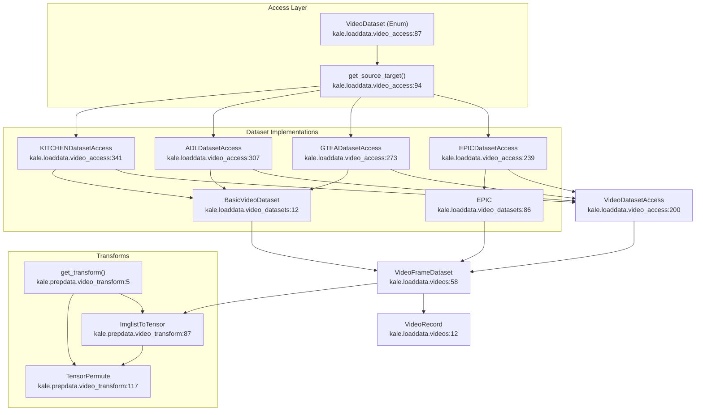
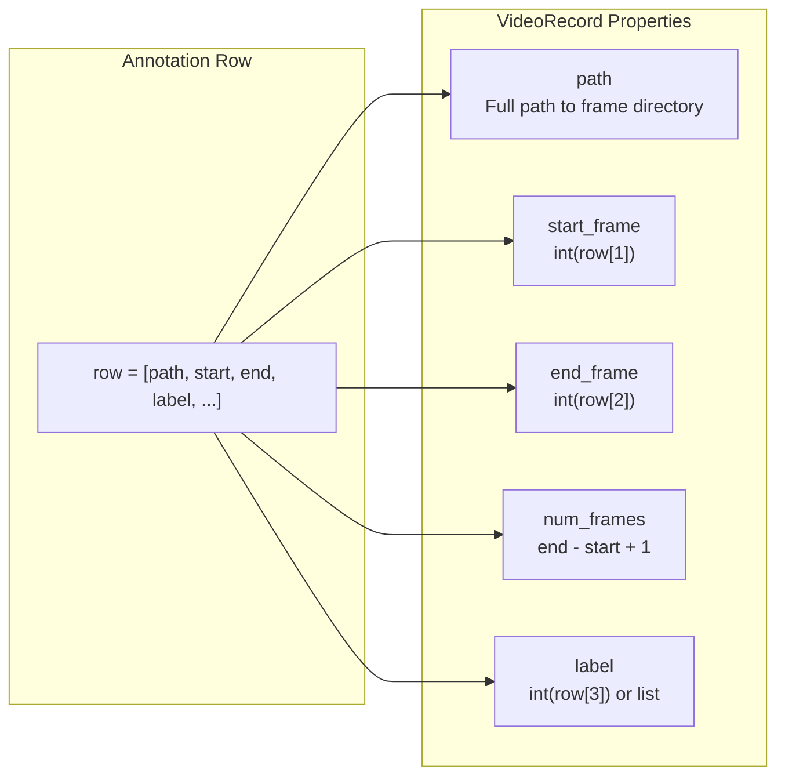
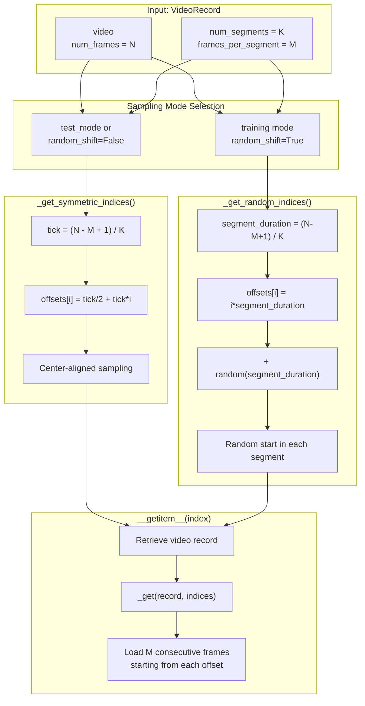
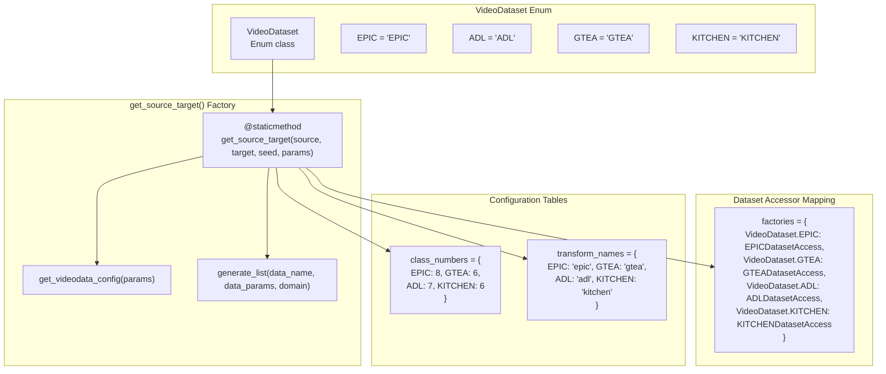
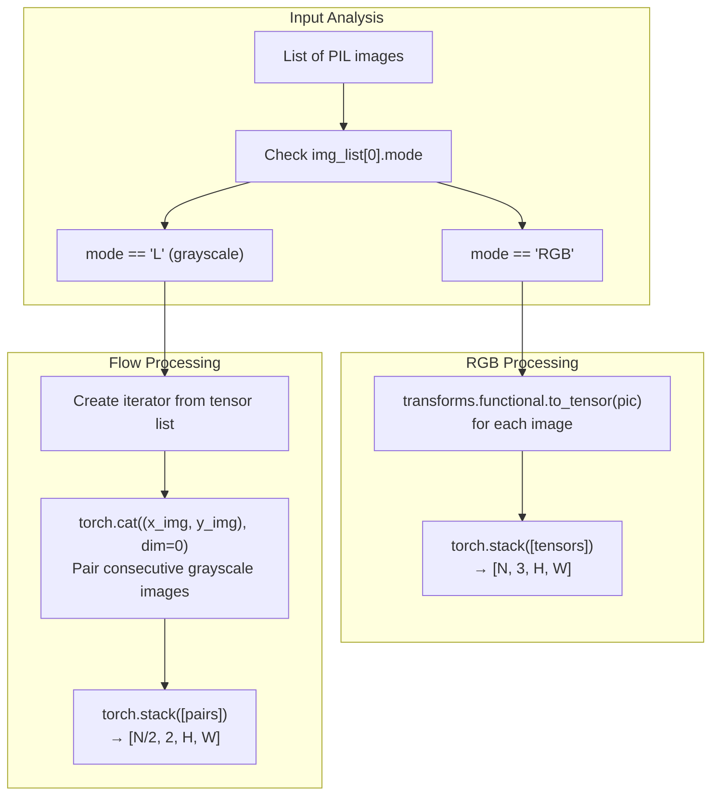

<!-- source: DeepWiki mcp.deepwiki.com · repo pykale/pykale · page 4.4 Video Processing · fetched 2026-10-21 -->

# Video Processing

<details>
<summary>Relevant source files</summary>

The following files were used as context for generating this wiki page:

- [.github/ISSUE_TEMPLATE/action-fail.md](.github/ISSUE_TEMPLATE/action-fail.md)
- [.github/workflows/test.yml](.github/workflows/test.yml)
- [README.md](README.md)
- [docs/source/installation.md](docs/source/installation.md)
- [examples/video_loading/README.md](examples/video_loading/README.md)
- [examples/video_loading/main.py](examples/video_loading/main.py)
- [kale/loaddata/video_access.py](kale/loaddata/video_access.py)
- [kale/loaddata/video_datasets.py](kale/loaddata/video_datasets.py)
- [kale/loaddata/videos.py](kale/loaddata/videos.py)
- [kale/prepdata/video_transform.py](kale/prepdata/video_transform.py)
- [setup.py](setup.py)

</details>


This document details PyKale's video data loading and preprocessing system. The core architecture consists of `VideoFrameDataset` (sparse temporal sampling), dataset accessors via `VideoDataset` enum, multi-modality support (RGB and optical flow), and video-specific transforms. For general data loading patterns, see page 2.1. For video domain adaptation trainers, see page 3.3.

## Architecture Overview

**Title:** Video Processing Class Hierarchy



**Sources:** [kale/loaddata/videos.py:1-284](), [kale/loaddata/video_access.py:1-373](), [kale/loaddata/video_datasets.py:1-154](), [kale/prepdata/video_transform.py:1-125]()

## VideoFrameDataset Core Architecture

### Class Structure and Initialization

`VideoFrameDataset` [kale/loaddata/videos.py:58-149]() is the base class for sparse temporal video sampling. Key constructor parameters:

| Parameter | Type | Default | Description |
|-----------|------|---------|-------------|
| `root_path` | str | Required | Root directory containing video folders |
| `annotationfile_path` | str | Required | Path to annotation file |
| `image_modality` | str | `"rgb"` | Image type: `"rgb"` or `"flow"` |
| `num_segments` | int | `3` | Number of temporal segments to divide video |
| `frames_per_segment` | int | `1` | Consecutive frames sampled per segment |
| `imagefile_template` | str | `"img_{:05d}.jpg"` | Frame filename template |
| `transform` | callable | `None` | Transform pipeline for frame list |
| `random_shift` | bool | `True` | Random vs center sampling within segments |
| `test_mode` | bool | `False` | If True, uses `random_shift=False` |

**Flow modality adjustment** [kale/loaddata/videos.py:146-147](): If `image_modality == "flow"`, `frames_per_segment` is automatically divided by 2 since flow frames are processed in pairs (u/v or x/y components).

### VideoRecord Metadata Container

`VideoRecord` [kale/loaddata/videos.py:12-56]() encapsulates video sample metadata parsed from annotation files:



The `label` property [kale/loaddata/videos.py:49-55]() handles both single-label (4 columns) and multi-label (5+ columns) formats.

### On-Disk Structure Requirements

Videos must be organized as frame sequences:

```
root_path/
├── annotationfile_path.txt
├── video_folder_1/
│   ├── img_00001.jpg
│   ├── img_00002.jpg
│   └── ...
└── video_folder_2/
    └── ...
```

Annotation format [kale/loaddata/videos.py:89-92]():
```
VIDEO_PATH START_FRAME END_FRAME LABEL [LABEL_2 ...]
```

Example:
```
jumping/0001 1 17 0
walking/0052 1 25 1
jumping/0002 1 18 0 1 2
```

**Sources:** [kale/loaddata/videos.py:12-163](), [examples/video_loading/main.py:33-66]()

### TSN-Based Sparse Temporal Sampling

PyKale implements the Temporal Segment Networks (TSN) sampling strategy [kale/loaddata/videos.py:68-79](), which divides videos into `num_segments` and samples `frames_per_segment` consecutive frames from each segment.

**Title:** TSN Temporal Sampling Algorithm



**Implementation details:**

1. **`_get_symmetric_indices()`** [kale/loaddata/videos.py:184-198](): Deterministic center-aligned sampling
   - Computes tick spacing: `tick = (num_frames - frames_per_segment + 1) / num_segments`
   - Offset formula: `int(tick / 2.0 + tick * x)` for segment x

2. **`_get_random_indices()`** [kale/loaddata/videos.py:165-182](): Random sampling within segments
   - Segment duration: `(num_frames - frames_per_segment + 1) // num_segments`
   - Adds random offset: `np.random.randint(segment_duration, size=num_segments)`

3. **Frame loading** [kale/loaddata/videos.py:253-280](): 
   - Iterates through segment start indices
   - Loads `frames_per_segment` consecutive frames starting from each index
   - Calls `_load_image()` for each frame

### Sampling Configuration Examples

| Use Case | `num_segments` | `frames_per_segment` | Total Frames | Behavior |
|----------|----------------|----------------------|--------------|----------|
| TSN-style sparse | 3 | 1 | 3 | Sample 1 frame from 3 segments |
| Dense sampling | 5 | 5 | 25 | 5 consecutive frames × 5 segments |
| Continuous clip | 1 | 16 | 16 | Single 16-frame clip (random start) |
| Full temporal | 8 | 1 | 8 | 8 frames evenly spaced |

**Sources:** [kale/loaddata/videos.py:165-280](), [examples/video_loading/main.py:56-95]()

## Multi-Modality Support: RGB and Optical Flow

### Image Modality Configuration

`get_image_modality()` [kale/loaddata/video_access.py:22-32]() converts string modality to boolean flags:

```python
if image_modality == "joint":
    rgb = flow = True
elif image_modality == "rgb" or image_modality == "flow":
    rgb = image_modality == "rgb"
    flow = image_modality == "flow"
```

| `image_modality` | `rgb` flag | `flow` flag | Channels | Application |
|------------------|------------|-------------|----------|-------------|
| `"rgb"` | `True` | `False` | 3 | Spatial appearance features |
| `"flow"` | `False` | `True` | 2 | Motion/temporal features |
| `"joint"` | `True` | `True` | 3 + 2 | Two-stream fusion |

### Flow Frame Loading

Optical flow requires special handling [kale/loaddata/videos.py:154-158]():

```python
elif self.image_modality == "flow":
    idx = math.ceil(idx / 2) - 1 if idx > 2 else 1
    x_img = Image.open(os.path.join(directory, self.imagefile_template.format("x", idx))).convert("L")
    y_img = Image.open(os.path.join(directory, self.imagefile_template.format("y", idx))).convert("L")
    return [x_img, y_img]
```

- Flow stored as grayscale image pairs (x/y or u/v components)
- Index adjusted: `idx = ceil(idx / 2) - 1` for frame synchronization
- Returns list of 2 images per "frame"

**EPIC-specific flow loading** [kale/loaddata/video_datasets.py:128-132]():

```python
elif self.image_modality == "flow":
    idx = math.ceil(idx / 2) - 1 if idx > 2 else 1
    u_img = Image.open(os.path.join(directory, "u", self.imagefile_template.format(idx))).convert("L")
    v_img = Image.open(os.path.join(directory, "v", self.imagefile_template.format(idx))).convert("L")
    return [u_img, v_img]
```

EPIC uses subdirectories `u/` and `v/` for flow components.

**Sources:** [kale/loaddata/videos.py:151-160](), [kale/loaddata/video_datasets.py:125-134](), [kale/loaddata/video_access.py:22-32]()

## VideoDataset Enum and Factory Methods

### VideoDataset Enum Structure

`VideoDataset` [kale/loaddata/video_access.py:87-197]() provides a unified interface for action recognition datasets:



### Factory Method Implementation

`get_source_target()` [kale/loaddata/video_access.py:94-197]() creates dataset accessors for source and target domains:

**Configuration retrieval** [kale/loaddata/video_access.py:35-51]():
```python
config_params = {
    "data_params": {
        "dataset_root": cfg.DATASET.ROOT,
        "dataset_src_name": cfg.DATASET.SOURCE,
        "dataset_src_trainlist": cfg.DATASET.SRC_TRAINLIST,
        "dataset_src_testlist": cfg.DATASET.SRC_TESTLIST,
        "dataset_tgt_name": cfg.DATASET.TARGET,
        "dataset_tgt_trainlist": cfg.DATASET.TGT_TRAINLIST,
        "dataset_tgt_testlist": cfg.DATASET.TGT_TESTLIST,
        "dataset_image_modality": cfg.DATASET.IMAGE_MODALITY,
        "frames_per_segment": cfg.DATASET.FRAMES_PER_SEGMENT,
    }
}
```

**Path generation** [kale/loaddata/video_access.py:54-84]():
```python
def generate_list(data_name, data_params_local, domain):
    if data_name == "EPIC":
        dataset_path = os.path.join(data_params_local["dataset_root"], data_name, "EPIC_KITCHENS_2018")
        data_path = os.path.join(dataset_path, "frames_rgb_flow")
    elif data_name in ["ADL", "GTEA", "KITCHEN"]:
        dataset_path = os.path.join(data_params_local["dataset_root"], data_name)
        data_path = os.path.join(dataset_path, "frames_rgb_flow")
    
    train_listpath = os.path.join(
        dataset_path, "annotations", "labels_train_test", data_params_local[f"dataset_{domain}_trainlist"]
    )
    test_listpath = os.path.join(
        dataset_path, "annotations", "labels_train_test", data_params_local[f"dataset_{domain}_testlist"]
    )
    return data_path, train_listpath, test_listpath
```

### Dataset Properties Table

| Dataset | Enum Value | Class Count | Accessor Class | Base Dataset |
|---------|------------|-------------|----------------|--------------|
| EPIC-KITCHENS | `VideoDataset.EPIC` | 8 | `EPICDatasetAccess` | `EPIC` |
| GTEA | `VideoDataset.GTEA` | 6 | `GTEADatasetAccess` | `BasicVideoDataset` |
| ADL | `VideoDataset.ADL` | 7 | `ADLDatasetAccess` | `BasicVideoDataset` |
| KITCHEN | `VideoDataset.KITCHEN` | 6 | `KITCHENDatasetAccess` | `BasicVideoDataset` |

**Num classes resolution** [kale/loaddata/video_access.py:143](): When datasets have different class counts, `num_classes = min(class_numbers[source], class_numbers[target])` ensures compatibility.

**Sources:** [kale/loaddata/video_access.py:87-197](), [kale/loaddata/video_access.py:35-84]()

## Video Transforms

### ImglistToTensor Implementation

`ImglistToTensor` [kale/prepdata/video_transform.py:87-114]() converts PIL image lists to tensors:

**Title:** ImglistToTensor Processing Flow



**RGB handling** [kale/prepdata/video_transform.py:108-109]():
```python
if img_list[0].mode == "RGB":
    return torch.stack([transforms.functional.to_tensor(pic) for pic in img_list])
```

**Flow handling** [kale/prepdata/video_transform.py:110-112]():
```python
elif img_list[0].mode == "L":
    it = iter([transforms.functional.to_tensor(pic) for pic in img_list])
    return torch.stack([torch.cat((i, next(it)), dim=0) for i in it])
```

Flow images (grayscale pairs) are concatenated along channel dimension: `[frame1_x, frame1_y, frame2_x, frame2_y, ...]` becomes `[[frame1_x, frame1_y], [frame2_x, frame2_y], ...]`.

### TensorPermute for 3D CNNs

`TensorPermute` [kale/prepdata/video_transform.py:117-124]() rearranges dimensions for 3D CNN input:

```python
def forward(self, tensor):
    return tensor.permute(1, 0, 2, 3).contiguous()
```

**Transformation**: `(FRAMES, CHANNELS, HEIGHT, WIDTH)` → `(CHANNELS, FRAMES, HEIGHT, WIDTH)`

This converts batch-like format to 3D CNN input format where temporal dimension follows channel dimension.

### get_transform() Dataset-Specific Pipelines

`get_transform()` [kale/prepdata/video_transform.py:5-84]() returns transform dictionaries for each dataset:

**RGB transform pipeline** [kale/prepdata/video_transform.py:16-46]():
```python
"train": transforms.Compose([
    ImglistToTensor(),
    transforms.Resize(size=256),
    transforms.RandomCrop(size=224),
    transforms.Normalize(mean=[0.5, 0.5, 0.5], std=[0.5, 0.5, 0.5]),
    TensorPermute(),
])
"test": transforms.Compose([
    ImglistToTensor(),
    transforms.Resize(size=256),
    transforms.CenterCrop(size=224),
    transforms.Normalize(mean=[0.5, 0.5, 0.5], std=[0.5, 0.5, 0.5]),
    TensorPermute(),
])
```

**Flow transform pipeline** [kale/prepdata/video_transform.py:47-79]():
```python
"train": transforms.Compose([
    ImglistToTensor(),
    transforms.Resize(size=256),
    transforms.RandomCrop(size=224),
    transforms.Normalize(mean=[0.5, 0.5], std=[0.5, 0.5]),
    TensorPermute(),
])
```

Note 2-channel normalization for flow: `mean=[0.5, 0.5], std=[0.5, 0.5]`.

**Sources:** [kale/prepdata/video_transform.py:1-125](), [examples/video_loading/main.py:102-109]()

## Dataset-Specific Implementations

### VideoDatasetAccess Base Class

`VideoDatasetAccess` [kale/loaddata/video_access.py:200-236]() provides common accessor interface:

```python
class VideoDatasetAccess(DatasetAccess):
    def __init__(self, data_path, train_list, test_list, image_modality, 
                 frames_per_segment, n_classes, transform_kind, seed):
        super().__init__(n_classes)
        self._data_path = data_path
        self._train_list = train_list
        self._test_list = test_list
        self._image_modality = image_modality
        self._frames_per_segment = frames_per_segment
        self._transform = video_transform.get_transform(transform_kind, self._image_modality)
        self._seed = seed
```

**`get_train_valid(valid_ratio)`** [kale/loaddata/video_access.py:227-236](): Splits training data with fixed random seed
```python
train_dataset = self.get_train()
ntotal = len(train_dataset)
ntrain = int((1 - valid_ratio) * ntotal)
return torch.utils.data.random_split(
    train_dataset, [ntrain, ntotal - ntrain], 
    generator=torch.Generator().manual_seed(self._seed)
)
```

### EPIC Dataset Parsing

`EPIC` class [kale/loaddata/video_datasets.py:86-153]() handles EPIC-KITCHENS dataset format:

**Path structure** [kale/loaddata/video_datasets.py:109]():
```python
self.img_path = self.root_path.joinpath(self.image_modality, self.dataset)
```
Combines: `root_path/rgb|flow/train|test/`

**Annotation parsing** [kale/loaddata/video_datasets.py:136-152]():
```python
def make_dataset(self):
    data = []
    i = 0
    input_file = pd.read_pickle(self.annotationfile_path)
    for line in input_file.values:
        if line[1] in ["P01", "P08", "P22"]:  # Specific participants
            if 0 <= line[9] < self.n_classes:  # Class filter
                if line[7] - line[6] + 1 >= self.frames_per_segment:  # Length check
                    label = line[9]
                    data.append((os.path.join(line[1], line[2]), line[6], line[7], label))
                    i = i + 1
    logging.info("Number of {:5} action segments: {}".format(self.dataset, i))
    return data
```

EPIC format: Participant ID (`line[1]`), Video ID (`line[2]`), Start Frame (`line[6]`), End Frame (`line[7]`), Label (`line[9]`)

**Flow loading override** [kale/loaddata/video_datasets.py:125-134]():
```python
def _load_image(self, directory, idx):
    if self.image_modality == "rgb":
        return [Image.open(os.path.join(directory, self.imagefile_template.format(idx))).convert("RGB")]
    elif self.image_modality == "flow":
        idx = math.ceil(idx / 2) - 1 if idx > 2 else 1
        u_img = Image.open(os.path.join(directory, "u", self.imagefile_template.format(idx))).convert("L")
        v_img = Image.open(os.path.join(directory, "v", self.imagefile_template.format(idx))).convert("L")
        return [u_img, v_img]
```

### BasicVideoDataset for GTEA/ADL/KITCHEN

`BasicVideoDataset` [kale/loaddata/video_datasets.py:12-83]() handles simpler dataset formats:

**Annotation parsing** [kale/loaddata/video_datasets.py:66-83]():
```python
def make_dataset(self):
    data = []
    i = 0
    input_file = pd.read_pickle(self.annotationfile_path)
    for line in input_file.values:
        if 0 <= eval(line[5]) < self.n_classes:
            data.append((line[0], eval(line[1]), eval(line[2]), eval(line[5])))
            i = i + 1
    logging.info("Number of {:5} action segments: {}".format(self.dataset, i))
    return data
```

Format: Video path (`line[0]`), Start (`line[1]`), End (`line[2]`), Label (`line[5]`)

**Accessor implementations**: `EPICDatasetAccess` [kale/loaddata/video_access.py:239-271](), `GTEADatasetAccess` [kale/loaddata/video_access.py:273-305](), `ADLDatasetAccess` [kale/loaddata/video_access.py:307-339](), `KITCHENDatasetAccess` [kale/loaddata/video_access.py:341-373]()

All accessors implement `get_train()` and `get_test()` methods that instantiate the appropriate dataset class with modality-specific configuration.

**Sources:** [kale/loaddata/video_access.py:200-373](), [kale/loaddata/video_datasets.py:1-154]()

## Usage Example

### Basic Video Loading Demo

From [examples/video_loading/main.py:33-72]():

```python
from kale.loaddata.videos import VideoFrameDataset
from kale.prepdata.video_transform import ImglistToTensor

# Sparse sampling: 5 segments, 1 frame each
dataset = VideoFrameDataset(
    root_path=videos_root,
    annotationfile_path=annotation_file,
    num_segments=5,
    frames_per_segment=1,
    imagefile_template="img_{:05d}.jpg",
    transform=None,
    random_shift=True,
    test_mode=False,
)

sample = dataset[0]
frames = sample[0]  # list of 5 PIL images
label = sample[1]   # integer label

# Continuous clip: 1 segment, 9 consecutive frames
dataset = VideoFrameDataset(
    root_path=videos_root,
    annotationfile_path=annotation_file,
    num_segments=1,
    frames_per_segment=9,
    imagefile_template="img_{:05d}.jpg",
    transform=None,
    random_shift=True,
    test_mode=False,
)
```

### With Transforms

From [examples/video_loading/main.py:97-126]():

```python
preprocess = transforms.Compose([
    ImglistToTensor(),  # list → (FRAMES, C, H, W)
    transforms.Resize(299),
    transforms.CenterCrop(299),
    transforms.Normalize(mean=[0.485, 0.456, 0.406], std=[0.229, 0.224, 0.225]),
])

dataset = VideoFrameDataset(
    root_path=videos_root,
    annotationfile_path=annotation_file,
    num_segments=5,
    frames_per_segment=1,
    imagefile_template="img_{:05d}.jpg",
    transform=preprocess,
    random_shift=True,
    test_mode=False,
)

sample = dataset[1]
frame_tensor = sample[0]  # (5, 3, 299, 299)
label = sample[1]
```

**Sources:** [examples/video_loading/main.py:1-213]()

## Summary of Key Classes and Functions

| Component | File | Purpose |
|-----------|------|---------|
| `VideoFrameDataset` | `kale.loaddata.videos` | Core video loading with sparse temporal sampling |
| `VideoDatasetAccess` | `kale.loaddata.video_access` | Dataset accessor interface for videos |
| `VideoMultiDomainDatasets` | `kale.loaddata.video_multi_domain` | Multi-domain video datasets with RGB/Flow support |
| `get_image_modality()` | `kale.loaddata.video_access` | Parse image modality string to boolean flags |
| `MultiDataLoader` | `kale.loaddata.sampler` | Synchronized iteration across multiple loaders |
| `FixedSeedSamplingConfig` | `kale.loaddata.sampler` | Deterministic sampling configuration |
| `ImglistToTensor` | `kale.prepdata.video_transform` | Convert PIL image list to tensor |
| `ClassNetVideo` | `kale.predict.class_domain_nets` | Video classification head |
| `DomainNetVideo` | `kale.predict.class_domain_nets` | Video domain discrimination head |
| `create_dann_like_video()` | `kale.pipeline.video_domain_adapter` | Factory for DANN-style video DA |
| `create_mmd_based_video()` | `kale.pipeline.video_domain_adapter` | Factory for MMD-style video DA |

**Sources:** [kale/loaddata/video_multi_domain.py:1-244](), [kale/loaddata/sampler.py:1-361](), [examples/video_loading/README.md:1-205](), [tests/pipeline/test_video_domain_adapter.py:1-150]()

---

