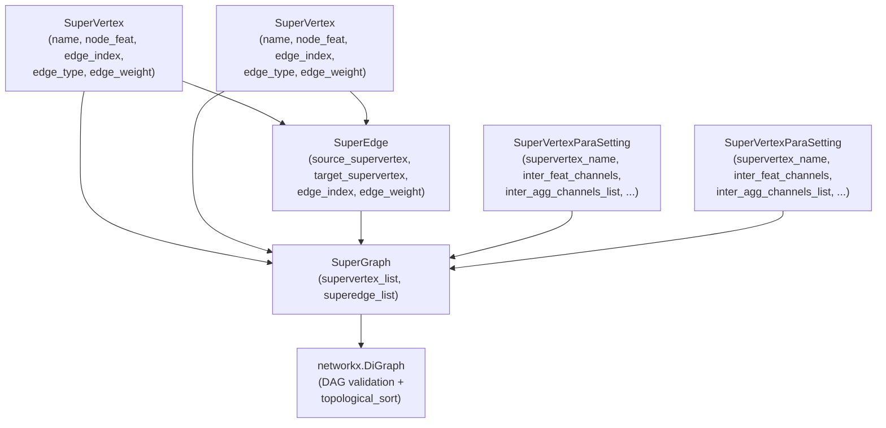
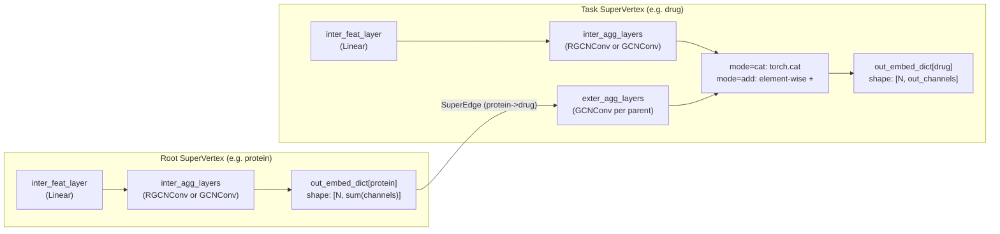
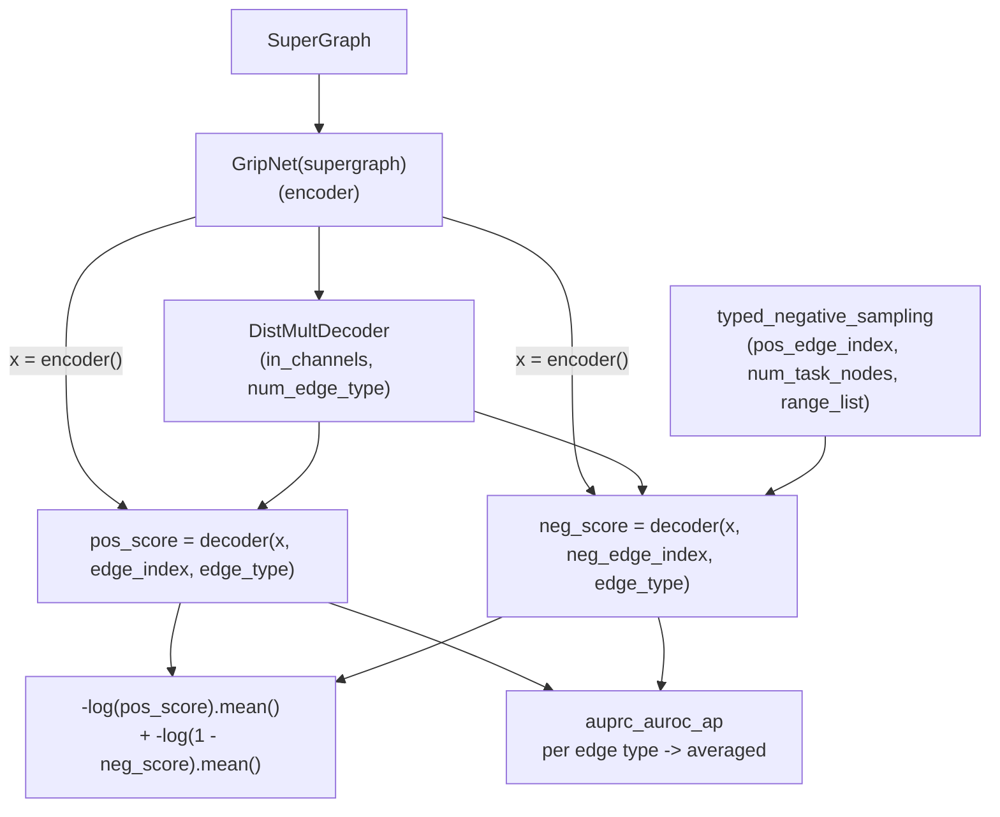
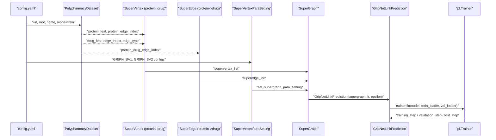

<!-- source: DeepWiki mcp.deepwiki.com · repo pykale/pykale · page 4.5 Graph Neural Networks · fetched 2026-10-21 -->

# Graph Neural Networks

<details>
<summary>Relevant source files</summary>

The following files were used as context for generating this wiki page:

- [examples/polypharmacy_gripnet/README.md](examples/polypharmacy_gripnet/README.md)
- [examples/polypharmacy_gripnet/__init__.py](examples/polypharmacy_gripnet/__init__.py)
- [examples/polypharmacy_gripnet/config.py](examples/polypharmacy_gripnet/config.py)
- [examples/polypharmacy_gripnet/configs/PoSE_MINI-GripNet.yaml](examples/polypharmacy_gripnet/configs/PoSE_MINI-GripNet.yaml)
- [examples/polypharmacy_gripnet/main.py](examples/polypharmacy_gripnet/main.py)
- [examples/polypharmacy_gripnet/model.py](examples/polypharmacy_gripnet/model.py)
- [kale/evaluate/metrics.py](kale/evaluate/metrics.py)
- [kale/loaddata/polypharmacy_datasets.py](kale/loaddata/polypharmacy_datasets.py)
- [kale/predict/decode.py](kale/predict/decode.py)
- [kale/prepdata/graph_negative_sampling.py](kale/prepdata/graph_negative_sampling.py)
- [kale/prepdata/supergraph_construct.py](kale/prepdata/supergraph_construct.py)
- [tests/embed/test_gripnet.py](tests/embed/test_gripnet.py)

</details>


This page covers GripNet, the heterogeneous graph neural network implemented in PyKale, along with its supporting supergraph data structures, link prediction decoder, and negative sampling utilities. The primary application is polypharmacy side effect prediction. For the drug discovery pipeline that uses GripNet end-to-end (including the example walkthrough), see [Drug Discovery Models](#4.2) and [Drug Discovery Applications](#5.3).

---

## Overview

GripNet (Graph Information Propagation Network) is a framework for learning node representations on heterogeneous knowledge graphs. It introduces a **supergraph** abstraction — a directed acyclic graph (DAG) of semantically coherent node groups called supervertices, connected by bipartite edge sets called superedges. Message passing follows the topological order of the supergraph, allowing information to flow from auxiliary node types (e.g., proteins) to task-relevant node types (e.g., drugs).

The implementation is split across three modules:

| Module | Role |
|---|---|
| `kale/prepdata/supergraph_construct.py` | Supergraph data structures |
| `kale/embed/model_lib/gripnet.py` | GripNet encoder |
| `kale/predict/decode.py` | DistMultDecoder, GripNetLinkPrediction |
| `kale/prepdata/graph_negative_sampling.py` | Negative sampling for training |
| `kale/loaddata/polypharmacy_datasets.py` | PolypharmacyDataset loader |

Sources: [kale/prepdata/supergraph_construct.py:1-10](), [kale/predict/decode.py:1-20](), [examples/polypharmacy_gripnet/README.md:1-15]()

---

## Supergraph Abstraction

The supergraph structures are defined in `kale/prepdata/supergraph_construct.py`. There are four classes:

**Data flow diagram — Supergraph Construction**



Sources: [kale/prepdata/supergraph_construct.py:18-269]()

### `SuperVertex`

[kale/prepdata/supergraph_construct.py:18-121]()

A supervertex represents a subgraph of semantically homogeneous nodes (e.g., all proteins, or all drugs). It stores:

| Attribute | Type | Description |
|---|---|---|
| `name` | `str` | Unique identifier |
| `node_feat` | `torch.Tensor` | Shape `[num_nodes, num_features]`; sparse tensors supported |
| `edge_index` | `torch.Tensor` | COO format, shape `[2, num_edges]` |
| `edge_type` | `torch.Tensor` (optional) | Integer relation type per edge, 0-indexed and contiguous |
| `edge_weight` | `torch.Tensor` (optional) | Scalar weight per edge |
| `num_edge_type` | `int` | Computed from `edge_type`; 1 if `edge_type` is `None` |
| `range_list` | `torch.Tensor` | Start/end index per edge type (computed internally) |
| `in_supervertex_list` | `List[str]` | Populated by `SuperGraph` |
| `out_supervertex_list` | `List[str]` | Populated by `SuperGraph` |
| `start_supervertex` | `bool` | `True` if no incoming superedges |

When `edge_type` is provided, `__process_edges__` sorts edges by type and builds `range_list` via `__get_range_list__`. Edge types must be contiguous integers starting at 0; otherwise a `ValueError` is raised.

### `SuperEdge`

[kale/prepdata/supergraph_construct.py:123-154]()

A superedge encodes a bipartite relationship between two supervertices. It stores:

| Attribute | Type | Description |
|---|---|---|
| `source_supervertex` | `str` | Name of the source supervertex |
| `target_supervertex` | `str` | Name of the target supervertex |
| `direction` | `tuple` | `(source_supervertex, target_supervertex)` — used as the dict key in `SuperGraph` |
| `edge_index` | `torch.Tensor` | COO format; row = source node indices, col = target node indices |
| `edge_weight` | `torch.Tensor` (optional) | Scalar weight per edge |

### `SuperGraph`

[kale/prepdata/supergraph_construct.py:197-268]()

`SuperGraph` is the top-level container that assembles supervertices and superedges into a validated DAG.

Constructor arguments:
- `supervertex_list: List[SuperVertex]`
- `superedge_list: List[SuperEdge]`
- `supervertex_setting_dict` (optional): populated later via `set_supergraph_para_setting`

Key computed attributes:

| Attribute | Description |
|---|---|
| `supervertex_dict` | `{name: SuperVertex}` |
| `superedge_dict` | `{(src, tgt): SuperEdge}` |
| `G` | `networkx.DiGraph` built from superedge directions |
| `topological_order` | `list` — result of `nx.topological_sort(G)` |
| `num_supervertex` | Node count in `G` |
| `num_superedge` | Edge count in `G` |

`__process_supergraph__` raises `TypeError` if the graph is not a DAG. `__update_supervertex__` populates each supervertex's `in_supervertex_list` and `out_supervertex_list`, and sets `start_supervertex = False` for any supervertex with incoming edges.

`set_supergraph_para_setting` accepts a list of `SuperVertexParaSetting` objects and builds `supervertex_setting_dict`.

### `SuperVertexParaSetting`

[kale/prepdata/supergraph_construct.py:157-194]()

This class configures the GNN layers for a single supervertex.

| Parameter | Type | Description |
|---|---|---|
| `supervertex_name` | `str` | Must match the corresponding `SuperVertex.name` |
| `inter_feat_channels` | `int` | Output dimension of the internal feature projection layer |
| `inter_agg_channels_list` | `List[int]` | Output dimensions for the sequence of internal aggregation layers |
| `exter_agg_channels_dict` | `Dict[str, int]` (optional) | Maps each parent supervertex name to the size of the received message vector. Required for non-root supervertices. |
| `mode` | `str` (optional) | How to combine internal and external embeddings: `"cat"` (concatenation) or `"add"` (element-wise addition) |
| `num_bases` | `int` | Number of bases for basis-decomposition in multi-relational supervertices. Default: 32 |
| `concat_output` | `bool` | Whether to concatenate layer outputs. Default: `True` |

`mode` is validated at construction: only `"cat"`, `"add"`, or `None` are accepted.

---

## GripNet Encoder

The `GripNet` class lives in `kale/embed/model_lib/gripnet.py` and is imported in `kale/predict/decode.py` and `tests/embed/test_gripnet.py`.

**GripNet internal architecture diagram**



Sources: [tests/embed/test_gripnet.py:1-65](), [kale/predict/decode.py:14-15]()

The `GripNet` model is constructed from a `SuperGraph` with fully configured `supervertex_setting_dict`. Internally it builds a `torch.nn.ModuleDict` (accessible as `supervertex_module_dict`) keyed by supervertex name.

Processing order is determined by `supergraph.topological_order`. Root supervertices (no incoming superedges) use only internal layers. Non-root supervertices receive aggregated embeddings from their parents via the superedge connections.

The `mode` parameter controls how external (inter-supervertex) messages are merged:
- `"cat"`: concatenates the internal embedding with all external messages. The output dimension grows with the number of parents.
- `"add"`: adds internal and external embeddings element-wise. All contributing dimensions must match.

The `out_channels` property returns the embedding dimension of the final task supervertex (last in topological order).

### Key Shapes (example from test)

From the test in `tests/embed/test_gripnet.py`:

```
node_feat: [4, 20]
inter_agg_channels_list: [10, 10]   → internal output: 20 + 10 + 10 = 40 (cat mode)
exter_agg_channels_dict: {"1": 30, "2": 30}
```

With `mode="cat"`, the task supervertex receives `30 + 30` from parents, giving a total of `30 + 15 + 10 = 55` output channels. With `mode="add"`, the output is `15 + 10 = 25` from internal layers, and the external aggregation adjusts accordingly.

Sources: [tests/embed/test_gripnet.py:9-48]()

---

## Link Prediction

### `DistMultDecoder`

[kale/predict/decode.py:75-112]()

The `DistMultDecoder` implements the DistMult factorization for scoring edges:

```
score(u, v, r) = sigmoid( embed[u] · W[r] · embed[v] )
```

Where `W` is a learnable matrix of shape `[num_edge_type, in_channels]`. Parameters are initialized with `Normal(std=1/sqrt(in_channels))`.

| Argument | Description |
|---|---|
| `in_channels` | Embedding dimension from GripNet encoder |
| `num_edge_type` | Number of distinct relation types on the task supervertex |

The `forward` method computes element-wise: `(x[edge_index[0]] * x[edge_index[1]] * weight[edge_type]).sum(dim=1)`.

### `GripNetLinkPrediction`

[kale/predict/decode.py:115-207]()

`GripNetLinkPrediction` is a `pl.LightningModule` that combines `GripNet` (encoder) and `DistMultDecoder` (decoder) for end-to-end link prediction.

**Full pipeline diagram**



Sources: [kale/predict/decode.py:115-207]()

**Constructor behavior:**
- `__init_decoder__` reads `encoder.out_channels` and the number of edge types from the last supervertex in `topological_order` to instantiate `DistMultDecoder`.
- `num_task_nodes` is set from the task supervertex's node count for use in negative sampling.

**`forward` signature:**

```python
forward(edge_index, edge_type, edge_type_range) -> (loss, auprc, auroc, ave_precision)
```

The optimizer is Adam, configured via `configure_optimizers`.

**PyTorch Lightning step methods:**

| Method | Mode logged |
|---|---|
| `training_step` | `train_loss` |
| `validation_step` | `val_loss` |
| `test_step` | `test_auprc`, `test_auroc`, `test_ap@50` |

All three delegate to `__step__`, which unpacks `(edge_index, edge_type, edge_type_range)` from the batch and reshapes as needed before calling `forward`.

---

## Negative Sampling

[kale/prepdata/graph_negative_sampling.py:1-49]()

Two functions generate negative edges for contrastive training:

| Function | Description |
|---|---|
| `negative_sampling(pos_edge_index, num_nodes)` | Randomly samples non-existing edges; loops until no false negatives remain |
| `typed_negative_sampling(pos_edge_index, num_nodes, range_list)` | Calls `negative_sampling` separately for each edge type range, then concatenates results |

`typed_negative_sampling` is called inside `GripNetLinkPrediction.forward` using `edge_type_range` from the batch.

---

## Data Loading

### `PolypharmacyDataset`

[kale/loaddata/polypharmacy_datasets.py:10-54]()

A `torch.utils.data.Dataset` that loads a pre-processed PyG `Data` object (`.pt` file) from a URL.

| Attribute (train mode) | Source field |
|---|---|
| `edge_index` | `train_idx` |
| `edge_type` | `train_et` |
| `edge_type_range` | `train_range` |
| `protein_feat` | `g_feat` |
| `protein_edge_index` | `gg_edge_index` |
| `drug_feat` | `d_feat` |
| `protein_drug_edge_index` | `gd_edge_index` |

The dataset always returns a single batch (length 1): `(edge_index, edge_type, edge_type_range)`.

---

## Polypharmacy Example End-to-End

The example at `examples/polypharmacy_gripnet/` assembles all the above components.

**Full construction sequence**



Sources: [examples/polypharmacy_gripnet/main.py:25-74](), [examples/polypharmacy_gripnet/model.py:1-36](), [examples/polypharmacy_gripnet/config.py:1-57]()

**Default configuration values (from `config.py`):**

| Setting | Value |
|---|---|
| `SOLVER.BASE_LR` | `0.01` |
| `SOLVER.EPSILON` | `1e-10` |
| `SOLVER.MAX_EPOCHS` | `66` |
| `GRIPN_SV1.INTER_FEAT_CHANNELS` | `16` |
| `GRIPN_SV1.INTER_AGG_CHANNELS_LIST` | `[16, 16]` |
| `GRIPN_SV2.INTER_FEAT_CHANNELS` | `32` |
| `GRIPN_SV2.INTER_AGG_CHANNELS_LIST` | `[16, 16]` |
| `GRIPN_SV2.EXTER_AGG_CHANNELS_LIST` | `[["protein", 16]]` |
| `GRIPN_SV2.MODE` | `"cat"` |

The `get_supervertex` helper in `examples/polypharmacy_gripnet/model.py` converts the YACS `CfgNode` into a `SuperVertexParaSetting` by parsing `EXTER_AGG_CHANNELS_LIST` into an `exter_agg_channels_dict`.

---

## Evaluation Metric

`auprc_auroc_ap` in `kale/evaluate/metrics.py` computes three metrics over binary edge scores:

| Metric | Description |
|---|---|
| `auprc` | Area under the Precision-Recall curve (`sklearn.metrics.auc`) |
| `auroc` | Area under the ROC curve (`torchmetrics.AUROC`) |
| `ave_precision` | Average precision (`torchmetrics.AveragePrecision`) |

In `GripNetLinkPrediction.forward`, this is called once per edge type and the results are averaged over all edge types before being returned.

Sources: [kale/evaluate/metrics.py:391-411](), [kale/predict/decode.py:158-171]()

---

